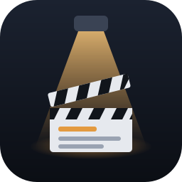
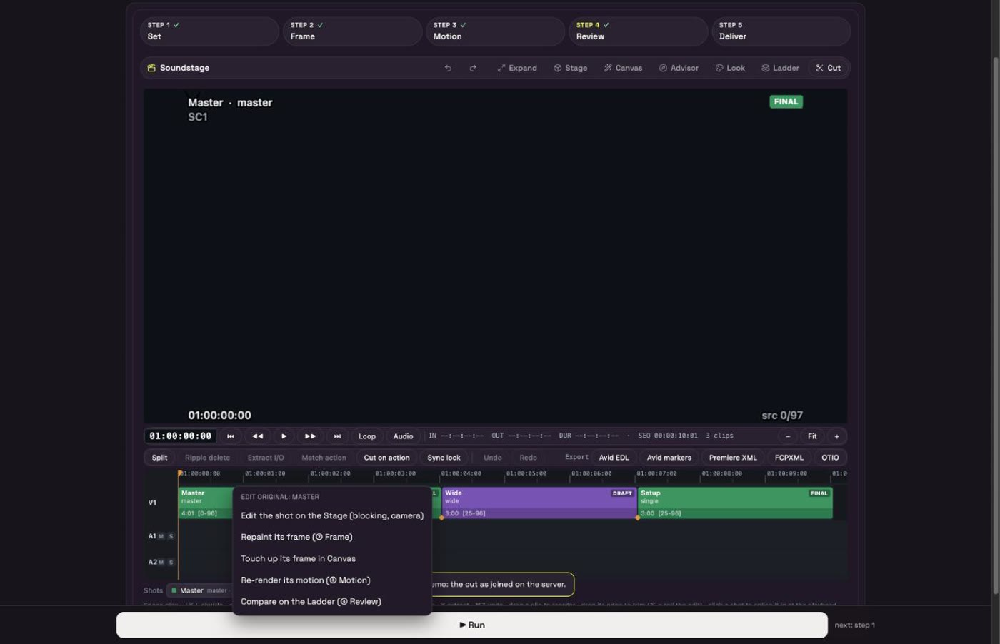

<p align="center"></p>

# Soundstage

Soundstage is a ComfyUI custom node pack plus an App-mode workflow that turns ComfyUI into a small film set, in production order: bring in your script, cast it (characters, props and locations with reference sheets), block each scene in a 3D stage, paint the first frame, animate it, review it as dailies and cut it. You block a scene in a 3D stage (actors, horses, cars, props, lights, cameras), and the App paints a first frame for every shot with FLUX 3 Klein (or Krea 2 locked to the stage's depth), keeping your framing and blocking. LTX-2.5 with the Layout-to-Render IC-LoRA then animates each shot with sound, following your blocking. You compare every step on a Ladder and deliver per-object layers for VFX, plus one cut video or an NLE export. Everything runs locally in ComfyUI on open models.

Built for Comfy Org's *Open Source Higgsfield* challenge (#OpenSourceHiggsfield).

<p align="center"></p>
<p align="center"><em>Left: the 3D stage's clay render. Right: what Soundstage renders from it. Same blocking, same camera.</em></p>

**[Watch the 100-second showcase](docs/media/soundstage_showcase.mp4)** &middot; [the longer walkthrough](docs/media/soundstage_demo.mp4) &middot; **[Try the App in your browser](https://claude.ai/artifact/GwtC3yFZtGCsTsiPGbvnAq)** (the real App UI, replaying real GPU renders)

**New here? [Read the full tutorial](docs/TUTORIAL.md):** install, a tour of every panel and button, each production step, the 3D stage in depth, a keyboard cheat sheet, 31 tips and troubleshooting.

<table>
<tr>
<td width="50%"><br><sub><b>Car chase, before and after:</b> left the 3D stage, right the final. Same cars, same positions, same camera: a crane wide, then a tracking shot.</sub></td>
<td width="50%"><br><sub><b>Western:</b> riders run to rigged horses, vault on and gallop off. Two camera setups, joined into one cut.</sub></td>
</tr>
</table>

<p align="center"></p>
<p align="center"><em>Any genre: left the 3D stage, right the final. Film noir in the rain, then horror in the woods.</em></p>

<p align="center"></p>
<p align="center"><em>Motion capture: any clip, or you acting it out on the webcam, drives a clay actor (body, hands, fingers, the path and the jumps). SAM 3D Body runs in ComfyUI; the clay then directs LTX. Clips: Pexels, free licence.</em></p>

### Script to screen

<table>
<tr>
<td width="50%"><br><sub><b>&#9312; Script.</b> Import Fountain, Final Draft (.fdx), PDF or text. Each scene gets an outline, a colour-coded breakdown (cast, props, vehicles, animals, SFX, extras) and your director's notes. <b>Build this scene on the stage</b> blocks it in 3D.</sub></td>
<td width="50%"><br><sub><b>&#9313; Cast &amp; Locations.</b> Every character, prop and location from the breakdown, each with a reference picture: upload a character sheet or generate one with FLUX 3 Klein (7 s). They feed the image model, so faces, costumes, cars and places match in every shot.</sub></td>
</tr>
<tr>
<td><br><sub><b>Pose in 3D.</b> Click any body part and turn it with the ring (fingers too), or drag a hand or foot and the arm or leg follows (IK). Same pose keys as the per-joint sliders.</sub></td>
<td><br><sub><b>Paint Studio.</b> A small Photoshop for the first frame, on our own Generative Fill (FLUX 3 Klein, crop and stitch, ~8 s): Fill, Remove, Extend to any aspect, magic select, layers, history, variations with before/after, <b>Use as first frame</b>.</sub></td>
</tr>
<tr>
<td><br><sub><b>Dailies.</b> Each scene's setups and takes as an Avid-style bin (slates 12, 12A, 12B; circled takes; drag to arrange; list view).</sub></td>
<td><br><sub><b>Lined script.</b> ScriptSync-style coverage lines per setup over the scene's page (squiggle = off camera); click a line to play that take from that line.</sub></td>
</tr>
<tr>
<td><br><sub><b>Video &rarr; Stage.</b> One job turns a clip into a 3D scene: the location (Depth Anything 3), the tracked camera, the set pieces (vision model) and the performer (SAM 3D Body), standing where they stood.</sub></td>
<td><br><sub><b>Camera rigs.</b> Tripod, dolly, Chapman, slider, jib, Steadicam, handheld, drone: the keys say where, the rig says how (push-off lag, overshoot and settle, rail rumble, arm arcs, breathing and shake).</sub></td>
</tr>
</table>

<p align="center"></p>
<p align="center"><em>Paint Studio, real FLUX 3 Klein results: remove, fill (a barrel), extend 1.9:1 &rarr; 2.39:1. Pixels outside the area never change.</em></p>

### The App, step by step

<table>
<tr>
<td width="50%"><br><sub><b>&#9312; Set.</b> Block the scene in 3D at true scale: cast, rigged horses and cars, lenses, sun, lights, several camera setups.</sub></td>
<td width="50%"><br><sub><b>&#9313; Frame.</b> A first frame for every shot. 31 genre styles and a real camera/lens/aperture picker.</sub></td>
</tr>
<tr>
<td><br><sub><b>&#9314; Motion.</b> LTX-2.5 Layout-to-Render animates each shot from its frame, with generated sound. Draft or final, one shot or every shot.</sub></td>
<td><br><sub><b>&#9315; Review.</b> The Ladder wipes from clay to frame to final for any shot.</sub></td>
</tr>
<tr>
<td><br><sub><b>&#9316; Deliver.</b> The Cut editor: right-click a clip to edit its original; Cut &rarr; one video; Avid, Premiere, FCPXML and OTIO export.</sub></td>
<td><br><sub>Running inside ComfyUI's App mode: one Run button climbs the ladder.</sub></td>
</tr>
</table>

<p align="center"></p>
<p align="center"><em>The Cut editor: split a clip at the playhead (B), drag it anywhere on the timeline, then export to your NLE.</em></p>

<p align="center"></p>

## The seven steps

The App has one step bar, in production order. Every step works on every shot in the scene; with a script, every step has a scene switcher.

1. **Script.** Optional. Import a screenplay; browse it scene by scene (outline, breakdown, page, director's notes). Each scene keeps its own stage, shots and cut. No writing tools: it is your script.
2. **Cast & Locations.** Characters, props and locations from the breakdown (or the stage), each with a reference picture (upload or generate). They become the image model's references.
3. **Set.** Block the scene in 3D: cast, set, light, cameras and timing. Add several camera setups to cover the scene.
4. **Frame.** Paint the first frame of each shot from its clay render with FLUX 3 Klein (default) or Krea 2 + stage depth.
5. **Motion.** Animate each shot with LTX-2.5 Layout-to-Render, with sound. The video follows the staged blocking and camera. LTX is the default; MiniMax H3 is an optional second engine in the same list (richer motion and its own sound, looser blocking, slower), with first + last frame, reference images and the clay as a motion reference.
6. **Review.** Scrub clay, frame, draft and final for each shot on the Ladder, with a wipe/fade compare.
7. **Deliver.** Export a Layer Pack for VFX, assemble the cut into one video, or export the edit to your NLE.

ComfyUI's cache means each Run only does the new work.

## Features

- **Script import.** Fountain, Final Draft, PDF or plain text: scenes, outlines, a breakdown sheet per scene, director's notes, a scene switcher in every step, scene numbers in the cut and NLE export.
- **Cast & Locations.** Reference sheets per character, prop and location, generated with FLUX 3 Klein or uploaded; they flow into the Frame step's references by name.
- **Pose in 3D and Pose Studio.** Click a body part to turn it, drag hands and feet (IK), or use a slider for every joint and finger knuckle; a pose gallery; interactions between people, animals and objects (look at, talk, shake hands, hug, hold hands, point, pet, lead by the reins).
- **Motion capture.** Capture from video or act it out on the webcam: SAM 3D Body (ComfyUI core) retargets body, hands and fingers onto the clay actor, with the path and the jumps.
- **Video → Stage.** A clip becomes a 3D scene: location mesh, tracked camera, set pieces and the performer on the rebuilt floor, dressed from the vision model's description.
- **Paint Studio.** Inpaint and outpaint the first frame with Soundstage's own Generative Fill nodes (`SoundstageFill`, crop and stitch): fill, remove, replace with a reference, extend to any aspect.
- **Camera rigs.** Real camera supports with their physics, deterministic per frame, so the clay, the frame and the video all see the same move.
- **Dailies and lined script.** Setups and takes as an Avid-style bin with circled takes; a ScriptSync-style lined script with coverage lines and thumbnails.
- **Tool dock.** Every Set feature has a labelled icon (Build with AI, Add object, Person, Interact, Capture motion, Video → Stage, Photo → 3D, Camera, Set & weather, Lighting, Phone camera).
- **Multi-shot through every step.** One scene, several camera setups. Frame, Motion, Review and Deliver all run per shot.
- **3D stage.** Add objects by name ("cowboy on a horse", "police car"). Riders sit astride horses, bikes and motorcycles. Sets include a plaza, a night street, interiors, a studio, forest, desert, beach and a water tank, with rain, snow, fog, smoke, dust and sparks. GLB import and export.
- **Rigged CC0 models.** A rigged horse (idle, walk, gallop) and three cars (hatchback, police car, sports car) by Quaternius, CC0.
- **Flashlight prop.** A handheld flashlight with a real beam. Drag it onto a person to hand it to them.
- **In-car camera presets.** The shot camera can ride along inside a vehicle, with interior framings. **＋ All interior shots** adds one shot per interior angle in a single click.
- **Camera.** Real lenses and aspect ratios (1.85, 2.39, 16:9, 9:16 and more), Catmull-Rom keyframes, free-fly view. A virtual camera turns a phone, iPad, Quest or Vision Pro into the shot camera; its stabilizer smooths your move rather than replacing it.
- **Light.** Solar-accurate time of day for any place and date. Film lights (key, fill, rim, practical, spot, neon) with Kelvin, power and softness.
- **Look tab.** 31 genre style presets and 18 ASC-style lighting setups (three-point, Rembrandt, low-key noir, book light and more), plus camera body, lens, film stock, era and grade. It compiles the still prompt and the LTX motion prompt from the stage itself.
- **Coach.** Watches the stage, the cut and the App and shows at most two small cards: what looks wrong, why, and a one-click fix. It never blocks a Run. See [docs/coach.md](docs/coach.md).
- **Director's Advisor.** Turns a scene description into a shot list with the reasoning, citing a film-language knowledge base. See [docs/advisor.md](docs/advisor.md).
- **Scene agent.** "Describe your scene" builds the stage; then edit it by chat. See [docs/agent.md](docs/agent.md).
- **Cut editor.** A timeline over your coverage with J/K/L and temp sound. Right-click a clip and choose **edit original** to jump back to the step that made it (stage, frame, touch-up or motion), then return to the cut. Exports one video, Avid EDL and markers, Premiere XML, FCPXML, OTIO and AAF. See [docs/cut.md](docs/cut.md).
- **Layer Pack.** Per-object mattes, PNG/EXR/ProRes 4444 layers, depth AOVs and the exact staged camera as `.chan`/JSON, with builders for After Effects, Nuke, Blender, Resolve and Photoshop. See [docs/layerpack.md](docs/layerpack.md).
- **Audio department.** DX/FX/MX tracks; TTS, voice clone and voice change (Chatterbox, or ElevenLabs through ComfyUI partner nodes). Audio can drive the video. See [docs/audio.md](docs/audio.md).
- **Footage and Recast.** Bring in real footage and recast one person; the plate and its audio stay real. See [docs/recast.md](docs/recast.md).
- **Model router.** Stage-aware model pickers with license badges. See [docs/router.md](docs/router.md).
- **Headless runner.** `tools/soundstage_sdk.py` renders a saved shot through the Comfy SDK.

## Try it

- **App demo:** https://claude.ai/artifact/GwtC3yFZtGCsTsiPGbvnAq. This is the real App UI running in the browser on a stand-in ComfyUI, replaying real GPU renders: Western, Car chase, In the car, Three in a car, plus Sci-fi, Horror, Romance and Monster genre scenes. Every step, from the 3D stage to the FLUX 3 Klein frame to the LTX video, the Cut and the exports. No install needed.

This link only opens for other people once the owner shares them publicly.

## Install

**Requirements**

- ComfyUI, a recent version with App mode.
- An NVIDIA GPU. 48 GB of VRAM is recommended (tested on an RTX 6000 Ada). 24 GB cards need offloading and are untested.
- About 60 GB of disk for the models.
- The stage, Look tab and Cut tab run in any browser and need no GPU models.

**Steps**

```bash
cd ComfyUI/custom_nodes
git clone https://github.com/theboord/ComfyUI-Soundstage
git clone https://github.com/Lightricks/ComfyUI-LTXVideo
git clone https://github.com/facok/comfyui-krea2-controlnet
pip install -r ComfyUI-Soundstage/requirements.txt
pip install -r ComfyUI-LTXVideo/requirements.txt
```

Use the same Python environment that runs ComfyUI. Then download the models listed in [MODELS.md](MODELS.md) into `ComfyUI/models/`. Some repos are gated: accept the license on Hugging Face first, then `hf auth login`.

**Linux / RunPod:** one script installs the node packs, copies the workflows and downloads the models:

```bash
bash ComfyUI/custom_nodes/ComfyUI-Soundstage/tools/install_runpod.sh /path/to/ComfyUI
# SKIP_MODELS=1 to install the node packs only; SKIP_LLM=1 to skip the optional Qwen3.5 file
```

## Run it locally

1. Start ComfyUI as usual (`python main.py`) and open it in the browser.
2. Load a workflow from `example_workflows/` (drag the JSON onto the canvas, or copy it into `ComfyUI/user/default/workflows/` and open it from **Workflows**):
   - `Soundstage_App_Full.json`: the full App with the five steps. Start here.
   - `Soundstage_Western.json`, `Soundstage_Car_Chase.json`, `Soundstage_In_The_Car.json`, `Soundstage_Three_In_A_Car.json`: the same App with a demo scene already blocked (riders on horses at sunset; a three-shot car chase; four in-car angles). They carry the scene and the cut, not the renders.
   - `Soundstage_App.json`: a leaner App with the ladder only.
3. Open the workflow in the graph view once, then switch to **App** mode.
4. **Set:** describe the scene or add objects and drag them into place. Add shots, move the playhead and set camera keys.
5. Press **Run** (labelled **Next**) to climb the ladder: Frame, then Motion, for every shot.
6. **Review** the shots on the Ladder, then **Deliver**: Layer Packs are written to `ComfyUI/output/soundstage_layerpacks/`, and the Cut tab renders one video or exports to your NLE.

**Without GPU models** you can still use the stage (Set), the Look tab and the Cut tab, including the NLE exports. Frame needs the Krea 2 group, Motion needs the LTX-2.5 group, and the Layer Pack uses SAM 3.1 and BiRefNet for mattes from the final frames (it falls back to the stage's own mattes without them).

### Headless (Comfy SDK)

```bash
pip install comfy-sdk comfy-api-proxy
comfy-api-proxy start --comfyui http://127.0.0.1:8188 --port 8190
export COMFY_BASE_URL=http://127.0.0.1:8190
python tools/soundstage_sdk.py shot_api.json --rung 4 --look "Korean thriller, anamorphic" --look "70s New Hollywood"
```

`shot_api.json` is **Workflow → Export (API)** of the App with your shot blocked.

### Tests

```bash
python3 -m pytest -q
for f in tests/js/*.test.mjs; do node --test "$f"; done
```

## Models and licenses

The full list, with folders, sources and licenses, is in [MODELS.md](MODELS.md). In short:

| Step | Models | License |
|---|---|---|
| Set | none | |
| Frame | Krea 2 Turbo, Qwen3-VL 4B text encoder, Qwen Image VAE, Krea 2 depth-control LoRA | Krea 2 Community License; Apache-2.0 |
| Motion | LTX-2.5 22B distilled, Gemma text encoder, LTX-2.5 video and audio VAEs, x2 latent upscaler, Layout-to-Render IC-LoRA | LTX-2 Community License; Gemma terms |
| Motion, optional | MiniMax H3 (int8 fl2va / ref2va, Qwen3-VL 32B text encoder, H3 video and audio VAEs). Off by default: pick it in ③ Motion's Video model list. Rich motion with its own sound, looser blocking, ~20+ min per final | MiniMax H3 Community License (region-limited, <$20M) |
| Set, optional (motion capture) | SAM 3D Body (Comfy-Org repackage `sam_3d_body_dinov3_bf16.safetensors`, in `models/detection`) | SAM License |
| Deliver (layers) | SAM 3.1, BiRefNet | SAM License; MIT |
| Optional | Qwen3.5 4B (object designer, scene agent), Chatterbox (TTS), ElevenLabs via partner nodes | Apache-2.0; MIT; ElevenLabs terms |

Model weights are not included in this repo. Check each license before commercial use.

## Credits

- [ComfyUI](https://github.com/comfyanonymous/ComfyUI): the host app and App mode.
- [Krea 2](https://huggingface.co/krea/Krea-2-Turbo) (Comfy-Org repackage) and the [Krea 2 depth ControlNet](https://github.com/facok/comfyui-krea2-controlnet): the first frame.
- [LTX-2.5](https://huggingface.co/Lightricks/LTX-2.5) and the [Layout-to-Render IC-LoRA](https://huggingface.co/Lightricks/LTX-2.5-22b-IC-LoRA-Layout-To-Render) by Lightricks, via [ComfyUI-LTXVideo](https://github.com/Lightricks/ComfyUI-LTXVideo): video with sound.
- [MiniMax H3](https://huggingface.co/MiniMaxAI/MiniMax-H3) by MiniMax: the optional second video engine, with its own sound.
- Gemma (LTX text encoder) and Qwen3-VL / Qwen3.5 (Krea text encoder, object designer, scene agent).
- [SAM 3D Body](https://huggingface.co/Comfy-Org/sam-3d-body) by Meta (ComfyUI core nodes): motion capture from video onto the clay actors. Demo clips from [Pexels](https://www.pexels.com/license/) (free licence).
- [SAM 3.1](https://huggingface.co/facebook/sam3) by Meta and [BiRefNet](https://github.com/ZhengPeng7/BiRefNet): mattes for the Layer Pack.
- Chatterbox by Resemble AI (open TTS) and ElevenLabs (optional, through ComfyUI partner nodes).
- [three.js](https://threejs.org) and [Spark](https://sparkjs.dev): the 3D stage and splat rendering.
- [Quaternius](https://quaternius.com): the CC0 horse and car models.
- [Lucide](https://lucide.dev): icons. [Space Grotesk](https://fonts.google.com/specimen/Space+Grotesk): the UI font.

Vendored components and their licenses are listed in [THIRD_PARTY_NOTICES.md](THIRD_PARTY_NOTICES.md).

## Docs

- [decisions.md](docs/decisions.md): the development log, with every design decision and its reason.
- Components: [look](docs/look.md), [agent](docs/agent.md), [advisor](docs/advisor.md), [coach](docs/coach.md), [layerpack](docs/layerpack.md), [cut](docs/cut.md), [audio](docs/audio.md), [recast](docs/recast.md), [vcam](docs/vcam.md), [router](docs/router.md), [assets3d](docs/assets3d.md).

## License

MIT for the code in this repo; see [LICENSE](LICENSE). Models and node packs keep their own licenses; see [MODELS.md](MODELS.md) and [THIRD_PARTY_NOTICES.md](THIRD_PARTY_NOTICES.md). Previz figures are deliberately faceless and no real person's likeness is used. Clone voices only with consent.
