<p align="center">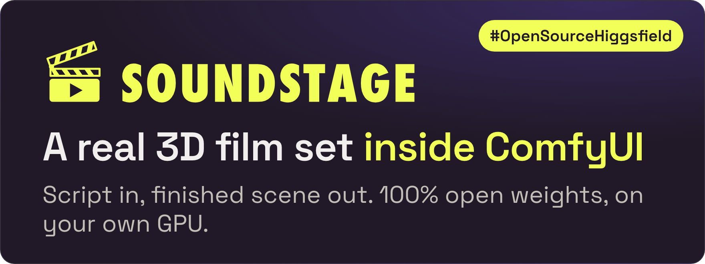</p>

<p align="center">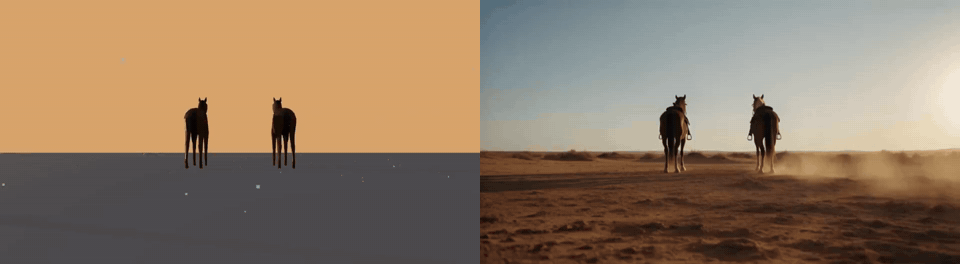</p>
<p align="center"><sub>Left: the 3D stage's clay. Right: what Soundstage renders from it. Same blocking, same camera.</sub></p>

<p align="center">
<a id="watch" href="#watch"></a>
<a href="https://claude.ai/artifact/GwtC3yFZtGCsTsiPGbvnAq"></a>
<a href="#install"></a>
</p>

<p align="center">
<a href="LICENSE"></a>
<a href="MODELS.md"></a>
<a href="https://github.com/comfyanonymous/ComfyUI"></a>
<a href="CHANGELOG.md"></a>
</p>

<p align="center"><a href="docs/QUICKSTART.md">Quickstart</a> &nbsp;·&nbsp; <a href="docs/TUTORIAL.md">Tutorial</a> &nbsp;·&nbsp; <a href="CHANGELOG.md">Changelog</a></p>

<a id="judging-it-start-here"></a>
<p></p>

<p><a href="https://claude.ai/artifact/GwtC3yFZtGCsTsiPGbvnAq">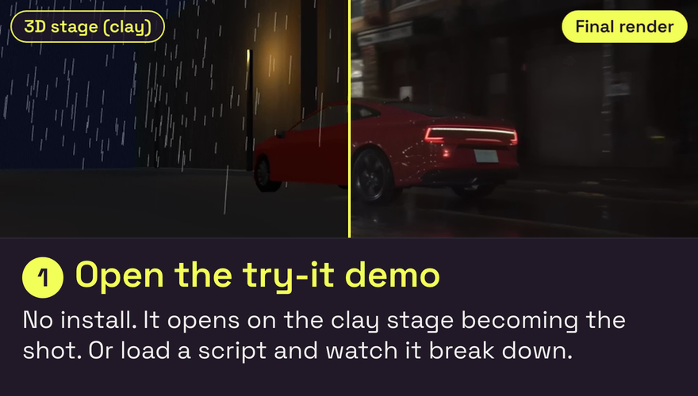</a></p>
<p>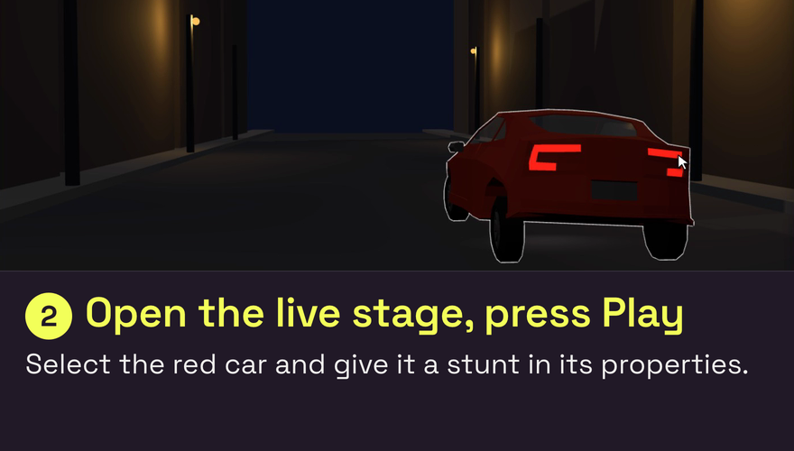</p>
<p>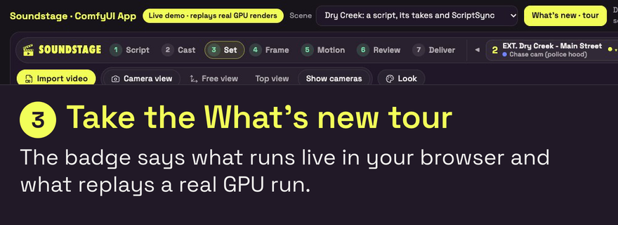</p>

<details>
<summary><b>What's live in the demo, what's replayed, and what's not in it</b></summary>

Soundstage is ComfyUI custom nodes plus an App that work like a film set: you block a scene in 3D clay (set, cast, camera, stunts), and open-weight models render takes that follow that blocking (FLUX 3 Klein for the frame, LTX-2.5 for motion and sound).

1. Open the [try-it demo](https://claude.ai/artifact/GwtC3yFZtGCsTsiPGbvnAq) (no install). The first screen is a recorded wipe between the stage's clay and the take it guided.
2. Press **Open the live stage**, then **Play**. Select the red car and pick a stunt in its properties.
3. Open **What's new · tour** and run any stop. The table below says which parts run live in your browser and which are recordings of a real run, played back. If the demo's top bar shows a **Live / Replayed** badge, it says the same thing for the screen you are on.
4. For the whole flow, script to delivered cut, read the [tutorial](https://claude.ai/artifact/Rf97KZZRHcrkt9ifFb2kFX).

| Live in your browser (the real App code) | Replayed from a real run (made earlier, played back) |
|---|---|
| The 3D stage and its playback, cameras, live physics (climb, mount, pick up, push), stunts, Drive mode, boats and swimming, Presets, the Timeline editor (trimming and ordering; the clips in it are recorded) | The drafts and finals in ④ Frame, ⑤ Motion, ⑥ Review and ⑦ Deliver (FLUX 3 Klein frames, LTX-2.5 clips: the same recorded files in each step), the takes in Takes and ScriptSync, take checks, the Advisor's answers, the Look's compiled prompts (saved per scene; they do not change when you edit the Look), the joined cut from ⑦ Deliver's Cut → one video, Video → 3D (one pod run of 61 min wall time, most of it queue wait, played back in 9 s), every Watch clip and the first screen |

Not in the demo at all (each one says "available in the full install"): new renders, the Director's language model, Timeline render, the phone viewfinder, Layer Packs, voices.

</details>

<a id="whats-inside"></a>
<p></p>

<p align="center">
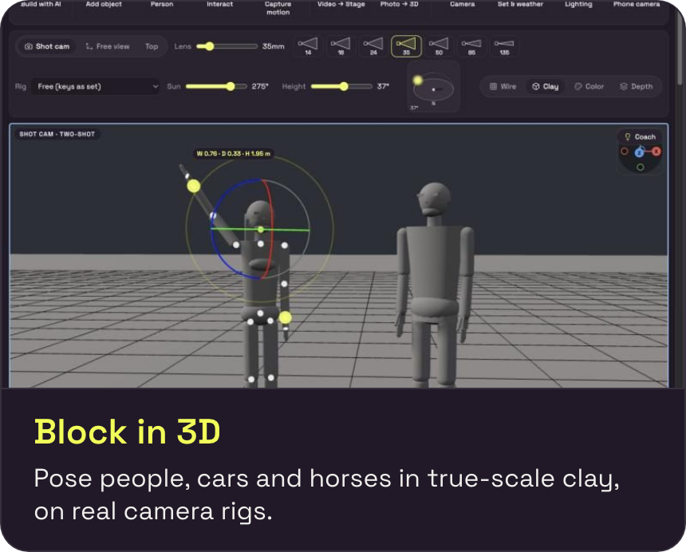
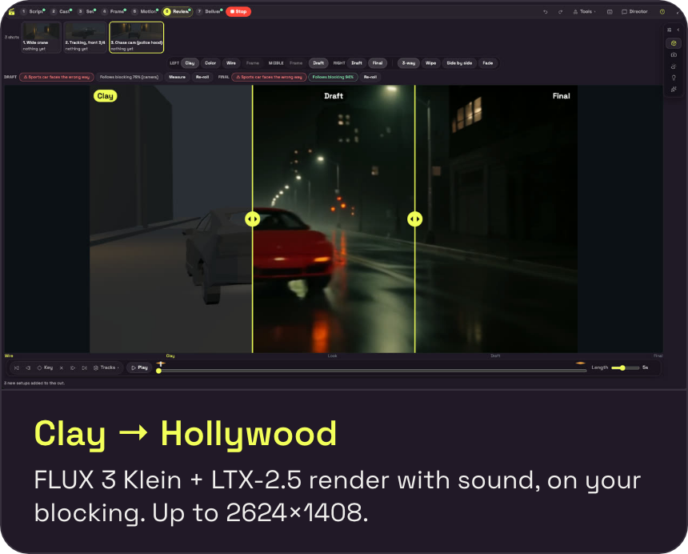
</p>
<p align="center">
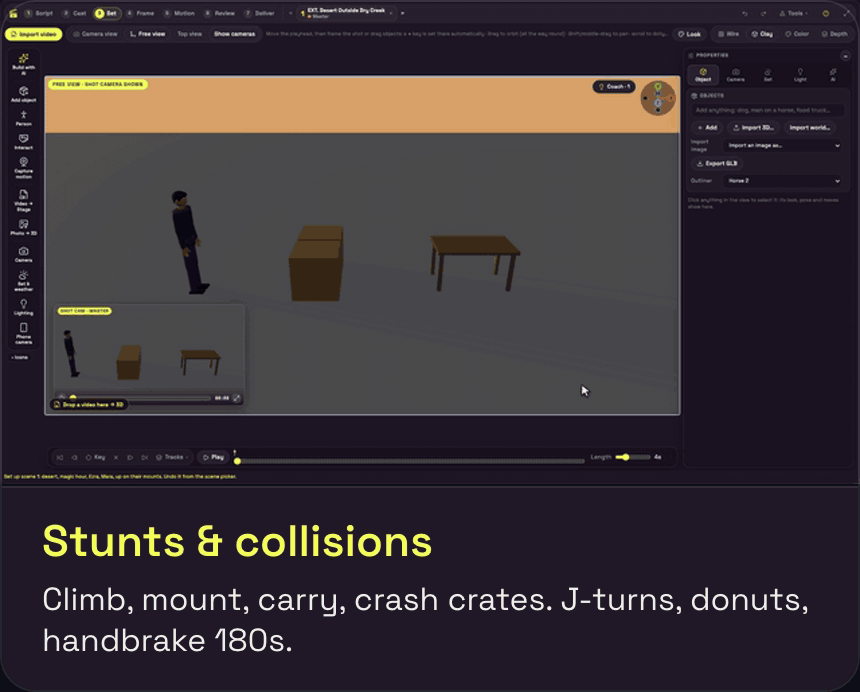
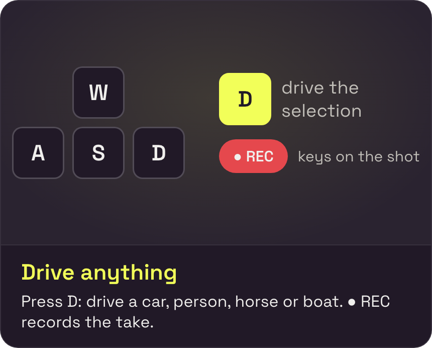
</p>
<p align="center">
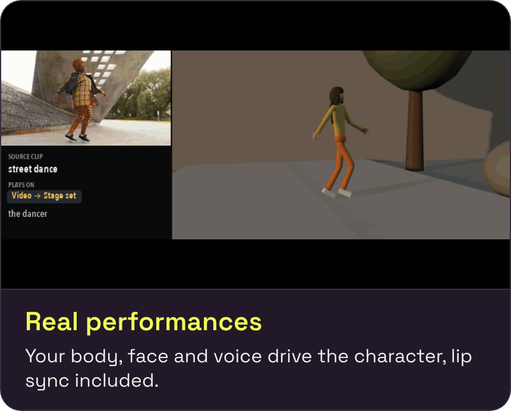
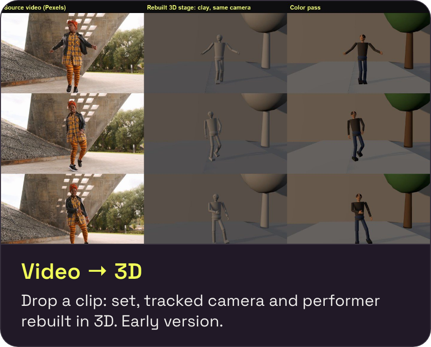
</p>
<p align="center">
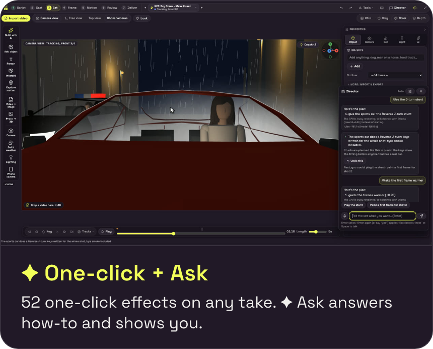
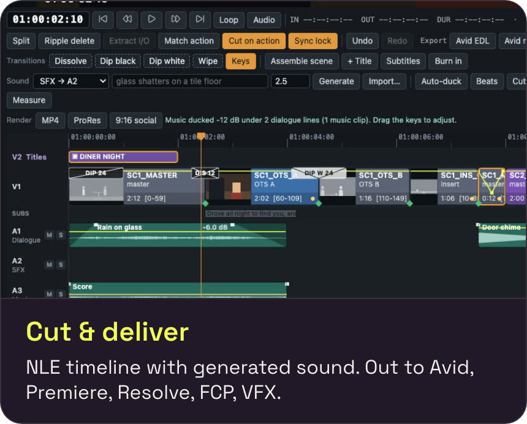
</p>

<p align="center"><sub>Built in 3 days for Comfy Org's <i>Open Source Higgsfield</i> challenge, and shipping daily since. &#11088; Star the repo to follow along.</sub></p>

<details>
<summary><b>The pitch, the highlights and every link</b></summary>

<p align="center">
<a href="https://x.com/hashtag/OpenSourceHiggsfield"></a>

<a href="https://github.com/theboord/ComfyUI-Soundstage/commits/main"></a>
</p>

Import your screenplay. Cast it. Block every scene in 3D clay with real camera rigs, then watch FLUX 3 Klein paint the frame and LTX-2.5 bring it to life **with sound, following your blocking shot for shot**. Approve takes like dailies and hand the cut to Premiere, Avid or Resolve. No cloud, no credits, no paid API: it all runs locally in ComfyUI.<sup>[1](#partner-footnote)</sup>

<p align="center">
<a href="https://claude.ai/artifact/GwtC3yFZtGCsTsiPGbvnAq"><b>&#128421;&#65039; Try it in your browser</b></a> &nbsp;&middot;&nbsp;
<a href="docs/QUICKSTART.md"><b>&#9201;&#65039; First shot in 10 minutes, then a 3-shot scene</b></a> &nbsp;&middot;&nbsp;
<a href="docs/TUTORIAL.md"><b>&#128214; Read the tutorial</b></a> &nbsp;&middot;&nbsp;
<a href="#install"><b>&#9881;&#65039; Install</b></a>
</p>

<p align="center"><sub>The browser demo is the real App UI replaying real GPU renders, no install needed. Built for Comfy Org's <i>Open Source Higgsfield</i> challenge.</sub></p>

#### Highlights: what only Soundstage does

- **Script to ScriptSync dailies.** Import a screenplay; get a breakdown, slated setups, circled takes and an Avid-style lined script where a click on a coverage line plays that take.
- **Actors you direct, not prompt.** Pose them to the fingertips with IK, or mocap them from any clip or your webcam into the set you already built. Horses and riders, cars with seated cast.
- **Live physics and movie stunts.** Drag people onto crates and horses, knock stacks over, crash cars through crates; reverse J-turns, donuts and handbrake 180s that roll on their springs.
- **Real camera rigs and true coverage.** Dolly, jib, Steadicam, handheld, drone, hood mounts, real lenses and solar-accurate light; several setups from one blocking, consistent by construction. Your **phone is the viewfinder**.
- **Hollywood-grade finals that check themselves.** Draft · Final · Hollywood (2624×1408) on LTX-2.5; every take is checked for freezes, jumps, face drift and cars driving backwards, and scored on how well it **follows your blocking**.
- **A real NLE timeline, delivered at source spec.** Dissolves, dips, wipes, sound generated in place, loudness to broadcast targets; export to Avid, Premiere, Resolve and FCP (EDL, XML, FCPXML, OTIO, AAF) with the camera original's timecode, plus VFX Layer Packs.
- **Round trip with Blender, Unreal, Maya and Nuke.** Import a whole world as the set; send the shot back with builder scripts (measured IoU 0.99+ in Blender).
- **An AI Director plus MCP.** Talk or type to the set; Claude Desktop or Code can drive the open App over MCP. Every change is proposed first and undoable.

</details>

<details>
<summary><b>Everything new since the contest (Director, Presets, Timeline, Hollywood, take checks, live physics, stunts, sets, interop, phone)</b></summary>

Every section links to its tutorial chapter. All pictures are real App screens and real renders from the milestone evidence.

#### The Director: chat, voice and MCP

Press `/` (or **Director** in the top bar) and say what you want: *"put Mara in the sports car at night, rain, camera on the hood, she's nervous"*. It shows a short plan, **Apply** runs it through the App's own controls, and every turn has **Undo this**. Hold `` ` `` to talk (offline Whisper); the model is a local Qwen3.5 4B. The same tools are an **MCP server**, so Claude Desktop or Claude Code can block, rig and render in the open App: propose first, apply on your OK, GPU work only with `confirm_gpu`. → [Tutorial](docs/TUTORIAL.md#the-director-chat-voice-and-mcp) · [director.md](docs/director.md) · [mcp.md](docs/mcp.md)

<p align="center">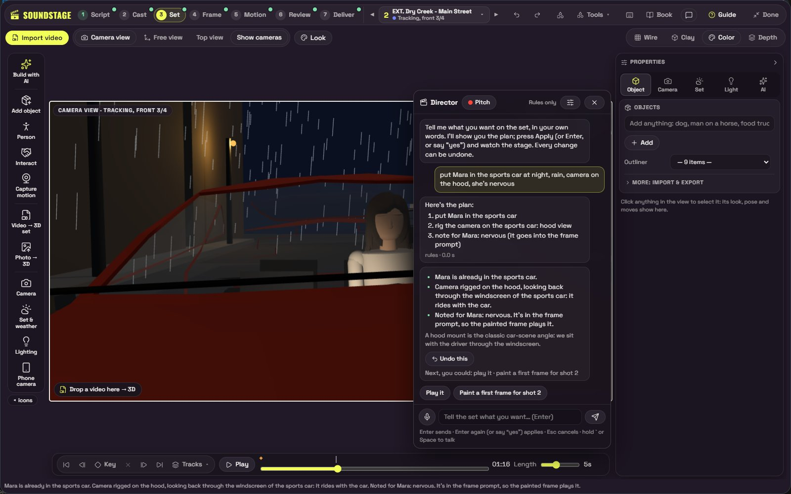</p>

#### Presets: one click, one undo

Press `V` for a searchable window of **Camera moves** (push in, crane up, dolly zoom, drone reveal, car mount, and the racing set: bumper cam, over the tyre, arm car, long-lens pan…), **Lighting**, **Looks**, **Action**, **Edit styles**, **Recipes** and **Mine** (save your own camera, light or look). Hover a camera move to preview it on the shot; every apply is one ⌘Z. The Director can call them too ("make it a crane up at golden hour"). → [Tutorial](docs/TUTORIAL.md#presets-one-click-camera-moves-and-lighting)

<p align="center">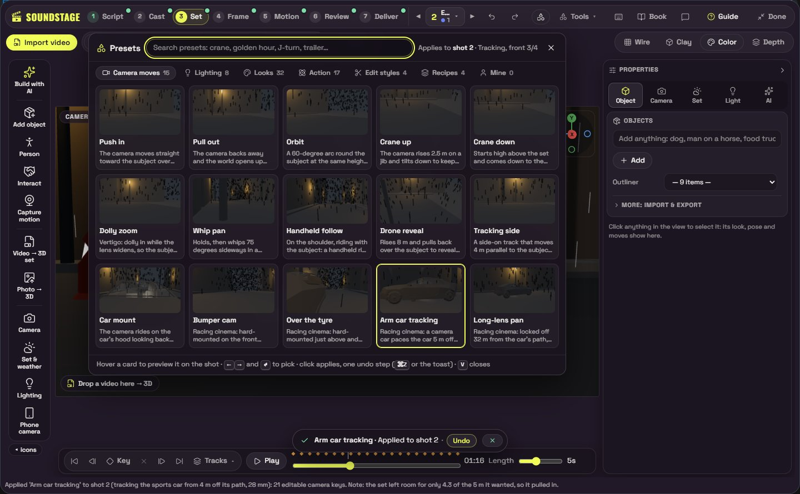</p>

#### The Timeline: transitions and sound

The **Edit** tab (the Cut) is now a real editing timeline: V2 titles, V3 motion graphics, a subtitles lane and A1 Dialogue · A2 SFX · A3 Music · A4 Ambience. Drag **Dissolve, Dip black, Dip white or Wipe** onto a cut, rubber-band keys, slip and roll. Type a sound and **Generate** it in place (open-weights LTX-2.5 audio and Chatterbox), **Auto-duck** the score under dialogue, snap cuts to the beat, **Assemble scene** from the ScriptSync lining, then render MP4, ProRes 422 HQ or a 9:16 cut at −14 / −23 / −24 LUFS. → [Tutorial](docs/TUTORIAL.md#transitions-sound-titles-and-render) · [cut.md](docs/cut.md)

<p align="center">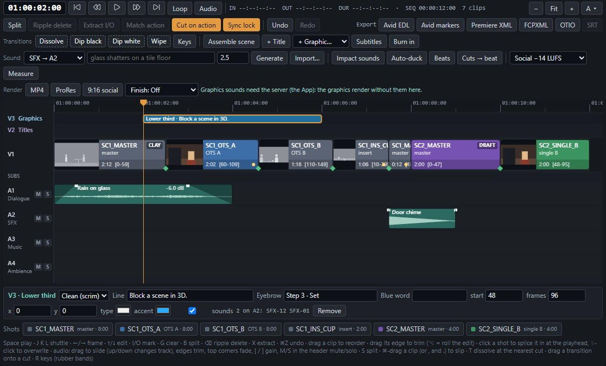</p>

#### Hollywood quality presets

⑤ Motion's Quality is **Draft · Final · Hollywood**, saved per shot, Final by default. Hollywood renders stage 1 at 704p, upscales in latent space and refines at **2624×1408**: real detail in skin, rain and panel lines, and a spinning car that stays one coherent car. **Advanced (LTX)** opens the full LTX controls (resolution, steps, sigmas, sampler, CFG, seed, IC-LoRA strength, an extra LoRA) and a **ProRes 422 HQ** master. → [Tutorial](docs/TUTORIAL.md#quality-draft-final-hollywood) · [quality.md](docs/quality.md)


#### Takes that check themselves

Every draft and final is checked on the CPU in seconds: black frames, freezes, jumps, smear, face drift, and **cars facing the wrong way** (the stage knows every car's path). Chips sit on the Ladder and in Dailies; **Re-roll** asks first. A **Follows your blocking %** score compares the take's camera and each actor's matte with the clay, the ground truth only Soundstage has. → [Tutorial](docs/TUTORIAL.md#takes-that-check-themselves)

<p align="center">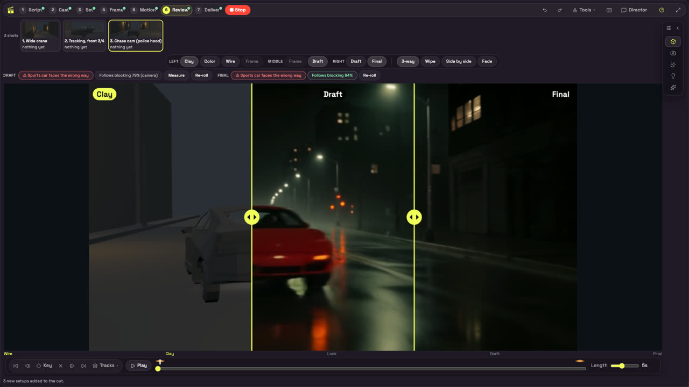</p>

#### Live 3D physics and characters

The stage is alive while you drag: people walk where you pull them, climb onto crates and tables, mount and dismount horses, pick up and carry props (`C`); stacks stand still until something hits them, and cars throw crates clear. Live physics runs on the CPU (XPBD) or, in beta, on the GPU ([three-avbd](https://github.com/sbobyn/three-avbd)); **Simulate & bake** turns it into keys every render follows. → [Tutorial](docs/TUTORIAL.md#live-3d-drag-climb-mount-carry)

<table>
<tr>
<td align="center">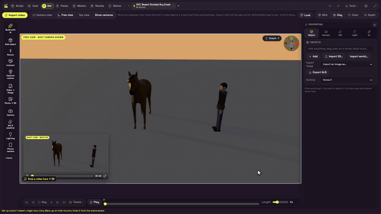</td>
</tr>
</table>

#### Stunts

Pick a car, then **Stunt ▸ Reverse J-turn / Donut / Handbrake 180**. The keys are written on your set from where the car starts, the body rolls, squats and dives on its springs, tyre smoke pours off the wheels, and the prompts say which end leads, so the video gets the spin right. → [Tutorial](docs/TUTORIAL.md#stunts-j-turn-donut-handbrake-180)


#### New sets

Underwater coral reef, burning building (plus **Fire** on any set), airplane cabin, runway, above the clouds, train carriage and station platform. Clouds and countryside stream past the windows, and a slugline like *INT. TRAIN* places the set, the camera and the blocking by itself. → [Tutorial](docs/TUTORIAL.md#the-new-sets)

<table>
<tr>
<td align="center">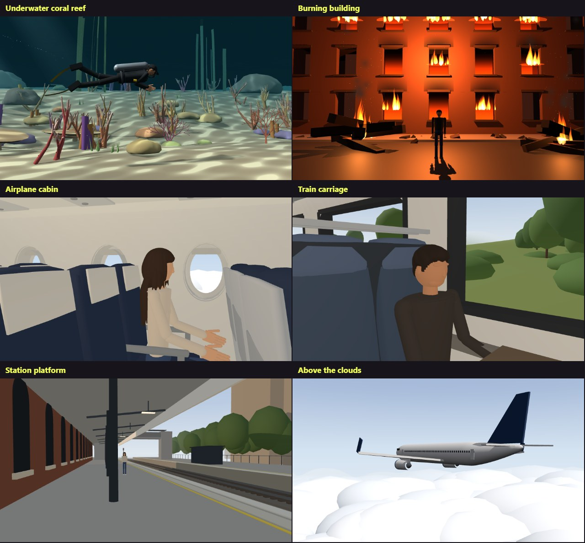</td>
</tr>
</table>

#### Interop: Blender · Unreal · Maya · Nuke

**Import world…** makes a GLB, FBX, OBJ or splat from any DCC the set, with real scale, colliders and its cameras as shots. **Export for Blender · Unreal · Maya · Nuke** sends the shot back as an animated GLB, camera files and a builder script for each app. Round trip measured in Blender at IoU 0.99+. [Details below](#bring-your-world-in-send-it-back-out-blender--unreal--maya--nuke). → [Tutorial](docs/TUTORIAL.md#interop-blender-unreal-maya-nuke)

<p align="center">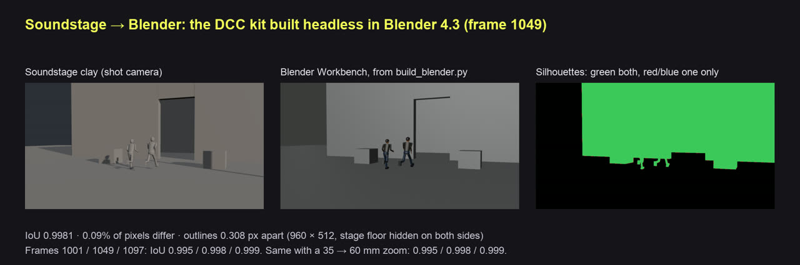</p>

#### The phone is the viewfinder

Scan a QR code and your phone shows the live stage through the shot camera, and *is* the camera: move it to aim, pinch or pick a **14–135 mm** prime, tap to focus, set A/B marks and **Pull ⇄**, an **IRIS** with live depth of field. **● REC** lands the move and the lens keys on the shot. The phone renders the stage itself, so there is no lag; the bridge is LAN-only with a pairing code. → [Tutorial](docs/TUTORIAL.md#phone-camera) · [vcam.md](docs/vcam.md)

<p align="center">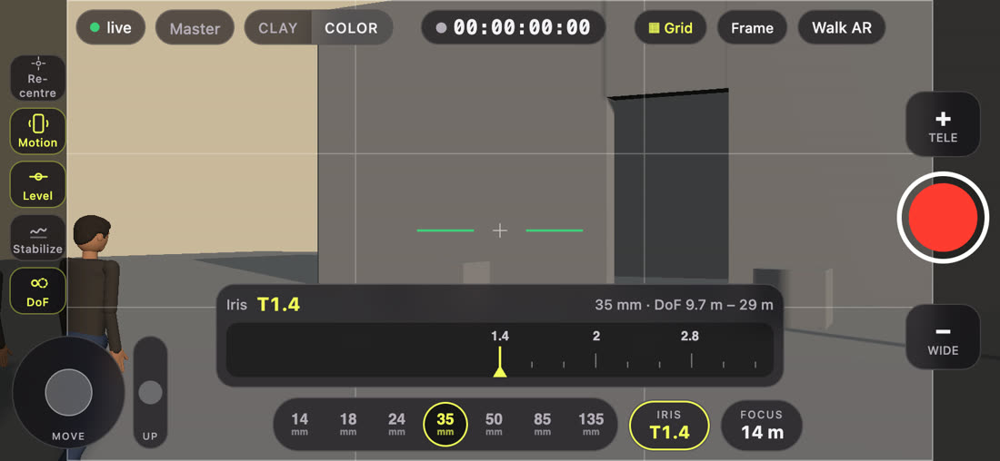</p>

#### What you get

| | |
|---|---|
| &#128221; **Import a script** (Fountain, Final Draft, PDF, text) and get a breakdown, a scene strip and auto scene setup | &#127917; **Cast every character and location** in one click with FLUX 3 Klein, then pick who is in each shot |
| &#129521; **Block scenes in 3D clay**: actors with sculpted hair, horses, cars, props, lights and weather | &#9995; **Pose to the fingertips** in 3D with IK, or **capture motion** from any video or your webcam (SAM 3D Body) |
| &#127909; **Shoot with real camera rigs**: dolly, jib, Steadicam, handheld, drone, with a Top plan view | &#127916; **Turn any clip into a 3D set** with Video &rarr; 3D set: rebuilt location, tracked camera, the performer |
| &#127912; **Paint the first frame** in Paint Studio: fill, remove, extend to any aspect | &#128266; **Animate with sound** on LTX-2.5; type a line and LTX speaks it, lip-synced |
| &#127902;&#65039; **Swap the film look** with one swatch: same animation, any look | &#9878;&#65039; **Compare Clay &#124; Draft &#124; Final** on a 3-way Ladder, approve or Redo every take |
| &#128450;&#65039; **Review as dailies**: Avid-style scene bins and a lined script | &#128228; **Deliver to Premiere, Avid or Resolve** at the source spec (4K, 8K, RED via proxy relink), plus a VFX Layer Pack |
| &#127897;&#65039; **Talk to the set**: the [Director](docs/director.md) chat plans what you say or type (local Qwen3.5 4B, offline Whisper voice) and applies it, undoable | &#129302; **Drive it from Claude** over [MCP](docs/mcp.md): 40 tools, every change proposed first, applied in the open App |

<table>
<tr>
<td align="center">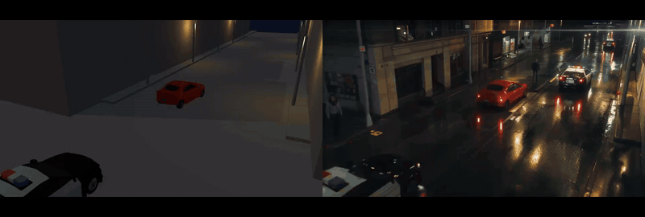<br><sub><b>Car chase, before and after:</b> left the 3D stage, right the final. Same cars, same positions, same camera: a crane wide, then a tracking shot.</sub></td>
</tr>
</table>

<p align="center">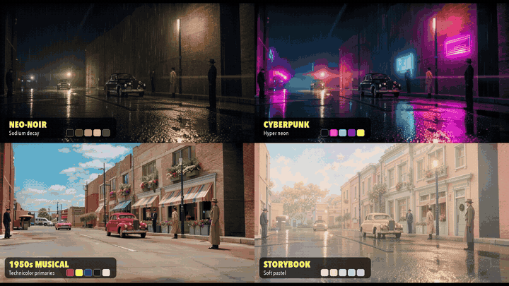</p>
<p align="center"><em>Film-look swatches: one animation, four looks. Pick a swatch and the same blocking and motion come back in a new style.</em></p>

<p align="center"><em>Any genre: Film noir in the rain, then horror in the woods.</em></p>

<p align="center">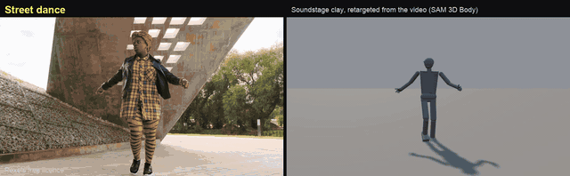</p>
<p align="center"><em>Motion capture into the set you already have: open your set, click a person, <b>Capture motion</b> &rarr; <b>Capture from video</b> (or <b>Act it out</b> on your webcam). The take plays on that person, right where they stand in your blocking, in your set's light and camera: body, hands, fingers and path, for the whole clip (the shot stretches to fit). SAM 3D Body runs in ComfyUI; the clay then directs LTX. Clips: Pexels, free licence.</em></p>

</details>

<details>
<summary><b>Script to screen, step by step (with screenshots)</b></summary>

One step bar, in production order. Every step works on every shot in the scene. Each block links to its chapter in the **[tutorial](docs/TUTORIAL.md)**.

<p align="center">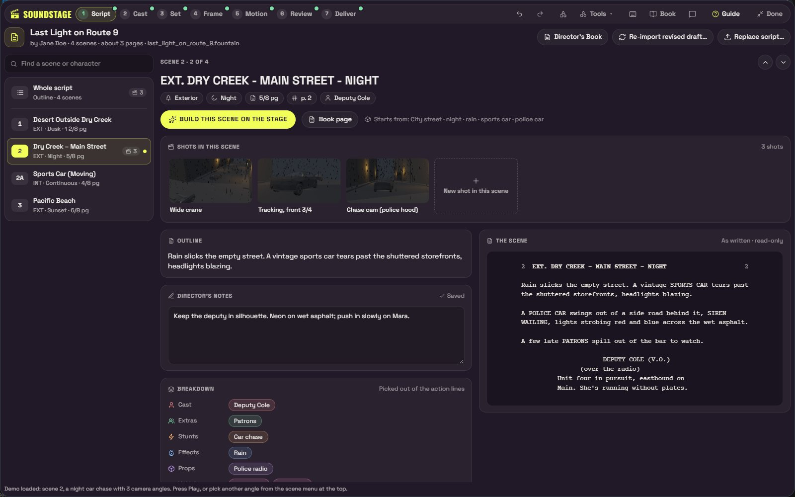</p>

#### &#9312; Script: bring in your screenplay

Import Fountain, Final Draft (.fdx), PDF or plain text, or try the sample script. Each scene gets an outline, a colour-coded breakdown (cast, extras, props, vehicles, animals, wardrobe, effects, sound) and a box for your director's notes. Picking a scene puts its set, time of day, characters and vehicles on the stage by itself; **Build this scene on the stage** blocks the action and cameras too, and every scene keeps its own stage, shots and cut, so a feature-length script stays organised. *Why it matters:* everything downstream (cast, locations, slates, the cut) is named after your script. → [Tutorial: ① Script](docs/TUTORIAL.md#step-1-script)

<p align="center">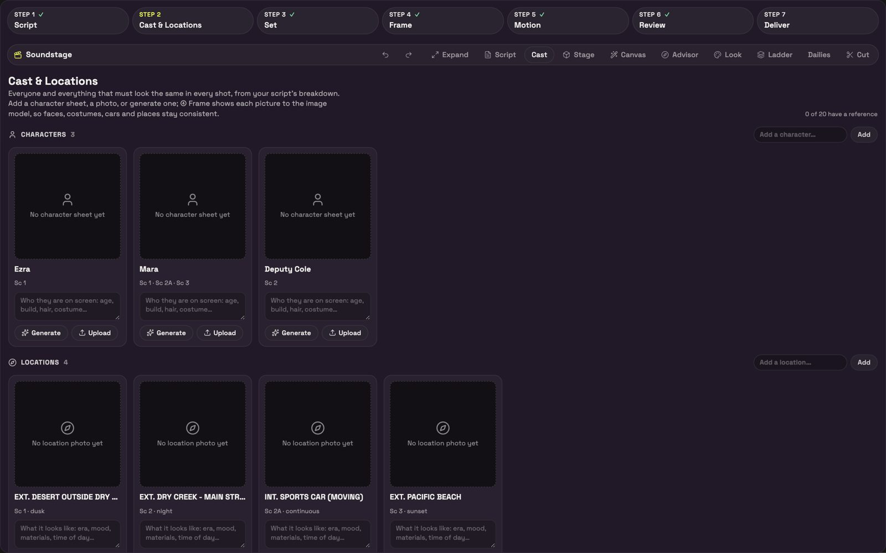</p>

#### &#9313; Cast &amp; Locations: one look for every shot

Every character, location, wardrobe piece and prop from the breakdown gets a reference picture: upload a character sheet or photo, or **Generate** one with FLUX 3 Klein (front, side and back for characters). In ④ Frame, **Cast in this shot** lets you tick who and what appears in each shot; up to four pictures go to the image model, characters first. *Why it matters:* the same face, costume, car and place in every shot, which is what keeps AI coverage from falling apart. → [Tutorial: ② Cast & Locations](docs/TUTORIAL.md#step-2-cast)

<p align="center">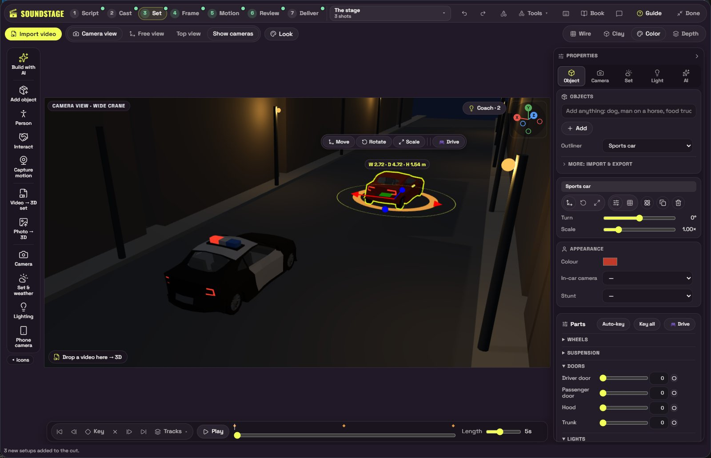</p>

<table>
<tr>
<td width="50%"></td>
<td width="50%">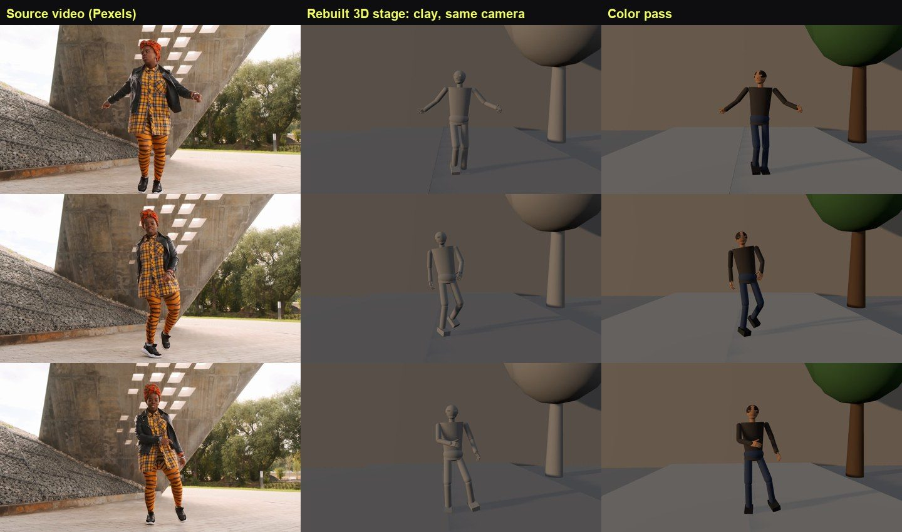</td>
</tr>
<tr>
<td>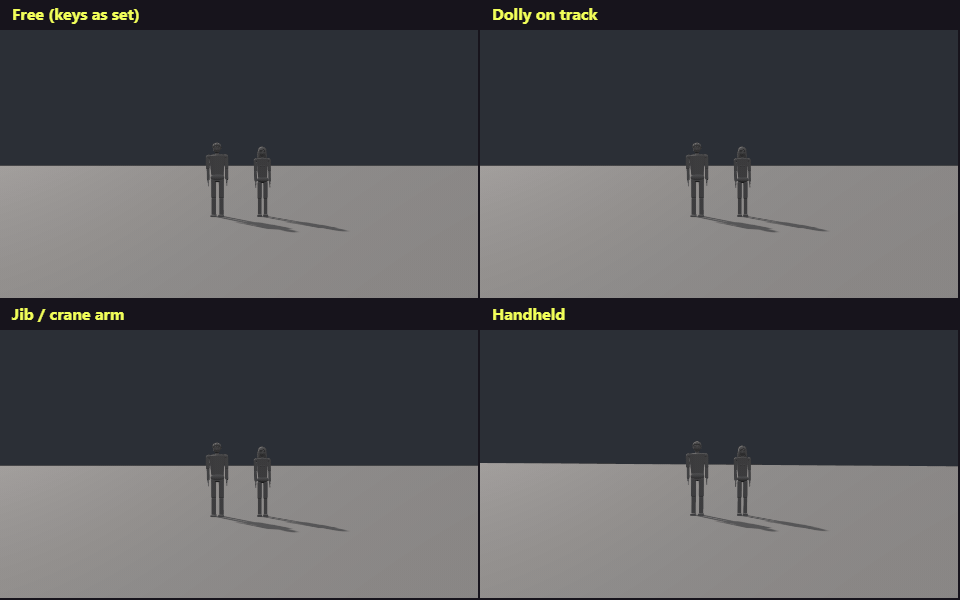</td>
<td>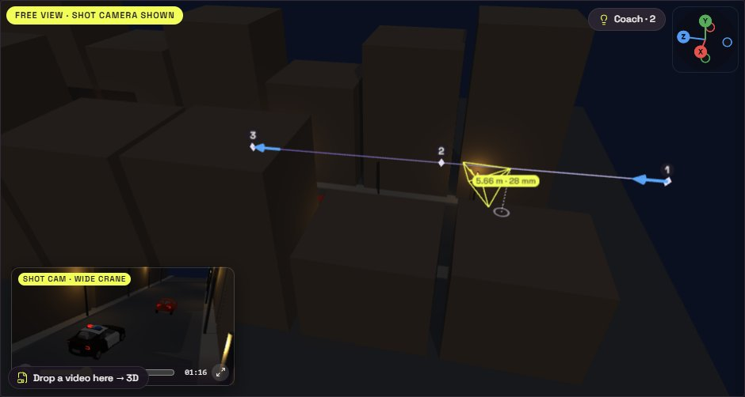</td>
</tr>
</table>

#### &#9314; Set: block it in 3D clay

A true-scale 3D stage: type what you need ("cowboy on a horse", "police car", "bedroom 4x3.5 m") or **Build with AI** from one sentence. Pose anyone in 3D (click a joint, drag a hand: IK), make them interact, or copy a real performance with **motion capture** from a clip or your webcam. **Video → 3D set** rebuilds a whole clip (location, tracked camera, performer). Keyframe the camera, put it on a dolly, jib, Steadicam or handheld rig, ride along inside cars, light it with a real sun and film lights, and add setups for coverage. *Why it matters:* the clay is the director's plan, and every later step follows it exactly. → [Tutorial: ③ Set](docs/TUTORIAL.md#step-3-set) · [the 3D stage in depth](docs/TUTORIAL.md#4-the-3d-stage-in-depth)

<p align="center">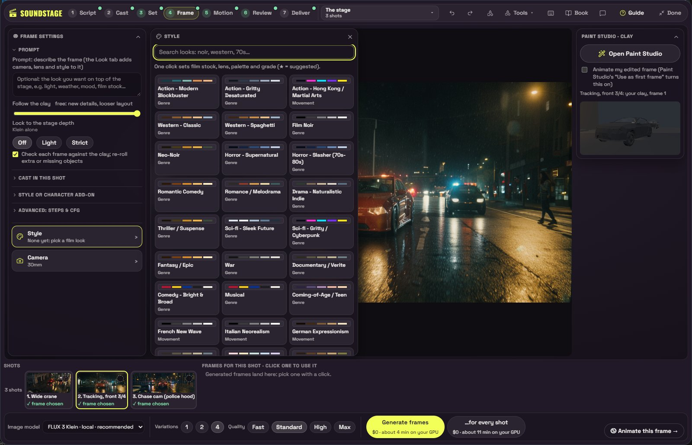</p>

<p align="center">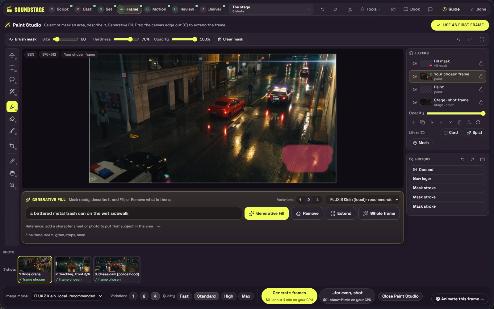</p>

#### &#9315; Frame: paint the first frame, then perfect it

FLUX 3 Klein (or Krea 2 locked to the stage's depth) paints the first frame of every shot from your clay, keeping the framing and blocking, in any of 32 film styles with a real camera, lens and aperture picker. Generate a few, pick one, then fix it in **Paint Studio**, a small Photoshop with our own Generative Fill: Fill, Remove, Extend to any aspect, magic select (SAM 3.1), layers, history and before/after variations. *Why it matters:* the video inherits everything in this frame, so a ten-second fix here saves a re-render. → [Tutorial: ④ Frame](docs/TUTORIAL.md#step-4-frame)

<p align="center">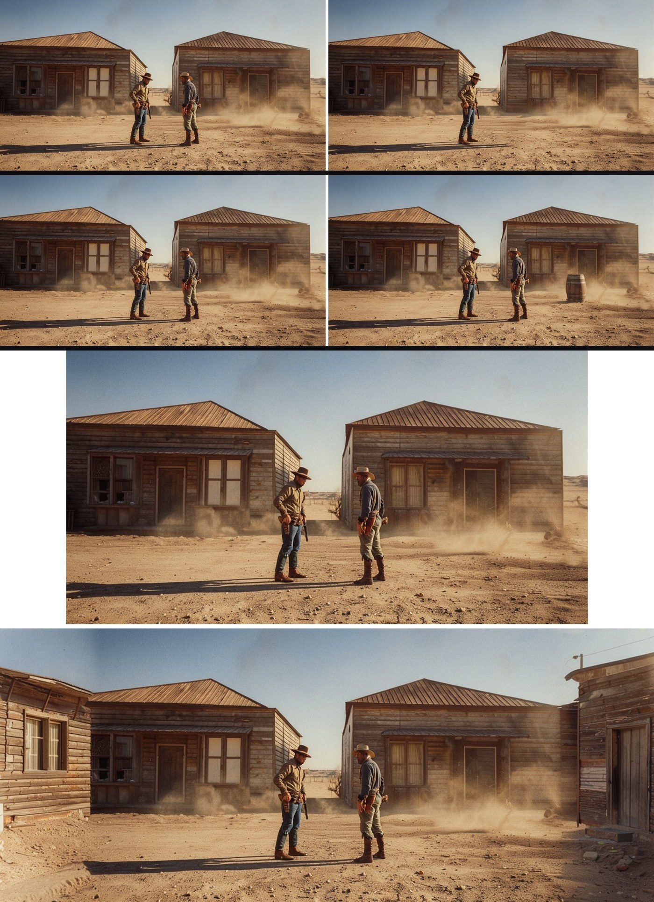</p>

<p align="center">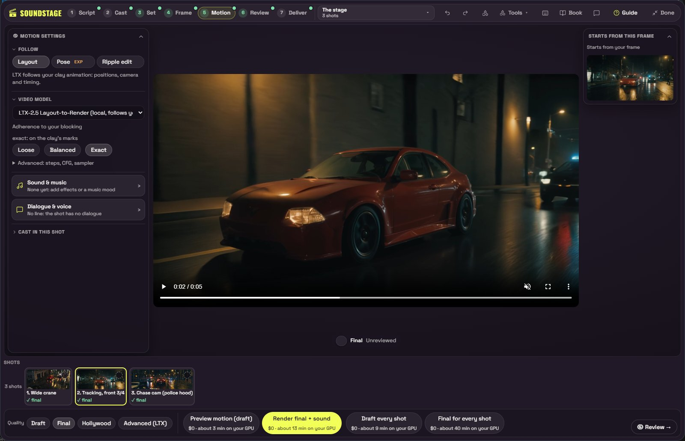</p>

#### &#9316; Motion: animate it with sound

LTX-2.5 Layout-to-Render animates each shot from its frame, following your clay: positions, camera, timing. **Draft** (quick look), **Final** (the default) or **Hollywood** (2624×1408, hero shots), saved per shot, with an **Advanced (LTX)** pop-over; one shot or every shot. Sound effects and music are generated with the final, and typing a **dialogue line** turns on audio-driven lip sync, so the mouth follows the words. MiniMax H3 is an optional second engine. Every take then checks itself (freezes, jumps, face drift, cars driving backwards) and gets a **Follows your blocking %** score. *Why it matters:* the motion is directed, not hoped for. → [Tutorial: ⑤ Motion](docs/TUTORIAL.md#step-5-motion)

<p align="center">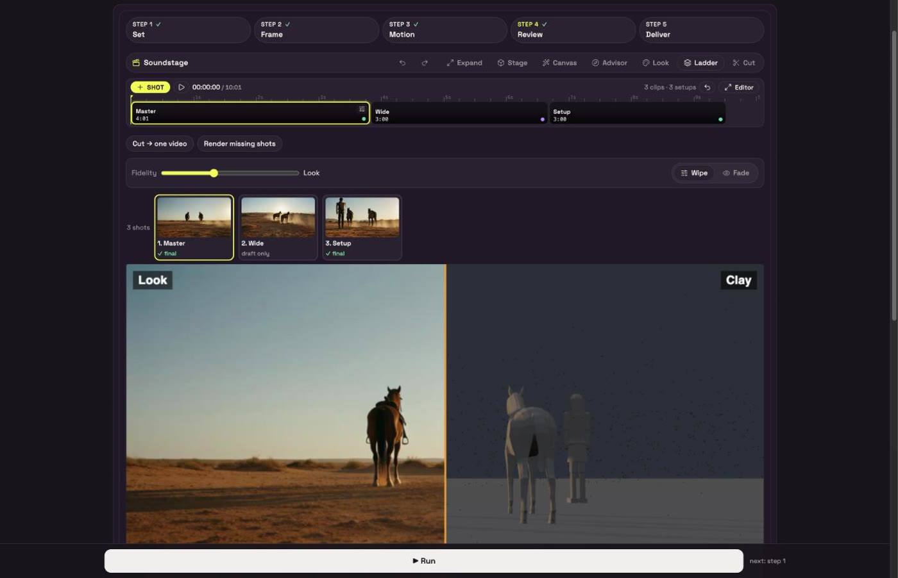</p>

#### &#9317; Review: the Ladder, plus dailies

The Ladder compares the same frame across stages with a **3-way slider**: Clay (or Color) | Draft | Final, two handles you drag across the picture, every layer cropped to line up. Wipe, side by side and fade too. *Why it matters:* you see at a glance whether the final still matches your blocking. → [Tutorial: ⑥ Review](docs/TUTORIAL.md#step-6-review)

<table>
<tr>
<td width="50%">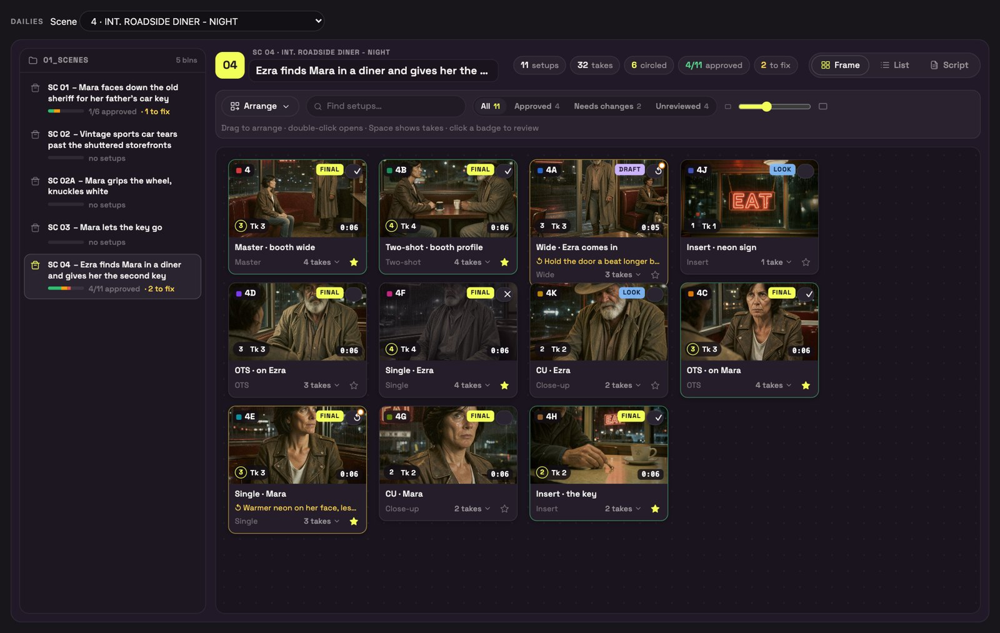</td>
<td width="50%">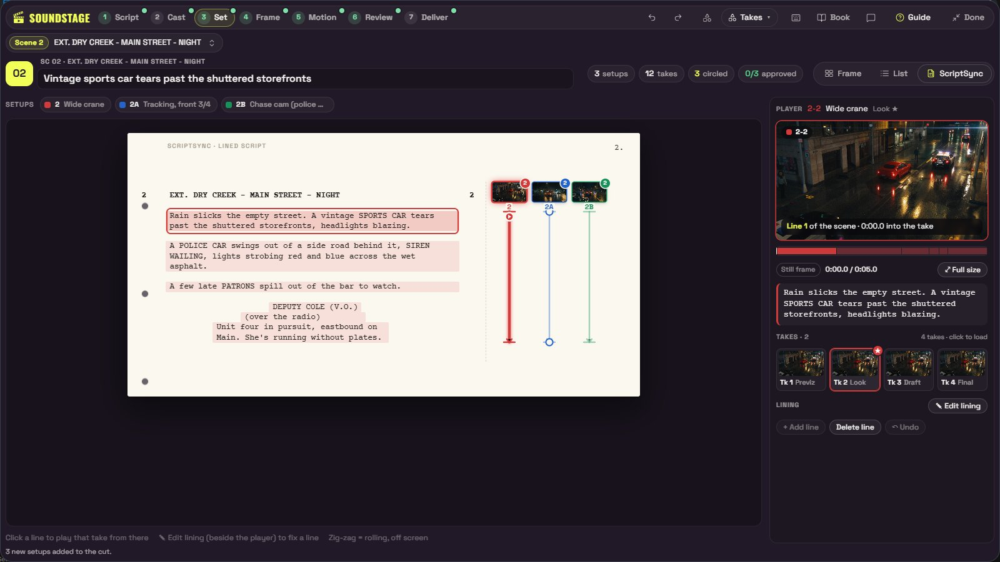</td>
</tr>
</table>

**Dailies and the lined script.** Every render is a take: setups slated like a real shoot (12, 12A, 12B), circled takes, frame and list views. Approve each frame, draft and final, or mark it **Needs changes** with a note and send it straight back to Frame or Motion. The lined script draws each setup's coverage over the page, ScriptSync-style (zig-zag = off camera); click a line to play that take from that point. → [Tutorial: Dailies](docs/TUTORIAL.md#dailies-and-the-lined-script)

<p align="center">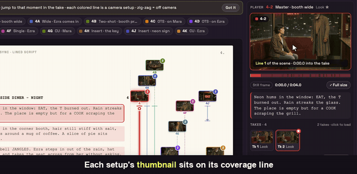</p>

**ScriptSync (lined script).** Like Avid ScriptSync: each setup's thumbnail sits at the top of its coverage line on the script page. Click any line and that take loads in the player beside the page, cued to that moment; the setup's takes are listed under it to swap. **Edit lining** fixes a wrong line: drag its ends, flip a stretch on or off camera, add or delete a line, undo. The lining saves with the workflow. Open it from **Tools → ScriptSync**, the Takes view, or a scene in ① Script. → [Tutorial: ScriptSync](docs/TUTORIAL.md#scriptsync-lined-script)

<p align="center">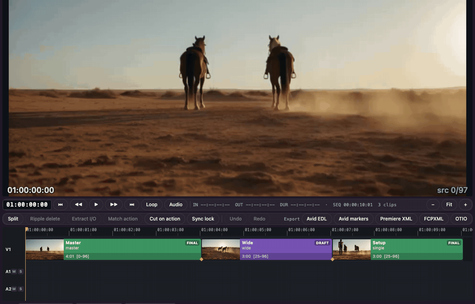</p>

#### &#9318; Deliver: the cut, your NLE, and layers for VFX

A real timeline over your coverage with J/K/L, splits, ripple, match action, dissolves, dips and wipes, titles, subtitles and A1–A4 sound generated in place; right-click any clip to **edit its original** in the step that made it. **Cut → one video** (or **Render** MP4, ProRes 422 HQ, 9:16) joins the whole scene with sound at a loudness target. Export to Avid (EDL, markers), Premiere XML, FCPXML and OTIO, or write a **Layer Pack**: per-actor ProRes 4444 layers with mattes, depth EXRs, the exact camera, and builders for After Effects, Nuke, Blender, Resolve and Photoshop. *Why it matters:* it ends in the tools post-production already uses. → [Tutorial: ⑦ Deliver](docs/TUTORIAL.md#step-7-deliver)

**What goes in goes out the same:** imported footage keeps its own spec. NLE exports link the camera original with its own timecode, frame rate and reel, and Layer Packs render at the source size, frame rate and timecode. RED, BRAW and ARRIRAW work through a proxy that relinks to the original, and anything that can't match is written into the export. → [Source fidelity](docs/source_fidelity.md)

<p align="center">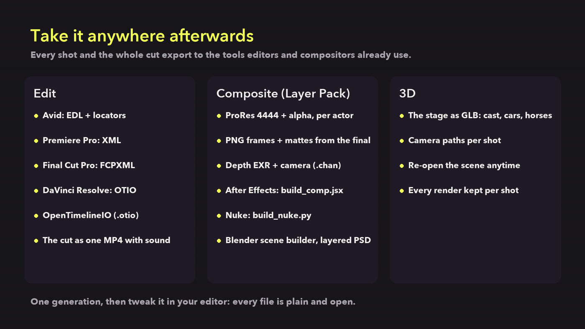</p>

<p align="center">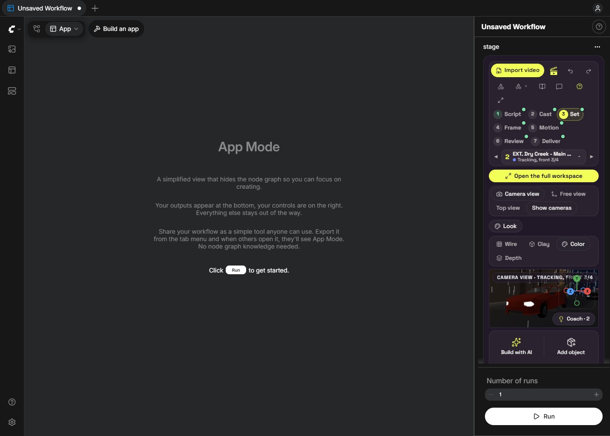<br><em>All of it runs inside ComfyUI's App mode, on open models on your own GPU.</em></p>

</details>

<details>
<summary><b>Blender · Unreal · Maya · Nuke round trip</b></summary>

### Bring your world in, send it back out (Blender · Unreal · Maya · Nuke)

**In.** In ③ Set, **Import world…** makes a whole location the Set. It takes GLB, glTF, FBX or OBJ from Blender,
Unreal, Maya or Sketchfab, or a Gaussian splat. Units and up axis come from the file (glTF, FBX GlobalSettings) or
from the geometry. Blender is m and Z up; Unreal FBX is cm and Z up; Maya is cm and Y up. The main floor goes on the
stage floor, and the panel reads *This world is 120 m × 80 m, 15 m tall*, with a one-click **Fix scale** when the
size looks wrong.

- **Physics.** The meshes become box colliders, so people stand on the floors, crates land on tables and stop at
  walls, and doorways stay open.
- **Cameras and animation.** Cameras in the file become shots, animated ones included. Animated objects play on the
  timeline.
- **Heavy worlds.** Static meshes are merged by material, with far LODs. A 4,201-object, 1.85 M-triangle town
  renders in 2.8 ms a frame instead of 21–29 ms.
- **Camera files.** A Nuke or Maya `.chan`, or a camera.json, comes in as a shot.

**Out.** In ⑦ Deliver, **Export for Blender · Unreal · Maya · Nuke** downloads one zip. It holds the staged shot as
an animated GLB (every move baked to keys, plus the camera with its lens), camera.json and `.chan`, a frame-one OBJ,
and a builder script for each app:

- **Blender:** camera, sensor, frame range, fps, resolution, and the Layer Pack plates as the camera background.
- **Unreal:** a CineCameraActor and a Level Sequence.
- **Maya:** an animated camera with rotate order zxy.
- **Nuke:** a Camera, ReadGeo and ScanlineRender.

**What was verified.** Both directions were run headless in **Blender 4.3** (the test-world script also runs on Blender 5.2.3):

- Blender → Soundstage: silhouette IoU 0.994–1.000 against Blender's own camera.
- Soundstage → Blender: IoU 0.995–0.999, with outlines within 0.5 px of the Soundstage clay frame.

The Unreal, Maya and Nuke scripts are **untested in those apps**. Their maths (axes, centimetres, rotators, ZXY
rotations, film backs, frame rates) is unit-tested. → [Interop](docs/interop.md)

</details>

<details>
<summary><b>The seven steps and the full feature list</b></summary>

### The seven steps

The App has one step bar, in production order. Every step works on every shot in the scene; with a script, every step has a scene switcher.

1. **Script.** Optional. Import a screenplay; browse it scene by scene (outline, breakdown, page, director's notes). Each scene keeps its own stage, shots and cut. No writing tools: it is your script.
2. **Cast & Locations.** Characters, props and locations from the breakdown (or the stage), each with a reference picture (upload or generate). They become the image model's references.
3. **Set.** Block the scene in 3D: cast, set, light, cameras and timing. Add several camera setups to cover the scene.
4. **Frame.** Paint the first frame of each shot from its clay render with FLUX 3 Klein (default) or Krea 2 + stage depth.
5. **Motion.** Animate each shot with LTX-2.5 Layout-to-Render, with sound. The video follows the staged blocking and camera. LTX is the default; MiniMax H3 is an optional second engine in the same list (richer motion and its own sound, looser blocking, slower), with first + last frame, reference images and the clay as a motion reference.
6. **Review.** Scrub clay, frame, draft and final for each shot on the Ladder, with a wipe/fade compare.
7. **Deliver.** Export a Layer Pack for VFX, assemble the cut into one video, or export the edit to your NLE.

ComfyUI's cache means each Run only does the new work.

### Features

- **Script import.** Fountain, Final Draft, PDF or plain text: scenes, outlines, a breakdown sheet per scene, director's notes, a scene switcher in every step, scene numbers in the cut and NLE export.
- **Cast & Locations.** Reference sheets per character, prop and location, generated with FLUX 3 Klein or uploaded; they flow into the Frame step's references by name.
- **Pose in 3D and Pose Studio.** Click a body part to turn it, drag hands and feet (IK), or use a slider for every joint and finger knuckle; a pose gallery; interactions between people, animals and objects (look at, talk, shake hands, hug, hold hands, point, pet, lead by the reins).
- **Motion capture.** Capture from video or act it out on the webcam: SAM 3D Body (ComfyUI core) retargets body, hands and fingers onto the clay actor, with the path and the jumps.
- **Video → 3D set.** A clip becomes a 3D scene: location mesh, tracked camera, set pieces and the performer on the rebuilt floor, dressed from the vision model's description.
- **Paint Studio.** Inpaint and outpaint the first frame with Soundstage's own Generative Fill nodes (`SoundstageFill`, crop and stitch): fill, remove, replace with a reference, extend to any aspect.
- **Camera rigs.** Real camera supports with their physics, deterministic per frame, so the clay, the frame and the video all see the same move.
- **Dailies and ScriptSync.** Setups and takes as an Avid-style bin with circled takes; ScriptSync (lined script): thumbnails on the coverage lines, click a line to play that take from there, editable lining.
- **Tool dock.** Every Set feature has a labelled icon (Build with AI, Add object, Person, Interact, Capture motion, Video → 3D set, Photo → 3D, Camera, Set & weather, Lighting, Phone camera).
- **Multi-shot through every step.** One scene, several camera setups. Frame, Motion, Review and Deliver all run per shot.
- **3D stage.** Add objects by name ("cowboy on a horse", "police car"). Riders sit astride horses, bikes and motorcycles. Sets include a plaza, a night street, interiors, a studio, forest, desert, beach, a water tank, open water, a lake, river rapids, a stadium, an underwater reef, a burning building, an airplane cabin, a runway, above the clouds, a train carriage and a station platform, with rain, snow, fog, smoke, dust and sparks. GLB import and export.
- **Rigged CC0 models.** A rigged horse (idle, walk, gallop) and three cars (hatchback, police car, sports car) by Quaternius, CC0.
- **Flashlight prop.** A handheld flashlight with a real beam. Drag it onto a person to hand it to them.
- **In-car camera presets.** The shot camera can ride along inside a vehicle, with interior framings. **＋ All interior shots** adds one shot per interior angle in a single click.
- **Camera.** Real lenses and aspect ratios (1.85, 2.39, 16:9, 9:16 and more), Catmull-Rom keyframes, free-fly view. A virtual camera turns a phone, iPad, Quest or Vision Pro into the shot camera; its stabilizer smooths your move rather than replacing it. The **phone viewfinder** shows the live stage on the phone, with primes, focus pulls and an iris.
- **Light.** Solar-accurate time of day: set the hour and North, and the sun sits where it would (the date and latitude come from the scene; Los Angeles in late October by default). Film lights (key, fill, rim, practical, spot, neon) with Kelvin, power and softness.
- **Look tab.** 32 genre style presets and 18 ASC-style lighting setups (three-point, Rembrandt, low-key noir, book light and more), plus camera body, lens, film stock, era and grade. It compiles the still prompt and the LTX motion prompt from the stage itself.
- **Coach.** Watches the stage, the cut and the App and shows at most two small cards: what looks wrong, why, and a one-click fix. It never blocks a Run. See [docs/coach.md](docs/coach.md).
- **Director's Advisor.** Turns a scene description into a shot list with the reasoning, citing a film-language knowledge base. See [docs/advisor.md](docs/advisor.md).
- **Scene agent.** "Describe your scene" builds the stage; then edit it by chat. See [docs/agent.md](docs/agent.md).
- **Cut editor.** A timeline over your coverage with J/K/L, transitions and fades, rubber-band keys, titles, subtitles, sound generated in place on A1–A4, auto-duck, beat snapping and loudness targets; it renders MP4, ProRes 422 HQ or 9:16. Right-click a clip and choose **edit original** to jump back to the step that made it (stage, frame, touch-up or motion), then return to the cut. Exports one video, Avid EDL and markers, Premiere XML, FCPXML, OTIO and AAF. See [docs/cut.md](docs/cut.md).
- **Layer Pack.** Per-object mattes, PNG/EXR/ProRes 4444 layers, depth AOVs and the exact staged camera as `.chan`/JSON, with builders for After Effects, Nuke, Blender, Resolve and Photoshop. See [docs/layerpack.md](docs/layerpack.md).
- **Audio department.** DX/FX/MX tracks; TTS, voice clone and voice change (Chatterbox, open weights). Audio can drive the video. See [docs/audio.md](docs/audio.md).
- **Footage and Recast.** Bring in real footage and recast one person; the plate and its audio stay real. See [docs/recast.md](docs/recast.md).
- **Model router.** Stage-aware model pickers with license badges. See [docs/router.md](docs/router.md).
- **Director and MCP.** Chat or voice to the set (local Qwen3.5 4B, offline Whisper); an MCP server lets Claude drive the open App. See [docs/director.md](docs/director.md) and [docs/mcp.md](docs/mcp.md).
- **Presets.** Camera moves, lighting, looks, action, edit styles and recipes, one click and one undo each (`V`).
- **Take checks.** Automatic QC chips, Re-roll and a Follows-your-blocking score on every draft and final.
- **Headless runner.** `tools/soundstage_sdk.py` renders a saved shot through the Comfy SDK.

</details>

<details>
<summary><b>What's new, by the hour</b></summary>

#### What's new (updated continuously, times US Pacific)

| When | Update |
|---|---|
| Nov 2, 11:10 PST | **Try-it demo at phone width:** long chooser chips and the frame-generate row wrap, and the Coach pill steps below the **Identical?** bar. |
| Nov 2, 10:45 PST | **Try it in your browser:** a first screen that shows clay becoming the shot, a 10-stop tour of what's new, and a real Video → 3D run replayed through the App. Video → 3D seats a car's driver and builds a city street; the rebuild is still the basic version. |
| Nov 2, 10:13 PST | **Docs checked against the code:** README, Quickstart, Tutorial, MCP and Video → 3D pages match the App today, including what the Video → 3D server doesn't do yet. |
| Nov 2, 09:45 PST | **Presets fix:** Crate crash, Drop and Throw keep their stack height again (the crash pile had sat inside itself and the bake flung crates). |
| Nov 2, 08:36 PST | **Video → 3D set, LAYOUT stage:** an inventory of what's in frame, SAM 3.1 tracks, measured boxes, floors and walls, keyed movers. Built and tested; the import route doesn't call it yet. |
| Nov 2, 08:30 PST | **Video → 3D set in the App:** one chooser for every way in, a progress card, flaws-first results and an **Identical?** bar that lays the source over the Camera view. The server hasn't caught up yet: trim, the people pick and Cancel don't reach the job ([docs/video2stage.md](docs/video2stage.md)). |
| Nov 2, 08:15 PST | **Motion graphics in the Cut:** + Graphic puts a title, kinetic type, lower third, callout zoom, PiP, dual PiP, device frame, split or end card on a V3 lane, editable in the inspector and by dragging in the viewer, each with its own designed sounds placed on A2. The render draws them at full resolution with motion blur ([docs/cut.md](docs/cut.md)). |
| Nov 2, 08:05 PST | **Video → 3D groundwork:** one shared context for every stage, and a dev runner that tests new code on the pod without a restart. |
| Nov 2, 07:47 PST | **A Video → 3D benchmark** with seven clips whose 3D answer is known. Today's baseline is poor and says so: mean MATCH 20.8 / 100. |
| Nov 2, 06:50 PST | **Shot tiles and the brass key:** the scene button stops sitting on the shot tiles; the key is held, tossed and snatched on the *Last Light* stage. |
| Nov 2, 05:55 PST | **Lock to the stage depth** in ④ Frame: Off, Light (Krea 2 + depth-control repaint over the Klein frame) or Strict (Krea 2 paints the frame on the stage's exact depth pass). Tested on three shots against ghost objects: Strict put the riders' horses on their marks (15% to 67% silhouette match) but lost the hero car, Light painted real clothes and headlights but added far pedestrians, so Off stays the default and the numbers sit in the tooltip. |
| Nov 2, 05:50 PST | **Camera view follows the shot:** picking a shot puts Camera view on that shot's camera, and a click picks the rider you see. |
| Nov 2, 05:30 PST | **✦ One-click:** a ✦ on every take and ④ Frame candidate opens 52 one-click cards: Nightfall, Flood, Rain, Snow, Fog, Golden hour, Empty the scene, Cutout (ProRes 4444 alpha on clips), Living photo, six experimental practical effects, the 18 lighting setups, approximate new angles and experimental exact ones from the 3D stage, and Expand to six aspects. Clips carry the edit with Ripple; every result lands as a take and meets the realism judge ([docs/oneclick.md](docs/oneclick.md)). |
| Nov 2, 04:40 PST | **The [Quickstart](docs/QUICKSTART.md):** a first shot, then a one-page scene, tested by two fresh-eyes runs; four first-run snags fixed. |
| Nov 2, 04:15 PST | **Real performance:** the read's clock starts when the job starts, not when it was queued; the dialog proven end to end on the pod. |
| Nov 2, 03:58 PST | **Cut:** a **Credit** title style for licence credits and supers. |
| Nov 2, 03:30 PST | **✦ Loop, Reshoot, Open in ComfyUI, Film a move:** seamless loops with a CPU seam meter (*Seamless / Visible seam · N×*) and a fixer that trims or bridges, never crossfades; reshoot any take from a slightly moved camera (±15° orbit, dolly, lens) with its performance and sound kept; open the exact graph behind any take in a new ComfyUI tab; film a move on the phone and it lands as Capture motion, Real performance or Footage. Honest status: no loop has measured seamless yet; the reshoot keeps the performance but still drifts wardrobe and melts its last half second (see the changelog). |
| Nov 2, 03:20 PST | **1024 fit, verified:** Presets no longer hides the shot strip; Physics no longer hides the Coach pill. |
| Nov 2, 01:40 PST | **The App fits a 1024-wide window:** the top row folds into **⋯**, Physics never covers the strip, **+ Shot** keeps its colour on hover. |
| Nov 2, 01:20 PST | **Boats, verified:** every boat now steers the way you turn it (the kayak and rowboat were reversed), motor trim lifts the bow as it should, paddlers pull with a person's strength, a speedboat carves a real ~35 m turn banked into it, the Laser sails flat, and the top hand stays below the eyes on every stroke; presets fit a 4–5 s shot. |
| Nov 2, 01:00 PST | **Recording fixes:** the cast's voices match, the Real performance dialog shows the queue, stays on its shot and keeps the tail; ④ frames survive a restart. |
| Nov 2, 00:55 PST | **Behind the README media:** real set colours in Color view, lit dust, real car words in the prompt, smoke and riders kept apart. |
| Nov 2, 00:15 PST | **Boats:** speedboats, a fishing boat, a sailing dinghy and yacht, canoe, kayak, rowboat, whitewater and log rafts, floating on real waves: the speedboat's bow climbs over the hump and levels as it planes, sails heel in the wind and swing across in a tack, paddlers' strokes surge the canoe in sync; wakes, spray, Lake and River rapids sets, four presets, and Drive mode at the helm. |
| Nov 1, 23:20 PST | **Swim verification:** an exhale carries a real breath of gas, so the bubble bursts read. |
| Nov 1, 23:10 PST | **Swimming and water:** divers flutter-kick, frog-kick and hover with real cadence (0.5-1 Hz from the Strouhal number), surge and glide, breathing buoyancy and a burst of bubbles from the regulator every 3-5 s; the regulator sits in the mouth, fins bend against the water, hair and straps drift; swimmers do freestyle, breaststroke and tread water with a wake; the reef gets wave-driven caustics, Snell's window, sun-aimed light shafts, surge-swayed kelp and sea fans, and sand stirred by fins. New Action preset: Diver swim. [docs/swim.md](docs/swim.md) |
| Nov 1, 23:10 PST | **Act every part yourself:** in Real performance, **Voice** keeps yours or converts it to the character (Chatterbox VC), timing kept. |
| Nov 1, 23:05 PST | **Queue load:** Export (API) carries the whole stage again, with about 30x less work per queue on the event loop. |
| Nov 1, 22:57 PST | **No menu is ever cut off:** one pop-over layer for every menu, drop-down and context menu. |
| Nov 1, 22:55 PST | **Real performance:** a phone take sits on a rider at the right size; an unticked frame check stays off. |
| Nov 1, 22:21 PST | **The script's red car is red**, one car not two, and dragging it in Top view is clean. |
| Nov 1, 22:15 PST | **Pod freeze fixed at the root:** the stage goes by reference, and nothing polls the full queue. |
| Nov 1, 21:24 PST | **Camera rigs that hit their marks:** a level gimbal drone, a new FPV drone that banks into turns, a jib that starts on its arm; the Coach flags moves a rig can't make. |
| Nov 1, 21:10 PST | **④ Frame without the porthole:** no dark ring round the frame, blank crates, each car keeps its paint. |
| Nov 1, 20:23 PST | **The ghost red car fixed:** ④ Frame reads the ID pass without inventing objects, and the first-frame check flags a car painted over the crates. |
| Nov 1, 19:28 PST | **Try it in your browser:** six new tour stops (Pitch, Book, Real performance, Parts, gaits, stunt dynamics). |
| Nov 1, 19:05 PST | **QA round 07:** the Move · Rotate · Scale bar shows in Camera view and beside the Physics panel; tilting a car with Rotate takes (the hidden yaw ring stole the drag); night prompts no longer add a "low sun" (it put a sunset on night drafts); Parts show real values when you switch objects (doors no longer look half open) and long labels wrap; the Outliner follows a deselect; Parts states proven in an LTX Draft (full beam + driver's door open). |
| Nov 1, 18:59 PST | **Drive mode:** select anything and press **D** to drive it like a video game, on the keyboard and mouse or a game controller: people run (walk / jog / run by the stick), jump, climb, get into a car (the door opens, they climb in, you're driving) or onto a horse, pick up a crate and throw it; cars drive on the real tyre physics (J-turns and drifts by hand). **● REC** records takes onto the shot as keys, layered like Sequencer's Take Recorder. |
| Nov 1, 18:50 PST | **Houdini-grade destruction, part 1:** props collide as their real shapes (convex hulls from their own mesh, a chair or table split into a few), crates fracture into Voronoi cells round where they're hit, held by nails and wood fibre that bend and crack before they break (a nudge leaves a bent, cracked crate; the next blow breaks it), and the clay shows splintered boards, so LTX paints real breakage. |
| Nov 1, 18:35 PST | **Secondary simulations and soft bodies:** one seeded particle system now makes all the dust, debris, tyre smoke and spray (it settles, drifts and swirls, with desert-sand, concrete, wet-spray and wood-splinter ground types and a dust matte), and the set gets cloth, ropes, a rope bridge, cardboard that crushes and stays crushed, and sand piles that slump and spill when a car drives through. New Action presets: Tarp in the wind, Rope bridge, Cardboard box crush, Sand pile. |
| Nov 1, 17:10 PST | **Riders run, climb on and gallop:** running legs before a timed mount, a 1 s mount, gait-blended cadence. |
| Nov 1, 16:20 PST | **Clay → frame → video on the blocking:** ④ Frame starts FLUX 3 Klein from your stage's layout and states what frame 1 holds (sizes and places measured on the ID pass); every candidate is checked against the clay with SAM 3.1 (count, silhouettes, ghost objects), badged, and re-rolled when it's off; and **head turns are blocked** per person (look at someone, the camera, left/right, at a time), steady otherwise, written into the prompt and settable from the Director and Pitch. |
| Nov 1, 16:16 PST | **The realism judge:** Hollywood takes get a VFX-supervisor pass. A local vision model checks that the cars, faces and hands are real, a red "✗ AI slop: rear lights incoherent" chip names the defect and its frames, and a failed take gets one automatic re-roll offer. It is strict on cars: treat a red car chip as "inspect". Also on any take (Judge), over MCP, and from the command line. |
| Nov 1, 15:47 PST | **Rotation you can find:** a Move · Rotate · Scale bar on the selected object, a yaw ring to grab, 3-axis Rotate, Shift snap. |
| Nov 1, 15:46 PST | **Full control over every object:** Properties › Parts keys every door, hood and trunk, headlights, brake lights, indicators, the police light bar, wipers, steering, suspension, tint, dirt and damage; a horse's head, tail and gait; faces; light intensity, colour and flicker; focus, T-stop, shutter and sensor. Lit lamps glow in the clay guide, the prompt says what's open and lit, and the Director takes "open the driver's door at 2 s". |
| Nov 1, 15:17 PST | **Stunt cars, round 2:** a stunt-sprung body that rocks, a floored launch with a fishtail, a donut held in closed loop, slip-energy smoke and spray. |
| Nov 1, 15:09 PST | **People and horses that really move:** keyed people walk, jog and run with planted feet (no more sliding), arms and hips swinging, leaning into turns; horses walk, trot, canter and gallop with hooves that plant, riders post and ride two-point; feet and hooves kick up dust on sand. |
| Nov 1, 14:40 PST | **Car stunts are driven, not hand-keyed:** a vehicle-dynamics simulation under the J-turn, handbrake 180 and donut. |
| Nov 1, 13:41 PST | **Pitch Mode:** press ● Pitch and talk the scene through; the set builds itself beat by beat (set, time, weather, cast, blocking, camera), a FLUX 3 Klein sketch per beat fills a storyboard filmstrip, Preview motion makes a fast LTX draft, and Lock it turns the beats into shots with the sketches as first frames. |
| Nov 1, 13:20 PST | **Physics round 2:** the live world's friction fixed; car hits no longer sink into crates. |
| Nov 1, 12:58 PST | **Physics benchmarked against Blender's Bullet:** friction fixed, towers stand still. |
| Nov 1, 12:50 PST | **Renders that stay on your blocking:** ⑤ Motion › **Adherence Loose · Balanced · Exact** (default Exact) replaces Motion freedom: a sharp clay guide, the full Layout IC-LoRA and a lighter frame reference keep cars, riders and actors on their clay marks (the walk-and-hug shot 0.91 → 0.99 Follows your blocking); raw values in Advanced (LTX). Color-as-guide tested and not adopted. |
| Nov 1, 12:35 PST | **Real performances:** record or import an actor with their voice; their body, face (68 landmarks) and voice drive your character through union control plus the lip-sync audio mask. Timing, expressions and lip sync carry over (mouth correlation 0.92, 0-frame lag); or keep the real footage with Ripple. |
| Nov 1, 12:31 PST | **Breakable props:** crates now splinter into planks and cardboard boxes tear open where they're hit (glued parts that snap above a material strength, debris carrying the crash's motion), and cardboard keeps its dents; the clay guide shows the pieces, so LTX paints real practical destruction. |
| Nov 1, 12:10 PST | **The Director's Book:** a binder page per scene (Coppola cover sheet, lighting, camera plan, floor plan, numbered shot strip, sound lane, margin notes), drafted by the local model from the script and checked against it; write notes in your own shorthand and they're filed on the right scene, line and department; the Director reads it every command; PDF binder and Markdown. |
| Nov 1, 10:55 PST | **Physics that reads as filmed:** every hit throws dust, debris or sparks into the guide, jolts the camera, gets a timed material beat in the prompt ("the crates splinter") and its own sound on A2; a Film Finish (lens, fringe, halation, grain) on the cut; imperfect crates, overcrank and "feels bigger" weight. |
| Nov 1, 10:25 PST | **Motion capture:** feet stick to the ground, no more floating or sinking performer. |
| Nov 1, 10:17 PST | **Director chat docks beside the panels**, no longer covering Properties, Look or Play. |
| Nov 1, 10:05 PST | **QA round 06:** switching scenes no longer re-renders hidden previews. |
| Nov 1, 07:45 PST | **Presets:** previews no longer stall the stage, and the window docks beside the panels. |
| Nov 1, 06:05 PST | **Presets show your own shot:** every card previews the current stage in clay with that move, light, look or stunt (loops for moves and stunts); hover a card to try it on the shot, arrows + Enter to pick, search across every tab, "Applied to shot N · Undo". |
| Nov 1, 05:05 PST | **QA round 05:** the timeline editor fits the window, and the wheel scrolls like an NLE. |
| Nov 1, 02:06 PST | **QA round 05:** the phone viewfinder works upright, and the Ready dots are whole again. |
| Nov 1, 01:02 PDT | **Try-it demo refreshed** with the Director, Presets, the Timeline, Hollywood quality and take checks. |
| Oct 31, 23:55 PDT | **README and tutorial** updated for the resubmission. |
| Oct 31, 22:51 PDT | **QA round 04:** Presets get every tab, ⌘Z works from the window, the top bar fits again. |
| Oct 31, 20:39 PDT | **Presets window** (`V`): one-click camera moves and lighting looks onto the current shot, each one undo step; the Director can call them too. |
| Oct 31, 20:35 PDT | **Hollywood-grade finals:** Quality presets Draft · Final · **Hollywood** (2624×1408, sharper, more coherent motion) saved per shot, Final by default (finals had been rendering at Draft), and an **Advanced (LTX)** pop-over with the normal LTX controls plus a ProRes 422 HQ master. |
| Oct 31, 20:34 PDT | **The phone is the viewfinder:** scan a QR, and your phone shows the live stage and *is* the camera: aim by moving it, pinch / primes to zoom, tap to focus, rack pulls, an iris with live depth of field, ● REC writes the move and lens onto the shot. LAN-only bridge with a pairing code. |
| Oct 31, 20:32 PDT | **A real editing timeline:** drag dissolves, dips and wipes onto cuts, fades, rubber-band keys; generate SFX, music and lines in place on A1-A4, auto-duck, beat snapping, loudness to −14/−23/−24 LUFS; assemble the scene from ScriptSync; subtitles and titles; render MP4, ProRes or 9:16. |
| Oct 31, 19:55 PDT | **The Director:** talk to the set (type, or hold `` ` `` to speak) and it plans, applies and explains every change, undoable; local Qwen3.5 4B, offline Whisper. **MCP:** Claude Desktop / Code drives the App, propose then apply. |
| Oct 31, 19:50 PDT | **Takes that check themselves:** after every draft or final, CPU checks flag black frames, freezes, jumps, smear, face drift and cars facing the wrong way, as chips on the Ladder and in Dailies, with a Re-roll that asks first. Plus a **Follows your blocking %** score, **Ready / Needs X** on every step, **$0 · about N min on your GPU** on Run, and the recipe inside every MP4 (drop it back to restore the shot). |
| Oct 31, 19:24 PDT | **Try-it demo** updated with everything since the contest version. |
| Oct 31, 16:22 PDT | **QA round 03:** a selected person can be grabbed by the body again, so they mount the horse. |
| Oct 31, 15:49 PDT | **The pro look:** one design system (type scale, spacing, legible text), yellow only for each step's main action, a **?** keyboard-shortcut sheet, a calmer first screen; Cast fits on one screen, Frame's Style and Camera open as searchable pop-overs, no more empty black players. |
| Oct 31, 15:41 PDT | **Stunts, round 2:** a meaner reverse J-turn that stays the same car. |
| Oct 31, 14:49 PDT | **New sets showcase:** reef diver, firefighter, airliner window and train window, rendered through the App. Scene setup frames each new set. |
| Oct 31, 14:06 PDT | **Movie car stunts:** reverse J-turn, donut and handbrake 180 in one pick; the body rolls on its springs, tyre smoke pours off the wheels, the prompts say which end leads. |
| Oct 31, 13:41 PDT | **New sets, round 2:** dense coral reef, scenery that streams past plane and train windows, real countryside out of the train window. |
| Oct 31, 13:40 PDT | **Cars face the way they drive:** lit headlights and tail lights in the guide; a test guards it. |
| Oct 31, 13:38 PDT | **Live 3D:** off the horse, legs together. |
| Oct 31, 13:36 PDT | **Polish:** step names stay whole while a render runs; one Import video button in the App panel; the physics badge no longer covers the status line. A visual regression guard now protects every screen. |
| Oct 31, 13:31 PDT | **Live 3D:** let go of a walking person and they stand. |
| Oct 31, 13:20 PDT | **Live 3D:** box stacks stand rock-still until hit; cars throw crates clear. |
| Oct 31, 13:05 PDT | **GPU physics (beta):** car hits, stacks and drops solved on the graphics card without crates sinking into each other; switch it on in the Physics panel. |
| Oct 31, 13:00 PDT | **Live 3D:** dragged people walk (face the way they go, legs swing); live physics ~3x faster on busy sets. |
| Oct 31, 12:55 PDT | **QA:** the Guide finds its control in the App's narrow side panel. |
| Oct 31, 12:52 PDT | **Live 3D:** the point you grab stays under the cursor; the wheel lifts a prop straight up to stack it. |
| Oct 31, 12:45 PDT | **New sets:** underwater reef, burning building, airplane cabin, runway, above the clouds, train carriage and station platform, plus an airliner, a train and **Fire** on any set. |
| Oct 31, 12:37 PDT | **Live 3D:** physics stays live while you drag. People climb onto crates, mount horses and pick up props. *(in progress)* |
| Oct 31, 11:55 PDT | **Blender · Unreal · Maya · Nuke:** import a whole world as the set, and export the shot back with builder scripts. Round trip verified in Blender. |
| Oct 31, 10:09 PDT | **Physics engine:** one interface, CPU XPBD by default, [three-avbd](https://github.com/sbobyn/three-avbd) GPU as experimental. |
| Oct 31, 03:07 PDT | **Polish:** see-through car glass (seated actors show), cleaner labels, Voice Change seeds. |
| Oct 31, 02:13 PDT | **Stage physics:** drop, tumble and crash props, then bake them to keys. |
| Oct 31, 01:09 PDT | **Ripple edit and Pose follow:** change one frame and the whole shot follows. |
| Oct 31, 00:47 PDT | **ScriptSync:** take thumbnails on the lined script; click a line to play. |
| Oct 30, 23:07 PDT | **Realism:** first frames show real people, not plastic clay figures; fewer phantom cars in car shots. |
| Oct 30, 21:49 PDT | **Model files and horses:** workflows find the build of each model you already have (bf16, fp8, int8); the rigged horse loads again. |
| Oct 30, 21:05 PDT | **Seated cast:** scene setup seats the cast in cars and on their horses, and the prompts count them where they sit. |
| Oct 30, 20:23 PDT | **First run:** a guided tour, a "Let's make a shot" card, one top row and plain names. |
| Oct 30, 19:23 PDT | **One giant canvas:** every step's settings float on the canvas, no page scrolling; H or Tab hides the panels. |
| Oct 30, 13:28 PDT | **FLUX 3 Klein** is the default image model. Drop a clip on the stage to rebuild it as a 3D set or capture its motion. |
| Oct 30, 08:29 PDT | **Contest submission** to Comfy Org's *Open Source Higgsfield* challenge. |

Full history with every milestone: **[CHANGELOG.md](CHANGELOG.md)**.

</details>

<a id="install"></a>
<p>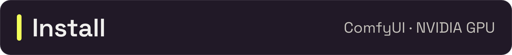</p>

ComfyUI with App mode, an NVIDIA GPU (48 GB recommended) and about 60 GB of models. Or [try it in your browser](https://claude.ai/artifact/GwtC3yFZtGCsTsiPGbvnAq) first.

<details>
<summary><b>Install steps, run it, headless, tests</b></summary>

### Try it

- **App demo:** https://claude.ai/artifact/GwtC3yFZtGCsTsiPGbvnAq. This is the real App UI running in the browser on a stand-in ComfyUI, replaying real GPU renders: Western, Car chase, Horror, Kaiju and a flashlight search. Every step, from the 3D stage to the FLUX 3 Klein frame to the LTX video, the Cut and the exports. No install needed.

This link only opens for other people once the owner shares them publicly.

### Install

**Requirements**

- ComfyUI, a recent version with App mode.
- An NVIDIA GPU. 48 GB of VRAM is recommended (tested on an RTX 6000 Ada). 24 GB cards need offloading and are untested.
- About 60 GB of disk for the models.
- The stage, the Look tab and the Edit tab (the Cut) run in any browser and need no GPU models.

**Steps**

```bash
cd ComfyUI/custom_nodes
git clone https://github.com/theboord/ComfyUI-Soundstage
git clone https://github.com/Lightricks/ComfyUI-LTXVideo
git clone https://github.com/facok/comfyui-krea2-controlnet
pip install -r ComfyUI-Soundstage/requirements.txt
pip install -r ComfyUI-LTXVideo/requirements.txt
```

Use the same Python environment that runs ComfyUI. Then download the models listed in [MODELS.md](MODELS.md) into `ComfyUI/models/`. Some repos are gated: accept the license on Hugging Face first, then `hf auth login`.

**Linux / RunPod:** one script installs the node packs, copies the workflows and downloads the models:

```bash
bash ComfyUI/custom_nodes/ComfyUI-Soundstage/tools/install_runpod.sh /path/to/ComfyUI
# SKIP_MODELS=1 to install the node packs only; SKIP_LLM=1 to skip the optional Qwen3.5 file
```

### Run it locally

1. Start ComfyUI as usual (`python main.py`) and open it in the browser.
2. Load a workflow from `example_workflows/` (drag the JSON onto the canvas, or copy it into `ComfyUI/user/default/workflows/` and open it from **Workflows**):
   - `Soundstage_App_Full.json`: the full App with all seven steps. Start here.
   - `Soundstage_Western.json`, `Soundstage_Car_Chase.json`, `Soundstage_In_The_Car.json`, `Soundstage_Three_In_A_Car.json`: the same App with a demo scene already blocked (riders on horses at sunset; a three-shot car chase; four in-car angles). They carry the scene and the cut, not the renders.
   - `Soundstage_App.json`: a leaner App with the ladder only.
3. Open the workflow in the graph view once, then switch to **App** mode.
4. **Set:** describe the scene or add objects and drag them into place. Add shots, move the playhead and set camera keys.
5. Press **Run** (labelled **Next**) to climb the ladder: Frame, then Motion, for every shot.
6. **Review** the shots on the Ladder (the **Compare** tab), then **Deliver**: Layer Packs are written to `ComfyUI/output/soundstage_layerpacks/`, and the Edit tab renders one video or exports to your NLE.

**Without GPU models** you can still use the stage (Set), the Look tab and the Edit tab (the Cut), including the NLE exports. Frame needs FLUX 3 Klein (or the optional Krea 2 group), Motion needs the LTX-2.5 group, and the Layer Pack uses SAM 3.1 and BiRefNet for mattes from the final frames (it falls back to the stage's own mattes without them).

#### Headless (Comfy SDK)

```bash
pip install comfy-sdk comfy-api-proxy
comfy-api-proxy start --comfyui http://127.0.0.1:8188 --port 8190
export COMFY_BASE_URL=http://127.0.0.1:8190
python tools/soundstage_sdk.py shot_api.json --rung 4 --look "Korean thriller, anamorphic" --look "70s New Hollywood"
```

`shot_api.json` is **Workflow → Export (API)** of the App with your shot blocked.

#### Tests

```bash
python3 -m pytest -q
for f in tests/js/*.test.mjs; do node --test "$f"; done
```

</details>

<details>
<summary><b>Models and licences</b></summary>

### Models and licenses

The full list, with folders, sources and licenses, is in [MODELS.md](MODELS.md). In short:

| Step | Models | License |
|---|---|---|
| Set | none | |
| Frame (default) | FLUX 3 Klein, Qwen3-VL 4B text encoder, FLUX.2 VAE | FLUX Kommunity License; Apache-2.0 |
| Frame, optional | Krea 2 Turbo + Krea 2 depth-control LoRA, Qwen Image VAE (locked to the stage's depth) | Krea 2 Community License; Apache-2.0 |
| Motion | LTX-2.5 22B distilled, Gemma text encoder, LTX-2.5 video and audio VAEs, x2 latent upscaler, Layout-to-Render IC-LoRA | LTX-2 Community License; Gemma terms |
| Motion, optional | MiniMax H3 (int8 fl2va / ref2va, Qwen3-VL 32B text encoder, H3 video and audio VAEs). Off by default: pick it in ⑤ Motion's Video model list. Rich motion with its own sound, looser blocking, ~20+ min per final | MiniMax H3 Community License (region-limited, <$20M) |
| Set, optional (motion capture) | SAM 3D Body (Comfy-Org repackage `sam_3d_body_dinov3_bf16.safetensors`, in `models/detection`) | SAM License |
| Deliver (layers) | SAM 3.1, BiRefNet | SAM License; MIT |
| Optional | Qwen3.5 4B (object designer, scene agent), Chatterbox (TTS) | Apache-2.0; MIT |

Model weights are not included in this repo. Check each license before commercial use.

To add an image, video, matte or clean-plate model (one registry entry plus one adapter), see [docs/ADD_A_MODEL.md](docs/ADD_A_MODEL.md). A model added that way does not reach the 19 generation paths that build their own graphs, including the App's default final render and all audio; [docs/MODEL_AUDIT.md](docs/MODEL_AUDIT.md) lists them.

<a id="partner-footnote"></a><sup>1</sup> Partner API models (ElevenLabs, Kling, Veo, Nano Banana and the like, through ComfyUI partner nodes and your Comfy credits) are hidden by default. To list them anyway, start ComfyUI with `SOUNDSTAGE_PARTNER_MODELS=1`. A saved workflow that still names one loads fine and says so when it runs.

</details>

<details>
<summary><b>Credits</b></summary>

### Credits

- [ComfyUI](https://github.com/comfyanonymous/ComfyUI): the host app and App mode.
- [FLUX 3 Klein](https://huggingface.co/black-forest-labs) (Black Forest Labs): the first frame, cast sheets and Paint Studio fills (default).
- [Krea 2](https://huggingface.co/krea/Krea-2-Turbo) (Comfy-Org repackage) and the [Krea 2 depth ControlNet](https://github.com/facok/comfyui-krea2-controlnet): the optional depth-locked first frame.
- [LTX-2.5](https://huggingface.co/Lightricks/LTX-2.5) and the [Layout-to-Render IC-LoRA](https://huggingface.co/Lightricks/LTX-2.5-22b-IC-LoRA-Layout-To-Render) by Lightricks, via [ComfyUI-LTXVideo](https://github.com/Lightricks/ComfyUI-LTXVideo): video with sound.
- [MiniMax H3](https://huggingface.co/MiniMaxAI/MiniMax-H3) by MiniMax: the optional second video engine, with its own sound.
- Gemma (LTX text encoder) and Qwen3-VL / Qwen3.5 (Krea text encoder, object designer, scene agent).
- [SAM 3D Body](https://huggingface.co/Comfy-Org/sam-3d-body) by Meta (ComfyUI core nodes): motion capture from video onto the clay actors. Demo clips from [Pexels](https://www.pexels.com/license/) (free licence).
- [SAM 3.1](https://huggingface.co/facebook/sam3) by Meta and [BiRefNet](https://github.com/ZhengPeng7/BiRefNet): mattes for the Layer Pack.
- Chatterbox by Resemble AI (open TTS).
- [three.js](https://threejs.org) and [Spark](https://sparkjs.dev): the 3D stage and splat rendering.
- [Quaternius](https://quaternius.com): the CC0 horse and car models.
- [Lucide](https://lucide.dev): icons. [Space Grotesk](https://fonts.google.com/specimen/Space+Grotesk): the UI font.

Vendored components and their licenses are listed in [THIRD_PARTY_NOTICES.md](THIRD_PARTY_NOTICES.md).

</details>

<details>
<summary><b>Docs</b></summary>

### Docs

- [decisions.md](docs/decisions.md): the development log, with every design decision and its reason.
- Components: [director](docs/director.md), [mcp](docs/mcp.md), [quality](docs/quality.md), [look](docs/look.md), [agent](docs/agent.md), [advisor](docs/advisor.md), [coach](docs/coach.md), [layerpack](docs/layerpack.md), [cut](docs/cut.md), [audio](docs/audio.md), [recast](docs/recast.md), [vcam](docs/vcam.md), [router](docs/router.md), [assets3d](docs/assets3d.md), [interop](docs/interop.md), [oneclick](docs/oneclick.md), [swim](docs/swim.md), [performance](docs/performance.md), [ripple](docs/ripple.md), [touchup](docs/touchup.md), [video2stage](docs/video2stage.md), [floorplan](docs/floorplan.md), [canvas](docs/canvas.md), [source_fidelity](docs/source_fidelity.md).
- [QUICKSTART.md](docs/QUICKSTART.md): a first shot, then a one-page scene.

</details>

**Licence:** MIT for the code in this repo; see [LICENSE](LICENSE). Models and node packs keep their own licenses; see [MODELS.md](MODELS.md) and [THIRD_PARTY_NOTICES.md](THIRD_PARTY_NOTICES.md). Previz figures are deliberately faceless and no real person's likeness is used. Clone voices only with consent.
