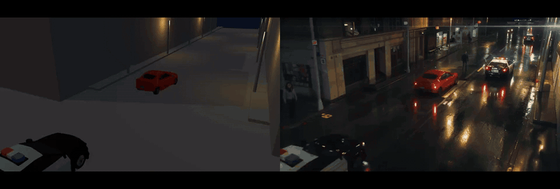
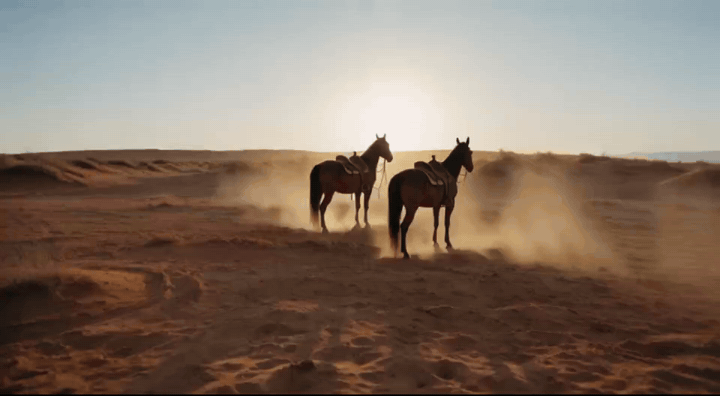
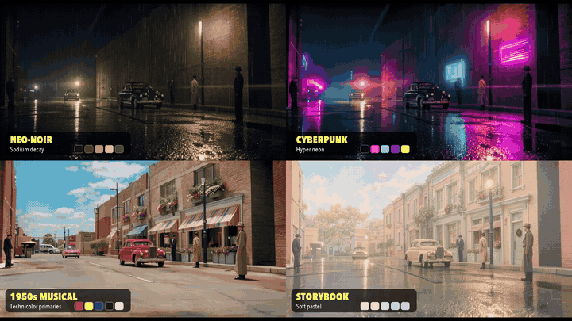
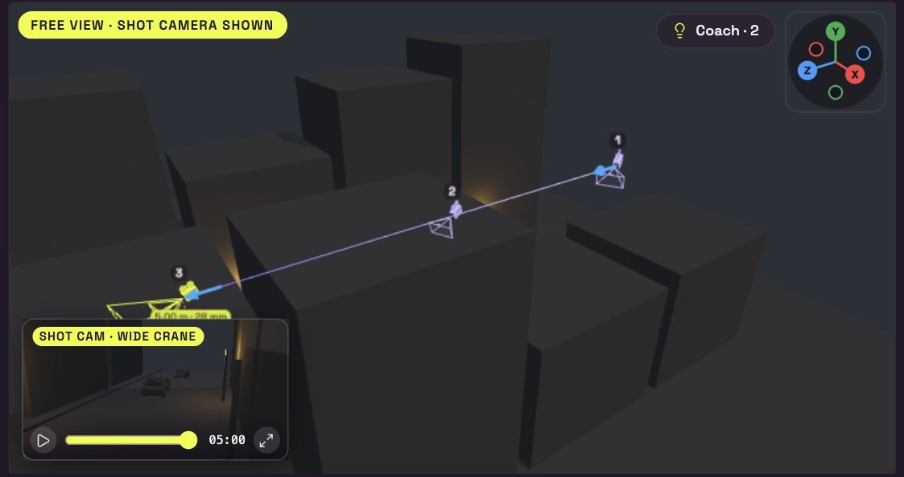
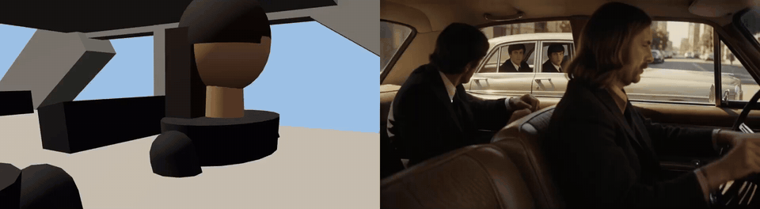
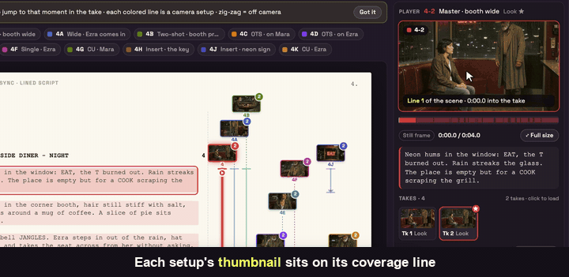
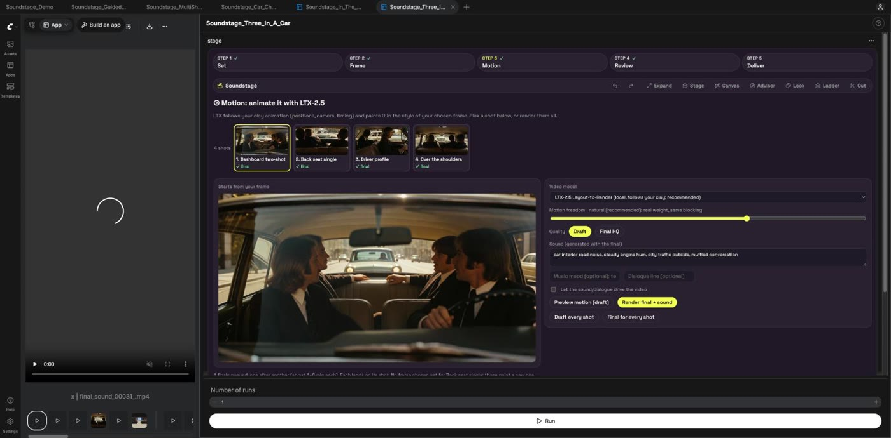

<h1 align="center">
<picture>
  <source media="(prefers-color-scheme: dark)" srcset="docs/media/logo.svg">
  
</picture>
</h1>

<p align="center"><b>A film set inside ComfyUI. Script in, finished scene out, on 100% open weights.</b></p>

<p align="center">
<a href="LICENSE"></a>
<a href="https://github.com/comfyanonymous/ComfyUI"></a>
<a href="MODELS.md"></a>
<a href="https://x.com/hashtag/OpenSourceHiggsfield"></a>

<a href="CHANGELOG.md"></a>
<a href="https://github.com/theboord/ComfyUI-Soundstage/commits/main"></a>
</p>

<p align="center"><b>Built in 3 days. This is only the beginning:</b> more features are coming. &#11088; Star the repo and build with us.</p>

Import your screenplay. Cast it. Block every scene in 3D clay with real camera rigs, then watch FLUX 3 Klein paint the frame and LTX-2.5 bring it to life **with sound, following your blocking shot for shot**. Approve takes like dailies and hand the cut to Premiere, Avid or Resolve. No cloud, no credits, no paid API: it all runs locally in ComfyUI.<sup>[1](#partner-footnote)</sup>

<p align="center"></p>
<p align="center"><em>Left: the 3D stage's clay render. Right: what Soundstage renders from it. Same blocking, same camera.</em></p>

<p align="center">
<a href="docs/media/soundstage_showcase.mp4"><b>&#9654;&#65039; Watch the trailer</b></a> &nbsp;&middot;&nbsp;
<a href="https://claude.ai/artifact/GwtC3yFZtGCsTsiPGbvnAq"><b>&#128421;&#65039; Try it in your browser</b></a> &nbsp;&middot;&nbsp;
<a href="docs/TUTORIAL.md"><b>&#128214; Read the tutorial</b></a> &nbsp;&middot;&nbsp;
<a href="#install"><b>&#9881;&#65039; Install</b></a>
</p>

<p align="center"><sub>The browser demo is the real App UI replaying real GPU renders, no install needed. Also: <a href="docs/media/soundstage_demo.mp4">the longer walkthrough</a>. Built for Comfy Org's <i>Open Source Higgsfield</i> challenge.</sub></p>

### What's new (updated continuously, times US Pacific)

| When | Update |
|---|---|
| Oct 31, 14:49 PDT | **New sets showcase:** reef diver, firefighter, airliner window and train window, rendered through the App. Scene setup frames each new set. |
| Oct 31, 14:06 PDT | **Movie car stunts:** reverse J-turn, donut and handbrake 180 in one pick; the body rolls on its springs, tyre smoke pours off the wheels, the prompts say which end leads. |
| Oct 31, 13:41 PDT | **New sets, round 2:** dense coral reef, scenery that streams past plane and train windows, real countryside out of the train window. |
| Oct 31, 13:40 PDT | **Cars face the way they drive:** lit headlights and tail lights in the guide; a test guards it. |
| Oct 31, 13:36 PDT | **Polish:** step names stay whole while a render runs; one Import video button in the App panel; the physics badge no longer covers the status line. A visual regression guard now protects every screen. |
| Oct 31, 13:20 PDT | **Live 3D:** box stacks stand rock-still until hit; cars throw crates clear. |
| Oct 31, 13:05 PDT | **GPU physics (beta):** car hits, stacks and drops solved on the graphics card without crates sinking into each other; switch it on in the Physics panel. |
| Oct 31, 13:00 PDT | **Live 3D:** dragged people walk (face the way they go, legs swing); live physics ~3x faster on busy sets. |
| Oct 31, 12:52 PDT | **Live 3D:** the point you grab stays under the cursor; the wheel lifts a prop straight up to stack it. |
| Oct 31, 12:45 PDT | **New sets:** underwater reef, burning building, airplane cabin, runway, above the clouds, train carriage and station platform, plus an airliner, a train and **Fire** on any set. |
| Oct 31, 12:37 PDT | **Live 3D:** physics stays live while you drag. People climb onto crates, mount horses and pick up props. *(in progress)* |
| Oct 31, 11:55 PDT | **Blender · Unreal · Maya · Nuke:** import a whole world as the set, and export the shot back with builder scripts. Round trip verified in Blender. |
| Oct 31, 10:09 PDT | **Physics engine:** one interface, CPU XPBD by default, [three-avbd](https://github.com/sbobyn/three-avbd) GPU as experimental. |
| Oct 31, 03:07 PDT | **Polish:** see-through car glass (seated actors show), cleaner labels, Voice Change seeds. |
| Oct 31, 02:13 PDT | **Stage physics:** drop, tumble and crash props, then bake them to keys. |
| Oct 31, 01:09 PDT | **Ripple edit and Pose follow:** change one frame and the whole shot follows. |
| Oct 31, 00:47 PDT | **ScriptSync:** take thumbnails on the lined script; click a line to play. |
| Oct 30, 19:23–23:07 PDT | **One giant canvas**, a guided first run, cast seated in cars and on horses, real-people realism. |

Full history with every milestone: **[CHANGELOG.md](CHANGELOG.md)**.

### What you get

| | |
|---|---|
| &#128221; **Import a script** (Fountain, Final Draft, PDF, text) and get a breakdown, a scene strip and auto scene setup | &#127917; **Cast every character and location** in one click with FLUX 3 Klein, then pick who is in each shot |
| &#129521; **Block scenes in 3D clay**: actors with sculpted hair, horses, cars, props, lights and weather | &#9995; **Pose to the fingertips** in 3D with IK, or **capture motion** from any video or your webcam (SAM 3D Body) |
| &#127909; **Shoot with real camera rigs**: dolly, jib, Steadicam, handheld, drone, with a Top plan view | &#127916; **Turn any clip into a 3D set** with Video &rarr; Stage: rebuilt location, tracked camera, the performer |
| &#127912; **Paint the first frame** in Paint Studio: fill, remove, extend to any aspect | &#128266; **Animate with sound** on LTX-2.5; type a line and LTX speaks it, lip-synced |
| &#127902;&#65039; **Swap the film look** with one swatch: same animation, any look | &#9878;&#65039; **Compare Clay &#124; Draft &#124; Final** on a 3-way Ladder, approve or Redo every take |
| &#128450;&#65039; **Review as dailies**: Avid-style scene bins and a lined script | &#128228; **Deliver to Premiere, Avid or Resolve** at the source spec (4K, 8K, RED via proxy relink), plus a VFX Layer Pack |

<table>
<tr>
<td width="50%"><br><sub><b>Car chase, before and after:</b> left the 3D stage, right the final. Same cars, same positions, same camera: a crane wide, then a tracking shot.</sub></td>
<td width="50%"><br><sub><b>Western:</b> riders run to rigged horses, vault on and gallop off. Two camera setups, joined into one cut.</sub></td>
</tr>
</table>

<p align="center"></p>
<p align="center"><em>Film-look swatches: one animation, four looks. Pick a swatch and the same blocking and motion come back in a new style.</em></p>

<p align="center"></p>
<p align="center"><em>Any genre: left the 3D stage, right the final. Film noir in the rain, then horror in the woods.</em></p>

<p align="center"></p>
<p align="center"><em>Motion capture into the set you already have: open your set, click a person, <b>Capture motion</b> &rarr; <b>Capture from video</b> (or <b>Act it out</b> on your webcam). The take plays on that person, right where they stand in your blocking, in your set's light and camera: body, hands, fingers and path, for the whole clip (the shot stretches to fit). SAM 3D Body runs in ComfyUI; the clay then directs LTX. Clips: Pexels, free licence.</em></p>

## Script to screen, step by step

One step bar, in production order. Every step works on every shot in the scene. Each block links to its chapter in the **[tutorial](docs/TUTORIAL.md)**.

<p align="center"></p>

### &#9312; Script: bring in your screenplay

Import Fountain, Final Draft (.fdx), PDF or plain text, or try the sample script. Each scene gets an outline, a colour-coded breakdown (cast, extras, props, vehicles, animals, wardrobe, effects, sound) and a box for your director's notes. Picking a scene puts its set, time of day, characters and vehicles on the stage by itself; **Build this scene on the stage** blocks the action and cameras too, and every scene keeps its own stage, shots and cut, so a feature-length script stays organised. *Why it matters:* everything downstream (cast, locations, slates, the cut) is named after your script. → [Tutorial: ① Script](docs/TUTORIAL.md#step-1-script)

<p align="center"></p>

### &#9313; Cast &amp; Locations: one look for every shot

Every character, location, wardrobe piece and prop from the breakdown gets a reference picture: upload a character sheet or photo, or **Generate** one with FLUX 3 Klein (front, side and back for characters). In ④ Frame, **Cast in this shot** lets you tick who and what appears in each shot; up to four pictures go to the image model, characters first. *Why it matters:* the same face, costume, car and place in every shot, which is what keeps AI coverage from falling apart. → [Tutorial: ② Cast & Locations](docs/TUTORIAL.md#step-2-cast)

<p align="center"></p>

<table>
<tr>
<td width="50%"></td>
<td width="50%"></td>
</tr>
<tr>
<td></td>
<td></td>
</tr>
<tr>
<td colspan="2" align="center"></td>
</tr>
</table>

### &#9314; Set: block it in 3D clay

A true-scale 3D stage: type what you need ("cowboy on a horse", "police car", "bedroom 4x3.5 m") or **Build with AI** from one sentence. Pose anyone in 3D (click a joint, drag a hand: IK), make them interact, or copy a real performance with **motion capture** from a clip or your webcam. **Video → Stage** rebuilds a whole clip (location, tracked camera, performer). Keyframe the camera, put it on a dolly, jib, Steadicam or handheld rig, ride along inside cars, light it with a real sun and film lights, and add setups for coverage. *Why it matters:* the clay is the director's plan, and every later step follows it exactly. → [Tutorial: ③ Set](docs/TUTORIAL.md#step-3-set) · [the 3D stage in depth](docs/TUTORIAL.md#4-the-3d-stage-in-depth)

<p align="center"></p>

<p align="center"></p>

### &#9315; Frame: paint the first frame, then perfect it

FLUX 3 Klein (or Krea 2 locked to the stage's depth) paints the first frame of every shot from your clay, keeping the framing and blocking, in any of 31 film styles with a real camera, lens and aperture picker. Generate a few, pick one, then fix it in **Paint Studio**, a small Photoshop with our own Generative Fill: Fill, Remove, Extend to any aspect, magic select (SAM 3.1), layers, history and before/after variations. *Why it matters:* the video inherits everything in this frame, so a ten-second fix here saves a re-render. → [Tutorial: ④ Frame](docs/TUTORIAL.md#step-4-frame)

<p align="center"></p>

<p align="center"></p>

### &#9316; Motion: animate it with sound

LTX-2.5 Layout-to-Render animates each shot from its frame, following your clay: positions, camera, timing. **Draft** (quick look), **Final** (the default) or **Final HQ** (hero shots); one shot or every shot. Sound effects and music are generated with the final, and typing a **dialogue line** turns on audio-driven lip sync, so the mouth follows the words. MiniMax H3 is an optional second engine. *Why it matters:* the motion is directed, not hoped for. → [Tutorial: ⑤ Motion](docs/TUTORIAL.md#step-5-motion)

<p align="center"></p>

### &#9317; Review: the Ladder, plus dailies

The Ladder compares the same frame across stages with a **3-way slider**: Clay (or Color) | Draft | Final, two handles you drag across the picture, every layer cropped to line up. Wipe, side by side and fade too. *Why it matters:* you see at a glance whether the final still matches your blocking. → [Tutorial: ⑥ Review](docs/TUTORIAL.md#step-6-review)

<table>
<tr>
<td width="50%"></td>
<td width="50%"></td>
</tr>
</table>

**Dailies and the lined script.** Every render is a take: setups slated like a real shoot (12, 12A, 12B), circled takes, frame and list views. Approve each frame, draft and final, or mark it **Needs changes** with a note and send it straight back to Frame or Motion. The lined script draws each setup's coverage over the page, ScriptSync-style (zig-zag = off camera); click a line to play that take from that point. → [Tutorial: Dailies](docs/TUTORIAL.md#dailies-and-the-lined-script)

<p align="center"></p>

**ScriptSync (lined script).** Like Avid ScriptSync: each setup's thumbnail sits at the top of its coverage line on the script page. Click any line and that take loads in the player beside the page, cued to that moment; the setup's takes are listed under it to swap. **Edit lining** fixes a wrong line: drag its ends, flip a stretch on or off camera, add or delete a line, undo. The lining saves with the workflow. Open it from **Tools → ScriptSync**, the Takes view, or a scene in ① Script. → [Tutorial: ScriptSync](docs/TUTORIAL.md#scriptsync-lined-script)

<p align="center"></p>

### &#9318; Deliver: the cut, your NLE, and layers for VFX

A real timeline over your coverage with J/K/L, splits, ripple, match action and audio tracks; right-click any clip to **edit its original** in the step that made it. **Cut → one video** joins the whole scene with sound. Export to Avid (EDL, markers), Premiere XML, FCPXML and OTIO, or write a **Layer Pack**: per-actor ProRes 4444 layers with mattes, depth EXRs, the exact camera, and builders for After Effects, Nuke, Blender, Resolve and Photoshop. *Why it matters:* it ends in the tools post-production already uses. → [Tutorial: ⑦ Deliver](docs/TUTORIAL.md#step-7-deliver)

**What goes in goes out the same:** imported footage keeps its own spec. NLE exports link the camera original with its own timecode, frame rate and reel, and Layer Packs render at the source size, frame rate and timecode. RED, BRAW and ARRIRAW work through a proxy that relinks to the original, and anything that can't match is written into the export. → [Source fidelity](docs/source_fidelity.md)

<p align="center"></p>

<p align="center"><br><em>All of it runs inside ComfyUI's App mode, on open models on your own GPU.</em></p>

## Bring your world in, send it back out (Blender · Unreal · Maya · Nuke)

**In.** In ③ Set, **Import world…** makes a whole location the Set. It takes GLB, glTF, FBX or OBJ from Blender,
Unreal, Maya or Sketchfab, or a Gaussian splat. Units and up axis come from the file (glTF, FBX GlobalSettings) or
from the geometry. Blender is m and Z up; Unreal FBX is cm and Z up; Maya is cm and Y up. The main floor goes on the
stage floor, and the panel reads *This world is 120 m × 80 m, 15 m tall*, with a one-click **Fix scale** when the
size looks wrong.

- **Physics.** The meshes become box colliders, so people stand on the floors, crates land on tables and stop at
  walls, and doorways stay open.
- **Cameras and animation.** Cameras in the file become shots, animated ones included. Animated objects play on the
  timeline.
- **Heavy worlds.** Static meshes are merged by material, with far LODs. A 4,201-object, 1.85 M-triangle town
  renders in 2.8 ms a frame instead of 21–29 ms.
- **Camera files.** A Nuke or Maya `.chan`, or a camera.json, comes in as a shot.

**Out.** In ⑦ Deliver, **Export for Blender · Unreal · Maya · Nuke** downloads one zip. It holds the staged shot as
an animated GLB (every move baked to keys, plus the camera with its lens), camera.json and `.chan`, a frame-one OBJ,
and a builder script for each app:

- **Blender:** camera, sensor, frame range, fps, resolution, and the Layer Pack plates as the camera background.
- **Unreal:** a CineCameraActor and a Level Sequence.
- **Maya:** an animated camera with rotate order zxy.
- **Nuke:** a Camera, ReadGeo and ScanlineRender.

**What was verified.** Both directions were run headless in **Blender 4.3**:

- Blender → Soundstage: silhouette IoU 0.994–1.000 against Blender's own camera.
- Soundstage → Blender: IoU 0.995–0.999, with outlines within 0.5 px of the Soundstage clay frame.

The Unreal, Maya and Nuke scripts are **untested in those apps**. Their maths (axes, centimetres, rotators, ZXY
rotations, film backs, frame rates) is unit-tested. → [Interop](docs/interop.md)

## The seven steps

The App has one step bar, in production order. Every step works on every shot in the scene; with a script, every step has a scene switcher.

1. **Script.** Optional. Import a screenplay; browse it scene by scene (outline, breakdown, page, director's notes). Each scene keeps its own stage, shots and cut. No writing tools: it is your script.
2. **Cast & Locations.** Characters, props and locations from the breakdown (or the stage), each with a reference picture (upload or generate). They become the image model's references.
3. **Set.** Block the scene in 3D: cast, set, light, cameras and timing. Add several camera setups to cover the scene.
4. **Frame.** Paint the first frame of each shot from its clay render with FLUX 3 Klein (default) or Krea 2 + stage depth.
5. **Motion.** Animate each shot with LTX-2.5 Layout-to-Render, with sound. The video follows the staged blocking and camera. LTX is the default; MiniMax H3 is an optional second engine in the same list (richer motion and its own sound, looser blocking, slower), with first + last frame, reference images and the clay as a motion reference.
6. **Review.** Scrub clay, frame, draft and final for each shot on the Ladder, with a wipe/fade compare.
7. **Deliver.** Export a Layer Pack for VFX, assemble the cut into one video, or export the edit to your NLE.

ComfyUI's cache means each Run only does the new work.

## Features

- **Script import.** Fountain, Final Draft, PDF or plain text: scenes, outlines, a breakdown sheet per scene, director's notes, a scene switcher in every step, scene numbers in the cut and NLE export.
- **Cast & Locations.** Reference sheets per character, prop and location, generated with FLUX 3 Klein or uploaded; they flow into the Frame step's references by name.
- **Pose in 3D and Pose Studio.** Click a body part to turn it, drag hands and feet (IK), or use a slider for every joint and finger knuckle; a pose gallery; interactions between people, animals and objects (look at, talk, shake hands, hug, hold hands, point, pet, lead by the reins).
- **Motion capture.** Capture from video or act it out on the webcam: SAM 3D Body (ComfyUI core) retargets body, hands and fingers onto the clay actor, with the path and the jumps.
- **Video → Stage.** A clip becomes a 3D scene: location mesh, tracked camera, set pieces and the performer on the rebuilt floor, dressed from the vision model's description.
- **Paint Studio.** Inpaint and outpaint the first frame with Soundstage's own Generative Fill nodes (`SoundstageFill`, crop and stitch): fill, remove, replace with a reference, extend to any aspect.
- **Camera rigs.** Real camera supports with their physics, deterministic per frame, so the clay, the frame and the video all see the same move.
- **Dailies and ScriptSync.** Setups and takes as an Avid-style bin with circled takes; ScriptSync (lined script): thumbnails on the coverage lines, click a line to play that take from there, editable lining.
- **Tool dock.** Every Set feature has a labelled icon (Build with AI, Add object, Person, Interact, Capture motion, Video → Stage, Photo → 3D, Camera, Set & weather, Lighting, Phone camera).
- **Multi-shot through every step.** One scene, several camera setups. Frame, Motion, Review and Deliver all run per shot.
- **3D stage.** Add objects by name ("cowboy on a horse", "police car"). Riders sit astride horses, bikes and motorcycles. Sets include a plaza, a night street, interiors, a studio, forest, desert, beach and a water tank, with rain, snow, fog, smoke, dust and sparks. GLB import and export.
- **Rigged CC0 models.** A rigged horse (idle, walk, gallop) and three cars (hatchback, police car, sports car) by Quaternius, CC0.
- **Flashlight prop.** A handheld flashlight with a real beam. Drag it onto a person to hand it to them.
- **In-car camera presets.** The shot camera can ride along inside a vehicle, with interior framings. **＋ All interior shots** adds one shot per interior angle in a single click.
- **Camera.** Real lenses and aspect ratios (1.85, 2.39, 16:9, 9:16 and more), Catmull-Rom keyframes, free-fly view. A virtual camera turns a phone, iPad, Quest or Vision Pro into the shot camera; its stabilizer smooths your move rather than replacing it.
- **Light.** Solar-accurate time of day for any place and date. Film lights (key, fill, rim, practical, spot, neon) with Kelvin, power and softness.
- **Look tab.** 31 genre style presets and 18 ASC-style lighting setups (three-point, Rembrandt, low-key noir, book light and more), plus camera body, lens, film stock, era and grade. It compiles the still prompt and the LTX motion prompt from the stage itself.
- **Coach.** Watches the stage, the cut and the App and shows at most two small cards: what looks wrong, why, and a one-click fix. It never blocks a Run. See [docs/coach.md](docs/coach.md).
- **Director's Advisor.** Turns a scene description into a shot list with the reasoning, citing a film-language knowledge base. See [docs/advisor.md](docs/advisor.md).
- **Scene agent.** "Describe your scene" builds the stage; then edit it by chat. See [docs/agent.md](docs/agent.md).
- **Cut editor.** A timeline over your coverage with J/K/L and temp sound. Right-click a clip and choose **edit original** to jump back to the step that made it (stage, frame, touch-up or motion), then return to the cut. Exports one video, Avid EDL and markers, Premiere XML, FCPXML, OTIO and AAF. See [docs/cut.md](docs/cut.md).
- **Layer Pack.** Per-object mattes, PNG/EXR/ProRes 4444 layers, depth AOVs and the exact staged camera as `.chan`/JSON, with builders for After Effects, Nuke, Blender, Resolve and Photoshop. See [docs/layerpack.md](docs/layerpack.md).
- **Audio department.** DX/FX/MX tracks; TTS, voice clone and voice change (Chatterbox, open weights). Audio can drive the video. See [docs/audio.md](docs/audio.md).
- **Footage and Recast.** Bring in real footage and recast one person; the plate and its audio stay real. See [docs/recast.md](docs/recast.md).
- **Model router.** Stage-aware model pickers with license badges. See [docs/router.md](docs/router.md).
- **Headless runner.** `tools/soundstage_sdk.py` renders a saved shot through the Comfy SDK.

## Try it

- **App demo:** https://claude.ai/artifact/GwtC3yFZtGCsTsiPGbvnAq. This is the real App UI running in the browser on a stand-in ComfyUI, replaying real GPU renders: Western, Car chase, Horror, Kaiju and a flashlight search. Every step, from the 3D stage to the FLUX 3 Klein frame to the LTX video, the Cut and the exports. No install needed.

This link only opens for other people once the owner shares them publicly.

## Install

**Requirements**

- ComfyUI, a recent version with App mode.
- An NVIDIA GPU. 48 GB of VRAM is recommended (tested on an RTX 6000 Ada). 24 GB cards need offloading and are untested.
- About 60 GB of disk for the models.
- The stage, Look tab and Cut tab run in any browser and need no GPU models.

**Steps**

```bash
cd ComfyUI/custom_nodes
git clone https://github.com/theboord/ComfyUI-Soundstage
git clone https://github.com/Lightricks/ComfyUI-LTXVideo
git clone https://github.com/facok/comfyui-krea2-controlnet
pip install -r ComfyUI-Soundstage/requirements.txt
pip install -r ComfyUI-LTXVideo/requirements.txt
```

Use the same Python environment that runs ComfyUI. Then download the models listed in [MODELS.md](MODELS.md) into `ComfyUI/models/`. Some repos are gated: accept the license on Hugging Face first, then `hf auth login`.

**Linux / RunPod:** one script installs the node packs, copies the workflows and downloads the models:

```bash
bash ComfyUI/custom_nodes/ComfyUI-Soundstage/tools/install_runpod.sh /path/to/ComfyUI
# SKIP_MODELS=1 to install the node packs only; SKIP_LLM=1 to skip the optional Qwen3.5 file
```

## Run it locally

1. Start ComfyUI as usual (`python main.py`) and open it in the browser.
2. Load a workflow from `example_workflows/` (drag the JSON onto the canvas, or copy it into `ComfyUI/user/default/workflows/` and open it from **Workflows**):
   - `Soundstage_App_Full.json`: the full App with the five steps. Start here.
   - `Soundstage_Western.json`, `Soundstage_Car_Chase.json`, `Soundstage_In_The_Car.json`, `Soundstage_Three_In_A_Car.json`: the same App with a demo scene already blocked (riders on horses at sunset; a three-shot car chase; four in-car angles). They carry the scene and the cut, not the renders.
   - `Soundstage_App.json`: a leaner App with the ladder only.
3. Open the workflow in the graph view once, then switch to **App** mode.
4. **Set:** describe the scene or add objects and drag them into place. Add shots, move the playhead and set camera keys.
5. Press **Run** (labelled **Next**) to climb the ladder: Frame, then Motion, for every shot.
6. **Review** the shots on the Ladder, then **Deliver**: Layer Packs are written to `ComfyUI/output/soundstage_layerpacks/`, and the Cut tab renders one video or exports to your NLE.

**Without GPU models** you can still use the stage (Set), the Look tab and the Cut tab, including the NLE exports. Frame needs FLUX 3 Klein (or the optional Krea 2 group), Motion needs the LTX-2.5 group, and the Layer Pack uses SAM 3.1 and BiRefNet for mattes from the final frames (it falls back to the stage's own mattes without them).

### Headless (Comfy SDK)

```bash
pip install comfy-sdk comfy-api-proxy
comfy-api-proxy start --comfyui http://127.0.0.1:8188 --port 8190
export COMFY_BASE_URL=http://127.0.0.1:8190
python tools/soundstage_sdk.py shot_api.json --rung 4 --look "Korean thriller, anamorphic" --look "70s New Hollywood"
```

`shot_api.json` is **Workflow → Export (API)** of the App with your shot blocked.

### Tests

```bash
python3 -m pytest -q
for f in tests/js/*.test.mjs; do node --test "$f"; done
```

## Models and licenses

The full list, with folders, sources and licenses, is in [MODELS.md](MODELS.md). In short:

| Step | Models | License |
|---|---|---|
| Set | none | |
| Frame (default) | FLUX 3 Klein, Qwen3-VL 4B text encoder, FLUX.2 VAE | FLUX Kommunity License; Apache-2.0 |
| Frame, optional | Krea 2 Turbo + Krea 2 depth-control LoRA, Qwen Image VAE (locked to the stage's depth) | Krea 2 Community License; Apache-2.0 |
| Motion | LTX-2.5 22B distilled, Gemma text encoder, LTX-2.5 video and audio VAEs, x2 latent upscaler, Layout-to-Render IC-LoRA | LTX-2 Community License; Gemma terms |
| Motion, optional | MiniMax H3 (int8 fl2va / ref2va, Qwen3-VL 32B text encoder, H3 video and audio VAEs). Off by default: pick it in ③ Motion's Video model list. Rich motion with its own sound, looser blocking, ~20+ min per final | MiniMax H3 Community License (region-limited, <$20M) |
| Set, optional (motion capture) | SAM 3D Body (Comfy-Org repackage `sam_3d_body_dinov3_bf16.safetensors`, in `models/detection`) | SAM License |
| Deliver (layers) | SAM 3.1, BiRefNet | SAM License; MIT |
| Optional | Qwen3.5 4B (object designer, scene agent), Chatterbox (TTS) | Apache-2.0; MIT |

Model weights are not included in this repo. Check each license before commercial use.

<a id="partner-footnote"></a><sup>1</sup> Partner API models (ElevenLabs, Kling, Veo, Nano Banana and the like, through ComfyUI partner nodes and your Comfy credits) are hidden by default. To list them anyway, start ComfyUI with `SOUNDSTAGE_PARTNER_MODELS=1`. A saved workflow that still names one loads fine and says so when it runs.

## Credits

- [ComfyUI](https://github.com/comfyanonymous/ComfyUI): the host app and App mode.
- [FLUX 3 Klein](https://huggingface.co/black-forest-labs) (Black Forest Labs): the first frame, cast sheets and Paint Studio fills (default).
- [Krea 2](https://huggingface.co/krea/Krea-2-Turbo) (Comfy-Org repackage) and the [Krea 2 depth ControlNet](https://github.com/facok/comfyui-krea2-controlnet): the optional depth-locked first frame.
- [LTX-2.5](https://huggingface.co/Lightricks/LTX-2.5) and the [Layout-to-Render IC-LoRA](https://huggingface.co/Lightricks/LTX-2.5-22b-IC-LoRA-Layout-To-Render) by Lightricks, via [ComfyUI-LTXVideo](https://github.com/Lightricks/ComfyUI-LTXVideo): video with sound.
- [MiniMax H3](https://huggingface.co/MiniMaxAI/MiniMax-H3) by MiniMax: the optional second video engine, with its own sound.
- Gemma (LTX text encoder) and Qwen3-VL / Qwen3.5 (Krea text encoder, object designer, scene agent).
- [SAM 3D Body](https://huggingface.co/Comfy-Org/sam-3d-body) by Meta (ComfyUI core nodes): motion capture from video onto the clay actors. Demo clips from [Pexels](https://www.pexels.com/license/) (free licence).
- [SAM 3.1](https://huggingface.co/facebook/sam3) by Meta and [BiRefNet](https://github.com/ZhengPeng7/BiRefNet): mattes for the Layer Pack.
- Chatterbox by Resemble AI (open TTS).
- [three.js](https://threejs.org) and [Spark](https://sparkjs.dev): the 3D stage and splat rendering.
- [Quaternius](https://quaternius.com): the CC0 horse and car models.
- [Lucide](https://lucide.dev): icons. [Space Grotesk](https://fonts.google.com/specimen/Space+Grotesk): the UI font.

Vendored components and their licenses are listed in [THIRD_PARTY_NOTICES.md](THIRD_PARTY_NOTICES.md).

## Docs

- [decisions.md](docs/decisions.md): the development log, with every design decision and its reason.
- Components: [look](docs/look.md), [agent](docs/agent.md), [advisor](docs/advisor.md), [coach](docs/coach.md), [layerpack](docs/layerpack.md), [cut](docs/cut.md), [audio](docs/audio.md), [recast](docs/recast.md), [vcam](docs/vcam.md), [router](docs/router.md), [assets3d](docs/assets3d.md), [interop](docs/interop.md).

## License

MIT for the code in this repo; see [LICENSE](LICENSE). Models and node packs keep their own licenses; see [MODELS.md](MODELS.md) and [THIRD_PARTY_NOTICES.md](THIRD_PARTY_NOTICES.md). Previz figures are deliberately faceless and no real person's likeness is used. Clone voices only with consent.
