# Soundstage Quickstart

Your first shot in about ten minutes (seven of them are the GPU working), then a whole one-page scene from script to delivery. Every picture is the real App on the built-in demo scene.

For every panel and button in depth, see the [complete tutorial](TUTORIAL.md).

**Contents:** [Four rules](#four-rules-before-you-click-anything) · [Quickstart](#quickstart-your-first-shot) · [First scene: Last Light at the Pump](#first-scene-last-light-at-the-pump) · [Story 2: The Chase](#story-2-the-chase) · [Known rough edges](#known-rough-edges)

---

## Four rules before you click anything

1. **Never click ComfyUI's own Run button** (white, at the top) or its "Click Run to get started" text. It sends the whole graph to the GPU. Soundstage has its own button for every render.
2. **One shot at a time.** Skip any button that works on many shots: "…for every shot", **Generate all missing**, **Render missing shots**. Each is a stack of GPU jobs.
3. **Esc only to close an open panel** (Presets, a pop-over, Drive, pose, the Book). With nothing open, Esc leaves the full workspace; click **Open the full workspace** to come back.
4. **Read a yellow button before you click it.** On ⑤ Motion the big yellow one is **Render final + sound**, a full render: about 8–9 minutes of GPU at the default Final quality (hover a Quality button for this GPU's estimate).

---

## Quickstart: your first shot

**0. Give the App room.** On a small or scaled display (about 1024 points wide), the top bar's right-hand buttons turn into icons and the least-used ones (Shortcuts, Book, Guide, Presets, Director, Undo, Redo) fold into a **⋯** menu. For more room, choose **System Settings → Displays → More Space**, or use a bigger display. Make the browser full screen.

**1. Load the Soundstage App.** Open ComfyUI (for example `http://127.0.0.1:8189`). If you see the node graph rather than the Soundstage side panel, open **Workflow → Browse templates**, pick **Soundstage_App** under Soundstage, then switch on **App** mode with the toggle at the top left. Do not click Run.

**2. Open the full workspace.** In the App side panel, click **Open the full workspace**.

**3. Load the demo.** A new browser opens a short Guide tour first (*1 of 6 · Start here*): click **Skip tour** (replay it from **Guide** later). On the **Let's make a shot** card, click **Try the demo scene**. The card closes and the shots appear within about 20 seconds; the stage can look empty for most of that. You get Scene 2 of the sample script *Last Light on Route 9*: a rainy night street in Dry Creek, Mara's sports car, Deputy Reed's police car and three shots (**Wide crane**, **Tracking, front 3/4**, **Chase cam (police hood)**). The card shows only on a brand-new stage: if you click *Import a script* by mistake, reload the browser tab to get it back.

<p align="center">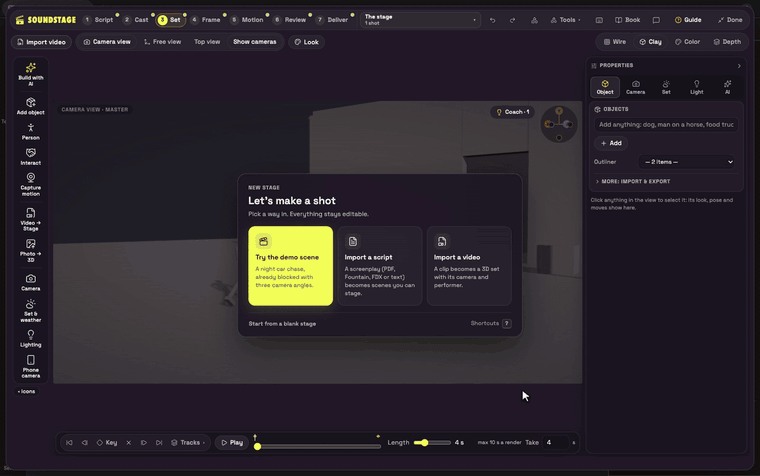</p>

**4. Turn the tips off.** Click the **Coach · N** pill at the top right of the viewport and choose **Turn tips off**. The pill stays and reads **Coach off**. The demo's tips (*Camera goes through the set*, *Mara leaves frame early*) are harmless here; the first can even flag a clean frame.

<p align="center">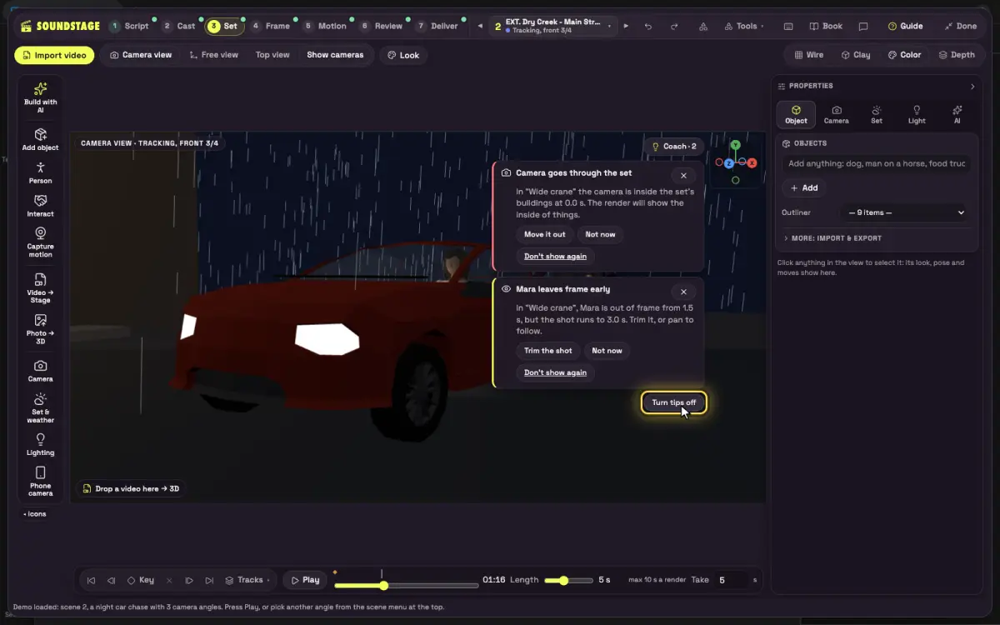</p>

**5. Check your angle, switch to Clay.** The demo opens on shot 2, **Tracking, front 3/4**, so the top bar reads **◀ 2 ▾ ▶**. If not, click **▾** (a strip of shot thumbnails opens) and click shot 2. The demo opens in **Color**: click **Clay** in the viewport's draw-mode buttons.

<p align="center">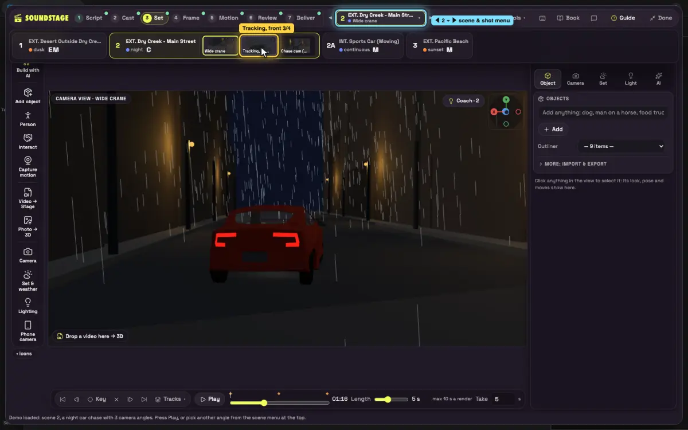</p>

**6. Give it a move.** Point at the stage and press **V** (or click **Presets** in the top bar). On **Camera moves**, hover **Push in** (its thumbnail and the shot behind the panel preview it), then click it. A toast reads *Push in · Applied to shot 2 · Undo*. Press Esc to close Presets.

<p align="center">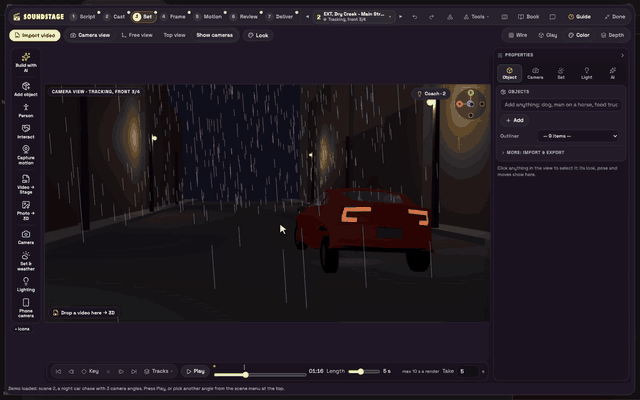</p>

**7. Check the move.** Click **Play** (it always starts from the first frame), then **Stop**. If the camera ends up inside the car (a known issue on this shot, because the car turns), press **⌘Z**, click **▾** and choose shot 1, **Wide crane**, which already cranes in down the street.

**8. Paint the first frame.** Click **④ Frame**. Leave the look box empty: the App describes the shot from your stage, and the grey text is only a hint. The defaults are Variations 4 and Standard (about 4 min); set **Variations 1** and **Fast** (about 1 min), then **Generate frames**. Wait for the frame: ⑤ says "Starts from your frame" even when there is none yet.

<p align="center">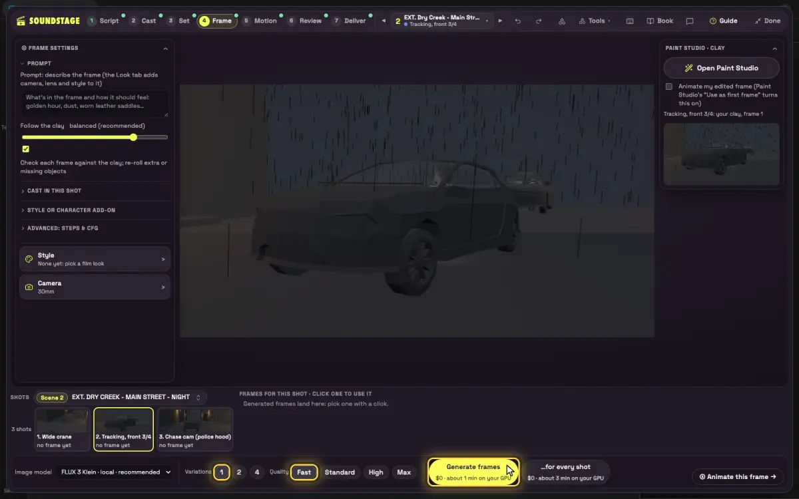</p>

**9. Animate it as a Draft.** Click **Animate this frame →**. In **⑤ Motion**, leave **Follow** on **Layout** and the model on **LTX-2.5 Layout-to-Render (local, follows your clay; recommended)**. **Quality** starts on **Final**: click **Draft**, then the grey **Preview motion (draft)** (about 3 minutes). Not the yellow **Render final + sound**.

<p align="center">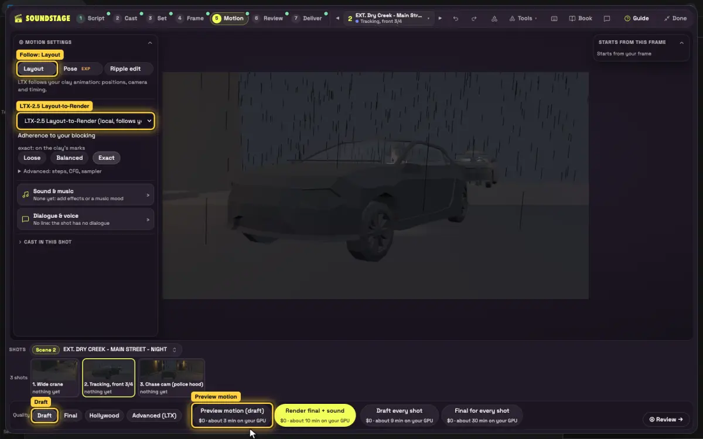</p>

**10. See clay become cinema.** Click **⑥ Review** (the shot switcher leaves the top bar here; the Ladder works on your shot). **Left**, **Middle** and **Right** are rows of buttons: click **Clay** on the left and **Draft** on the right, choose **Wipe** and drag the yellow handle. Until the draft exists, Draft is greyed out and the right side shows Color, which looks much like Clay on the demo.

<p align="center">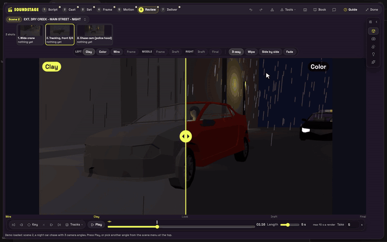</p>

<p align="center">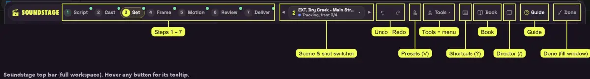</p>
<p align="center"><em>The top bar. The keyboard sheet (?) is an icon-only button; Presets and Director drop their words when the App is under 1720 px wide. Tools ▾ holds Paint Studio, Shot ideas, Look, Takes, ScriptSync (lined script), Edit and Classic layout, and renames itself to the open tool (Takes ▾, Edit ▾).</em></p>

---

## First scene: Last Light at the Pump

An original one-page scene: three shots, one location, about fifteen seconds of screen time. It reuses the demo's cast and cars, and it touches every step of the App.

**Where you build it.** ① Script is read-only in this version: it fills from an imported screenplay and has no page to type into. So you stage this scene on the demo's own street (*EXT. DRY CREEK - MAIN STREET - NIGHT*), re-dressed for dawn. The Book, ScriptSync and the cut will say Dry Creek, night; that is expected. Optional, untested here: save the page below as a plain-text `.fountain` file and use **Import a script** to give it its own heading (the stage then builds from the page's words, so the demo's cars may not come with it).

```
Title: Last Light at the Pump

EXT. ABANDONED GAS STATION - DAWN

Grey dawn. Fog off the flats. A dead neon sign over two rusted
pumps. Wooden crates are stacked by the kiosk.

MARA's vintage sports car idles at the pump. She checks the mirror.

DEPUTY REED's police car rolls in and stops across the exit, light
bar turning, no siren.

REED
(through the window)
End of the road, Mara.

Mara looks at Reed, then at the crates.

She slams it into reverse, whips the car round in a J-turn and clips
the crate stack. The crates burst across the forecourt and the car
is gone into the fog.

Reed watches the dust settle. Reed does not chase.
```

| Shot | Setup | Lens | Move | Length |
|---|---|---|---|---|
| 1 | **Wide**: the station, the police car blocking the exit, Mara at the pump | 24 mm | Static (Master) | 4 s |
| 2 | **Single on Reed**: the line, eyes locked on Mara's car | 50 mm | Slow **Push in** preset | 4 s |
| 3 | **Action wide**: the reverse J-turn and the crate crash, ending on empty fog | 28 mm | Short pan with the car | 6 s |

### ① Script (5 min)

- Click **① Script**: the demo script, *As written · read-only*. The one box you can type in is **Director's notes**: write *She chooses the crates over surrender. Reed lets her go.* It saves with the script as your note; it does not reach the Book or the AI prompts yet.
- Skip **New shot in this scene** (it adds a shot called "Setup"; your cameras come in ③).
- Click **Book** in the top bar. It opens on the scene page, with the floor plan and shot strip filled in *from the stage*. Open **Spine & statement** in its rail and write the beat there. Close with its ✕ or Esc. (The Book calls Wide crane's setups 2A/2B/2C; ScriptSync calls them 2/2A/2B.)

<p align="center">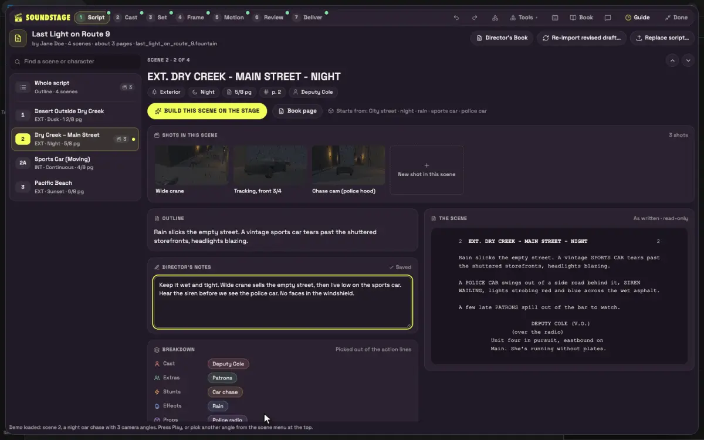</p>

### ② Cast & Locations (5 min, one GPU job)

Mara and Deputy Reed have no pictures yet (initials on a gradient, *No character sheet yet*); that is fine for clay. Type *Gas station* into **Add a location…** and click **Add** (what you type is the card's name), then click that card's **✨ Generate** icon. Never click **Generate all missing**, the bright yellow button at the top right: one GPU job per empty card, about 20.

<p align="center">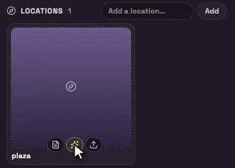</p>

### ③ Set: the blocking (15-20 min, all live, no GPU)

1. **Look.** Click **Clay**. Open **Set & weather** on the left toolbar: there is no gas-station set, so keep **City street** (or **Desert** for an open roadside). Set **Elements** to **Fog / haze** with a small **Amount**, and close the pop-over by clicking the stage, not with Esc. On the **Light** tab, set the time of day to **Dawn** (sun at −3°, blue hour). Both are subtle in Clay.
2. **Props.** **Add object** → type *crate* → Enter. *Crate 1* often lands off camera: press **0** for Free view and **F** to frame it. Add two pumps and a kiosk the same way. **⌘D** duplicates (1 m to the side); press **G**, drag a copy on top and click to drop it (no Esc while moving). Faster: **Presets → Action → Crate crash** drops six crates in the car's path and sets the car to drive straight through; the stunt in steps 4-5 replaces that path.
3. **Block the police car.** Press **0** for Free view; fly with **WASD**, **Q/E** down and up, **Shift** for speed. Drag the police car across the exit: **G** moves, **R** rotates (**Shift** snaps to 15°).
4. **Drive the stunt.** Select the sports car, press **D** (or **🎮 Drive**). **R** starts a 3-2-1 countdown and records. **Shift+S** reverses fast (about 50 km/h; plain S tops out around 15-25), add **A** for full lock, **Space** is the handbrake, **W** drives off. **R** stops, **Enter** keeps, **Backspace** discards, **Esc** leaves Drive. A take ends at the end of the shot.
5. **Or pick it.** Select the car and choose **Stunt → Reverse J-turn** (also Donut and Handbrake 180; **Presets → Action** calls it J-turn). Keep whichever take is better.

<p align="center">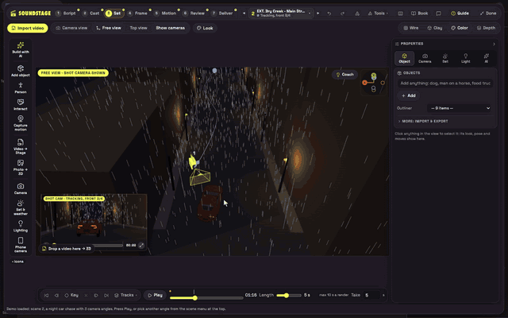</p>

6. **Crash the crates.** Select a crate, click **Physics** on its card: **Dynamic**, Material **Wood**, tick **Dust** and **Debris**, **Breakable** on, then **Simulate & bake** (CPU; leave GPU beta off). The baked keys show on the timeline while a crate is selected.

<p align="center">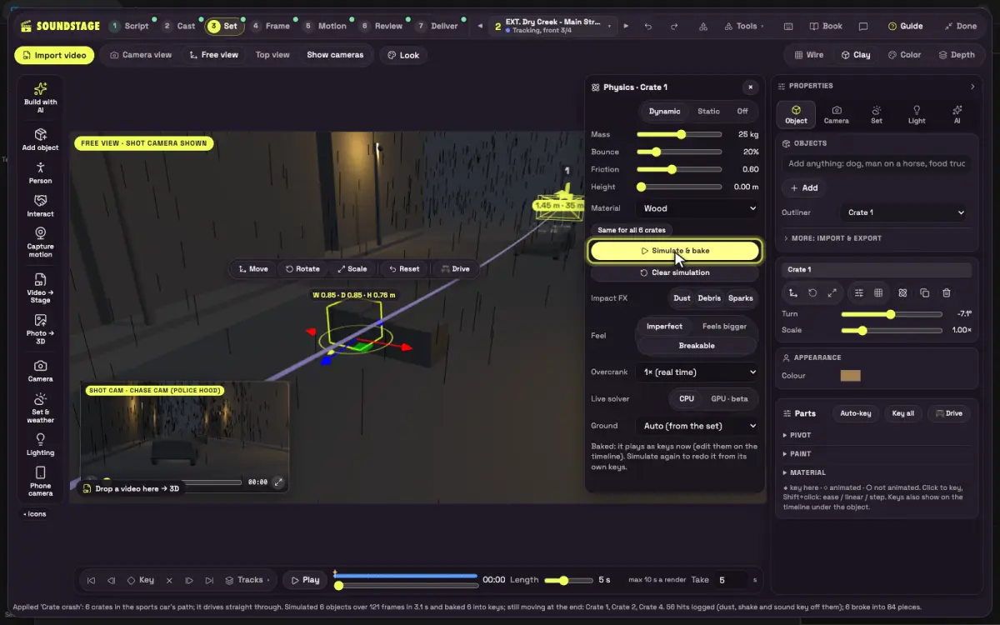</p>

7. **Aim Reed's eyes.** Select Reed, press **P**. In **Parts › Eyes** choose **At Sports car**, then **◆ Key**. Esc ends pose. If Reed is seated, choose *Get off / stand* first; she lands where the car stood, so move her clear of the police car's path (**G**) and play the shot.
8. **Cameras.** Left toolbar → **Camera** (*Lens, camera setups…*) → **New setup** drop-down: **Master** (shot 1, lens card 24), **Single A** (shot 2, lens card 50), **Wide** (shot 3: there is no 28 card, so type 28 into **Focal length**). Click **Top view** (a small inset at the bottom right; if it lights up with no inset, toggle it again), drag each camera's ◆ key into place, then **Fit**.
9. **Moves and length.** Shot 2: **V → Camera moves → Push in**. Shot 3: two camera keys (◆ Key at 0 s and at the end) for a short pan. Shots 1-2 at 4 s, shot 3 at 6 s (10 s maximum per render). On **Tracks**, each object gets a row under the shot strip; on a window under about 900 px tall only the strip fits, so press **H** to hide the panels. Leave **Render missing shots** alone.
10. **Play every shot.** Turn tips back on from the **Coach off** pill. Where a tip has a fix button (for example **Move it out** on *Camera goes through the set*) use it, and check the frame yourself: the Coach can be wrong.

<p align="center">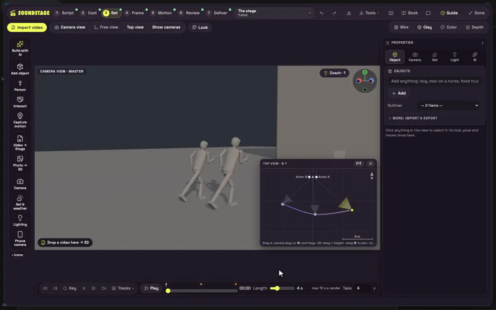</p>

### ④ Frame (one shot at a time)

Start with shot 3, the money shot. Slide **Follow the clay** high. **Camera** pop-over: **ARRI Alexa 35** and **28mm**. **Style** pop-over: a grounded look (Neo-noir or a natural dawn). **Variations 2**, **Standard**, then **Generate frames** and pick the better one. If a crate or the car is wrong: **Open Paint Studio** → magic select (W; it needs a frame first) → **Generative Fill** → **Use as first frame**, then click **④ Frame** in the step bar to go back.

### ⑤ Motion

**Animate this frame →**. Follow **Layout**, model **LTX-2.5 Layout-to-Render**, **Adherence: Exact** (the "do what I blocked" switch). Quality starts on **Final**: click **Draft**, then **Preview motion (draft)**. When the draft reads right, switch Quality to **Hollywood** and click **Render final + sound** on that one shot. Hollywood is much slower than Final: run shots 1 and 2 at Final, or queue all three before a long break.

<p align="center">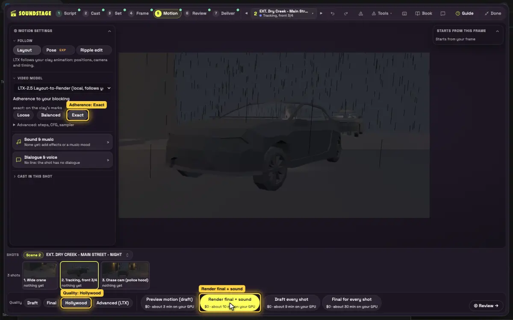</p>

### ⑥ Review

- **Ladder**: Left **Clay**, Middle **Draft**, Right **Final**; **3-way**, then **Wipe** over the J-turn.
- Read **Follows your blocking %** and the AI-slop realism judge. Under about 80%, or a slop flag: keep Exact, then raise **Follow the clay** in ④ or re-key the stunt in ③.
- **Tools ▾ → ScriptSync (lined script)** (the Tools ▾ at the right of the top bar, not the shot switcher's ▾): check every line of the page is covered by a setup. Circle the keeper with **C** in Dailies. While a tool is open, Tools ▾ renames itself (*Takes ▾*, *Edit ▾*) and the step bar stays lit on the last step.

### ⑦ Edit and deliver

- **Tools ▾ → Edit** (or **Open the editor** in ⑦). **Assemble scene** lays out the shots from the ScriptSync lining (read its message and drag in anything it left out). Cut on the car's first move into shot 3 (**M** match action), end on **Dip black**.
- Type the forecourt ambience into the sound box (its hint reads *glass shatters on a tile floor*) and click **Generate**; **Impact sounds** on the crate hit, **Auto-duck** under Reed's line, the loudness drop-down on **Social −14 LUFS**, and a title: *LAST LIGHT AT THE PUMP*.
- Render MP4 or ProRes; export **Avid EDL**, **Avid markers**, **Premiere XML**, **FCPXML** or **OTIO** (SRT needs subtitles; AAF comes only from the Cut Export node).

<p align="center">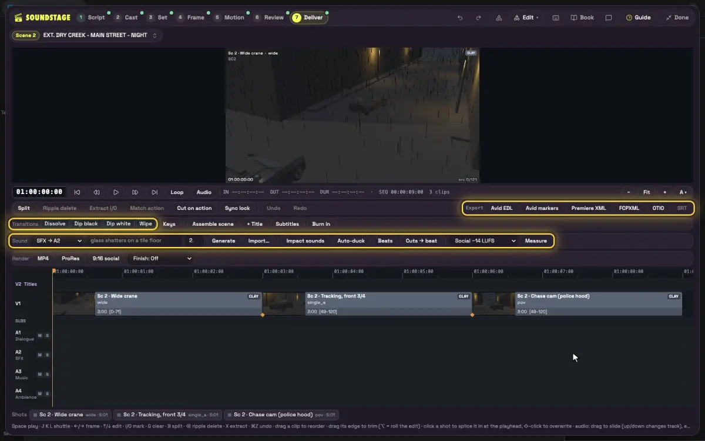</p>

- **⑦ Deliver**: **Cut → one video**, **Make the Layer Pack** (once finals exist) and **Download the DCC kit**. The Blender script is the tested path; Unreal, Maya and Nuke are untested. Skip **Render missing shots first** (every shot on the GPU).

<p align="center">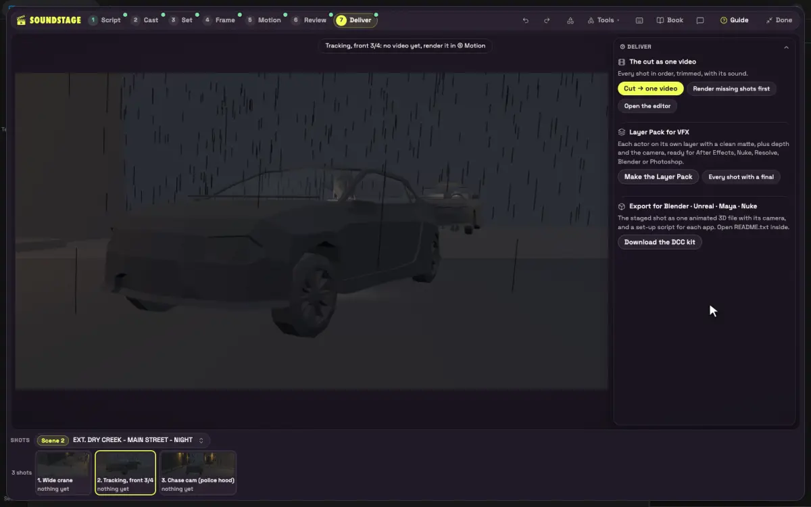</p>

---

## Story 2: The Chase

Your First Scene changed the demo's street, so start a fresh copy: **Workflow → Browse templates → Soundstage_App** opens a new tab with a brand-new stage; **Skip tour**, then **Try the demo scene**. Make its night chase your own:

- Re-block it in Drive mode with a recorded take on Mara's sports car. Start from a short run-up at about 50 km/h: the police car follows its own keys, so a slow take lets it drive through you.
- Add a **Donut** or **Handbrake 180** from **Presets → Action**.
- Select the police car: **Parts → Lights → Light bar → Flashing** (or **Shift+L** in Drive).
- Push in on the **Chase cam**, keep the rain, and take that one shot through ④ → ⑤ Draft → Final at **Adherence Exact**.

---

## Known rough edges

- **Renders wait in line.** If ④ or ⑤ shows *queued*, it is waiting for the GPU and has not failed.
- **The ■ Stop button's queue count can read wrong** until ComfyUI is restarted after an update. Ignore the number.
- **Push in on the demo's car-following shots** (*Tracking, front 3/4*, *Chase cam (police hood)*) can carry the camera into the car, because the car turns. Quickstart step 7 shows the way round it.
- **① Script has no editable page or New scene button.** A scene of your own needs an imported screenplay.
- **The demo entry** lives only on the first-run card.
- **Drive:** above about 50 km/h the follow cam can lose the car; on stop it swings into a wall for about a second; the red REC chip overlaps the take text.
- **Tracks** needs a tall window for the object rows.
- **⑤ Advanced's extra-LoRA list** shows every LoRA installed on the machine. ④'s add-on list shows only FLUX Klein LoRAs.

Next: the [complete tutorial](TUTORIAL.md) covers every control, the Director chat, Pitch Mode, Video → 3D and the keyboard cheat sheet.
