# Soundstage Quickstart

Your first shot in about ten minutes on the built-in demo, then a whole three-shot scene, *High Water*, from script to delivery. Every picture is the real App on the built-in demo (*Last Light on Route 9*, Scene 2, Dry Creek; recorded 2 Nov 2026, steps re-checked against the live App the same evening). For every panel in depth, see the [complete tutorial](TUTORIAL.md).

**Judging it?** Start with [Judging it? Start here](../README.md#judging-it-start-here) in the README, then come back here.

**Contents:** [Four rules](#four-rules-before-you-click-anything) · [Rough edges](#rough-edges-we-know-about) · [Quickstart](#quickstart-your-first-shot) · [First scene: High Water](#first-scene-high-water) · [Cheat sheet](#cheat-sheet)

---

## Four rules before you click anything

1. **Never click ComfyUI's own white Run button.** It sends the whole graph to the GPU. Soundstage has its own button for every render. The *Click Run to get started* text and white **Run** pill in the middle of the App screen are ComfyUI's own placeholder, not Soundstage's: ignore them.
2. **One shot at a time.** Skip every batch button: *Generate all missing*, *…for every shot*, *Draft every shot*, *Final for every shot*, *Render missing shots*.
3. **Esc closes the open panel, menu or pop-over first.** With nothing open, Esc (or **Done**) drops you to the narrow App panel. Click **Open the full workspace** to come back.
4. **Read a yellow button before you click it.** On ⑤ Motion the big yellow one is *Render final + sound*, about 13 minutes of GPU.

## Rough edges we know about

- **Crate crash needs commit 0d69037 (2 Nov) or later.** Older builds start the crates on the floor and throw them hundreds of metres. Update the node pack and reload the browser tab. Space-to-play on ③ Set, ⌘Z from anywhere in the workspace and Esc for the Physics panel need the same evening's update ("③ Set: Space plays the shot…" in the CHANGELOG).
- **Look doesn't change the clay viewport.** It changes the stock, lens, palette and grade that go into the render. Only the framing changes on screen.
- **Gaze is subtle on the clay figures**: a few degrees of head turn. The render shows it better.
- **After *Add anything…* + Enter, the cursor stays in the text box.** Click the stage or the new object before you press F or G, or the letters go into the box.
- **The Tools ▾ button renames itself** to the tool you opened (*Takes ▾*, *Edit ▾*). It is the same button, next to the Undo arrows.
- **The status line can go stale.** After an Undo it can still describe the last bake. Trust the stage, not the old message.
- **In Drive mode the view can stay on the shot camera** instead of following the car you drive (one test watched the red sports car while the police car drove off). Press `V` while driving to cycle the camera: chase, shot, orbit. The red REC pill can also overlap the timecode text, and the key legend can sit over the *Drop a video here* chip.
- **Physics now crashes keyed cars into each other.** With **Everything collides** on (the default, Physics panel › **World**), a car keyed through another car, a lamp or a wall crashes in **Simulate & bake** instead of passing through. Checked headless only. **Keep keyed** holds one car on its path.
- **✦ One-click's Loop, Reshoot, Open in ComfyUI and Send a move from your phone need a ComfyUI restart** after you update. Until then a card says *this server needs a restart*. No loop made so far is seamless.
- **The Cut now plays takes in real time (2 Nov evening), but only at 24 fps, and *Edit in* from the timeline isn't in this build.** Its fast proxies need `ffmpeg` on the server and a ComfyUI restart after you update; until then the Cut plays the takes themselves. The speed-up was measured on a simulated laptop, not a real one.
- **The 8 template cards have blank thumbnails** and look alike. Pick by name: **Soundstage_App**, not *Soundstage_App_Full*.
- **An Advanced hero shot at 1408p takes much longer than its estimate** (about 15–17 min, not 13). Run it during a break.
- **The Dialogue card can still say *No line*** after you type one in the pop-over. Open the pop-over again to check the line is there.
- **The take checks and the realism judge only appear on real renders.** You'll see them once your first Final exists.
- **If keys stop responding** (H, ?, P) or the Coach pill vanishes, reload the tab. Your stage is saved. In one test the Coach pill went after about 10 minutes.

---

## Quickstart: your first shot

### 0. Give the App room (1 min)

Open **System Settings → Displays** and choose **More Space**, or move the browser to a bigger screen. Since 2 Nov the App fits a 1024-wide window: buttons that don't fit fold into **⋯** at the right of the top row (at 1024 it holds the shortcuts, Book, Guide and Presets; `V` still opens Presets). But at 1024 the picture is small, so give it more room if you can.

Then reload the ComfyUI tab at `http://127.0.0.1:8189` so you start from a fresh session.

<p align="center">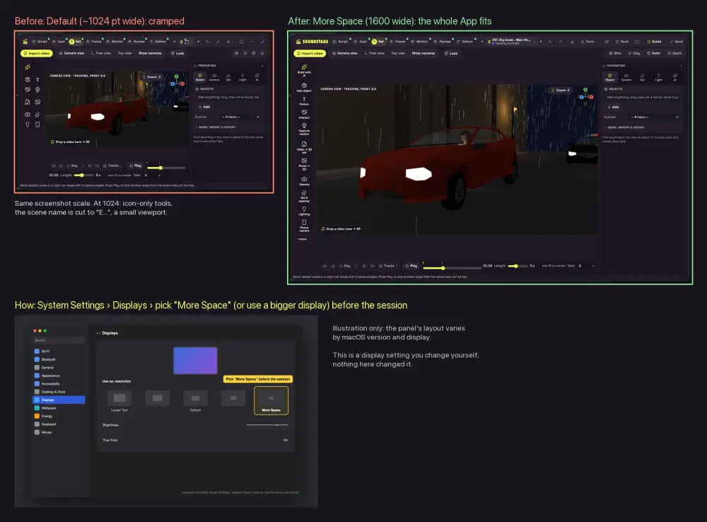</p>
<p align="center"><em>The same App at 1024 px (cramped) and at 1600 px. Use More Space or a bigger display.</em></p>

### 1. Open the App (about 90 s)

In ComfyUI open the main menu (top left) → **Browse Templates**. The list takes about 10 s to load. Scroll the left-hand list down to **Extensions** (it sits below the fold) and click **ComfyUI-Soundstage**.

You get 8 cards with the same blank thumbnail. Click the **second** one, **Soundstage_App** (not *Soundstage_App_Full*). It opens in App mode; if you see the node graph, flip the **Graph / App** toggle to App.

Click the yellow **Open the full workspace**. The *Let's make a shot* card appears.

On a fresh browser a 6-card **Guide** tour opens by itself (*1 of 6 · Start here*). Click **Next** through it or **Skip tour**. Its first card can highlight ComfyUI's Run button: look, don't press. **Guide** in the top bar brings the tour back.

> **Watch out.** Never click ComfyUI's white **Run** button under the panel, or the white Run pill in the middle of the screen. If the panel shows a red **Stop (N)**, those are other jobs on the shared pod. Leave them alone.

<p align="center">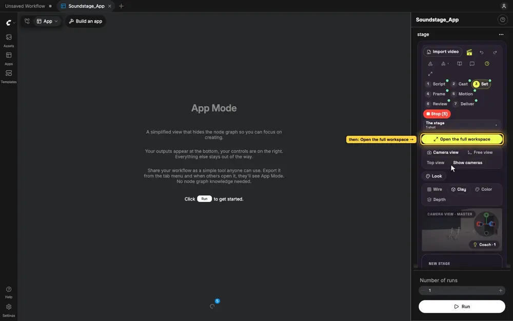</p>
<p align="center"><em>Menu → Browse Templates → Extensions → ComfyUI-Soundstage → Soundstage_App, then the yellow Open the full workspace. ComfyUI's white Run button is circled in red: never press it.</em></p>

### 2. Load a scene in one click

On the *Let's make a shot* card, click **Try the demo scene**. The demo is a short script, *Last Light on Route 9* (by the placeholder writer Jane Doe, 4 scenes). You land in Scene 2, *EXT. DRY CREEK - MAIN STREET - NIGHT*: a rainy night street, Mara's red sports car, Deputy Cole's police car and 3 shots (*Wide crane*, *Tracking, front 3/4*, *Chase cam*). Rain, night and Color mode are already on.

It usually loads in 2 to 20 s. The status line says what you got.

<p align="center">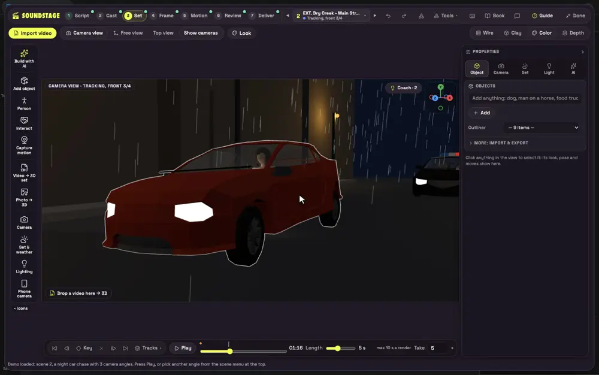</p>
<p align="center"><em>Try the demo scene. A first load can take about 20 s; the wait is sped up here.</em></p>

### 3. Look around the set

Click through steps **1** to **7** on the top bar to see the whole pipeline, then come back to **3 Set**.

Press `0` to switch between the shot camera and the free view. Start every orbit drag on empty sky or road, not on a car: a drag that starts on an object selects it and can move it. Then use `W` `A` `S` `D` to fly, and click **Top view** to see the blocking from above.

> **Watch out.** With a car selected, `D` means **Drive**, not fly right. Press `Esc` or click empty ground to deselect before you fly with WASD. If you land in Drive mode, `Esc` leaves it.

> **Lost?** Press `.` (or **⌂ Back to the set**, top left of the viewport) to see the whole set again, and `,` (**↶ Last view**) to step back to where you were. Click the viewport first so it has the keyboard. A **Lost? Back to the set** chip also appears when the camera is far off or inside a building.

<p align="center">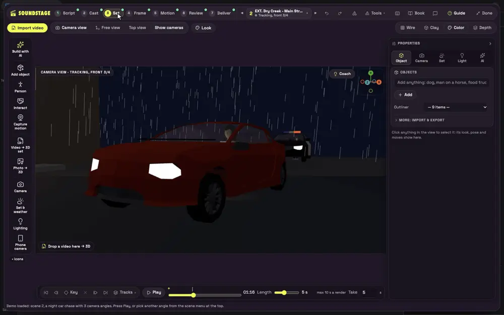</p>
<p align="center"><em>The seven steps on the top bar. A green dot means that step is installed and ready, not that you have done it.</em></p>

<p align="center">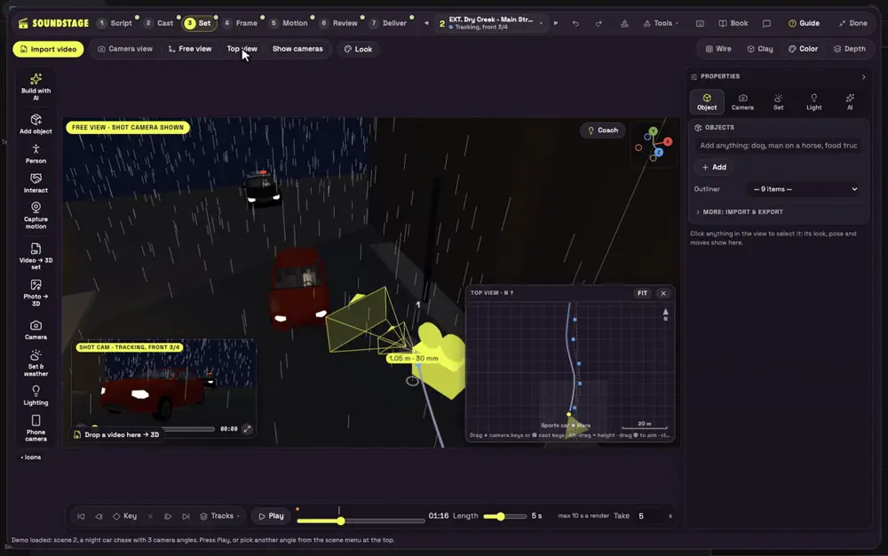</p>
<p align="center"><em>0 switches shot camera and free view, drag orbits, WASD flies, Top view opens the inset.</em></p>

### 4. Direct with Presets

Press `V` (or click **Presets**). On **Camera moves** (the tabs show counts, like *Camera moves 11*), hover a card to preview it in the shot-camera inset, then click **Crane up**. A toast reads *Crane up · Applied to shot 2 · Undo*. Press `V` again to close.

There are 11 camera moves: Push in, Pull out, Orbit, Crane up, Crane down, Dolly zoom, Whip pan, Handheld follow, Drone reveal, Tracking side and Car mount. (*Wide crane* is the name of the demo's shot 1, not a preset.)

> **Watch out.** Don't use **Push in** on the car-following shots. The car turns and the camera can end up inside it.

<p align="center">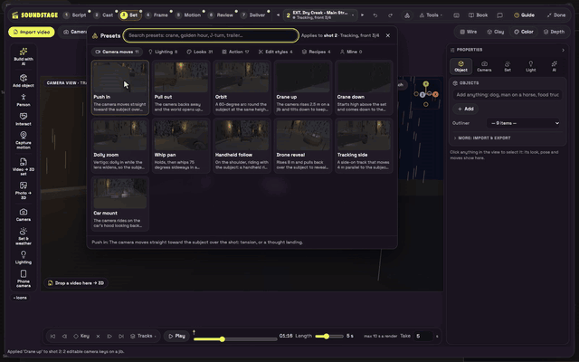</p>
<p align="center"><em>V opens Presets. Hover to preview, click to apply, and the toast confirms the shot.</em></p>

### 5. Add an action beat

Press `V`, open the **Action** tab and click **Crate crash**. Six crates appear, the physics bakes on its own, and the status line reports it (*Simulated 6 objects … 6 broke into … pieces*). If a car is selected, the toast says *Applied to* that car.

Press `V` to close Presets, then press `Space` or click **Play** to watch the cars smash through the stack. Playback starts from the top of the shot. `⌘Z` (or the top-bar ↶) undoes the whole preset in one step.

> **Watch out.** Click **Crate crash** once. Each click adds another stack of 6.

<p align="center">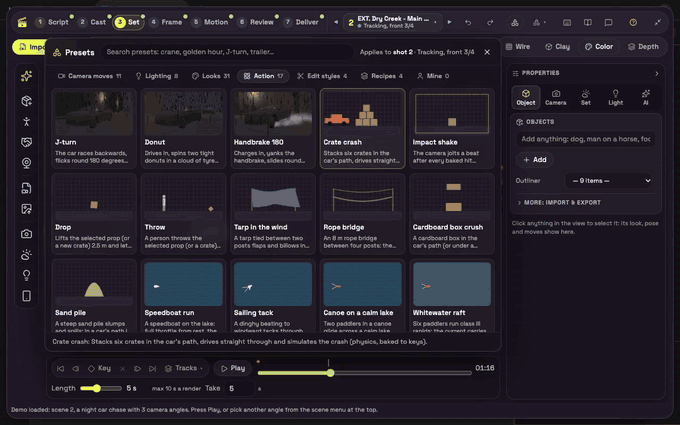</p>
<p align="center"><em>Presets → Action → Crate crash adds six crates and bakes the physics on its own; V closes Presets and Space plays the crash. Recorded on the live pod after the 2 Nov fix.</em></p>

### 6. Pick a look

Click **Look** above the viewport and choose a genre. **Film Noir**, or one of the three Action looks (*Modern Blockbuster*, *Gritty Desaturated*, *Hong Kong*), suits a rainy night. The card lights up; there's no toast.

The **Coach** pill at the top right offers one-click fixes, such as *Move it out* when the camera sits inside the set. Check the frame yourself, because a tip can be wrong.

> **Watch out.** The clay viewport doesn't change colour. The look goes into the render: stock, lens, palette and grade.

<p align="center">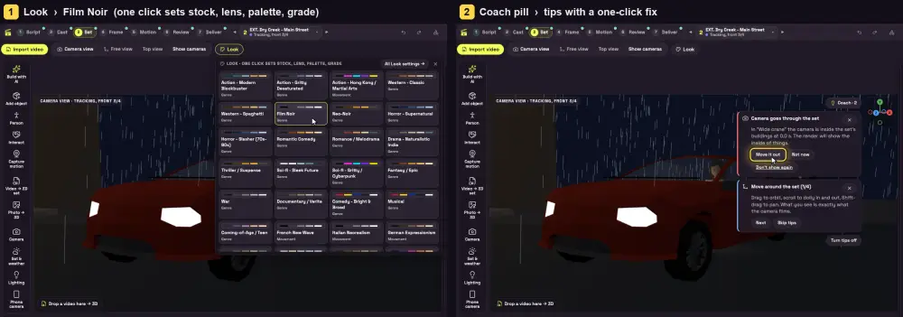</p>
<p align="center"><em>Left: Look palette with Film Noir picked. Right: the Coach pill open with a one-click fix.</em></p>

### 7. Make the frame (about 1 to 4 min of GPU)

Click **4 Frame**. (**④ Make the first frame →** at the right end of ③ Set's time bar also opens ④ Frame, but it starts painting at once with ④'s current settings, which begin at 4 variations at Standard. Use it once you have set them.) The prompt box starts empty: type one line about the shot,, for example *rain-soaked night street, police lights on wet asphalt*. Set **Variations** to 1 (it starts at 4) and **Quality** to **Fast** (it starts on Standard; the button then says about 1 min). Click **Generate frames**.

Do **not** click *…for every shot*. It queues a GPU batch.

While it paints, the **Activity** pill in the top row (left of **✦ Ask**) says what the GPU is doing, for example **Sampling · 8/12 · ~1 min** (with a thin bar filling under it). Click it to see each node as it runs, how long so far and about how long is left, and **Cancel**. Tick **Node types** under **Details** for the raw ComfyUI node names. See [Activity](TUTORIAL.md#activity).

<p align="center">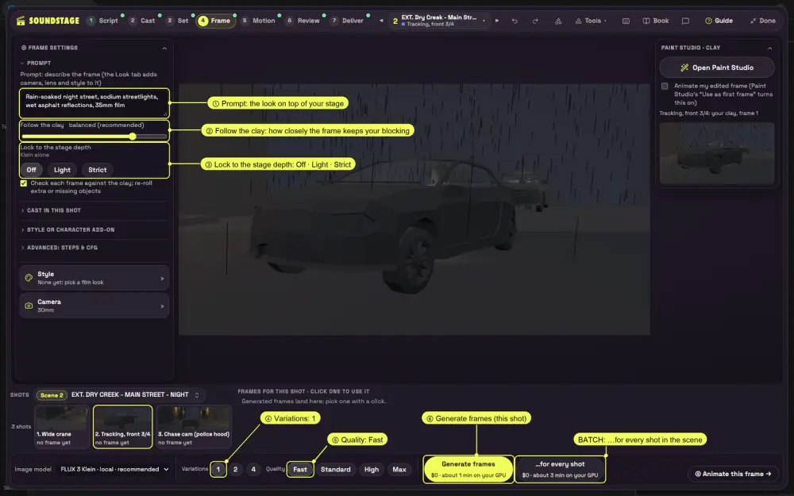</p>
<p align="center"><em>④ Frame: prompt, Follow the clay, Lock to the stage depth, Variations 1, Quality Fast, Generate frames. '…for every shot' is a batch.</em></p>

### 8. Pick a frame and animate it

Click the frame you like best, then click **5 Animate this frame →**. A frame you don't want: its trash takes it off the list (**Undo** for 5 s; the chosen frame asks first). **✕ Reject** in the round badge keeps it on record instead.

After you change the clay or the camera, **④ Remake the first frame →** on ③ Set's time bar paints new frames from the edited set and keeps the old one in the list.

### 9. Get a moving shot

In **5 Motion**, set **Follow** to **Layout** and **Adherence** to **Exact**, so the AI follows your blocking.

Quality starts on **Final**. Switch it to **Draft**, then click **Preview motion (draft)** (about 3 min). It stays grey until the shot has a frame from step 7. Skip *Draft every shot* and *Final for every shot*, the two grey batch buttons.

> **Watch out.** The big yellow **Render final + sound** stays the brightest button even on Draft. It's the 13-minute Final. Leave it for when you love the shot. (The tour's Motion card says about 11 min; the button's estimate is the one to trust.)

<p align="center">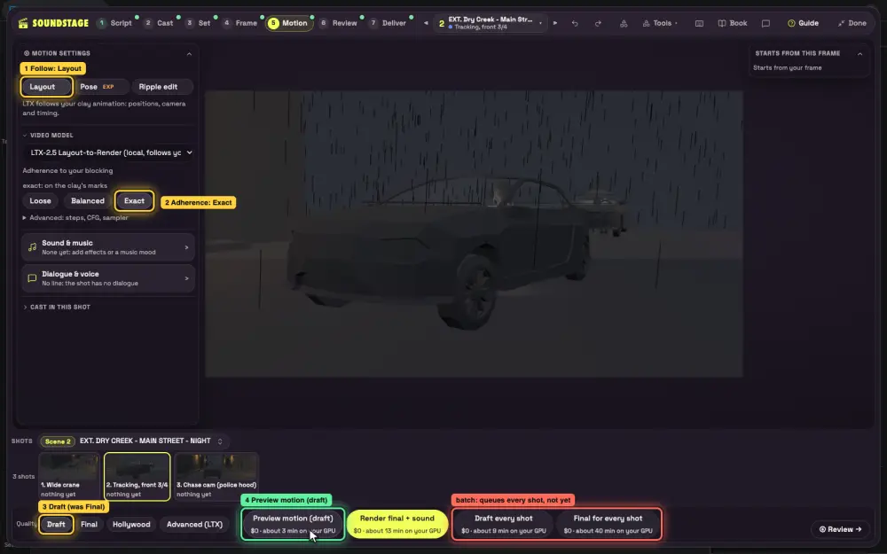</p>
<p align="center"><em>⑤ Motion: Follow Layout, Adherence Exact, Draft (not Final), Preview motion (draft). The two batch buttons, outlined in red here, are grey in the App.</em></p>

### 10. Watch it against the layout

Click **6 Review**. It opens with three rungs, **Left**, **Middle** and **Right**, in **3-way**. Put **Clay** on the left rung and your **Draft** on the right, choose **Wipe** and drag the yellow handle. *Frame*, *Draft* and *Final* stay greyed out (*not rendered yet*) until those renders exist.

That's a directed, rendered shot. Your Draft now has a **✦ One-click** button on the Review bar: Nightfall, Rain, a relight or a new angle (Reshoot), each asking first with its GPU time. See [✦ One-click](TUTORIAL.md#one-click-effects-relight-angles-expand).

If you ever land on the narrow panel (a stray Esc, or **Done**), click **Open the full workspace**.

<p align="center">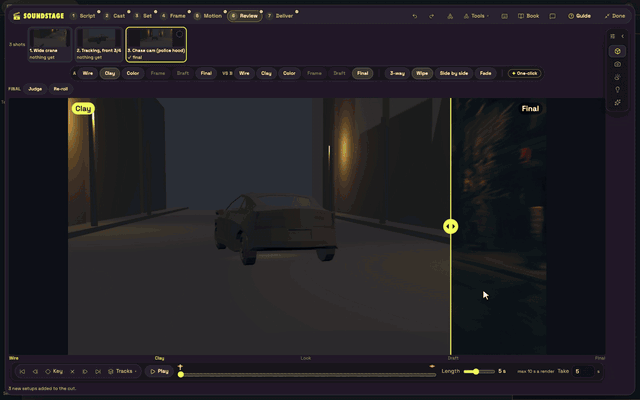</p>
<p align="center"><em>⑥ Review: Clay on the left rung, the render on the right, Wipe, drag the yellow handle.</em></p>

<p align="center">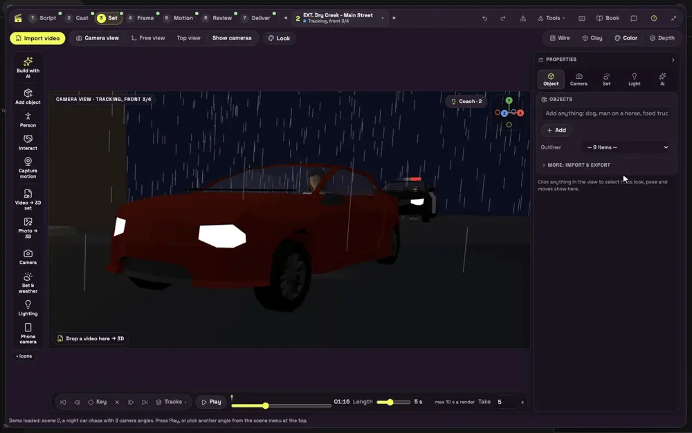</p>
<p align="center"><em>A stray Esc drops you to the narrow App panel. Open the full workspace brings you back.</em></p>

---

## First scene: High Water

An original three-shot story staged inside Scene 2 of the demo script (Dry Creek). We keep the demo's street, actors and police car, re-stage its first two shots and add a Single A on Deputy Cole. ① Script is read-only, so everything happens on the 3D stage.

```text
HIGH WATER

EXT. DRY CREEK - NIGHT - RAIN

Shot 1. WIDE, CRANE
Deputy Cole's cruiser races down the creek road through the rain, headlights flaring. Water already covers the crossing. Cole brakes and whips the car round in a reverse J-turn.

Shot 2. MEDIUM, ACTION
The sliding cruiser clips a roadside stack of crates. They burst across the wet asphalt in splinters and spray.

Shot 3. SINGLE, 85 MM
Cole steps out into the rain and looks off at the wrecked crates. Then Cole turns and looks straight into the lens. Hold.

```

| Shot | Setup | What you use |
|---|---|---|
| 1 | *Wide crane* (the demo's shot 1) | Drive mode, Reverse J-turn, Parts (lights), Crane up |
| 2 | *Tracking, front 3/4* (shot 2) | Crate crash, Physics bake, Strict depth lock |
| 3 | New *Single A*, 85 mm | Get off / stand, Pose (P), Eyes picked twice, Push in |

### A. Script: write your intent (step 1)

1. Open **1 Script** and read Scene 2 (*Dry Creek – Main Street*) in the outline and its **Book page**. The script is read-only, so no new pages here.
2. Paste the story above into **Director's notes**. It saves as you type and when you click away; a small *✓ Saved* flashes for a second. It's your production note: it doesn't reach the AI or the Book page yet.
3. Leave the yellow **Build this scene on the stage** alone. It asks the scene agent to rebuild the stage for this scene, and the demo's Scene 2 is already built.
4. Click **3 Set**. The scene switcher sits in the top bar there (it's hidden on ① Script). Click its **▾** and pick shot 1, **Wide crane**, under Scene 2.

> **Watch out.** In the switcher, **◀** and **▶** change the *scene*, not the shot, and changing scene rebuilds the stage (▶ from Scene 2 lands in 2A, inside the sports car). ◀ takes you back with your blocking kept. To change shots, always use **▾**.

<p align="center">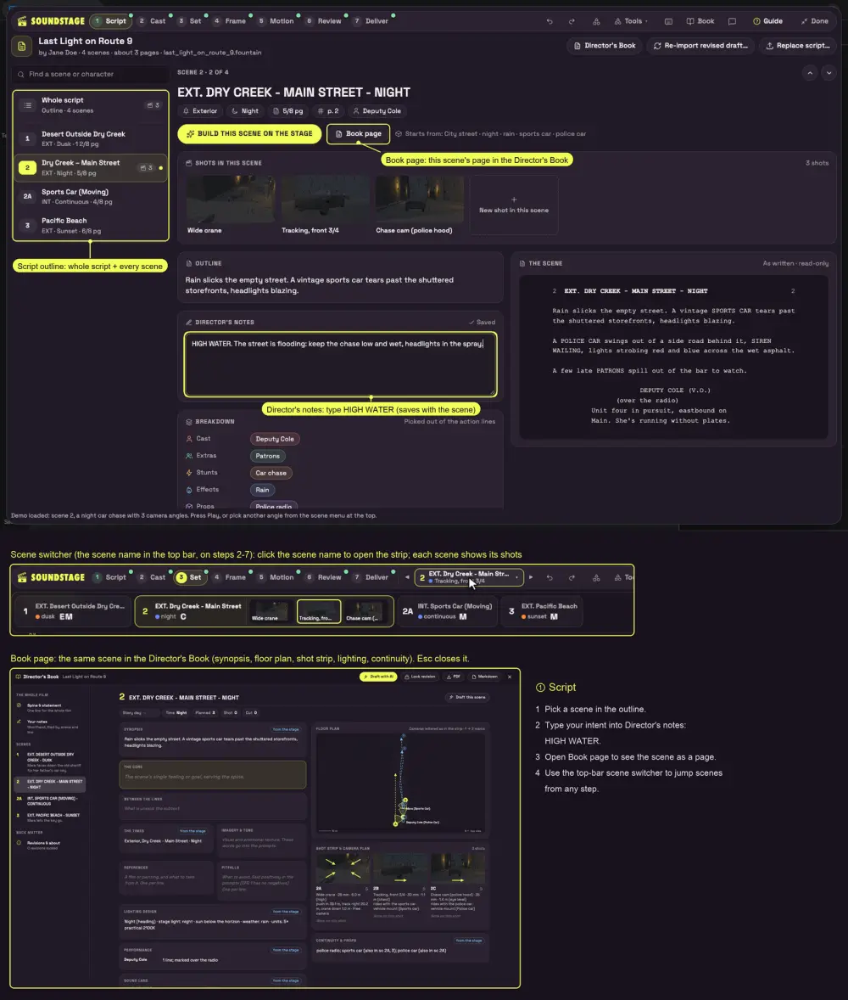</p>
<p align="center"><em>① Script: Director's notes saved and the scene's Book page. The scene switcher (middle) lives in the top bar of steps ③ to ⑤, not on ① Script.</em></p>

### B. Cast & Locations (step 2)

1. The 3 cast cards (Ezra, Mara, Deputy Cole) show initials only. For **Deputy Cole only**, click the **Generate** icon on that one card (one GPU job) or the **Upload** icon for a reference you own. The two icons have no labels; hover to read them.
2. Type *flooded creek crossing* into **Add a location…** and click **Add**. A new card appears.
3. Never click the yellow **Generate all missing (…)** (it reads about 20). It queues a picture for every card.

<p align="center">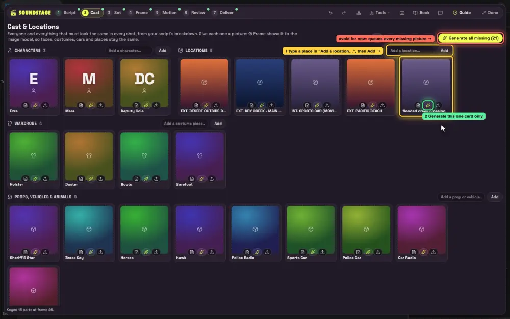</p>
<p align="center"><em>② Cast & Locations: a new location card. Green = generate this one card. Red = Generate all missing, avoid.</em></p>

### C. Set: block the action (step 3)

1. **Start clean.** If you did the Quickstart, press `⌘Z` (or the top-bar ↶) until its crates and Crane up are gone. Crates belong to the whole scene, so they'd show in every shot.
2. **Weather and light.** The demo already has **Color** draw mode, **Rain** and **Night (moonlight)** on. Check them in the right inspector's **Set** tab (two drop-downs); the left dock's **Set & weather** opens the same tab.
3. **Shot 1 (Wide crane), drive it.** Click the **police car** (Cole's cruiser) and press `D`, or click **🎮 Drive**. If the view doesn't follow the car, press `V` (in Drive it cycles the camera: chase, shot, orbit) until you're behind it. Press `R` for the 3-2-1, hold `W` and stay under about 50 km/h, press `R` to stop and `Enter` to keep the take (*Take 1 kept*). `Backspace` throws a take away, `Esc` leaves Drive.
4. **The stunt.** With the car selected, open **Appearance → Stunt** and pick **Reverse J-turn**. The status line reports about *turns 180° in 1.75 s, slides 19 m, leans 8°*.
5. **The lights.** Open **Parts**: `L` for headlights, `Shift`+`L` for the light bar, then `K` to key every part at the playhead. Each key confirms itself in the status line.
6. **The camera.** Shot 1 is already a crane. To push it further: `V` → Camera moves → **Crane up**, then `V` to close.
7. **Shot 2 (Tracking, front 3/4), the crash.** Open the switcher's **▾** and click **Tracking, front 3/4**. `V` → **Action** → **Crate crash** (once), then `V` to close.
8. **Tune the crash.** Click a crate, then **Physics** on the object bar. Crate crash has already set **Dynamic**, **Dust**, **Debris** and **Breakable**: check they're lit, and don't click them, because a click turns them off. Pick Material **Wood**, click **Same for all**, keep **CPU**, then **Simulate & bake**. It takes about a second. Leave GPU physics (beta) off. Close the panel with its **×** or `Esc`.
9. If the status says crates are *still moving at the end*, make the shot a little longer (**Length** on the timeline) or keep it: it reads as tumbling. `F` frames anything that landed off camera, `G` moves it.
10. **Shot 3, a new Single A on Cole.** Click Deputy Cole. He starts seated in the police car, so set **Ride / sit on** to **Get off / stand** first. Then Camera tab → **New setup → Single A**. This *adds* a fourth setup (*Single A*) that starts from the current camera; the demo's *Chase cam* stays in the list, unused. With Cole still selected, press `F`: the shot camera frames him.
11. **The lens.** Scroll the inspector to **Lens & rig** and click the **85** mm card. **Push in** is fine here, because no car is moving.
12. **The performance.** With Cole selected press `P`. Click body parts and drag the yellow IK dots into a step away from the car. Press `P` again to finish.
13. **The eyes.** Scroll the inspector to **Parts › Eyes, hands, in hand** (it's far down; at 1440 px it sits about 1000 px below the top). With the playhead early, pick **At Crate 1** (any crate) in **Eyes**: picking keys the gaze at the playhead, there's no separate Key button. Move the playhead later and pick **Into the lens**.
14. **Play each shot.** Click **Play** or press `Space` (not while typing in a box). Playback starts from the top of the shot.

> **Watch out.** Drive the **police car**, not the red sports car. The cop's keyed path runs straight through a sports car you start from a standstill, and with **Everything collides** on, the bake in step 8 crashes the two cars for real. If that's not your story, turn **Everything collides** off in the Physics panel's **World** row: the scene re-bakes, the crates still crash and the two cars pass through each other. Or press **Clear simulation**, ask the Director (`/`) to *reroute the police car around the red car*, then **Simulate & bake** again (the swerve can take it past the crates too). **Keep keyed** on the police car alone doesn't stop it: it still hits the red car and pushes it ahead. Change shots only with the switcher's **▾**: ◀ ▶ change the scene and rebuild the stage. On the clay figures the gaze change is small.

<p align="center">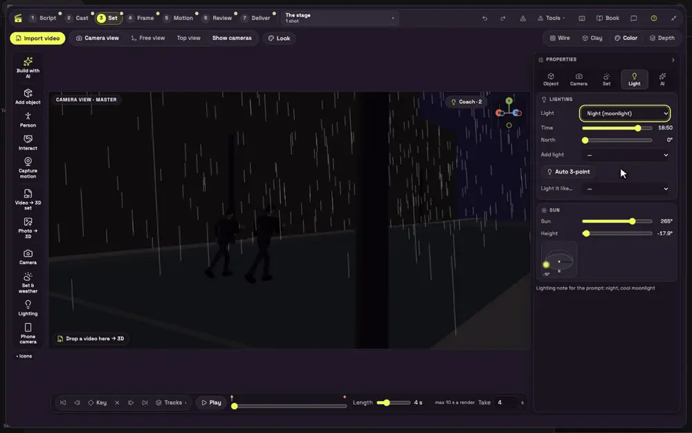</p>
<p align="center"><em>Color draw mode, Properties › Set: Rain and Night (moonlight). The demo already has all three set. Sped up.</em></p>

<p align="center">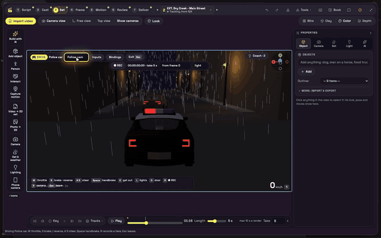</p>
<p align="center"><em>Select the police car, D, R for 3-2-1, W under 50 km/h, R to stop, Enter keeps the take.</em></p>

<p align="center">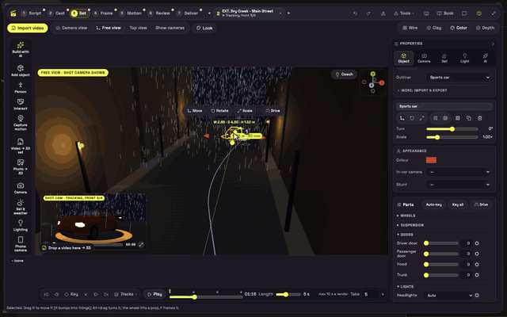</p>
<p align="center"><em>Appearance → Stunt → Reverse J-turn, with the stunt report in the status line, then Play.</em></p>

<p align="center">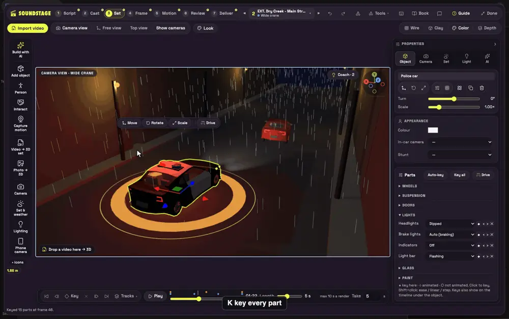</p>
<p align="center"><em>Parts on the police car: L headlights, Shift+L light bar, ◆ Key, K keys everything, then scrub.</em></p>

<p align="center">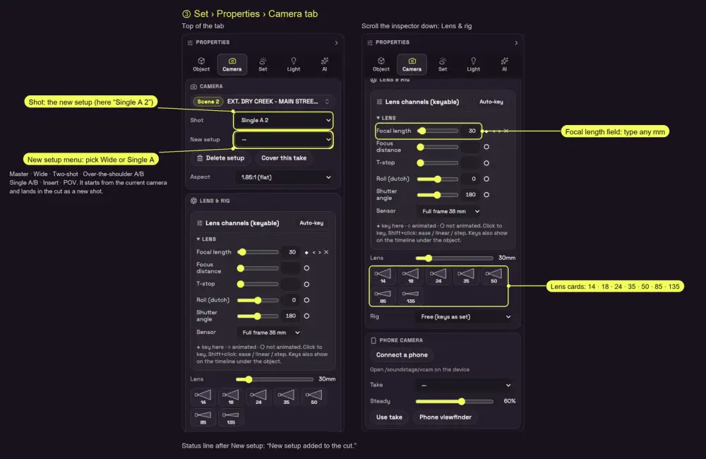</p>
<p align="center"><em>Camera tab: New setup (Single A), and further down the lens cards 14 to 135 mm and the Focal length field.</em></p>

<p align="center">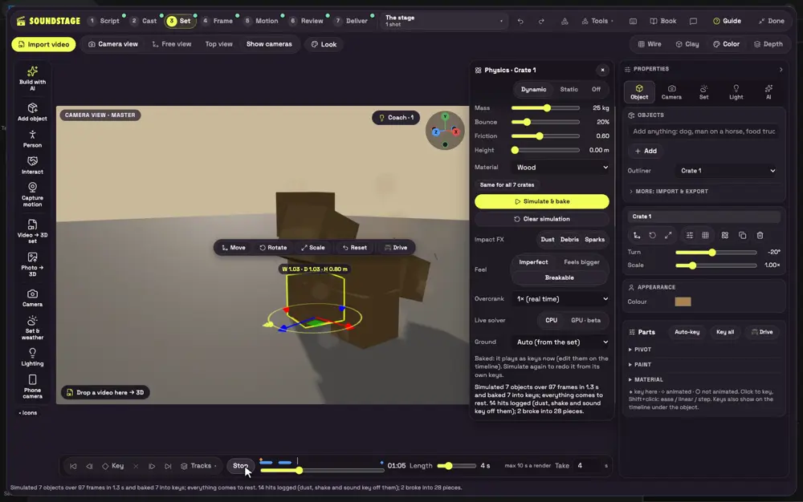</p>
<p align="center"><em>Physics on a crate: Dynamic, Wood, Dust, Debris and Breakable lit, Same for all, Simulate & bake (CPU).</em></p>

<p align="center">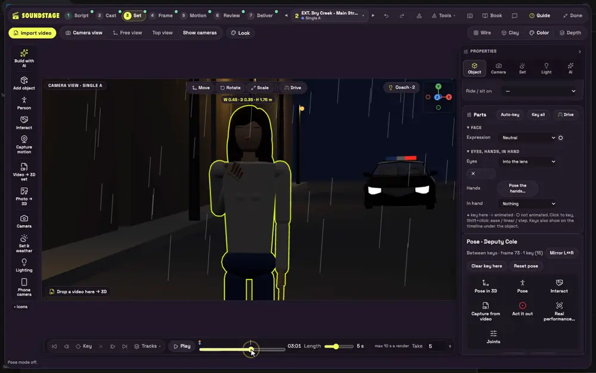</p>
<p align="center"><em>Through an 85 mm Single A: P to pose, an IK hand drag, Eyes set to 'At' an object, then 'Into the lens' later in the shot.</em></p>

### D. Frame (step 4)

1. For each of your three shots (*Wide crane*, *Tracking, front 3/4*, *Single A*), write a one-line prompt; the box starts empty. Keep **Follow the clay** high and set **Lock to the stage depth** to **Light**. Use **Strict** on the crash shot so the crates stay where you put them.
2. Generate **2 variations** at **Standard** (about 4 min each), one shot at a time. Never *…for every shot*.
3. Pick the best frame and click **5 Animate this frame →**. If Paint Studio opened, close it with **Cancel (×)**.

<p align="center"></p>
<p align="center"><em>④ Frame: prompt, Follow the clay, Lock to the stage depth, Variations 1, Quality Fast, Generate frames. '…for every shot' is a batch.</em></p>

### E. Motion (step 5)

1. Set **Follow** to **Layout** and **Adherence** to **Exact**. For each shot, click **Preview motion (draft)** first and approve the movement.
2. For the hero shot only (*Wide crane*), choose **Advanced**, set **Output resolution** to 1440p (1408) and **H.264 CRF** to 12 (or run the **Hero final** preset), then click **Render final + sound**. Run it during a break. The other two get **Final** (about 13 min each). Skip *Chase cam*.
3. Open **Sound & music** to describe rain, engine and siren. On shot 3, open **Dialogue & voice** if Cole says a line.

> **Watch out.** At 1408p the button's estimate runs short. It takes much longer (15–17 min). The Dialogue card can also keep saying *No line* after you type one, so reopen the pop-over to check.

<p align="center">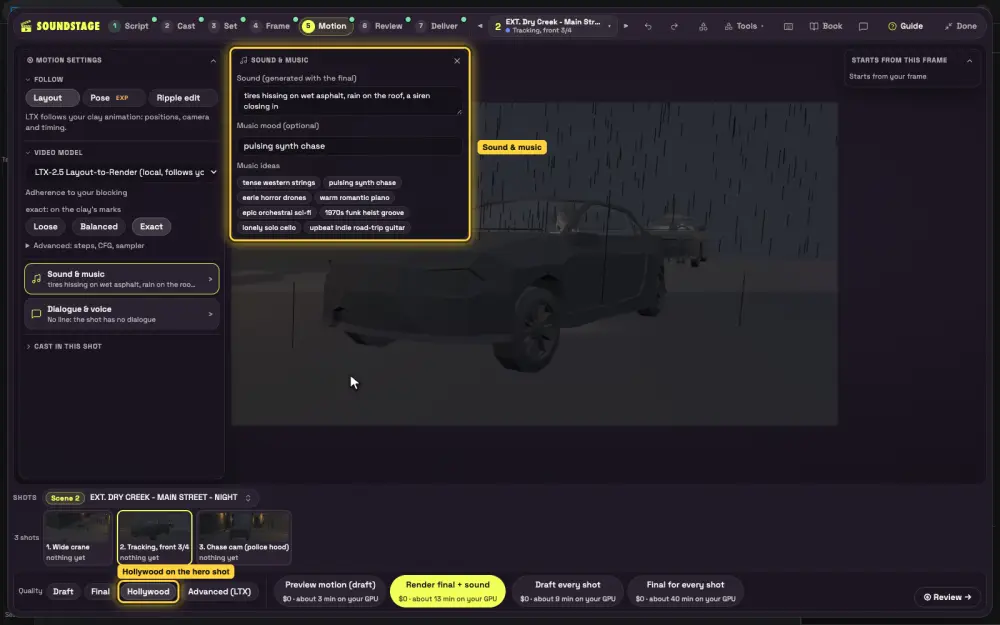</p>
<p align="center"><em>⑤ Motion with the hero quality picked on one shot and the Sound & music pop-over open (an older build: the third button now reads Advanced).</em></p>


### F. Review (step 6)

1. In **6 Review**, compare **Clay** with **Final** on the rungs using **Wipe** or **3-way**.
2. Real takes show the take checks: *Follows your blocking %* and the AI-slop realism judge. Treat them as a second opinion. Judge the car physics yourself, like a VFX supervisor.
3. Open **Tools ▾ → Takes** and press `C` to circle the keepers. Then click the **ScriptSync** tab inside Takes to see your takes lined against the page. (Once a tool is open, the Tools button shows its name, such as *Takes ▾*.)

> **Watch out.** The take checks only appear once a real render exists.

<p align="center">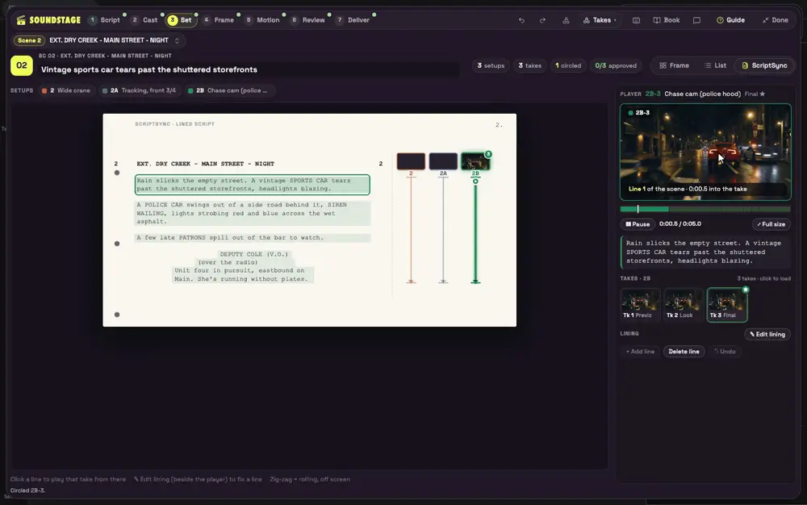</p>
<p align="center"><em>Tools ▾ → Takes: C circles a take. The ScriptSync tab shows the lined page and plays the take on its line.</em></p>

### G. Edit (step 7)

> **New (2 Nov evening).** Press **Space** and the cut plays in real time. Each clip's badge (**Final**, **Draft**, **Look**, **Clay**) says what is playing; **Clay** stands in while a take loads. 24 fps only; *Edit in* from the timeline is not in this build. See [Real-time playback](TUTORIAL.md#real-time-playback-in-the-cut).

1. Click **7 Deliver → Open the editor** and click **Assemble scene**. It rebuilds the cut from the ScriptSync lining and replaces what's on the timeline.
2. Check what it laid down. With no dialogue in the scene it can put the Wide under all the action (3 clips of *Wide crane*). If your crash and Single A are missing, click them in the editor's **Shots** row: a click splices the shot in at the playhead (⇧-click overwrites). Delete extra clips with **Ripple delete**.
3. Select the crash clip and click **Match action** (`M`): it slides the clip to continue the action of the clip before it. Drag **Dip black** onto the cut before the Single A. `J` `K` `L` shuttle; **Split** and **Ripple delete** trim.
4. Add a **+ Title** card: *HIGH WATER*. Type *rain, distant thunder* in the sound box and click **Generate**. Then **Auto-duck** and pick a **LUFS** target.
5. Hold off on **+ Graphic…** renders until the pod's ComfyUI has been restarted.

> **Watch out.** Auto-duck needs dialogue on A1. With no line in the scene it says so and does nothing.

<p align="center">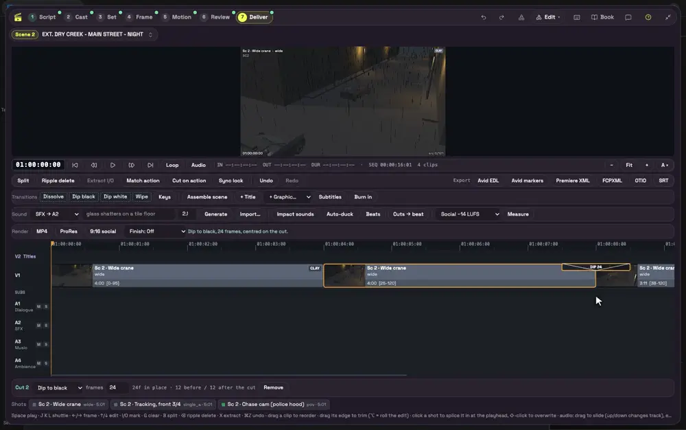</p>
<p align="center"><em>Cut editor: Assemble scene, Match action, Dip black, + Title, a sound idea, Auto-duck, LUFS, J K L.</em></p>

### H. Deliver (step 7)

1. Click **Cut → one video** for the master (MP4, ProRes or 9:16).
2. From the editor's **Export** row, export **Avid EDL** or **Premiere XML** for your NLE. There's no AAF.
3. Click **Download the DCC kit** and run its Blender script. Blender is the only builder tested so far.
4. Once the finals exist, click **Make the Layer Pack** for compositing.


<p align="center">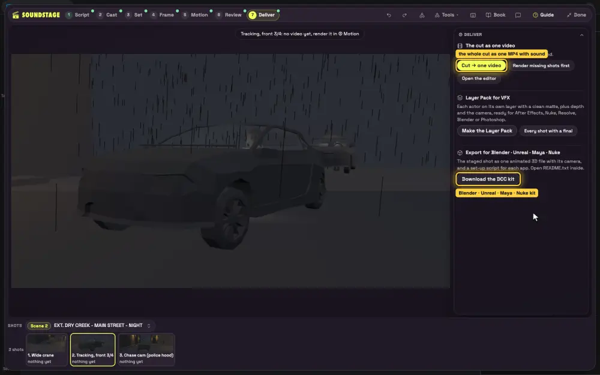</p>
<p align="center"><em>⑦ Deliver: Cut → one video and Download the DCC kit.</em></p>

<p align="center">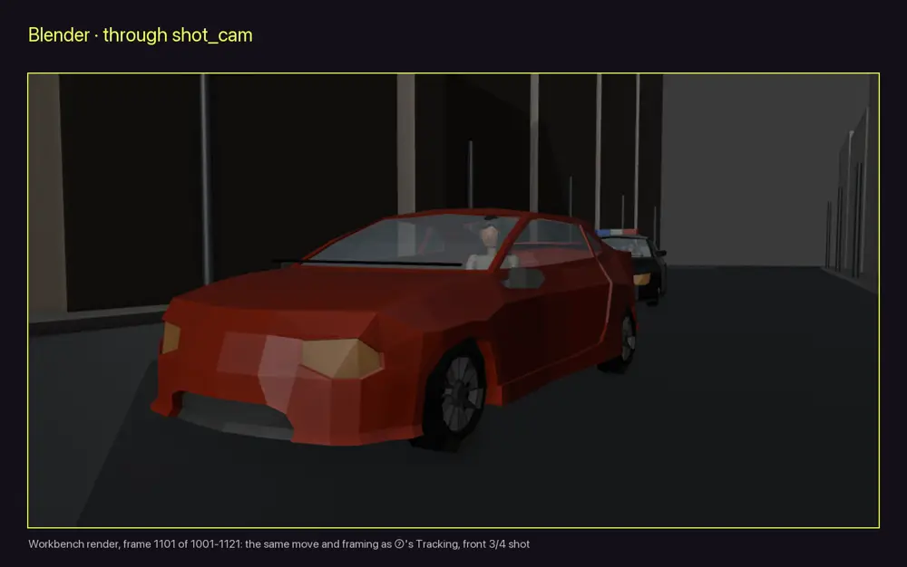</p>
<p align="center"><em>The DCC kit: the App builds the zip, then Blender runs its script and rebuilds the set and the shot camera.</em></p>

---

## Cheat sheet

**Anywhere:** `V` Presets · `/` or `⌘K` / `Ctrl+K` Ask (the assistant) · `?` Shortcuts sheet, or the keyboard icon · `H` / `Tab` Hide or show every panel · `⌘Z` / `⇧⌘Z` Undo / redo · `←` `→` Change scene (rebuilds the stage) · `Space` On ③ Set: Play / stop · `Esc` Closes the open panel, menu or pop-over first

**Look around:** `0` Shot camera / free view · `.` Back to the set (⌂) · `,` Last view (↶) · Drag Orbit; Shift+drag pans, wheel dollies · `W` `A` `S` `D` Fly; `Q` / `E` down / up · Top view Inset from above, with Fit and ✕ · `F` Frame the selection · `Esc` Deselect before WASD (with a car selected, `D` = Drive)

**Move things:** `G` `R` `T` Move, rotate, scale · Shift Snap 15° · Alt+drag Turn · `⌘D` Duplicate · Add anything… + `Enter` Add a typed object. Then click the stage before F or G

**People:** `P` Pose on / off (IK hands and feet) · Ride / sit on Get off / stand, to pull someone out of a car · Eyes Parts › Eyes: Ahead, Into the lens, Off L/R, Up, Down, At <object>; each pick keys it · Real performance… Low in the pose inspector; scroll

**Car:** `D` Drive; `W` `A` `S` `D`, Shift, Space, E · `R` Record / stop · `Enter` / `Backspace` Keep / discard the take · `V` (driving) Camera: chase, shot, orbit · `Esc` Leave Drive · `L` / `Shift`+`L` Headlights / light bar · `I` / `O` Indicators / doors · `K` Key every part

**Edit:** `J` `K` `L` Shuttle · `Space` Play (real time; Final / Draft / Look / Clay badge per clip) · `C` Circle a take (Takes)

**Quality:** Frame Fast (~1 min) · Standard (~4 min) · High · Max · Motion Draft → Final (~13 min) → Advanced (hero shots at 1408p, or faster drafts) · Adherence Exact Follow my blocking

**New on 1-2 Nov:** **✦** on every take, ④ Frame candidate and the Review bar (effects, relight, angles, expand, Seamless loop, Reshoot, Open in ComfyUI, Send a move from your phone) · Physics › World: **Everything collides** / **Keep keyed** · Director: *check for collisions* · Real performance… › **Voice**: Keep my voice / Convert to … · Presets › Looks › **Racing Cinema**; Camera moves › **Bumper cam**, **Over the tyre**, **Arm car tracking**, **Long-lens pan** · Action › **Speedboat run**, **Sailing tack**, **Canoe on a calm lake**, **Whitewater raft**, **Diver swim** · Motorboat in Drive: `Space` / `Q` trim out / in · Menus: `↑` `↓` `Home` `End`, `Esc` · **2 Nov evening:** **✦ Ask** (`⌘K` / `Ctrl+K` or `/`; hold Ask or `` ` `` to talk; **Show me**, **Do it for me**) · **Activity** pill: the node your render is on, steps, time left, **Details**, **Cancel** · real-time playback in the Cut · ④ Frame: trash / **Clear all** (Undo 5 s); ③ Set: **④ Make the first frame →** · Drive takes over from keys; kept takes auto-corrected, **Undo** to raw · `.` **⌂ Back to the set** / `,` **↶ Last view** / **Lost?** chip · **Passes** on every Dailies take, the Ladder bar and Video → 3D: Alpha matte (Matte, Over, Rubylith, Edges), Pose, Talking, Depth; `1`-`4` tabs, `F` Flicker, `,` `.` step · All of it, with limits: [New on 1 and 2 November](TUTORIAL.md#new-on-1-and-2-november)

**Tools ▾ (shows the open tool's name):** Paint Studio Paint on a frame · Shot ideas Coverage suggestions · Look Genre looks · Takes The bin · ScriptSync Lined script (also a tab in Takes) · Edit The cut editor · Classic layout Skip it

**Where things live:**

- **Top bar:** Steps 1-7, scene switcher on ③-⑤ (◀ ▶ = scene, ▾ = shots), Undo / Redo, Presets, Tools ▾, Activity (what the GPU is doing, node by node), Book, ✦ Ask, Guide, Done. Below 1400 px some are icons (hover for the name); in a narrow window the least used fold into **⋯** (✦ Ask and Activity never do)
- **Left dock:** Build with AI, Add object, Person, Interact, Capture motion, Video → 3D, Photo → 3D, Camera, Set & weather, Lighting, Phone camera
- **Right inspector:** Everything for what you selected: Object, Camera, Set, Light, AI. Long: scroll for Lens & rig, Parts and Eyes
- **Above the viewport:** Camera view, Free view, Top view, Show cameras, Look, Coach; Wire / Clay / Color / Depth
- **Bottom:** ⏮, Key, Play, Length, Tracks ▴ (shot strip, + Shot)

**Never click (for now):** ComfyUI's white Run, Build this scene on the stage (demo), Generate all missing, …for every shot, Draft every shot, Final for every shot, Render missing shots, Classic layout. Esc with nothing open, or **Done**, drops you to the narrow panel: click **Open the full workspace**. Reload the tab if keys stop responding.

<p align="center">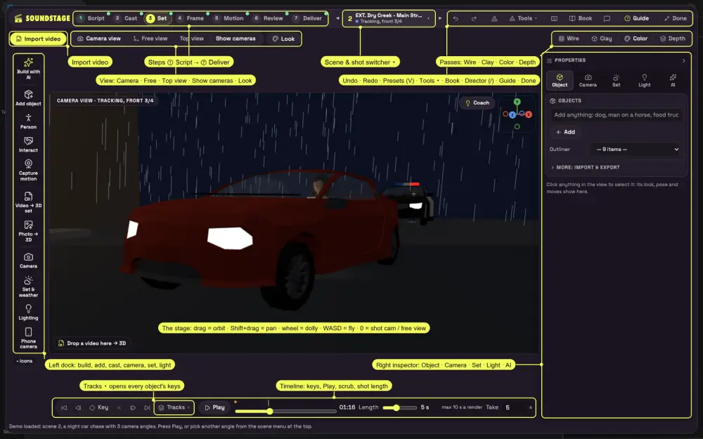</p>
<p align="center"><em>The full workspace, labelled.</em></p>

For every panel, button and shortcut, read the [complete tutorial](TUTORIAL.md).
