# Soundstage: the complete tutorial

Soundstage turns ComfyUI into a small film set. You bring in a script, cast it, block each scene with clay actors in a 3D stage, paint a first frame, animate it with sound, review it like dailies and cut it, all on one screen and all on open models running on your own GPU.

**100% open weights: every model runs locally.** (Paid partner API models are hidden; they are opt-in only, with `SOUNDSTAGE_PARTNER_MODELS=1` when you start ComfyUI.)

**New here? Start with the [Quickstart](QUICKSTART.md):** the [four rules](QUICKSTART.md#four-rules-before-you-click-anything), [your first shot](QUICKSTART.md#quickstart-your-first-shot) in about ten minutes on the demo, then [*High Water*](QUICKSTART.md#first-scene-high-water), a three-shot scene from script to delivery (drive, stunt, physics crash, gaze, cut, Avid EDL), and a one-screen [cheat sheet](QUICKSTART.md#cheat-sheet).

This guide is for anyone who has just cloned the repo. It covers where every panel and button is, what each one does, and the habits that get good shots quickly. Every control named here is in the code, with the same label you see on screen.

<p align="center">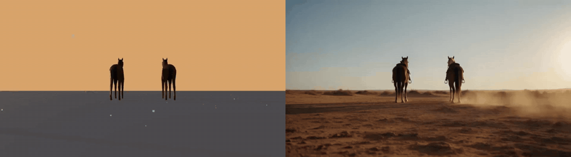</p>
<p align="center"><em>What you are working towards: block it in clay (left), Soundstage renders it (right). Same blocking, same camera.</em></p>

## Contents

0. **[New on 1 and 2 November](#new-on-1-and-2-november)** (limits first): [world collisions](#world-collisions-everything-collides) · [✦ One-click](#one-click-effects-relight-angles-expand) · [Seamless loop](#seamless-loop-and-the-seam-meter) · [Reshoot](#reshoot-from-a-new-angle) · [Open in ComfyUI](#open-in-comfyui-and-download-the-graph) · [Film a move](#film-a-move-on-your-phone) · [Racing Cinema](#racing-cinema-and-the-racing-camera-moves) · [boats](#boats) · [swimming](#swimming-and-water) · [Drive mode](#drive-mode-what-changed) · [voice conversion](#voice-conversion-in-real-performance) · [1024 layout and ⋯](#the-1024-wide-layout-and-the-menu) · [pop-over layer](#one-pop-over-layer-for-every-menu) · [move, fold or pop out a panel](#move-fold-or-pop-out-any-panel) · [brass key and strip](#the-brass-key-and-the-shot-strip-fixes) · [Passes viewer](#passes-judge-the-matte-pose-talking-and-depth) · **2 Nov evening:** [real-time playback in the Cut](#real-time-playback-in-the-cut) · [Activity bar](#activity-bar-which-node-your-render-is-on) · [✦ Ask](#ask-on-every-step) · [④ Delete, Clear all, Make the first frame](#frame-delete-clear-all-and-make-the-first-frame) · [the first frame shows only what the camera sees](#the-first-frame-shows-only-what-the-camera-sees) · [Drive takes over from keys](#drive-takes-over-from-keys-and-cleans-the-take) · [⌂ Back to the set and ↶ Last view](#back-to-the-set-and-last-view) · [Load a script in the demo](#load-a-script-in-the-try-it-demo)
1. [Install](#1-install)
2. [A tour of the workspace](#2-a-tour-of-the-workspace)
3. [The seven steps, one by one](#3-the-seven-steps-one-by-one)
   - [① Script](#step-1-script) · [② Cast & Locations](#step-2-cast) · [③ Set](#step-3-set) · [④ Frame](#step-4-frame) · [⑤ Motion](#step-5-motion) · [⑥ Review](#step-6-review) · [⑦ Deliver](#step-7-deliver)
   - [Dailies and the lined script](#dailies-and-the-lined-script) ([ScriptSync](#scriptsync-lined-script)) · [The Look tab: re-render in any film look](#the-look-tab-re-render-in-any-film-look) · [The Stop button](#the-stop-button) · [Activity: what the GPU is doing](#activity)
   - **New since the contest:** [Ask: the assistant, on every screen](#ask-the-assistant) · [The Director: chat, voice and MCP](#the-director-chat-voice-and-mcp) · [Presets](#presets-one-click-camera-moves-and-lighting) · [Quality: Draft, Final, Advanced](#quality-draft-final-advanced) · [Takes that check themselves](#takes-that-check-themselves) · [Timeline: transitions, sound, titles and render](#transitions-sound-titles-and-render)
4. [The 3D stage in depth](#4-the-3d-stage-in-depth)
   - **New since the contest:** [Practical effects: explosions, fire, squibs](#practical-effects-explosions-fire-squibs) · [Live 3D: drag, climb, mount, carry](#live-3d-drag-climb-mount-carry) · [Drive mode](#drive-mode-control-anything-like-a-video-game-and-record-it) · [Stunts](#stunts-j-turn-donut-handbrake-180) · [The new sets](#the-new-sets) · [Interop: Blender, Unreal, Maya, Nuke](#interop-blender-unreal-maya-nuke) · [Phone camera and the phone viewfinder](#phone-camera)
5. [Keyboard and mouse cheat sheet](#5-keyboard-and-mouse-cheat-sheet)
6. [Tips and tricks](#6-tips-and-tricks)
7. [Troubleshooting and FAQ](#7-troubleshooting-and-faq)

---

<a id="new-on-1-and-2-november"></a>

## New on 1 and 2 November

Everything below landed on `main` on 1 and 2 November 2026 ([CHANGELOG](../CHANGELOG.md)). Each part says where it is in the App, gives the steps, and names one limit. The limits come first, because they are what you will hit.

**Judging it?** Start with [Judging it? Start here](../README.md#judging-it-start-here) at the top of the README: a 60-second path through the [try-it demo](https://claude.ai/artifact/GwtC3yFZtGCsTsiPGbvnAq) and a table of what runs live in your browser and what is a recording of a real run, played back. Then do the [Quickstart](QUICKSTART.md).

### Known limits, first

| Feature | The limit you will meet |
|---|---|
| [World collisions](#world-collisions-everything-collides) | Checked headless in Node only; not yet watched in a browser or rendered. After a hit a car is one rigid body: it dents, but nothing folds or comes off, and its wheels stop spinning and steering. |
| [✦ One-click](#one-click-effects-relight-angles-expand) | Most prompt fixes are not re-rendered yet. The Krea 2 depth pass and the **· exact** angles are experimental (one invented people, the other can look like clay). |
| [Seamless loop](#seamless-loop-and-the-seam-meter) | No loop made so far is seamless: the meter read *Visible seam* on every test render. The meter and the fixer work; the loop render isn't good enough yet. |
| [Reshoot from a new angle](#reshoot-from-a-new-angle) | Not Hollywood yet: on the riders test a shirt drifted from red to brown, a hat appeared mid-clip and the last half second dissolved into dust. |
| [Open in ComfyUI](#open-in-comfyui-and-download-the-graph) | Needs a ComfyUI restart after updating; until then the card says *"this server needs a restart to know the hand-off route"*. |
| [Film a move](#film-a-move-on-your-phone) | Needs the https address (run `tools/vcam_bridge.py`); a plain http page can't record. Uploads stop at 300 MB. |
| [Racing Cinema](#racing-cinema-and-the-racing-camera-moves) | No frame or video has been rendered with it yet. **Long-lens pan** cannot hold a fast J-turn inside the 40 m depth guide (at 60 km/h 2 of 21 keys fall past it; the toast says so). |
| [Boats](#boats) | No capsize, no swamping, no rock collisions (the raft passes through boulders). Canoe and rowboat turns are slow, and the log raft's pole barely steers. |
| [Swimming](#swimming-and-water) | No swim-style picker: the style follows the speed. Renders look like CG animation, not photographed water. |
| [Drive mode](#drive-mode-what-changed) | The view can stay on the shot camera instead of following what you drive: press `V` to cycle it. |
| [Voice conversion](#voice-conversion-in-real-performance) | On a voice Chatterbox did not make, Whisper misheard 39-51% of Ezra's words. Listen to every converted line. Clips over 20 s need a ComfyUI restart to convert in pieces. |
| [1024-wide layout](#the-1024-wide-layout-and-the-menu) | Checked headless at 1024×640, not on a real 1024-pt iMac. At 1024 the picture is small. |
| [Pop-over layer](#one-pop-over-layer-for-every-menu) | Coach tips were not part of the sweep (the demo scene has none). |
| [Brass key and the strip](#the-brass-key-and-the-shot-strip-fixes) | Holding and tossing a key is set in the scene data; there is no button for it yet. In Clay the key reads small and grey: it shows brass only in Color. |
| [Passes viewer](#passes-judge-the-matte-pose-talking-and-depth) | The matte tools were checked headless on a synthetic Layer Pack only: no real SAM 3.1 or BiRefNet matte has been judged in it yet. A clip ✦ Cutout's alpha is ProRes 4444, which browsers can't decode, so it isn't shown. Pose has per-point confidence for the face only, until a new Real performance read (body and hands come with the next ComfyUI restart). |
| [Load a script in the demo](#load-a-script-in-the-try-it-demo) | ④ and ⑤ replay a recorded example from the closest demo set, never a render of your scene. **Build this scene on the stage** (the scene agent) needs the full install. The extractor picks some words wrongly (a capitalised name can show up as a prop). |
| [Real-time playback](#real-time-playback-in-the-cut) | Measured on a 60 s test cut in headless Chrome, one run per profile, not on a real laptop. The bench did not exercise the proxies. Frame rates other than 24 and *Edit in* from the timeline are not in this build. |
| [Activity bar](#activity-bar-which-node-your-render-is-on) | Not run against a live ComfyUI yet (simulated events in ComfyUI's shapes). A job from another tab shows node numbers until it ends; another session's job has no node detail. |
| [✦ Ask](#ask-on-every-step) | Not clicked through in the live App. Answers come from 20 written recipes; anything else needs the local model. ⌘K / Ctrl+K can clash with a browser shortcut. |
| [④ Delete and Make the first frame](#frame-delete-clear-all-and-make-the-first-frame) | Delete takes a frame off the list, not off the disk. Only the newest delete can be undone, for 5 s, and only while you stay on ④ Frame. |
| [First frame, camera only](#the-first-frame-shows-only-what-the-camera-sees) | The Look description is filtered by word, not meaning; a car named only by brand slips through. Checked on 2 shots with stills, no motion renders. |
| [Drive takes over from keys](#drive-takes-over-from-keys-and-cleans-the-take) | Checked in Node tests and headless Chrome, not in the live App. A fast weaving car still needs a key every 6-9 frames. Undo to the raw take covers only the last kept take. |
| [⌂ Back to the set / ↶ Last view](#back-to-the-set-and-last-view) | `.` and `,` work only while the viewport has the keyboard (click it first), and the buttons hide while you drive. On a set with a big floor, Back to the set can land far out. |

<a id="world-collisions-everything-collides"></a>

### World collisions: everything collides

**Where:** select a prop, press **Physics** in its card. The panel's **World** row holds **Everything collides** (on by default) and **Keep keyed**. The Director runs the consequence check.

Cars, people, street lamps, benches, hydrants, trees and walls are real bodies in **Simulate & bake**. A keyed car keeps its keys until its first real hit; then the physics takes over.

1. Key a car through another car, a lamp, a wall or a crate stack (or tell the Director *"the police car rams the red car into the boxes"*).
2. Press **Simulate & bake**. The panel and the status line say where the physics took over: *"Physics took over at f 42 (1.8 s)"*.
3. Scrub back and forth: the bake is deterministic, so every pass plays the same frames.
4. Change your mind? One **⌘Z** restores the scene from before the bake. Edit a key or drag anything in a baked scene and it re-bakes about half a second after you stop; the edit and its re-bake are one Undo step.
5. To keep one actor on its path whatever it hits, select it and press **Keep keyed**. To let everything pass through everything again, turn **Everything collides** off.
6. **The consequence check.** Type *"check for collisions"* in the Director (press **/**). It runs by itself before every Director render too. It says what passes through what, in plain words, with one-click fixes: **Crash them** or **Reroute** for two cars, **Make them collide** for a group of props, **Crash them all (bake)** for an unbaked scene. Anything still passing through stops the render; say *"render the draft anyway"* to render it as it is. With **Everything collides** off the check doesn't stop the render.

**Limit:** checked headless only. People are "ragdoll-lite": one body that topples, still playing its walk cycle while it slides. A car stops against a solid wall in one substep (a real crush takes about 0.1 s). Of the set pieces, only the street and plaza lamp posts can be knocked down; facades and planters stay put. The *ram* plan assumes a constant speed, but the stage eases between keys, so the real hit comes a little later and faster than the Director says. Details: [world.md](world.md).

<a id="one-click-effects-relight-angles-expand"></a>

### ✦ One-click: effects, relight, angles, expand

**Where:** the **✦** button on every Dailies take (its card and its row in the takes list), the **✦ One-click** button on ⑥ Review's Ladder bar (it works on the best layer on view: Final, else Draft, else Frame), and a **✦** on every ④ Frame candidate.

1. Click **✦**. One card window opens over the canvas with every card in groups: **Effects**, **Light**, **Camera**, **Frame**, **Loop** and **Hand-off**. A card that doesn't fit this take is greyed; hover it for the reason.
2. Click a card. It asks once, with the cost: **Run (about N min on your GPU)** for a GPU card, **Go** for one that needs none, or **Cancel**. Fill its fields first if it has any (*What to take out*, *What to keep*).
3. The result lands as a new take: *"✦ Nightfall landed as a new take."* A still also becomes a ④ Frame candidate. The take checks and the realism judge run on it.
4. Under the result: **Open**, **Use as ④ Frame** (stills) and **✦ again** to run another card on the result.
5. **Esc** closes the window (or backs out of the ask first).

What's in the groups:

- **Effects:** Nightfall, Flood, Rain, Snow, Fog, Golden hour, **Empty the scene**, **Cutout** (a PNG, or ProRes 4444 with alpha for a clip), **Living photo** (five seconds of small real motion and sound, camera locked off). Pop, Inflate, Cake, Squish, Unzip and Gulp are experimental.
- **Light:** the 18 lighting setups as relights. The box *Experimental: add a Krea 2 pass locked to the stage depth (it can invent things)* is off by default.
- **Camera:** Orbit left, Orbit right, Low angle and three more, each approximate (FLUX 3 Klein) or **· exact** (experimental: the shot camera really moves on the stage), plus **Reshoot from a new angle** for clips (below).
- **Frame:** **Expand to 2.39:1**, 1.85:1, 16:9, 4:3, 1:1 or 9:16 on a still (Paint Studio's Extend; the original pixels never change), and **Expand a clip** (greyed for now: *not yet*, its out-painting LoRA is untested on LTX-2.5).

**Limit:** the first renders found problems: the depth-locked Krea 2 pass invented three people and a different street (now off by default), the first Flood left a thin film of water with feet on top, and Living photo morphed a canoe. The prompts are fixed but not re-rendered yet. Every card costs $0 (local models) but uses your GPU. Details: [oneclick.md](oneclick.md).

<a id="seamless-loop-and-the-seam-meter"></a>

### Seamless loop and the seam meter

**Where:** ✦ One-click › **Loop**: **Seamless loop**, **Seam meter**, **Fix a loop seam**.

1. Open ✦ on a still or a take and pick **Seamless loop**.
2. Say **What moves** and the **Length**. Leave *If the seam shows: trim it, then one bridge render (a 2nd GPU job)* ticked if you want the fixer.
3. Run it. LTX-2.5 starts on the picture and is guided back to it at the end.
4. Read the badge on the take: **Seamless · 1.2x**, or **Visible seam · 8.3x (jump at frame 86)**, with what the fixer tried.
5. On any clip, **Seam meter** scores the wrap on the CPU (no GPU). **Fix a loop seam** trims to the best frame pair, then makes one bridge render back to frame 1, and reports before → after. It never crossfades.

**Limit:** no loop made so far is seamless. On a canoe the meter read *Visible seam · 8.3x*; a bridge render fixed the paddlers but not the water (17x), so the fixer kept the original. On a crash shot LTX drove the car through the crates. The loop routes need a ComfyUI restart; until then the card says *"this server needs a restart"*. Details: [loop.md](loop.md).

<a id="reshoot-from-a-new-angle"></a>

### Reshoot from a new angle

**Where:** ✦ One-click › **Camera** › **Reshoot from a new angle** (clips only).

1. Open ✦ on a clip take and pick **Reshoot from a new angle**.
2. Choose a **Move** (orbit, rise, dolly or lens), or **Or type it**: *orbit 12, tilt -4, dolly 10, lens 1.2*.
3. Run it (two GPU jobs, about 4 min). Depth Anything 3 reads every frame, the camera is moved, and LTX-2.5 re-renders the take with its own sound.
4. The take says the move in words and how much of the view had to be invented.

**Limit:** the moves are capped at ±15° orbit, ±8° rise, 25% dolly and 0.7-1.6x lens, because past that too much is invented. Even inside the caps it isn't Hollywood yet (see the table above). Details: [reshoot.md](reshoot.md).

<a id="open-in-comfyui-and-download-the-graph"></a>

### Open in ComfyUI and Download the graph

**Where:** ✦ One-click › **Hand-off** › **Open in ComfyUI** and **Download the graph**. No GPU.

1. Open ✦ on any take and pick **Open in ComfyUI**.
2. The exact graph that made the take opens in a **new workflow tab**, framed. Your App tab keeps its nodes and its stage.
3. Tweak and queue it there like any ComfyUI graph.
4. **Download the graph** saves the UI workflow and the API prompt as JSON files instead.

**Limit:** it opens the graph saved inside the take (the UI workflow when the take carries one, else the API prompt), and only for files inside ComfyUI's own folders: anything else is refused (*a file in input/output/temp*). Details: [handoff.md](handoff.md).

<a id="film-a-move-on-your-phone"></a>

### Film a move on your phone

**Where:** ✦ One-click › **Hand-off** › **Send a move from your phone** (a QR code), then **Film** on the phone viewfinder's side rail.

1. If ComfyUI runs on another machine, start `python3 tools/vcam_bridge.py` on your computer first (https on your Wi-Fi only).
2. Pick **Send a move from your phone** and scan the QR.
3. On the phone, tap **Film**. Under **Send it as**, choose **Capture motion** (your movement onto a person), **Real performance** (your body, face and voice drive a character) or **Footage** (keep the real clip for Ripple or Recast).
4. Tap the red record button, act, stop. The clip goes to the computer and lands where you said: Real performance opens with the clip already loaded.

**Limit:** https only (the bridge gives you that); uploads are capped at 300 MB. Film only yourself or someone who agreed. Details: [handoff.md](handoff.md).

<a id="racing-cinema-and-the-racing-camera-moves"></a>

### Racing Cinema and the racing camera moves

**Where:** **Presets** (key `V`): the **Racing Cinema** card on **Looks**; **Bumper cam**, **Over the tyre**, **Arm car tracking** and **Long-lens pan** on **Camera moves**; **J-turn** on **Action**.

1. Select the car and apply **J-turn** (Action).
2. Apply a racing camera: **Long-lens pan** for the whole 180 in one frame, or **Over the tyre** to ride the wheel.
3. Apply the **Racing Cinema** look.
4. Read the toast: it says what the camera gave up (pulled in for the depth guide, moved to the side with room).
5. Or say it in one line to the Director: *"give the car a J-turn with a long-lens pan in the racing cinema look"*.

**Limit:** see the table above; on the City street the long-lens pan finds only 13 m between the buildings (a 55 mm pan, not a long lens), and the toast says to use the plaza or runway. The full table of what each camera does: [Presets](#presets-one-click-camera-moves-and-lighting).

<a id="boats"></a>

### Boats

**Where:** the add box (**Add object**): **Speedboat**, **Fishing boat**, **Sailing dinghy**, **Sailing yacht**, **Canoe**, **Kayak**, **Rowboat**, **Whitewater raft**, **Log raft**. The sets **Lake (calm, wooded shore, a dock)** and **River rapids (whitewater)** in **Set & weather**. Presets › **Action**: **Speedboat run**, **Sailing tack**, **Canoe on a calm lake**, **Whitewater raft**.

1. In **Set & weather**, pick **Lake** or **River rapids**.
2. Press `V` › **Action** and click **Speedboat run** (or another boat preset). Or add a boat and key it like a car.
3. Press **Play**. The hull floats on the waves, a speedboat climbs over its bow wave and then planes, a dinghy heels in the wind, paddlers pull in time.
4. To steer it yourself, select the boat and press `D` ([Drive mode](#drive-mode-what-changed)).
5. Fine-tune in **Parts**: throttle, motor trim, rudder, sheet, boom, paddling effort, and the nav, anchor and deck lights.

**Limit:** see the table above. The wake is drawn, not simulated. On the test Drafts the speedboat's crew grew from 2 to 3-4 and the canoe gained a third paddler.

<a id="swimming-and-water"></a>

### Swimming and water

**Where:** the sets **Underwater reef**, **Water tank** and **Open water (sea / lake)** in **Set & weather**; Presets › **Action** › **Diver swim**.

1. In **Set & weather**, pick **Underwater reef**.
2. Press `V` › **Action** › **Diver swim**, or key a person more than 0.35 m above the seabed.
3. Press **Play**: they flutter-kick at a speed-matched cadence, with the regulator in the mouth and bursts of bubbles on each exhale. Caustics move on the sand in **Color**.
4. In a **Water tank** or **Open water**, a person at the water's level swims at the surface: they tread water when still, swim breaststroke when slow and freestyle when faster.

**Limit:** no swim-style picker yet (the style follows the speed; [swim.md](swim.md) lists the scene fields). The fins read as thin lines from the side, small bubbles are 1-2 px at 960 px wide, and a low diver path goes straight through coral.

<a id="drive-mode-what-changed"></a>

### Drive mode: what changed

**Where:** select something and press `D`, or **🎮 Drive** on its bar or in **Properties › Parts**. The full guide: [Drive mode](#drive-mode-control-anything-like-a-video-game-and-record-it).

1. Boats drive on the same physics as their presets: **W** throttle (or paddle), **S** slow / reverse (back-paddle), **A** **D** steer, **Shift** harder.
2. On a motorboat, **Space** trims the motor out (bow up) and **Q** trims it in; the trim now stays where you set it. A sailboat sails on the wind: steer through the wind to tack.
3. **R** records as before; a boat take keeps its own throttle, trim and paddle strokes.
4. Drive mode and the shortcut sheet keep the keyboard to themselves, so keys don't leak to the stage behind them.

5. Driving something keyed takes over from its keys (they wait, unchanged, and play again when you leave); it starts settled upright on the ground. A kept take is auto-corrected and fitted with far fewer keys, with **Undo** to the raw take. See [Drive mode](#drive-mode-control-anything-like-a-video-game-and-record-it).
6. **⌂ Back to the set** (**.**) and **↶ Last view** (**,**) on the viewport, and a **Lost?** chip when the camera is far off or inside a building.

**Limit:** the view can stay on the shot camera; press `V` to cycle chase, shot and orbit. The red REC pill can overlap the timecode.

<a id="voice-conversion-in-real-performance"></a>

### Voice conversion in Real performance

**Where:** select a person, then **Real performance…** in the person's pose panel, next to **Act it out** (low in the inspector: scroll). In the **Use a real performance** dialog, the **Voice** row.

1. **● Record (camera + mic)** or **Import a clip…** of yourself acting the line.
2. Tick the consent box and type the performer's name.
3. In **Voice**, choose **Keep my voice**, **Convert to Mara Voss (MARA_VOSS)** (the character's own voice), or any other saved Character Voice.
4. Press **Read the performance**. The sound goes through Chatterbox VC (local, free) before the performance is saved, so the converted voice keeps your timing, breaths and pauses and lines up with your mouth.
5. **Apply to shot**, then render from the dialog's row. The voice you chose is saved on the character's ② Cast card for the next take.

**Limit:** see the table above. Changing **Voice** after a read means reading again (the dialog says so). Details: [performance.md](performance.md#voice-keep-mine--convert-to-the-character).

<a id="the-1024-wide-layout-and-the-menu"></a>

### The 1024-wide layout and the ⋯ menu

**Where:** the right end of the top row.

1. Below 1400 px wide, **Book**, **Presets**, **Director**, **Tools** and **Guide** become icons; hover one for its name.
2. If the row still doesn't fit, whole buttons fold into **⋯**, the least used first: the shortcuts, Book, Guide, Presets, Director, then Redo and Undo. At 1024 wide, ⋯ holds the shortcuts, Book, Guide and Presets.
3. Click **⋯** and pick one: it runs the real button. Its tooltip lists what's inside (*More: …*).
4. The steps, the scene picker, **Tools** and **Done** never fold. The keys still work: `V` opens Presets wherever its button is.

Also at 1024: **Physics** docks over the Properties column when it would be too short to float, and never covers the shot strip. Presets ends above the timeline bar. Wire, Clay, Color and Depth become icons below 1150 px.

**Limit:** see the table above. The tester runs for the Quickstart were at 1440 and 1600 wide.

<a id="one-pop-over-layer-for-every-menu"></a>

### One pop-over layer for every menu

**Where:** every menu, drop-down and context menu: the shot strip's **+ Shot**, clip and right-click menus, the scene picker, **Tools ▾**, the Look palette, Takes › **Arrange ▾**, the Cut editor's right-click menu, the phone viewfinder's QR, the take-check pop-over and **⋯**.

1. Open any menu: it opens on the side of its button that has room and is never cut off by the window.
2. A tall menu scrolls inside itself.
3. The arrow keys, **Home** and **End** move between items.
4. **Esc** or a click outside closes it. Esc also closes the ④ / ⑤ settings pop-overs and the Look palette from anywhere, without leaving the full workspace.

**Limit:** see the table above.

<a id="the-brass-key-and-the-shot-strip-fixes"></a>

### Move, fold or pop out any panel

**Where:** any panel over the canvas (Properties, Presets, Physics, Look, ✦ Ask, Coach, each step's panels and pop-overs, Drive's key hints).

1. Drag a panel by its header to move it out of the way (or click its header and use the arrow keys; Shift moves further). It stays where you put it, and on screen when the window shrinks.
2. **—** folds it to a title chip; click the chip to open it again.
3. **⧉** (Properties, Presets, ✦ Ask) opens the panel in its own window: drag that to a second monitor. **Dock back** (or closing the window) puts it back. If the browser blocks pop-ups, the status line says so.
4. **Drive mode** folds every other panel to a chip on the right edge, clear of Exit, ● REC, the speed and Keep / Discard / Again, and puts them back when you leave. H or Tab still hides every panel.
5. **Tools ▾ › Reset panel positions** puts every panel back where it started.

### The brass key and the shot strip fixes

**The key.** **Where:** type *key* in the add box (**Add object**): a 6 cm old ignition key with a round bow and a split ring.

1. Add the key and place it like any prop.
2. To put it in a hand or throw it, the scene data takes `hold` (whose hand, from when to when) and `toss` (from the hand to a mark, with one small bounce). The try-it demo's brass-key stop shows it on *Last Light on Route 9*.
3. Check it in **Color**: that's where it reads as brass.

**Limit:** no button for hold and toss yet, and the *Last Light* key setup lives in the pod's copy of the workflow, not in `example_workflows/`. No rider leans down for the snatch: the key leaves the frame but no glove comes in.

**The shot strip.**

1. The yellow **Set up scene N — …** button now sits on its own line under the shot tiles, so a click on a tile can't set the scene up again.
2. On a scene that already has actors, the first click asks: *"This scene already has 5 actors on the stage. Set it up anyway?"*: **Set up anyway** or **Cancel**.
3. Picking a shot in the strip now puts **Camera view** on that shot's camera, so clicking a rider selects the rider you see.

**Limit:** the long-take build (shot windows) used on the pod is not on `main`.

<a id="passes-judge-the-matte-pose-talking-and-depth"></a>

### Passes: judge the matte, pose, talking and depth

**Where:** the **Passes** button (a layers icon) on every Dailies take (its card, and under each take's name in the takes list), on ⑥ Review's Ladder bar (it opens the layer on view: Final, else Draft, else Frame), and on the Video → 3D result (the **Identical?** bar and the result card). It opens one full-window viewer, in the canvas and classic layouts and on a phone.

It has four tabs. A tab with a green dot has something to show. A pass the App didn't make for this clip is still listed, with the reason (*Not available here*).

1. **Alpha matte** (it opens first when there is one). The sources are a still **✦ Cutout** (its PNG alpha), a **Layer Pack** layer (pick the layer: SAM 3.1 with BiRefNet edges, one PNG per frame), and a Video → 3D run's clip masks. Then pick a **View**:
   - **Matte**: black and white, white = kept.
   - **Over**: the cut-out over **Checker**, **Black**, **White**, **Colour** (any flat colour, green by default; use the swatch) or **Busy test** (stripes, fine checks and a gradient, to catch fringes).
   - **Rubylith**: the original with red over everything the matte throws away.
   - **Edges**: only the soft band, where alpha is between 0.02 and 0.98, lit from magenta (almost gone) to yellow (almost kept), over a dark picture. The panel counts it: *"Soft edge 8,898 px (3.9 % of the frame) · about 14.4 px wide"*. A hard-edged matte says *"Hard edge: no pixel between 0.02 and 0.98 alpha"*.
2. **Pose.** A Real performance read: DWPose's body (18 points), both hands (21 each), the 68 face points and the pupils over the actor's clip. **By confidence** colours each point green (0.6 and up), amber (0.3 to 0.6) or red (below 0.3: DWPose drops it). Toggle **Body**, **Hands** and **Face**, and **Numbers** (the iBUG index of each face point). **Picture** dims the clip. A Video → 3D result or any shot with clay people shows the stage skeleton through the shot camera instead (no confidence: it isn't read from a video).
3. **Talking.** The sound's waveform runs under the timeline, with the actor's mouth-open curve (yellow) and a tick at each mouth opening. Click the strip to jump. **Play** plays the sound. **Mouth close-up** zooms the picture to the lips. When the render's mouth was measured too, its curve is blue and the panel gives the lip-sync *r* and the best lag.
4. **Depth.** The stage depth through the shot camera (the guide the render followed; near = white, 1 to 40 m), or a Layer Pack's depth AOV. Pick **Greyscale** or **Turbo**, and set **Near** and **Far** (in metres for stage depth) to spread the colours over the range you care about.

**Common to every tab:** **Play** (Space), the scrub bar, **◁ ▷** frame steps (← → or , .), **Original: Off · Wipe · Side by side · Flicker** (F toggles Flicker; drag the yellow line to move a wipe), a zoom menu (**Fit**, 100 to 800 %; the mouse wheel zooms on the cursor, drag pans, double-click toggles Fit and 200 %; **+** / **−** double or halve the zoom, **0** fits), and **Still**, which saves a PNG of the view as it is. From 200 % the pixels are drawn square, so you judge the real edge, not a smoothed one. 1 to 4 switch tabs; Esc closes.

**In the try-it demo:** the **Three in a car** scene's *Driver profile* setup has the Milestone 25 performance (a talking head Soundstage generated) as its take 6: Pose, Talking with the recorded lip sync (*r* = 0.92) and Depth all work. The demo has no matte media (cutouts and Layer Packs are made on the GPU server), and the Matte tab says so.

**Limit:** the matte tools were checked headless on a synthetic Layer Pack (a soft figure with hair-like strands), not on a real SAM 3.1 or BiRefNet matte yet. Layer Packs made before today aren't linked to their shot: the viewer lists every pack on the server as *not linked to this shot*. A clip ✦ Cutout keeps its alpha in ProRes 4444, which browsers can't decode; make a Layer Pack to judge a clip's matte. Video → 3D keeps no per-frame Depth Anything 3 depth and Recast doesn't save its pose guide, so neither can be shown. Older Real performance reads have face points only; body and hands show as DWPose drew them, without confidence. Playback seeks frame by frame, so a long clip can play below real time.

<a id="the-cut-timeline-being-upgraded-tonight"></a>
<a id="real-time-playback-in-the-cut"></a>

### Real-time playback in the Cut

**Where:** the **Edit** tab (the Cut). Nothing to switch on: press **Space** (or **L**) and rendered takes play at their real speed, cuts and dissolves included.

**What changed** ([web/cut/rtengine.mjs](../web/cut/rtengine.mjs), [soundstage/proxy.py](../soundstage/proxy.py)):

1. **The clip on screen no longer seeks while it plays.** It plays on its own and is nudged 3 to 8 % faster or slower to stay on the timeline's clock; it only jumps when it is more than 6 frames off (or after you scrub, loop or edit).
2. **The next clip is ready before the cut.** It is loaded and parked on its first frame 1.5 s before its edit (3 s while it is still loading), then started just ahead of the cut, so the cut lands on time. While a picture settles, the last one holds (up to 6 frames) instead of flashing black, then the clay stands in.
3. **Proxies.** The server makes a small copy of each take (480 to 1920 wide, the width your viewer needs, with a keyframe every 12 frames) the first time the Cut asks for it, and the Cut switches to it when it's ready. Scrubbing, reverse and 8× use it, so they seek in milliseconds instead of decoding from the start of the take. A small **proxy** note sits beside the clip's badge while one plays.
4. **Each clip says what is playing:** a **Final**, **Draft**, **Look** or **Clay** badge in that stage's colour, on the clip and over the viewer. While a take loads, **Clay** stands in and the note says *Final loading*. A take that won't load falls to the next stage down instead of being reloaded forever.
5. **Sound:** with **Audio** on, both sides of a dissolve play and their sound crossfades (a dip goes down and up), as the server render mixes it. Picture-in-picture and dual windows on V3 stay silent.
6. **New Finals seek faster everywhere.** Final takes saved by Soundstage's own save node now get a keyframe every 24 frames (sound and metadata copied), not one for the whole take.

**Measured** (60 s test cut, 17 events, six real takes; local media, headless Chrome, one run per profile; [PR #30](https://github.com/theboord/ComfyUI-Soundstage/pull/30)): on the simulated laptop (software decode, CPU slowed ×4), dropped frames went from 84-90 a minute to 6, A/V p95 from about 160 ms to 45 ms, and the worst cut hitch from about 4 s (a clip that never caught up) to 0. On the desktop: 4-6 to 3 a minute.

**Limit:** "laptop" is a simulation, not a real laptop, and each figure is one run. The bench played the original takes, so the proxies were not part of those numbers. Proxies need `ffmpeg` on the ComfyUI server and a ComfyUI restart after you update (the route is new); until then, or if a proxy fails, the Cut plays the take itself. They are kept in ComfyUI's temp folder, up to 4 GB (`SOUNDSTAGE_PROXY_CACHE_GB`), and are made one at a time so the GPU's machine isn't starved. The short keyframe interval costs every Final save a second, quick re-encode. The Cut still runs at 24 fps only, and editing a clip from the timeline (*Edit in*) is not in this build.

<a id="activity-bar-which-node-your-render-is-on"></a>

### Activity bar: which node your render is on

**Where:** the **Activity** pill in the top row, left of **Book** and **✦ Ask**; it never folds into **⋯**. While your render runs it leads with the step: **Sampling: stage 1 · 8/12 · 2 queued · ~6 min**, with a thin progress bar under it. Click it for the panel: each job's stage in plain words (*Depth map*, *Pose (DWPose)*, *Decoding video (VAE)*…), sampler steps, **node 7 of 11 · 2 cached**, time so far and left, **Details** (every node with its time) and **Cancel**. A failure names its node: *Failed at Decoding video (VAE) (VAEDecodeTiled #16)*. The full guide: [Activity](#activity).

**The timer and the chime:** while a job runs, a bar under the top row shows its name, a big `mm:ss` clock, the percent, `step 6 / 12`, the time left and the node; with no step info (a loader) it shows only the clock and a moving bar. When your job finishes you hear a soft rising chime (a gentler falling pair if it stopped or failed), the pill pulses once, and the tab title reads "✓ Done" if you are in another tab. Open the Activity panel, **Sound**, to turn it off, set the volume, play it only when the tab is in the background or only for jobs longer than N seconds (default 15), or press Test. Browsers keep audio locked until your first click or key press on the page.

**Limit:** checked with simulated events, not a live render. Before the first finished run of a kind, time left is only the current sampler's rate, shown as **at least**.

<a id="ask-on-every-step"></a>

### ✦ Ask on every step

**Where:** **✦ Ask** in the top row on every step (pinned: it never folds into **⋯**), **⌘K** / **Ctrl+K** or **/** from anywhere, or a floating **✦** when the top row is scrolled out of sight. Hold **Ask** (or **`**) to talk. It knows where you are (step, shot, selection, open panel), answers "how do I…" with numbered steps and **Show me** (it lights up the real button), and **Do it for me** shows the Director's plan, then **Apply** and **Undo this**. The full guide: [Ask](#ask-the-assistant).

**Limit:** recipes cover 20 how-to questions; the rest need the local model (Qwen3.5 4B or your Ollama model).

<a id="frame-delete-clear-all-and-make-the-first-frame"></a>

### ④ Frame: Delete, Clear all, and Make the first frame

**Where:** the trash on each ④ Frame candidate, **Clear all** over the list (on the filmstrip's label in the canvas layout), and **④ Make the first frame →** at the right end of ③ Set's time bar (**④ Remake the first frame →** once the shot has one).

1. Delete or Clear all takes frames off the list; a toast offers **Undo** for 5 s. The shot's chosen frame is never deleted without a red bar asking first (**Delete it** / **Keep it**; for Clear all, **Keep the chosen one, clear N**).
2. **④ Make the first frame →** opens ④ Frame and starts painting the active shot at once, with ④'s current image model, Variations and Quality (4 at Standard to start). Remake keeps the old frame in the list, still chosen, until you pick a new one.
3. **✕ Reject** is different: it keeps the take and marks it. Details: [④ Frame](#step-4-frame).

**Limit:** the files stay on disk. A second delete replaces the first one's Undo, and leaving ④ Frame ends it. After a reload only the chosen frame comes back.

<a id="the-first-frame-shows-only-what-the-camera-sees"></a>

### The first frame shows only what the camera sees

**Where:** nothing to click: ④ Frame's prompt. The still's prompt now names only what the shot camera sees at frame 0. A car up the street that drives in later, a diver still below frame, or the Look description's sentence about the police stays out of the still (they stay in ⑤ Motion's prompt). A figure or car behind a building is left out too. People are described from the clay's facing in five bands: facing the camera, three-quarter toward it, profile, three-quarter from behind, and seen from behind.

**Limit:** the description is filtered by word, not meaning ("no cars" is kept; a car named only by its brand is not caught). Only buildings and houses hide things. A clay turned three-quarter away can still come back from the image model facing the lens.

<a id="drive-takes-over-from-keys-and-cleans-the-take"></a>

### Drive takes over from keys, and cleans the take

**Where:** select anything keyed and press **D**. Its keys pause (unchanged) while you drive, and the HUD says **Took over from keys: Esc to leave**. It starts settled: on its wheels or feet, eased out of a keyed lean in 0.3 s, and pushed clear of a wall or car it was keyed through. **Keep** a take and it is auto-corrected (spikes, teleports, over-speed, impossible roll, floating or sinking) and fitted with far fewer keys; the toast reads, for example, **Smoothed 3 spikes, settled roll · 1,440 keys → 38**, with **Undo** to the raw take. The full guide: [Drive mode](#drive-mode-control-anything-like-a-video-game-and-record-it).

**Limit:** a fast weaving car still needs a key every 6-9 frames. Props, thrown things and paddle strokes aren't corrected. Undo to raw covers only the last kept take, until the next one. A car driven into a wall at an angle stops against it instead of sliding along it.

<a id="back-to-the-set-and-last-view"></a>

### ⌂ Back to the set and ↶ Last view

**Where:** two buttons at the top left of the 3D viewport, under the view badge, with keys **.** and **,** (on the shortcut sheet, **?**).

- **⌂ Back to the set** (**.**) flies the free view in 0.4 s to a view of the whole set (its buildings, walls and everything on it) from the front right, a little above. It never moves the shot camera.
- **↶ Last view** (**,**) steps back through your last 10 views: a view counts once you rest on it for half a second, and the view just before Drive, ● REC, Back to the set, **F** or a compass click is always kept. The button greys out when there is nowhere to go back to.
- A **Lost? Back to the set** chip appears over the view when the camera is more than three set radii (half the set's diagonal) from its centre, or inside a wall or building. One tap brings you back.

**Limit:** the keys work only while the viewport has the keyboard (click it first) and not with ⌘, Ctrl or Alt held. The buttons hide while you drive. On a set with a big floor, Back to the set frames all of it, so it can sit far out. In the **Passes** viewer, **.** and **,** step a frame instead.

<a id="load-a-script-in-the-try-it-demo"></a>

### Load a script in the try-it demo

**Where:** the [try-it demo](https://claude.ai/artifact/GwtC3yFZtGCsTsiPGbvnAq): **Load a script** in the top bar or on the first screen, *Load a script: watch it break down* in the scene picker, or the tour's **Load a script** stop.

1. Pick a sample, paste a script, or choose or drop a file. The samples are three short original scripts: *Low Tide* (Fountain), *The Night Train* (Final Draft .fdx) and *Brush Fire* (PDF). You can paste Fountain or Final Draft XML. A file can be `.fountain`, `.fdx`, `.pdf` or `.txt`.
2. ① Script breaks it down in your browser with the App's own importer, the same code as the full install. You get the outline, each scene's cast, location, time of day, pages, props, vehicles, animals, sound and effects, and the pages in screenplay format. A PDF is read from its text by pdf.js, which loads from cdnjs. A scan has no text layer, so it can't be read. Nothing is uploaded.
3. Click a scene. The 3D stage sets itself up from the heading and the breakdown, as in the App: the set, the time of day and the weather, the cast blocked, and the vehicles. **New shot in this scene** adds camera setups, and they show under *Shots in this scene*. Open **③ Set** to work on the stage.
4. **④ Frame** and **⑤ Motion** replay a recorded example: a render a GPU made for the demo scene with the closest set (a beach plays the *Romance* sunset, a forest plays the *Horror* woods, a night street plays the car chase). The note above the frames, the label on every frame and the bar badge all say it's an example and not your shot.

**Limit:** the demo has no GPU, so your own scene is never rendered. **Build this scene on the stage** asks the scene agent, which runs on the ComfyUI server. In the demo it says so, and the scene is already set up from its heading. *Shot ideas* (the Advisor) has no saved answer for your script. The breakdown is keyword work: on *Low Tide* it lists a mirror as set dressing because the sand "mirrors" the sky.

---

## 1. Install

### What you need

| | |
|---|---|
| ComfyUI | A recent version with **App mode**. |
| GPU | NVIDIA, **48 GB of VRAM recommended** (tested on an RTX 6000 Ada). 24 GB cards need offloading and are untested. |
| Disk | About 60 GB for the models. |
| Browser | Any modern browser. The 3D stage, the Look tab and the Cut tab run in the browser and need no GPU models at all. |

### Install the node packs

Open a terminal in your ComfyUI folder and use the same Python environment that runs ComfyUI:

```bash
cd ComfyUI/custom_nodes
git clone https://github.com/theboord/ComfyUI-Soundstage
git clone https://github.com/Lightricks/ComfyUI-LTXVideo
git clone https://github.com/facok/comfyui-krea2-controlnet
pip install -r ComfyUI-Soundstage/requirements.txt
pip install -r ComfyUI-LTXVideo/requirements.txt
```

Soundstage itself needs `soundfile` (audio read/write), plus `opencv-python-headless` and `scipy` for Video → Stage, Photo → 3D and motion capture. `pyaaf2` is optional and only used for Avid AAF export from the Cut tab; EDL, XML and OTIO exports need nothing extra.

**On Linux or RunPod** one script installs the node packs, copies the workflows into `user/default/workflows/` and downloads the Krea 2, LTX-2.5 and Qwen3.5 files listed below:

```bash
bash ComfyUI/custom_nodes/ComfyUI-Soundstage/tools/install_runpod.sh /path/to/ComfyUI
# SKIP_MODELS=1  installs the node packs only
# SKIP_LLM=1     skips the optional Qwen3.5 file
```

Some model repos are gated. Accept the license on Hugging Face first, then run `hf auth login` (or set `HF_TOKEN`).

### Download the models

All folders are relative to `ComfyUI/models/`. You don't need everything on day one: the table says which step needs which file. The full list, with sources and licenses, is in [MODELS.md](../MODELS.md).

**④ Frame, the default image model: FLUX 3 Klein** (also used by Cast & Locations and Paint Studio)

| File | Folder |
|---|---|
| `flux3-image-klein-int8-convrot.safetensors` | `diffusion_models/` |
| `qwen3vl_4b_fp8_scaled.safetensors` (or `qwen3vl_4b_int8_convrot.safetensors`) | `text_encoders/` |
| `flux2-vae.safetensors` | `vae/` |

**④ Frame, the strict depth lock: Krea 2 Turbo + stage depth**

| File | Folder |
|---|---|
| `Krea-2-Turbo.safetensors` (or Comfy-Org's `krea2_turbo_fp8_scaled.safetensors`) | `diffusion_models/` |
| `qwen3vl_4b_fp8_scaled.safetensors` | `text_encoders/` |
| `qwen_image_vae.safetensors` | `vae/` |
| `depth-control-lora.safetensors` | `loras/krea2/cn/` |

**⑤ Motion: LTX-2.5 with the Layout-to-Render IC-LoRA**

| File | Folder |
|---|---|
| `ltx-2.5-22b-distilled-transformer-comfy-int8-convrot.safetensors` | `diffusion_models/` |
| `gemma4-12b-with-proj-ltx-2.5-comfy-int8-convrot.safetensors` | `text_encoders/` |
| `ltx-2.5-video-vae-bf16.safetensors` and `ltx-2.5-audio-vae-bf16.safetensors` | `vae/` |
| `ltx-2.5-latent-spatial-upscaler-x2-bf16-1.0.safetensors` | `latent_upscale_models/` |
| `ltx-2.5-22b-ic-lora-layout-to-render-1.0.safetensors` | `loras/ltx2.5/` |

**Optional extras**

| Feature | File | Folder |
|---|---|---|
| Motion capture, and the performer in Video → Stage | `sam_3d_body_dinov3_bf16.safetensors` (Comfy-Org repackage of SAM 3D Body) | `detection/` |
| Video → Stage and Photo → 3D location rebuilds | a Depth Anything 3 checkpoint: `depth_anything_3_base.safetensors` or `_small` (these also give the camera move directly), or `depth_anything_3_mono_large.safetensors` | `geometry_estimation/` |
| Layer Pack mattes from the final frames | `sam3.1_multiplex_fp16.safetensors` | `checkpoints/` |
| | `birefnet.safetensors` | `background_removal/` |
| Object designer ("add a food truck") and the scene agent ("Build with AI") | `qwen3.5_4b_bf16.safetensors` | `text_encoders/` |
| MiniMax H3, an optional second video engine | see [MODELS.md](../MODELS.md#motion-optional-second-engine-minimax-h3) | |

Without SAM 3.1 and BiRefNet the Layer Pack falls back to the stage's own mattes. Without Qwen3.5 the scene agent builds from its own rules instead, and the library's built-in objects still work.

### Open the Soundstage App

1. Start ComfyUI as usual (`python main.py`) and open it in your browser.
2. Load a workflow from `example_workflows/`: drag the JSON onto the canvas, or copy it into `ComfyUI/user/default/workflows/` and open it from **Workflows**.

   | Workflow | What it is |
   |---|---|
   | `Soundstage_App_Full.json` | The full App with every step. **Start here.** |
   | `Soundstage_Western.json` | The same App with riders on horses at sunset already blocked. |
   | `Soundstage_Car_Chase.json` | A three-shot car chase. |
   | `Soundstage_In_The_Car.json` | Four in-car angles. |
   | `Soundstage_Three_In_A_Car.json` | Three people in a car. |
   | `Soundstage_App.json` | A leaner App with the ladder only. |
   | `Soundstage_AudioDriven_Dialogue.json`, `Soundstage_AudioDriven_Walkin.json` | Graph examples of audio-driven (lip-sync) shots. |
   | `Soundstage_Recast_*.json` | Recast: swap one person in real footage. |

   The demo scenes carry the blocking and the cut, not the renders.
3. Open the workflow in the normal graph view once, then switch to **App** mode.
4. App mode shows Soundstage in a narrow side panel. Click **Open the full workspace** (or **Expand** in the tab bar) to give it the whole window. **Esc** returns to the panel.

> **No GPU yet?** You can still do all of ① Script, ② Cast (uploading pictures), ③ Set, the Look tab and the Cut tab, including the NLE exports. Frame needs FLUX 3 Klein or Krea 2, Motion needs LTX-2.5.

---

## 2. A tour of the workspace

Soundstage is laid out like Blender, Maya or After Effects: one screen, nothing to scroll past. Tools on the left, the picture in the middle, settings on the right, the timeline underneath.

<p align="center">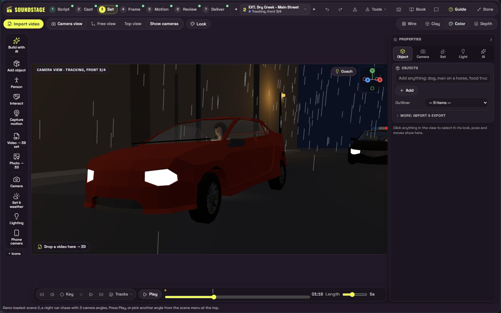</p>

From top to bottom:

### The step bar

Seven buttons, **1** to **7** (**Step 1** to **Step 7** in the classic layout), in production order: **Script**, **Cast & Locations**, **Set**, **Frame**, **Motion**, **Review**, **Deliver**. Click one to go to that step. Hover for a one-line reminder of what it does. A step's number turns green (a **✓** in the classic layout) once it is done for the current shot (a clay preview exists, a frame is chosen, a video has rendered...).

On the right of the step bar, a red **■ Stop** button appears whenever anything is rendering. It shows how many jobs are queued or running, for example **■ Stop (3)**. See [The Stop button](#the-stop-button).

### The tab bar

In the default canvas layout the steps, **↶** / **↷**, **Tools ▾** and **Expand** share one top row: Script, Cast, Stage and Compare open from the steps, and Paint Studio, Shot ideas, Look, Takes, Edit and ScriptSync sit in the **Tools ▾** menu. **Classic layout** in that menu brings back the tab bar below. In a narrow window the right-hand buttons turn into icons and then fold into a **⋯** menu (see [the 1024-wide layout](#the-1024-wide-layout-and-the-menu)).

| Control | What it does |
|---|---|
| **Soundstage** | The App's name. |
| **↶** / **↷** | Undo and redo stage edits (Cmd/Ctrl+Z, Shift+Cmd/Ctrl+Z). |
| **Expand** / **Done** | Fill the whole window with Soundstage, and back. Esc also returns. |
| **Script** | The screenplay view (same as Step 1). |
| **Cast** | Cast & Locations (same as Step 2). |
| **Stage** | The 3D stage (same as Step 3). |
| **Paint Studio** | Paint Studio on its own (the Canvas), for touching up any frame. |
| **Shot ideas** | The Director's Advisor: describe a scene and get a shot list with the reasons. |
| **Look** | The film look: style presets, camera body, lens, film stock, grade. See [the Look tab](#the-look-tab-re-render-in-any-film-look). |
| **Compare** | The Ladder, the compare view (same as Step 6). |
| **Takes** | Dailies: setups and takes as an editor's bin, plus the lined script. |
| **Edit** | The full Cut editor (timeline, audio, NLE export). |
| **Layers** / **Lite** | Appear after a Layer Pack is written: download the whole pack, or the same pack without the per-frame PNG sequences. |

### The tool rail (left)

In ③ Set, a column of labelled icons. A tool never hides a feature of its own: it takes you to the control that does the job, lights it up and puts the cursor in it.

| Tool | What it brings up |
|---|---|
| **Build with AI** | The AI box: describe a scene in plain words and it blocks the cast, set, light and camera for you. |
| **Add object** | The add box: type any name ("dog", "food truck", "man on a horse"). Things the library doesn't have are designed by AI. |
| **Person** | The pose gallery and per-joint pose controls for the selected person (or the first person on set; if there is nobody, it adds a woman to work on). |
| **Interact** | Look at, talk to, shake hands, hug, hold hands, point at, pet or lead someone or something. |
| **Capture motion** | Copy a real performance onto a person, from a video clip or acted out on your webcam. |
| **Video → Stage** | Pick a clip; Soundstage rebuilds the location, the performer and the camera move (about a minute). |
| **Photo → 3D** | Turn a photo into a whole 3D set, a solid object, a splat, a cut-out card, a backdrop or a floor plan. |
| **Camera** | Lens, camera setups (wide, over-the-shoulder, insert...), aspect ratio. |
| **Set & weather** | Where it happens (desert, night street, interior, water tank...) and rain, snow, fog, dust. |
| **Lighting** | Time of day with a real sun, film lights and classic setups like Rembrandt. |
| **Phone camera** | Hand-hold the shot camera with your phone or headset. |

### The viewport (middle)

The header above the picture:

| Control | What it does |
|---|---|
| **Camera view** | Look through the camera that renders (the shot cam). What you frame here is the shot. |
| **Free view** | Fly around the set without moving the shot camera; the shot camera is drawn as a frustum. Key **0** toggles it. |
| **Top view** | A top-down plan: the camera move and the cast's paths as lines with keys. Drag a camera key or a cast key, re-aim, add or delete keys. |
| **Show cameras** | In Free view, show a small camera at every camera key (where it stands, where it looks). Click one to jump the playhead there. Turning it on switches to Free view. |
| hint line | A reminder of the mouse and keyboard moves. Hover it to read it in full. |
| **Wire** / **Clay** / **Color** / **Depth** | How the stage is drawn: wireframe, grey clay (default), flat colour (splats and backdrop plates show here), or the depth pass the image model reads. |

Inside the picture: a badge in the top-left corner (**Camera view · Master**, or **Free view · shot camera shown**), the **Coach** pill in the top right, just left of the axis gizmo (it collects tips as **Coach · 2**; click to read them, each with a one-click fix and **Not now**), and the coloured axis gizmo: click an axis dot to look straight along it.

### The inspector (right)

Five tabs. Selecting something in the view switches it for you: an object or person opens **Object**, a light opens **Light**.

| Tab | What's in it |
|---|---|
| **Object** | The add box, **Import 3D…**, the **Import an image as…** menu, **Export GLB**, the **Outliner**, and the selected object's controls: **Move** / **Rotate** / **Scale** gizmo, **Measure**, **Snap**, **Turn**, **Scale**, **Duplicate**, **Delete**; for people also Appearance, Pose, Interact and Capture. |
| **Camera** | **Shot** picker, **New setup**, **Delete setup**, **Aspect**, **Lens & rig** (the lens slider, lens cards 14 to 135 mm, **Rig** and its amount), and the phone camera. |
| **Set** | **Set**, **Elements**, **Amount**, and **Water** for the water tank. |
| **Light** | **Light** (time-of-day presets or **Manual sun**), **Time**, **North**, **Add light**, **Auto 3-point**, **Light it like…**, the **Sun** dial, and the selected light's **K**, **Power**, **Height**, **Soft**, **Delete light**. |
| **AI** | **Describe your scene…** + **Build scene**, then a second box to change it by chat ("move the camera lower", "add rain"). |

### The timeline (bottom)

| Control | What it does |
|---|---|
| ⏮ / ⏴ | First key / previous key. |
| **◆ Key** | Set a key here for the camera (and the selected object). |
| ✕ | Delete the key at the playhead. |
| ⏵ / ⏭ | Next key / last key. |
| **Tracks** | Show a row per object: drag keys to retime, double-click to add, right-click to delete. |
| **Play** / **Stop** | Play the shot in the viewport. |
| scrubber | Drag the playhead. Orange diamonds above it are camera keys, blue ones object keys. |
| timecode | Seconds:frames at 24 fps. |
| **Length** | Shot length, 2 to 10 seconds. |

Under the timeline sits the **shot strip**: every camera setup as a clip in cut order. Click a clip to edit that setup. **+ Shot** adds a setup (a copy of the current camera, or a new angle: Master, Wide, Two-shot, Over-the-shoulder, Single, Insert, POV), **Editor** opens the full Cut editor, and the play button plays the cut on the stage. Drag clips to reorder them and drag their edges to trim. Right-click a clip for **Edit this setup on the stage**, **Edit in…** (First frame, Re-generate, Re-block, Ripple, Recast camera, ✦, Touch up, Compare: see the Cut editor below), **Duplicate setup**, **Duplicate clip**, **Split at playhead**, **Remove from cut** and **Delete setup**. Below it, **Cut → one video** and **Render missing shots** (see [⑦ Deliver](#step-7-deliver)).

The grey **status line** at the very bottom tells you what just happened and what to do next. Read it: most messages end with the next step.

---

## 3. The seven steps, one by one

Every step works on every shot in the scene. Each step screen has a row of shot thumbnails at the top: click one to work on that shot. Once a script is loaded, every step also has a **scene switcher** (a button showing **Scene 12** and its heading, or **All scenes**) so you can jump between scenes without going back to the script.

**The scene strip.** With a script loaded, one slim row sits over ③ Set, ④ Frame and ⑤ Motion: a chip per scene with its number, place, a time-of-day dot and the initials of who is in it. The current scene's chip opens to show its shots as small thumbnails with a status dot. Click a scene to switch to it (and set it up, see below), click a shot to work on it, and use ◀ ▶ or ← → to step through the scenes. On a scene you have already worked on, a button named after the setup ("Set up scene 3 — EXT. PACIFIC BEACH — SUNSET (Mara)") adds its set, time of day, characters and vehicles: it adds what's missing and removes nothing you placed. **↶ Undo setup** takes it back. Without a script the strip shows the stage's own shots.

<a id="step-1-script"></a>

### ① Script

Optional, but it makes everything after it faster. Soundstage reads your screenplay scene by scene; it never changes it. There are no writing tools: it is your script.

<p align="center">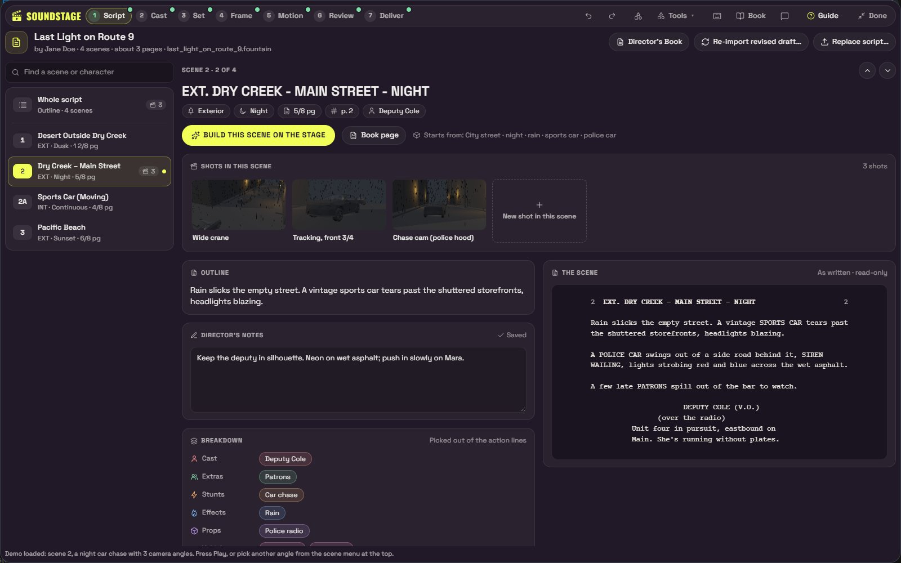</p>

**Bringing a script in**

| Control | What it does |
|---|---|
| **Choose file…** | Import a script: Fountain (`.fountain`, `.spmd`), Final Draft (`.fdx`), PDF, or plain text (`.txt`, `.text`, `.md`). |
| **Try the sample script** | Loads a short sample ("Last Light on Route 9", four scenes) so you can look around. |
| drag and drop | Drop a file anywhere on the Script view. With a script already loaded you get two drop zones: **Revised draft** (scenes matched by number, your notes kept) and **New script** (starts fresh). |
| **Re-import revised draft…** | Bring in a new version. Scenes are matched by number; your notes and shot links carry over. |
| **Replace script…** | Bring in a different script. If you have notes, it asks first and offers **Re-import as revised draft…** instead. |

Scenes are found by their headings, so every scene must start with `INT.` or `EXT.` (or `INT./EXT.`, `I/E`, `EST.`). A PDF needs a text layer: a scanned PDF has no text to read. PDF reading loads pdf.js from cdnjs the first time, so it needs an internet connection; `.fdx` and `.fountain` work offline.

**The scene list (left)**

- **Find a scene or character**: filter by number, heading, location, character or synopsis. Esc clears it.
- **Whole script**: the overview, with the speaking parts (how many scenes each is in), the outline, and any shots that don't belong to a scene.
- One row per scene: number, location, `INT · Night · 1 3/8 pg`, a clapperboard pill with its shot count, and a yellow dot if you've written notes on it. Arrow keys, Home/End and PgUp/PgDn move through the list.

**A scene (right)**

| Part | What it is |
|---|---|
| ‹ › arrows | Previous and next scene. |
| tags | Interior / Exterior, time of day, length in pages, the page it starts on, and the characters in it. |
| **Build this scene on the stage** | The scene agent blocks the scene in 3D: set, time of day, cast and vehicles. Next to it, **Starts from:** shows what it will start from. |
| **Shots in this scene** | One tile per shot (click to open it on the stage), plus **New shot in this scene**. |
| **Synopsis** | The action lines. |
| **Director's notes** | Your notes for the scene: tone, coverage, references. Saves itself as you type (**✓ Saved**). |
| **Breakdown** | Colour-coded chips picked out of the action lines: Cast, Extras, Stunts, Effects, Props, Vehicles, Animals, Wardrobe, Set dressing, Sound, Music. |
| **The scene** | The scene's pages, read-only, in screenplay format. |

**Each scene gets its own stage, its own shots and its own cut, and picking a scene sets it up for you.** The first time you open a scene (or whenever its stage is empty), Soundstage reads its heading and breakdown and puts it on the stage: the set and weather, the time of day (NIGHT → Night (moonlight), DAWN → Dawn, DUSK or MAGIC HOUR → Magic hour, MORNING → Golden hour AM…), the scene's characters as named actors in simple blocking (with their looks from ② Cast & Locations where known) and the vehicles or animals it calls for. The status line says what it did ("Set up scene 3: beach, magic hour, Mara, Ezra…"). A stage you have already worked on is never changed by itself. **Build this scene on the stage** goes further: the scene agent blocks the action and the cameras too.

<a id="step-2-cast"></a>

### ② Cast & Locations

Everyone and everything that must look the same in every shot. Each item gets a reference picture, and ④ Frame shows those pictures to the image model, so faces, costumes, cars and places stay consistent from shot to shot.

<p align="center">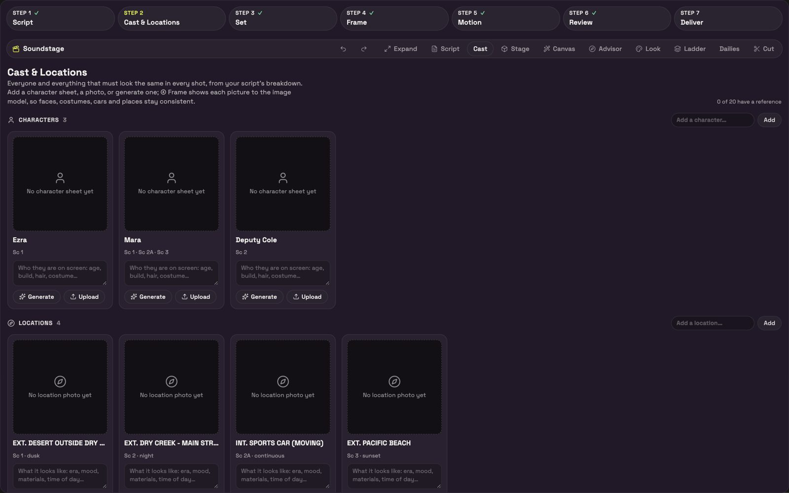</p>

The list fills itself: from the script's breakdown if you have one (characters, locations, props, vehicles, animals; clothing props are filed under Wardrobe), otherwise from the people and props on the stage. There are four sections, **Characters**, **Locations**, **Wardrobe** and **Props, vehicles & animals**, each with its own **Add** box ("Add a character…", "Add a location…", "Add a costume piece…", "Add a prop or vehicle…"). **Fit S M L XL** at the top sets the thumbnail size, and a counter shows how many items have a reference.

Each card:

| Control | What it does |
|---|---|
| picture | Drop an image on it to upload. Click it to open it full size. |
| description | What it looks like ("Who they are on screen: age, build, hair, costume…"). Used when you generate. |
| **Generate** / **Regenerate** | Makes a 1024×1024 reference with FLUX 3 Klein from the description. For characters it is a full-body sheet: front, side and back. |
| **Upload** / **Replace** | Use your own picture or character sheet. |
| **Edit** | Open the picture in Paint Studio. **Save to reference** replaces it, and ④ Frame uses the new picture. |
| **Clear** | Remove the picture. |

<p align="center">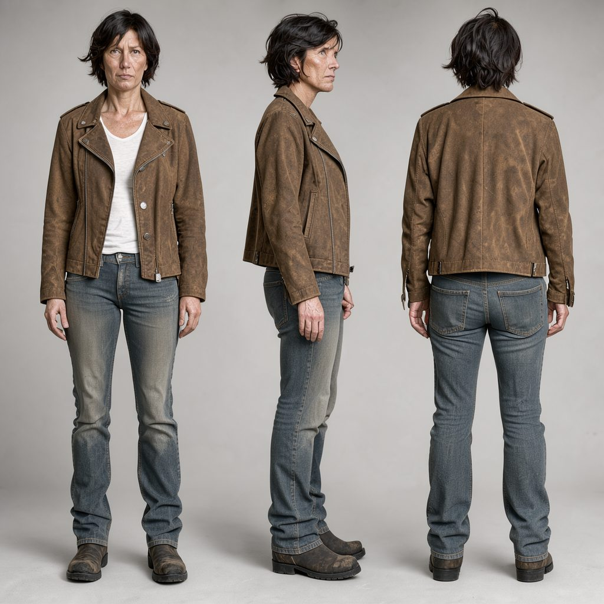</p>


<a id="step-3-set"></a>

### ③ Set

Block the scene in 3D clay: who stands where, what moves, where the camera is and how it moves. Nothing here needs a GPU model. Everything later (the frame, the video, the layers) follows what you block here, so this is where the film is made.

<p align="center">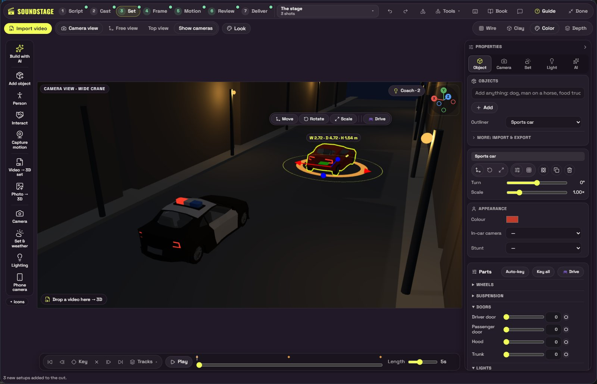</p>

A typical pass through the step:

1. **Get the scene on the stage.** With a script, just pick the scene in the scene strip: its set, light, characters and vehicles appear. Or press **Build with AI** and describe it ("two cops question a cowboy on a horse outside a diner at magic hour"), or use **Build this scene on the stage** in ① Script, or add things by hand with **Add object**. To start from real material, use **Video → Stage** or **Photo → 3D**.
2. **Pick the world.** **Set & weather** for the location and the elements; **Lighting** for the time of day, film lights or a classic setup.
3. **Place and move the cast.** Click a person to select it, drag it to place it. Move the playhead and drag again: a key is set at the playhead and the person walks between keys. Use **Person**, **Interact** and **Capture motion** for poses, interactions and real performances.
4. **Frame the shot.** Stay in **Camera view**, pick a lens, and frame by dragging in the view, scrolling, or flying with W A S D. Move the playhead and reframe for a camera move; choose a **Rig** to give the move a real dolly, jib or handheld feel.
5. **Add coverage.** **New setup** (Master, Wide, Two-shot, Over-the-shoulder A/B, Single A/B, Insert, POV) or **+ Shot** on the shot strip adds another camera on the same action.
6. **Press Play** to watch the clay, then click **④ Make the first frame →** at the right end of the time bar. It opens ④ Frame and paints this shot's first frame from the clay and camera as they are now, with ④ Frame's image model (FLUX 3 Klein unless you picked another there) and its Variations and Quality settings. Paint Studio stays closed. When the shot already has a frame the button reads **④ Remake the first frame →**: the frame you had stays in the list, still chosen, until you pick a new one.

**The AI box** (**Build with AI**, or the **AI** tab in the inspector):

| Control | What it does |
|---|---|
| **Describe your scene: …** + **Build scene** | The scene agent blocks the whole scene: cast, set, light and camera. Enter also builds. |
| **Change it: "move the camera lower", "add rain"… (Enter)** | Edit the scene by chat after it is built. |

The scene agent runs on Qwen3.5 4B if you installed it, and on its own rules otherwise. The section [The 3D stage in depth](#4-the-3d-stage-in-depth) covers every stage control.

<a id="step-4-frame"></a>

### ④ Frame

**Paint the first frame from your clay.** The image model keeps your blocking (layout, camera, who stands where) and adds the photography. Generate a few, pick one, fix it in Paint Studio if needed, and the video starts from it. Every shot gets its own frame: pick the shot in the row at the top.

<p align="center">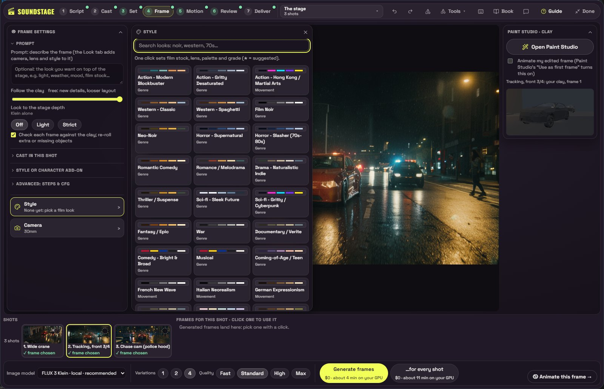</p>

Each shot card in the row says where it stands: **no frame yet**, **painting…**, **N to pick from**, **✓ frame chosen**.

**The main card (left)**

| Control | What it does |
|---|---|
| **Image model** | **FLUX 3 Klein · local · recommended**: steered by the stage picture and depth, and it takes the cast's reference pictures. **Krea 2 + depth · local · strict**: holds the stage's depth very tightly, but takes no references. Other installed image models are listed after them. |
| **Prompt: describe the frame** | What's in the frame and how it should feel ("golden hour, dust, worn leather saddles…"). The Look tab adds camera, lens and style to it. This is the same text as the Look tab's **Describe the scene**. |
| **Follow the clay** | How closely the frame sticks to the clay, from **strict** through **balanced (recommended)** to **free**. It works with both image models. |
| **Style or character add-on** | A stack of LoRAs on the image model, for a recurring character, a product or a house style. **＋ Add LoRA** adds a row (a LoRA, a strength slider, ✕ to remove); they apply in order. Every LoRA in `models/loras` is listed, the ones made for this model first, the rest marked *may not work with this model* with a warning, never blocked. A file whose header says it is for another model stops the frame with a message. An older single add-on opens as one row. |
| **Advanced: steps, CFG, sampler, shift** | Steps, CFG, sampler, scheduler and sigma shift for FLUX 3 Klein or Krea 2. *auto* and 0 mean the model's tuned values. |
| **Variations** | 1, 2 or 4 frames per click (default 4). |
| **Quality** | **Fast**, **Standard**, **High**, **Max**: the number of steps. FLUX 3 Klein: 8, 20 (default), 28, 40. Krea 2: 6, 8 (default), 14, 20. CFG stays at 1: these models are distilled. |
| **Generate frames** | Queue the variations for this shot. About 6 to 10 s a frame once the models are warm; a new shot also renders its clay passes first. Pressing it again adds more candidates. |
| **…for every shot** | The same number of variations for every shot in the scene. |
| **Advanced: steps & CFG** | **Steps**, **CFG** and a negative prompt. Leave CFG at 1: above about 1.5 it burns and doubles the time. |
| **Style** | The 32 style cards from the Look tab: one click sets film stock, lens, palette and grade. |
| **Camera** | Body, lens, focal length and aperture cards, the same as the Look tab. |

**Cast in this shot.** Under the main card: the characters, location, wardrobe, props and style references from ② Cast & Locations, as tiles. Tick who is in this shot (click the picture, or the **In this shot** box). The tiles that go to the model get a badge, **#1** to **#4**: FLUX 3 Klein takes **four references**, ranked characters first, then the location, wardrobe and props. A fifth tick shows **over** and is not sent. **S M L** sets the tile size, **② Cast & Locations** jumps to step 2, **Edit** opens a reference in Paint Studio (**Save to reference** keeps the edit for every shot that uses it), and **Add picture** / **Replace** uploads one. The note underneath says exactly what is sent ("Sent to the image model: …"). Nobody ticked means the frame is painted from the prompt and the clay alone.

**The candidates (right).** Your clay ("your clay, frame 1") and the frames as they land. Click a frame's **Use this frame** to choose it (**✓ Chosen**). The first frame to land is chosen for you. Choosing locks that model and seed, so ⑤ Motion reproduces exactly this frame from cache.

**Delete and Clear all.** The trash on a frame takes it off the list, and **Clear all** (over the list) takes every frame off. The files stay on disk. A toast offers **Undo** for 5 seconds; a newer delete replaces it. The shot's chosen frame is never deleted straight away: a red bar over the list asks first (**Delete it** / **Keep it**; for Clear all, **Clear all**, **Keep the chosen one, clear N** or **Cancel**). Deleting the chosen frame also clears the shot's saved frame, so ⑤ Motion has nothing to start from until you pick another or Generate again.

**Delete or Reject?** They do different things, so both stay. **Delete** removes a frame from ④ Frame's list. **✕ Reject** in the round review badge (see [Approvals](#approvals)) keeps the frame and marks it: the Takes bin shows it dimmed and can filter it, the shot's status dot turns red, and the Director's cut does not add a shot whose current take is rejected. Neither one steers the next generation. Reject's tooltip says the same.

**Paint Studio.** The card **Paint Studio: get the first frame right before you animate it** has **Open Paint Studio**, which opens the chosen frame in a small Photoshop right here. When you press **Use as first frame** in Paint Studio, the painted picture becomes the shot's frame (captioned **Paint Studio** in the candidates) and **Animate my edited frame** is ticked for you.

Then **⑤ Animate this frame →**.

#### Paint Studio

Paint Studio is a layered image editor with Soundstage's own Generative Fill (FLUX 3 Klein by default, crop and stitch: nothing outside your area changes). It opens inside ④ Frame, from a Cast reference's **Edit**, and on its own in the **Paint Studio** tab.

<p align="center">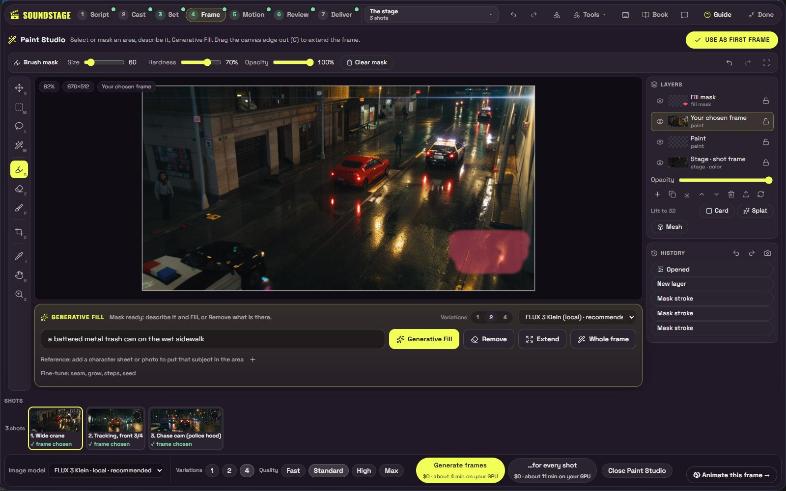</p>

**Tools** (left rail; the letter is the shortcut):

| Tool | Key | What it does |
|---|---|---|
| Move | V | Drag the active layer or the selected pixels; corners scale (Shift keeps the shape). |
| Marquee select | M | Drag a rectangle. Shift adds, Alt subtracts. |
| Lasso select | L | Draw around an area. Shift adds, Alt subtracts. |
| Magic select | W | Click an object and SAM 3.1 selects it. Shift-click or right-click excludes. |
| Brush mask | B | Paint the area Generative Fill should repaint (the default tool). |
| Eraser | E | Erase the mask, or a layer's pixels (switch it in the top bar). |
| Paint brush | P | Paint colour on the active layer. |
| Crop / Extend | C | Drag an edge past the picture to outpaint it, or pick **16:9**, **2.39**, **1.85**, **9:16**, **4:3**. |
| Eyedropper | I | Pick a paint colour from the picture. |
| Hand | H | Pan (or hold Space, or middle-drag). |
| Zoom | Z | Click to zoom in, Alt-click to zoom out. Scroll zooms anywhere, F fits. |

The bar at the top changes with the tool: **Size** (`[` and `]`), **Hardness**, **Opacity**, **Clear mask**, **Clear points**, the extend presets and **Reset**. With a selection: **Grow**, **Shrink**, **Feather**, **To mask**, **To layer**, **Invert**, **Deselect**.

**The Generative Fill bar** (under the picture):

| Control | What it does |
|---|---|
| prompt | What to put there ("a brass floor lamp"), what to remove, or what lies beyond the frame. |
| **Generative Fill** (Enter) | Repaint the selected or masked area with what you describe. The area is widened to a box with headroom above, so an added object (a car) is never clipped. |
| **Remove** | Erase what's in the area: the background continues through it. |
| **Extend** | Paint the empty canvas around the picture after you drag the edges out with Crop / Extend. With no prompt it uses the frame's description. |
| **Variations** | 1, 2 or 4 (default 2). |
| model | The image model that paints the fill. |
| **Reference** row | Tick a cast picture to put that subject in the area (the button becomes **Fill with reference**); **+** adds one. |
| **Fine-tune: seam, grow, steps, seed** | Seam feather, mask grow, steps, detail, and a fixed seed. |

Results come back as a filmstrip of **Variations**: click one to preview it on the canvas, toggle **Before / after** and drag the line to compare, then **Keep** (adds it as a new layer) or **Discard**.

**Layers** (right): the stage frame, your chosen frame, **Paint**, **Fill mask** and every kept fill, with show/hide, lock, rename (double-click), **Opacity**, new, duplicate, merge down, reorder, delete, import an image, and **Re-render the Stage layer at the playhead**. **Lift to 3D** sends the layer back to the stage as a **Card**, **Splat** or **Mesh**.

**History**: every step since **Opened**, click to jump back; the camera button saves a **Snapshot** to return to.

**Use as first frame** (top right) makes the picture the shot's first frame. When you came from a Cast reference, it reads **Save to reference** instead, with **Cancel**.

Keyboard: Cmd/Ctrl+Z / Shift+Cmd/Ctrl+Z undo and redo, Cmd/Ctrl+A select all, Cmd/Ctrl+D deselect, Shift+Cmd/Ctrl+I invert, Delete erases the selection on the active layer, Cmd/Ctrl+0 or F fits, Esc clears.

<p align="center">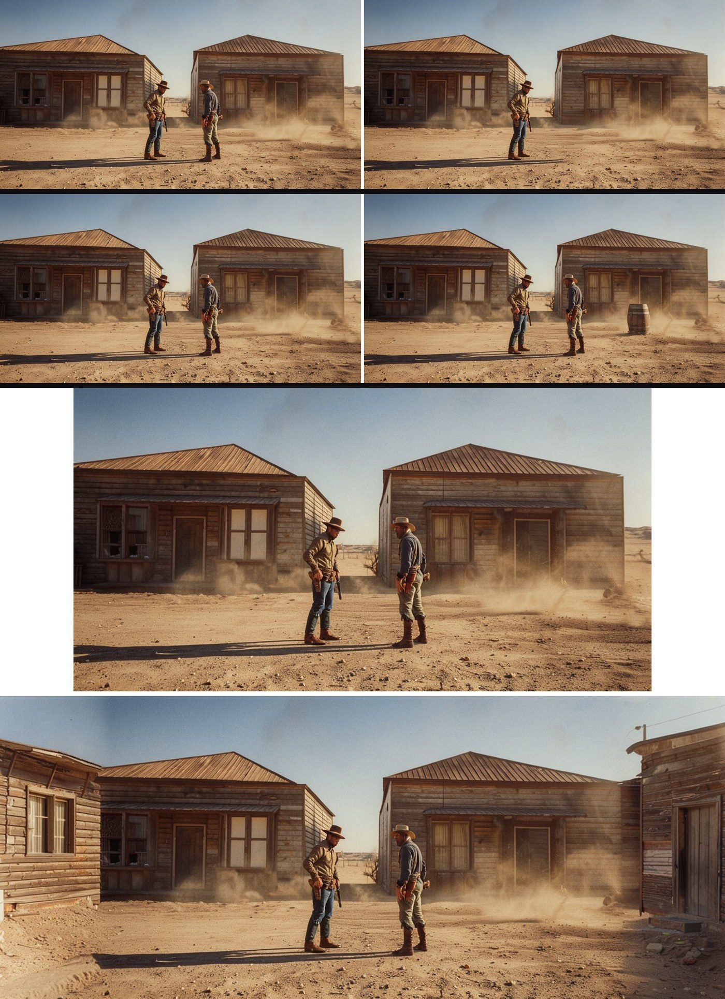</p>

<a id="step-5-motion"></a>

### ⑤ Motion

**Animate it with LTX-2.5.** LTX follows your clay animation (positions, camera, timing) and paints it in the style of your chosen frame, with generated sound. Pick a shot, or render them all.

<p align="center">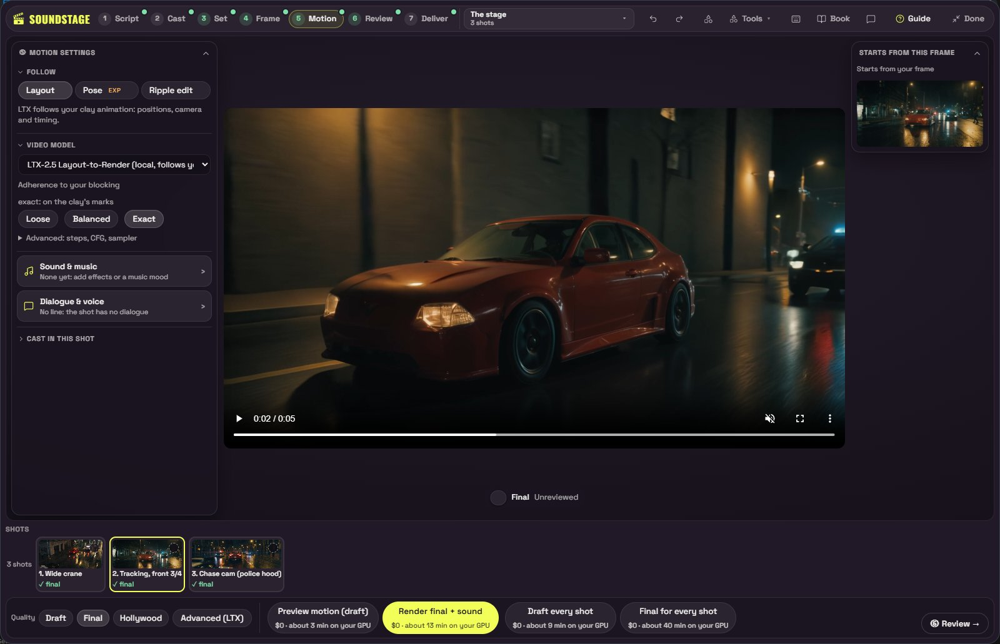</p>

| Control | What it does |
|---|---|
| **Starts from your frame** | The frame this shot will animate. |
| **Video model** | **LTX-2.5 Layout-to-Render (local, follows your clay; recommended)**. Other installed image-to-video models are listed after it, and **MiniMax H3** if you installed it (see below). |
| **Adherence to your blocking** | How closely the video follows the clay: **Loose** (more invention, framing may drift), **Balanced** (close, with a little freedom for gait and limbs), **Exact** (as close as LTX goes; the default). |
| **Quality** | **Draft**, **Final** (the default) or **Advanced** (every knob yours). Saved per shot, so a shot reopens on its own preset. See [Quality](#quality-draft-final-advanced) below. |
| **Advanced (LTX)** | Beside Quality: the full LTX controls on top of the preset (see below). |
| **Sound (generated with the final)** | The sound effects ("hooves galloping on packed dirt, wind…"). Left empty, it is filled in from what's on the stage. |
| **Music mood (optional)** | With **Music ideas** chips: tense western strings, pulsing synth chase, eerie horror drones, and more. |
| **Dialogue line (optional)** | A spoken line, with **Line ideas** chips. Typing one turns on lip sync (below). |
| **Let the sound/dialogue drive the video** | The audio drives the picture, so the mouth follows the words. |
| **Preview motion (draft)** | Queue a draft of this shot. The time under the button comes from your own measured renders. |
| **Render final + sound** | Queue the final with sound, at the shot's Quality preset. |
| **Draft every shot** | A draft for every shot that doesn't have one, each from its own chosen frame. |
| **Final for every shot** | A final with sound for every shot that doesn't have one yet. |

<a id="quality-draft-final-hollywood"></a>
<a id="quality-draft-final-advanced"></a>

**Quality: Draft, Final, Advanced.** Draft and Final are fixed recipes; both render in two stages (a base pass, a x2 latent upscale, a refine pass) with the same seed. Advanced is yours.

| Preset | Output | Steps | Time, 121 frames, 48 GB card | Use it for |
|---|---|---|---|---|
| **Draft** | 1984×1088 | 8 + 3 | about 6–7 min | A quick check: is the blocking right, does the car go the right way? |
| **Final** (default) | 1984×1088 | 12 + 6 | about 8–9 min | Your keeper renders. |
| **Advanced** | yours (Final's numbers to start) | yours | shown under the buttons | Faster drafts (fewer steps, a lower resolution) or hero shots (2624×1408, CRF 12: real detail in skin, rain and panel lines, and a spinning car stays one car, about 15–17 min). |

Each button's tooltip shows its time. Renders write H.264 (CRF 18 / 14, or yours).

1. Pick the shot in the strip, then click **Draft**, **Final** or **Advanced** under **Quality**. The choice is kept with the shot.
2. **Advanced** opens the settings, pre-filled from Final: resolution, two-stage on or off, frame rate and frame count, temporal x2, steps for each stage (down to 1; below 8 the distilled curve is thinned, untested on the GPU, for rough drafts), the **scheduler** (Distilled, the tuned curve; Linear; Linear-quadratic, LTX's paper schedule), the sigma **shift** (1 = as tuned; above 1 spends more steps on composition and motion, below 1 on detail), the stage-2 start sigma, manual sigmas, sampler, CFG, seed, the layout IC-LoRA strength, a stack of LoRAs, decode tiles, and the codec: H.264 at a CRF, or a **ProRes 422 HQ** master beside an H.264 preview. Changing any of these on a Draft or Final shot makes it Advanced with the rest carried over. **Reset to Draft / Final** goes back (the seed, Adherence and LoRAs stay).
3. Press **Render final + sound**.

A shot saved on the old **Hollywood** preset opens as Advanced with its numbers (1408p, 12 + 6 steps, CRF 12). The **Hero final** preset recipe sets the same. Older saved App workflows keep their old graph: open the Soundstage App template again to get the current wiring. Details: [quality.md](quality.md).

**Lip sync: type the line.** A line pasted over a mouth that never heard it doesn't sync. So when you type or pick a **Dialogue line**, Soundstage turns on **Let the sound/dialogue drive the video** for you. With **Who speaks the line** on **Made with the video** (the default), LTX-2.5 speaks the line in the shot and the status line says "Lip sync on: LTX speaks the line in the shot, voice and lips together." With **A saved voice**, a Chatterbox voice reads the line and that audio drives the final. You can still untick it on purpose.

Shot length comes from **Length** in ③ Set, frame size from **Aspect**, and the camera move from the keys and **Rig**. The video panel at the bottom shows the **Latest result** for the shot. Then **⑥ Review →**.

**MiniMax H3 (optional).** If installed, **MiniMax H3 (local, looser blocking, rich motion, own sound; ~20+ min)** appears in **Video model**. It makes richer motion and its own sound in one pass, but follows your blocking only loosely, and a final takes 20 to 30 minutes. Drafts still preview with LTX. Extra options: **Use the clay as a motion reference** (slower, closer blocking) and **Add images** (up to 7 reference pictures). See [MODELS.md](../MODELS.md) for its files and region-limited license.

<a id="step-6-review"></a>

### ⑥ Review

**Compare the same frame across the stages.** The Ladder shows a shot at every stage it has been through, on one picture: the clay previz, the painted frame, the draft and the final. Drag across the picture to slide between them, and scrub or play the timeline to compare any moment.

<p align="center">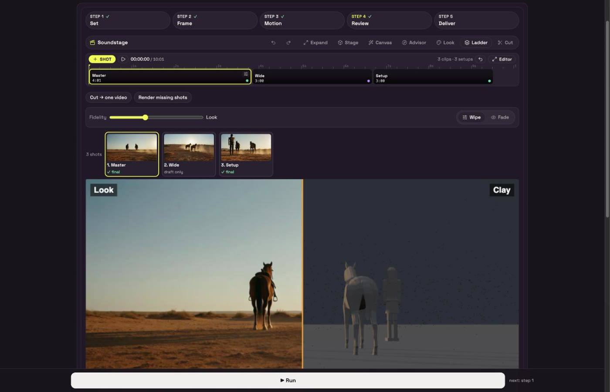</p>

Use it to check that the final still matches your blocking: the same people in the same places, the car going the right way, the camera doing what you keyed. A stage that hasn't been rendered yet says so on the picture. If something's off, right-click the shot in the strip (or its clip in the Cut editor, **Edit in…**) to go straight back to the step that made it.

The bar above the picture picks what you compare and how:

| Control | What it does |
|---|---|
| **3-way** (default) | The same frame cut into three slices, **Left** \| **Middle** \| **Right**, with two handles you drag across it. Left is **Clay** (or **Color**, **Wire**, **Frame**), Middle is **Frame** or **Draft** (click it again to drop the middle), Right is **Draft** or **Final**. Every layer is cropped to the render's own aspect, so they line up while you drag: what changes between them is only what the model changed. |
| **Wipe** | Two stages, **A** and **vs B** (any of Wire, Clay, Color, Frame, Draft, Final), split by one handle. |
| **Side by side** | A and B next to each other. |
| **Fade** | Drag to mix from A to B. |

Drag anywhere on the picture and the nearest handle follows; a click jumps it there. Greyed-out buttons are stages not rendered yet.

<a id="takes-that-check-themselves"></a>

#### Takes that check themselves

Every draft and final is checked on the CPU about 7 seconds after it lands. No models, no GPU.

<p align="center">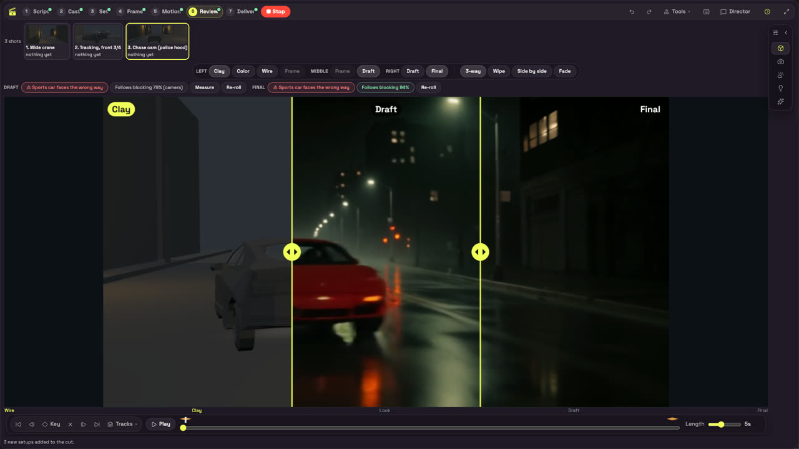</p>

1. Render a draft or a final as usual.
2. Look under the Ladder's bar (and on the Dailies cards and take rows): a chip says **✓ clean**, or what it found, such as **⚠ freeze 2.1–2.6 s** or **⚠ Sports car faces the wrong way**. It checks for black frames, frozen or stuttering stretches, jumps between frames, heavy smear, face drift, and cars whose lit lamps don't match the end that should face the camera.
3. Click a chip and the Ladder jumps to that moment.
4. Read **Follows blocking N%**: the take's camera move compared with the stage camera. Hover it for the breakdown. Press **Measure** to also score each actor against their stage position (SAM 3.1, through the queue). A camera-only score is never shown green, and "can't tell" never counts as a pass.
5. On a flagged take, **Re-roll** renders it again with a new seed. It asks first and says how much GPU time it costs.

Also new on every step button: a **Ready / Needs X** dot (the models it needs are installed, or which are missing, with a link to MODELS.md), and **$0 · about N min on your GPU** under the render buttons, from your own measured render times. Every App render carries its recipe in the MP4: drop a Soundstage MP4 on the stage and it offers to restore its set and shot.

<a id="step-7-deliver"></a>

### ⑦ Deliver

Hand a shot to post, or the whole cut to an editor. The shot cards at the top show where each shot stands: **✓ final**, **draft only**, **frame ✓, no video**, **nothing yet**, or **making layers…**.

<p align="center">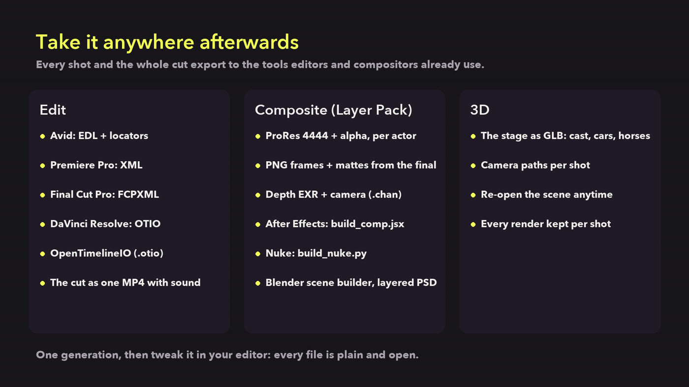</p>

| Control | What it does |
|---|---|
| **Make the Layer Pack** | For the shot picked above: one layer per actor with mattes cut from the final frames (SAM 3.1 + BiRefNet edges), depth, the camera, and builders for After Effects, Nuke, Resolve, Blender and Photoshop. The final is reused from cache; the mattes take about a minute. |
| **Layer Packs for every shot with a final** | The same for every shot that has a final. |
| **Cut → one video** | Every shot in the strip, trimmed and in order, with sound, joined into one MP4. Each clip uses its best render (Final with sound, then Final, Draft, the clay preview, the frame); a shot with nothing yet becomes a black slate of the right length. When it's done you get **Watch** and **Download**. |
| **Render missing shots first** | Queue a Final for every shot in the cut that has none, then join the cut. |
| **Open the editor** | Opens the Cut tab, for export to Avid, Premiere, Resolve, FCP or OTIO. |

When a Layer Pack is ready, **Layers** and **Lite** download links appear in the tab bar, top right. **Lite** is the same pack without the per-frame PNG sequences (the ProRes 4444 movies, EXRs, camera and builders are kept).

**What's in a Layer Pack** (`ComfyUI/output/soundstage_layerpacks/<shot>_<date>_<time>/`):

| Folder / file | Contents |
|---|---|
| `layers/<nn>_<name>/png/` | RGBA frames per actor, straight alpha, numbered from 1001 |
| `layers/<nn>_<name>/matte/` | 16-bit mattes |
| `layers/<nn>_<name>/<name>_4444.mov` | ProRes 4444 with alpha, timecode from 1001 |
| `aovs/depth/` | depth EXRs in metres, plus a viewable `depth_vis/` |
| `camera/camera.json`, `camera/camera.chan` | the exact staged camera |
| `dcc/ae/`, `dcc/nuke/`, `dcc/blender/`, `dcc/resolve/`, `dcc/photoshop/` | an After Effects `.jsx`, a Nuke script, a Blender script, a Resolve OTIO timeline and a layered PSD |
| `preview/` | a contact sheet and a comp preview movie |

#### The Cut editor

> **Real-time playback (2 November).** Rendered takes now play at their real speed, from proxies the server makes, with a **Final** / **Draft** / **Look** / **Clay** badge on every clip: see [Real-time playback in the Cut](#real-time-playback-in-the-cut). The Cut runs at 24 fps only, and editing a clip from the timeline (*Edit in*) is not in this build.

The **Edit** tab (the Cut; or **Editor** on the shot strip) is a real timeline over your coverage, with the keys editors expect.

<p align="center">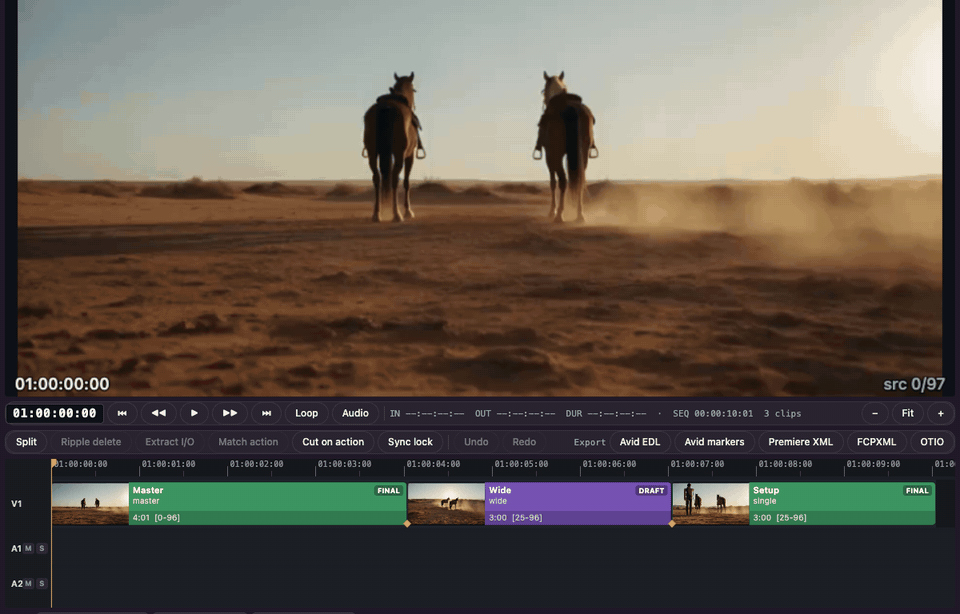</p>

| Control | What it does |
|---|---|
| timecode box | Record timecode: 24 fps non-drop, starting at 01:00:00:00. |
| transport | Previous edit (↑), shuttle reverse (J), play/stop (Space), stop (K), shuttle forward (L), next edit (↓). Press J or L again for 2×, 4×, 8×. Play runs in real time; reverse and 8× seek on the take's proxy once it is ready. |
| **Loop** | Loop playback (the I/O range when marked). |
| **Audio** | Play the audio of Draft and Final clips. |
| **−** / **Fit** / **+** | Zoom the timeline (`-`, `\`, `=`). |
| **Split** | Add an edit at the playhead (B or Cmd/Ctrl+B). |
| **Ripple delete** | Delete the selected clip and close the gap; with nothing selected, extract the I/O range (Backspace). |
| **Extract I/O** | Remove the marked range and close the gap (X). |
| **Match action** | Slide the selected clip so it continues the action of the clip before it (M). |
| **Cut on action** | On by default: match the scene frame when cutting between setups of one scene, and snap trims to it. |
| **Sync lock** | On by default: picture ripple edits move the audio after them too. |
| **Undo** / **Redo** | Cmd/Ctrl+Z, Shift+Cmd/Ctrl+Z. |
| **Shots** bin | Click a shot to splice it in at the playhead, Shift-click to overwrite, drag onto the track to insert. |
| audio tracks | A1, A2… with **M** (mute) and **S** (solo). Select an audio clip for gain dB, fade in, fade out, track, **Remove**. `[` and `]` change gain by 1 dB. |

On the timeline: drag a clip to reorder, drag its edge to trim, Option/Alt-drag an edit to roll it (the viewer shows a two-up trim monitor). Mark in and out with I and O, clear with G.

**Right-click any clip (or hover it and click ✎, or press E) → Edit in….** Each item opens the step that made the clip, with that clip loaded: **First frame** (④ Frame, the frame this take started from), **Re-generate** (⑤ Motion, with this take's settings), **Re-block** (③ Set, at the clip's frame), **Ripple**, **Paint video-to-video**, **Recast camera** and **✦ One-click cards** for the video itself, plus **Touch up its frame in Paint Studio** and **Compare in ⑥ Review**. The clip and the other clips of that shot hold their take while you are away. **↩ Back to the cut** in the step bar brings you back to the same clip, and **Replace in cut** makes the new take the clip's next version (⌘Z brings the old one back). Details: [docs/cut.md](cut.md#edit-from-the-timeline).

**Export to your NLE** (the **Export** buttons; all download straight from the browser):

| Button | File | For |
|---|---|---|
| **Avid EDL** | `.edl` (CMX3600, picture + audio events) | Avid Media Composer |
| **Avid markers** | `_avid_locators.txt` | Avid's Markers window → Import Markers |
| **Premiere XML** | `_premiere.xml` (FCP 7 XML) | Premiere Pro, with the audio tracks |
| **FCPXML** | `.fcpxml` (1.10) | DaVinci Resolve and Final Cut Pro |
| **OTIO** | `.otio` | DaVinci Resolve and other OpenTimelineIO tools |

Avid AAF comes from the graph node **Soundstage · Cut: Export to Avid / Premiere / Resolve / FCP**, which writes every format plus an `.aaf` and per-shot audio mixes into `output/soundstage_cuts/<name>/`. Add it in the graph view and install `pyaaf2` to use it. Transitions, fades, opacity and volume keys, and titles travel into the EDL, Premiere XML, FCPXML and OTIO exports, with .srt and .vtt for subtitles.

<a id="transitions-sound-titles-and-render"></a>

#### Transitions, sound, titles and render

The timeline has **V3** (motion graphics, once you add one) and **V2** (titles) over **V1**, a **SUBS** lane, and **A1 Dialogue · A2 SFX · A3 Music · A4 Ambience**.

<p align="center">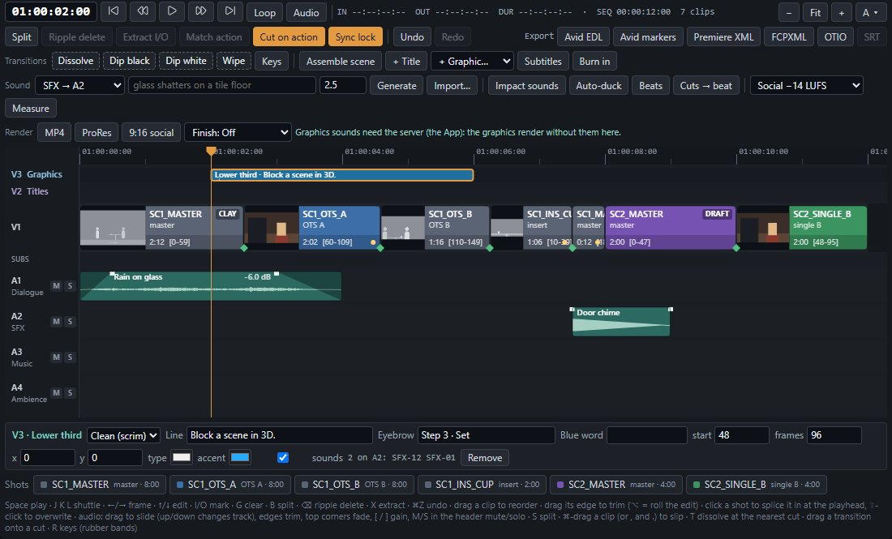</p>

**Add a transition or a fade**

1. Drag **Dissolve**, **Dip black**, **Dip white** or **Wipe** from the **Transitions** row onto a cut. Drop it on the head of the first clip for a fade up, on the tail of the last for a fade out. Or press **T** for a dissolve on the cut nearest the playhead.
2. Click the transition bar to change its type or length, or **Remove** it (⌫).
3. If the bar turns orange, the clips' handles were too short: the status line says how much fitted. A dip needs no handles.

**Edit like an NLE.** **S** splits, ⌘-drag (or `,` / `.`) slips a clip, Option/Alt-drag rolls an edit, and drags reorder with snapping. **Keys** (or **R**): click a clip's line to add a rubber-band key (opacity on V1, volume on audio), drag it, Option/Alt-click deletes it.

**Generate sound in place**

1. Put the playhead where the sound should start.
2. In the **Sound** row pick **SFX → A2**, **Music → A3** or **Dialogue → A1**, type it (a line as `MARA: Drove all night to find you`) and a length, then **Generate**. It's made by the App's own open-weights nodes (LTX-2.5 audio, Chatterbox) and lands on its track. **Import…** puts your own file there.
3. **Auto-duck** dips the music −12 dB under every dialogue line (amber keys you can drag).
4. **Beats** finds the music's tempo; trims snap to it, and **Cuts → beat** rolls each cut onto the nearest beat.
5. Pick the loudness target: **Social −14 LUFS**, **EBU R128 −23 LUFS** or **ATSC A/85 −24 LKFS**. **Measure** reads the mix.

**Titles, subtitles and a first cut**

- **+ Title** puts a card on V2 (card on black, lower third or centre) with text, length and fades in the inspector.
- **Assemble scene** builds a first cut from the ScriptSync lining: the wide for action, an insert where one is lined, the speaker's single for their lines, cutting on line ends.
- **Subtitles** builds cues from the typed dialogue lines; **Burn in** draws them into the render.

**Motion graphics on V3**

**+ Graphic…** (next to **+ Title**) puts a motion graphic on a **V3 Graphics** lane at the playhead. The lane appears with the first graphic. There are nine templates, all from one design system: one typeface, one accent blue, and the same easing and timing everywhere.

| Template | What it does | Its sounds on A2 |
| --- | --- | --- |
| **Title** | A sentence (up to 2 lines) rises line by line on black, or over the picture, which recedes behind a scrim | a soft tick per line |
| **Kinetic type** | One word per beat: the first slams in, each next word swaps in place | a sub thump on the slam, a tick pair per swap |
| **Lower third** | A blue eyebrow and a line over a bottom scrim (or a glass plate) | a puff, then a tick |
| **Callout zoom** | Zooms the picture into a control, rings it, and pops a chip with its words. *Ring only* skips the zoom. *Zoom + cursor click* adds a pointer that glides in and clicks | a riser that ends as the zoom lands, a glassy ping, a puff, a click |
| **PiP corner** | Another clip in a rounded window (bottom right, top right or bottom left) while the picture recedes | a whoosh in, a whoosh out |
| **Dual PiP** | Two windows side by side, staggered, or a window plus a still card ("picture on video on video") | two whooshes, the second a tone higher |
| **Device frame** | A clip inside a plain monitor or phone (no logos, no notch) | a lower whoosh |
| **Split** | The same shot in two rungs (Final on the left, Clay on the right): a divider sweeps to the centre, holds, then wipes on | an air pass that follows the divider |
| **End card** | The Soundstage logo, a tagline, the repo line and optional small print | a warm chord swell, ticks for the lines |

1. Pick a template from **+ Graphic…**. A window takes the clip under the playhead; **Dual PiP** takes the next clip for B.
2. Edit it in the inspector: its look, the text fields, **start** and **frames**, **x / y** (or a callout's box), the **type** and **accent** colours, the clips in its windows with their rung (*best rung*, *clay*, *look*, *draft*, *final*) and in-frame, and **sounds** on or off. Mark one word **Blue** to colour it.
3. Drag the graphic in the viewer to move it. A callout drags its target box. Drag the block on V3 to retime it, or drag its right edge to change its length. **⌫** removes the selected graphic.

Each graphic places its own designed sounds on **A2**, on the frames where its events land, at the design system's levels. Move, retime or edit a graphic and its sounds follow. Turn **sounds** off and they go. The sounds are synthesised by the App (no samples, no downloads) and checked with an AudioSet classifier.

The render draws the graphics at full resolution, frame by frame, with motion blur on moving frames, over the picture and under the V2 titles. The preview in the viewer uses the same timing and layout. Text in the render is set with the App's Space Grotesk face, so it can differ from the browser by a pixel or two. Graphics stay in the render only: the NLE exports don't carry them.

**Render.** **MP4** (H.264 + AAC), **ProRes** (422 HQ + 24-bit PCM) or **9:16 social** (1080×1920, titles laid out for the phone), written to `output/soundstage_cuts/`. Transitions, fades, keys, titles, the mix and each Final's own sound are rendered, taken to the loudness target with a true-peak limiter. Details: [cut.md](cut.md).

### Dailies and the lined script

The **Takes** tab (Dailies) shows a scene's setups and takes the way an editor's bin does. It has no step of its own: open it from **Tools ▾** (the tab bar in the classic layout).

<p align="center">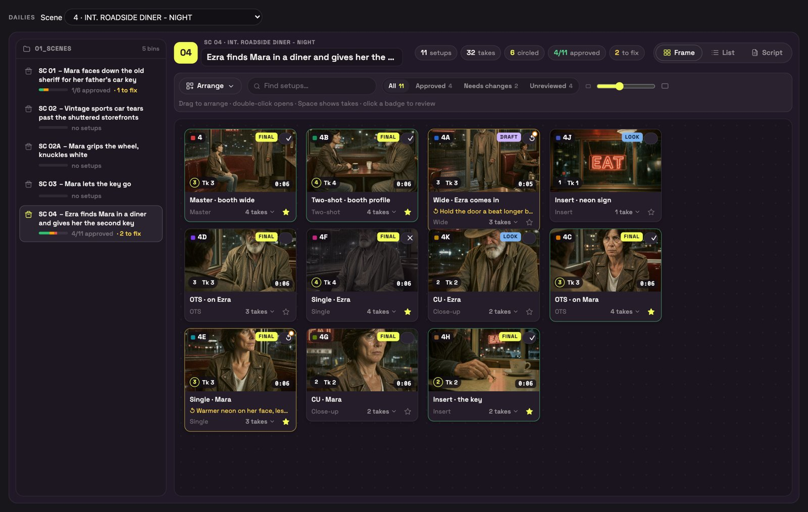</p>

**Every render is a take.** The clay preview, each frame variation, each Draft and each Final of a setup become takes 1, 2, 3… Setups are slated like a real shoot: the first setup of scene 12 is **12**, then **12A**, **12B** (I and O are skipped). A clip is named **12B-3**: scene 12, setup B, take 3.

The header shows `SC N ·` and the scene heading, the counts of setups, takes, circled and approved takes, and three views: **Frame**, **List** and **ScriptSync**.

**Frame view**

| Control | What it does |
|---|---|
| **Arrange ▾** | **Script order** (where each setup starts in the scene), **By setup type** (masters, two-shots, OTS, singles, close-ups, inserts), **Tidy grid**. |
| **Find setups…** | Filter by slate, name, setup type or take kind. Type `circled` to see only circled setups. |
| size slider | Thumbnail size. |
| card | Thumbnail, slate, take kind (Previz / Look / Draft / Final), take number, duration, setup type. |
| **N takes ▾** | Show the takes (also on hover, or Space). Each row opens that take or circles it. |
| ☆ | Circle the shown take (one circled take per setup). |

Drag cards to arrange them (Option/Alt-drag places freely), arrow keys nudge, Enter or double-click opens the circled take, `C` or `*` circles.

<a id="approvals"></a>

**Approvals.** Review every take the way a director signs off dailies. A small round badge sits on each frame, draft and final (in the bin, on ④ Frame's variations, on ⑤ Motion's latest result and in the shot rows). Click it for the **Review** pop-over: **✓ Approve**, **↺ Needs changes** or **✕ Reject**, plus **Clear** to go back to unreviewed. **Reject** keeps the take on record (dimmed in the bin, in the status filter); to take a frame off ④ Frame's list instead, use the trash on its tile ([Delete or Reject?](#step-4-frame)). With **Needs changes**, write what should change ("warmer light, she looks left, slower push-in") and press **↺ Redo in ④ Frame** or **↺ Redo in ⑤ Motion**: Soundstage opens that step for the shot with your note on top, and in ④ Frame it adds the note to the frame prompt (**Undo prompt edit** takes it back out). The same status shows everywhere and is saved with the workflow. The bin has a status filter to show setups by review status, such as the takes that need changes.

**Scene bins.** Like an Avid project, there is one bin per script scene, named like **SC 03 – what happens**, in script order, each showing how much of it is approved.

**List view** is a sortable table: Setup, Name, Type, Takes, Circled, Status, Kind, Duration, Coverage. Click a column header to sort, Enter opens, C circles.

#### ScriptSync (lined script)

ScriptSync works like Avid ScriptSync. It shows the scene's page with a coloured vertical **coverage line** for each setup, running through the lines and action that setup covers. Each setup's **thumbnail** and slate (4, 4A, 4B…) sit at the top of its line. Where lines start close together, the thumbnails stack upward. A straight stretch is on camera. A **zig-zag** means the camera is rolling but the character is off screen.

<p align="center">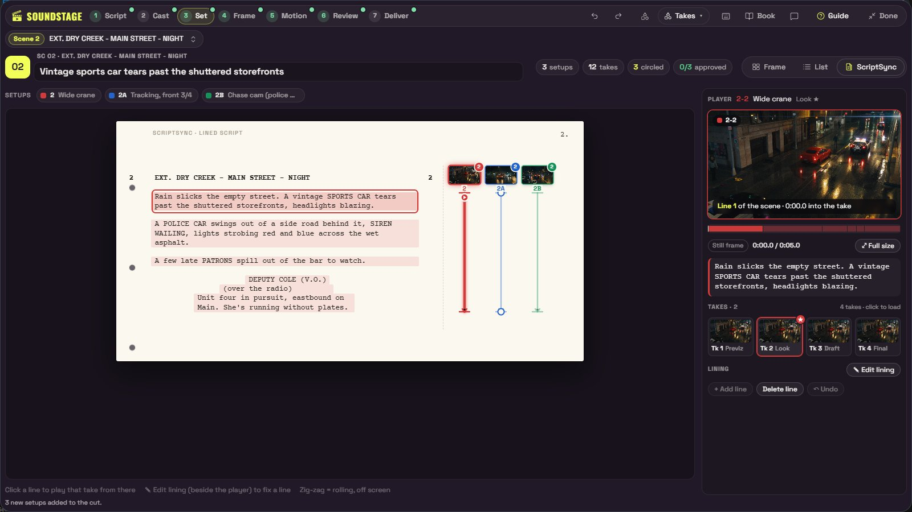</p>

**Open it** from any of these:

- **Tools → ScriptSync (lined script)** in the top row. In the classic layout, it is the button after **Takes**.
- The **ScriptSync** toggle in the Takes view, next to Frame and List.
- **Open ScriptSync for this scene** on a scene in ① Script that has takes.

The first time it opens, a hint explains the three basics.

**Play from a line.**

- **Click a coverage line** at any script line. That setup's take loads in the **player** beside the page, cued to that moment (for example "Line 7 of the scene · 0:00.1 into the take"). The line is highlighted, and a play mark sits where you clicked.
- **Click the page text** to load the setup covering that line. The setup already in the player keeps playing if it covers the line. Otherwise ScriptSync picks the tightest one, a single over the master.
- **Click a thumbnail or a setup chip** to load that setup from the top of its line.
- The player shows the slate (4C-3), the script line it is cued to, and a take bar with one segment per covered line. Click the bar to move the cue. A video take plays from the cue, and the cue moves down the page as it plays. A still take shows its frame. **Full size** opens the take large.
- **Takes** under the player lists every take of the setup (Tk 1, Tk 2…). Click one to swap it into the player at the same cue.

**Edit lining.** When Soundstage's starting lining is wrong, press **✎ Edit lining** (beside the player). A banner over the page repeats the moves:

- **Drag a line's top or bottom dot** to change the lines it covers. It snaps to whole script lines. Keyboard: ↑/↓ moves the end, Shift+↑/↓ moves the start.
- **Click a stretch of a line** to flip that script line on or off camera (zig-zag). Option/Alt+click does the same outside Edit lining.
- **+ Add line** draws the loaded setup's line: click the script line where it starts. You can also drag a take from the takes list onto the page. A dashed setup chip is a setup that isn't lined yet.
- **Delete line** removes a wrong line (Delete or Backspace on a focused line also works).
- **↶ Undo** or ⌘Z / Ctrl+Z takes back the last lining change.
- **Done** leaves Edit lining.

Lining edits save with the workflow (on the stage node), per scene.

Soundstage lines setups for you to start with:

- Masters, wides and two-shots cover the whole scene.
- Singles and close-ups run from the character's first cue to their last speech, with zig-zags where others talk.
- Inserts cover the action line that mentions their subject.


### The Look tab: re-render in any film look

The look lives apart from the stage. Change it and the clay, depth and camera are untouched (and reused from cache), so **the same blocking and the same animation can be rendered again in any film look**: a western as film noir, a car chase as a 70s New Hollywood picture.

<p align="center">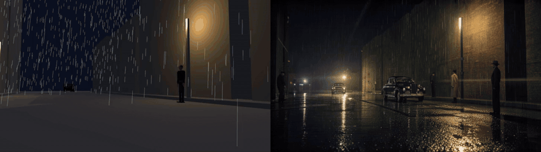</p>

**To re-render a shot in another look:**

1. Open the **Look** tab (or the **Style** section in ④ Frame) and click a style card.
2. In ④ Frame press **Generate frames**: new frames from the same clay and depth. Pick one.
3. In ⑤ Motion render again. LTX is guided by the same clay animation, so the positions, the camera path and the timing stay; only the photography changes.

**The 32 style swatches.** Each card shows its palette as a colour strip; hover for a one-line summary. One click sets the camera body, lens, aperture, film stock, genre, era, technique, mood, energy, palette and grade, and the stage lens. In-car cameras keep their wide lens. In the Look tab, a **director's notes** panel then explains the style's lighting, camera and framing, and ★ marks its suggested film stocks, lenses, focal lengths and apertures.

| Group | Styles |
|---|---|
| Action | Action - Modern Blockbuster · Action - Gritty Desaturated · Action - Hong Kong / Martial Arts · Racing Cinema |
| Western | Western - Classic · Western - Spaghetti |
| Noir and thriller | Film Noir · Neo-Noir · Thriller / Suspense · Korean Thriller · Nordic Noir |
| Horror | Horror - Supernatural · Horror - Slasher (70s-80s) |
| Romance and drama | Romantic Comedy · Romance / Melodrama · Drama - Naturalistic Indie · Coming-of-Age / Teen |
| Sci-fi and fantasy | Sci-fi - Sleek Future · Sci-fi - Gritty / Cyberpunk · Fantasy / Epic |
| Others | War · Documentary / Verite · Comedy - Bright & Broad · Musical · Music Video / Commercial Gloss |
| Movements and eras | French New Wave · Italian Neorealism · German Expressionism · Dogme 95 / Handheld Realism · Storybook Symmetry · 70s New Hollywood · Hong Kong Mood Cinema |

**Everything else on the Look tab**, top to bottom:

| Control | What it does |
|---|---|
| **Type a look** + **Apply** | Plain words ("Korean thriller, anamorphic, teal-orange") set the matching controls. Words it doesn't recognise go into the scene description. **Reset** clears every look control. |
| **Describe the scene** | Who they are, wardrobe, props, place details. Blocking, lens and time of day come from the stage. |
| **Camera** | Four columns of cards: **Body**, **Lens**, **Focal length** (14 to 135 mm; sets the stage camera at the playhead) and **Aperture**. |
| selects | **Film stock / sensor look** (Kodak Vision3, CineStill 800T, bleach bypass, Double-X black and white, VHS…), **Genre**, **Subgenre**, **National cinema / movement**, **Era**, **Director technique**, **Mood / emotion** with an intensity slider, and **Energy** (the pacing of the motion). |
| **Colour palette** | 32 palettes (Teal & orange, Sodium decay, Moonlit blue, Technicolor primaries, Vaporwave…), editable swatches, **+ Swatch**, **Randomize**, and **From image…** to pull five swatches from a reference picture. |
| **Grade** | Contrast, Saturation, Warmth, Grain, Halation, Vignette, and extra negative words. |
| **Restyle brief** | Describe the finished world: target world, atmosphere, surfaces, set dressing, colour, light, what's outside the windows. |
| **Compiled prompts** | The exact prompts Soundstage will send: **Look still · frame 1**, **Still negative**, **Motion · LTX**, each with **Copy**. |

The 18 lighting setups (**Light it like…**) live with the lights in ③ Set → **Light**.

### The Stop button

The red **■ Stop** at the end of the step bar is there whenever ComfyUI is rendering. With more than one job queued or running it shows the count, **■ Stop (4)**.

Press it to **cancel every queued render and interrupt the one running now**. The status line confirms: "Stopped: 3 queued renders cancelled, the running one interrupted." Shots marked painting… or rendering… go back to normal, and anything already rendered stays.

It clears the **whole ComfyUI queue**, including jobs you queued from other workflows or tabs on the same server.

<a id="activity"></a>

### Activity: what the GPU is doing, node by node

The **Activity** pill sits in the top row, left of **Book** and **✦ Ask**, in both layouts, and never folds into **⋯**. It reads **Idle**, or, while one of your jobs runs, the step it is on first: **Sampling: stage 1 · 8/12 · 2 queued · ~6 min**. A thin bar along its bottom edge fills as the job goes. Click it for the panel.

**Running now**, for a job you queued from this browser:

- The job (**Final · shot 1G**), then the stage it is on in plain words: *Loading model*, *Encoding prompt (Gemma)*, *Depth map*, *Pose (DWPose)*, *3D stage (clay passes)*, *Sampling: stage 1*, *Upscaling ×2: stage 2*, *Sampling: stage 2*, *Decoding video (VAE)*, *Saving MP4*. A node you gave a title shows its title; a node the App doesn't know shows its class name.
- On a sampler, the steps (**step 8/12**) and a thin blue bar for them, over the job's own bar.
- **node 7 of 11 · 2 cached · 0:12 so far · about 2 min left**. Cached nodes are ones ComfyUI skipped because their inputs had not changed.
- **Details**: every node as it ran, with its time (**✓ Depth map · 2.0 s**, **▶ Sampling: stage 1 · 8/12**), cached ones on one line. Tick **Node types (class and id)** to see `KSampler #12` instead of the plain names; the App remembers it in this browser.
- **Cancel** stops it (ComfyUI interrupts that prompt).

**Queued next**: place in line, what queued it, and about when it starts. **Cancel** takes your own queued job off the queue.

**Finished recently**: done, failed or cancelled, how long it took, links to the results. A failure names the node and the message, for example *Failed at Decoding video (VAE) (VAEDecodeTiled #16)*, *Ran out of GPU memory…*, then ComfyUI's own first line. A job you stopped says where: *Cancelled at Depth map*.

Jobs from other browsers or people on the same server show too, marked **another session**, with their place and time but no node detail and no Cancel (ComfyUI sends node events only to the session that queued a job).

**Time left** is the average of your last runs of that kind and size in this browser. Before the first one it is the current sampler's step rate, which only counts that sampler, so it reads **at least** (and the pill **≥**). Past its average it says *longer than usual* instead of a number.

Limits: the stage names come from the prompt your browser sent, so a job queued from another tab of the same browser shows node numbers only until it finishes. The node count is every node in the prompt; nodes ComfyUI doesn't need are never run, so the count can jump at the end. More: [activity.md](activity.md).

<a id="the-director-chat-voice-and-mcp"></a>

<a id="ask-the-assistant"></a>

### Ask: the assistant, on every screen

**✦ Ask** sits in the top row beside **Guide** and **Expand** on every step and tool, and never folds into **⋯**, even 1024 px wide. **⌘K** / **Ctrl+K** (or **/**) opens it from anywhere. If the top row is out of sight (the App's side panel scrolled down), a small floating **✦** appears in the corner of the App instead.

1. Press **Ask**. The chat opens inside the canvas; its top line says where you are, for example *You're on ③ Set · shot 2 (Tracking) · Red car selected · Physics open*.
2. **Ask how:** *"how do I make the car crash into the boxes?"*. You get numbered steps. Each step has **Show me**, which opens that step and lights up the real button (the same spotlight the Guide uses). **Show me, step by step** walks through all of them.
3. **Or have it done:** press **Do it for me**. You see the Director's plan first, then press **Apply**, and **Undo this** puts it all back.
4. **Learn as you go:** the buttons under each answer suggest what to do next from where you are. *"What should I do next?"* works too.
5. **Talk:** hold the **Ask** button (or the floating ✦, or **`** anywhere) and speak; let go to send.

Questions about controls are answered from built-in recipes, so they work offline with no model. For other questions it uses the local model (Qwen3.5 4B, or your Ollama model) if it's free, and never waits behind a render. Orders ("make it rain") go straight to the Director below.

### The Director: chat, voice and MCP

Say what you want and the Director does it with the App's own controls.

<p align="center">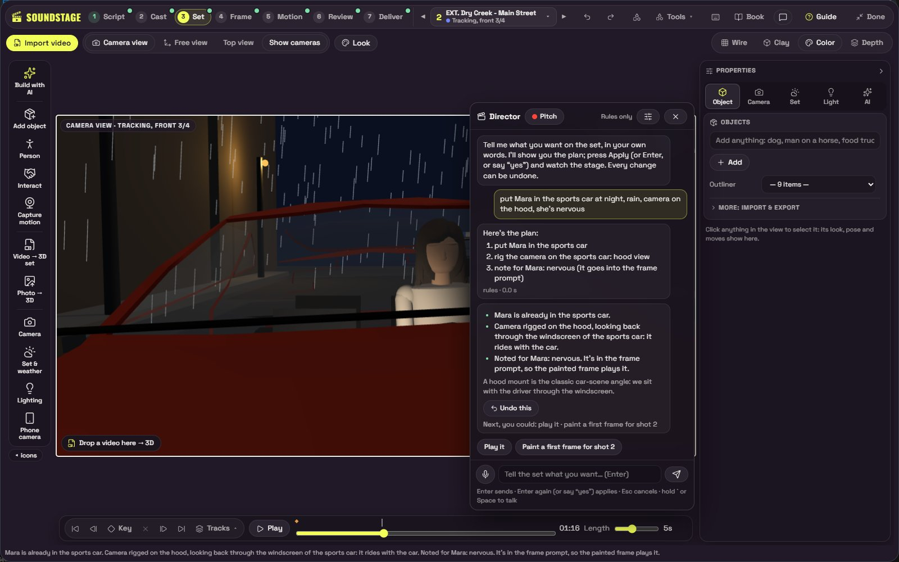</p>

1. Press **/** (or **✦ Ask** in the top bar). The panel opens with the cursor in the box.
2. Type what you want, for example *"put Mara in the sports car at night, rain, camera on the hood, she's nervous"*, and press Enter. Or **hold `** anywhere in the App (or Space in the empty box) and talk; let go to send.
3. Read the plan: a short numbered list of steps.
4. Press **Apply**, Enter on the empty box, or say "yes". Each step runs in front of you on the stage.
5. Changed your mind? **Undo this** on that turn puts back the scene, the look, the approvals and the cut. "no" or Esc drops a waiting plan.
6. Use the suggested next steps (buttons such as **Play the stunt**) or keep talking.

**What it can do:** cast and props, crate stacks, mounting people in cars and on horses, time, weather and lights, coverage setups, lenses, animated camera moves, rigs and hood mounts, car stunts and drive-through crashes, physics and bake, notes for an actor, the grade, script scenes, presets, frames, drafts and finals, approvals and the cut. Anything that uses the GPU always asks first, unless you said "go" ("render a draft of shot 2, go").

**The model.** By default a local **Qwen3.5 4B** through ComfyUI's queue (offline). It can also use an Ollama model on your computer, which answers while the GPU is busy, or plain rules with no model. Voice uses the browser's speech recognition or **Whisper** on the server (offline; on the GPU when there is one, else the CPU). Pick these in the panel's settings. Details: [director.md](director.md).

**Drive it from Claude (MCP).** The same tools are an MCP server, `tools/soundstage_mcp.py` (Python standard library only).

1. Open the Soundstage App in a browser, with ComfyUI running.
2. Add the server. For Claude Code:
   ```bash
   claude mcp add soundstage -e SOUNDSTAGE_URL=http://127.0.0.1:8188 -- python3 /path/to/ComfyUI/custom_nodes/ComfyUI-Soundstage/tools/soundstage_mcp.py
   ```
   For Claude Desktop, add the same command to `claude_desktop_config.json` (see [mcp.md](mcp.md)).
3. Ask Claude, for example *"Look at my Soundstage set and make shot 2 a slow push-in at 50 mm"*. It reads the set and proposes a plan; nothing changes yet.
4. Approve it, and the plan runs in the open App as a "Claude · MCP" turn in the Director panel, with **Undo this**. Renders also need `confirm_gpu`, so a well-behaved client asks you first.

<a id="presets-one-click-camera-moves-and-lighting"></a>

### Presets: one-click camera moves and lighting

<p align="center">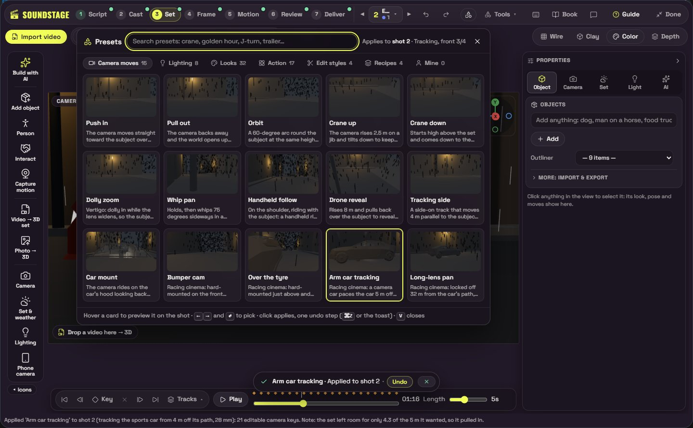</p>

1. Pick the shot in the strip, then press **V** (or **Presets** in the top bar).
2. Choose a tab: **Camera moves** (push in, pull out, orbit, crane up / down, dolly zoom, whip pan, handheld follow, drone reveal, tracking side, car mount, bumper cam, over the tyre, arm car tracking, long-lens pan), **Lighting** (golden hour, blue hour, night street, noir hard key, neon, overcast, candle / firelight, studio three-point), **Looks**, **Action**, **Edit styles**, **Recipes** or **Mine**. Or type in **Search presets** ("crane", "golden hour", "J-turn", "trailer").
3. Hover a camera move to preview it on the shot; click it to apply. Camera moves write editable camera keys and a rig; lighting sets the time of day, a lighting setup, the prompt words and the grade.
4. Every apply is **one undo step**: ⌘Z (even right after clicking a card) or **Undo** on the toast.
5. To keep your own: set up a camera, light or look you like, open **Mine** and **Save current as Camera**, **Light** or **Look**. **Export** saves them as JSON.

The Director can use presets too: *"make it a crane up at golden hour"*.

**Racing cinema (car stunts).** For a J-turn that looks like *Ford v Ferrari* or *F1* rather than a game, select the car, apply **J-turn** (Action), then a racing camera, then the **Racing Cinema** look (Looks), or say it in one line: *"give the car a J-turn with a long-lens pan in the racing cinema look"*.

| Preset | What it puts on the shot | From the films |
|---|---|---|
| **Long-lens pan** | A still camera on a tripod 32 m from the middle of the car's path, lens 1.2 m up, 135 mm, a pan key on the car every 6 frames. It pulls in (the lens shortening with it) to keep the car inside the stage's 40 m depth guide, and moves to the other side of the path if a building is in the way; the toast says what it gave up. | Racing films reportedly shoot this on long zooms from far back at trackside; the stage's depth guide keeps it closer in. At a fast entry speed (60 km/h and up) the J-turn covers more road than one base can hold inside 40 m: the toast names the keys past it. |
| **Arm car tracking** | A camera car 5 m off the car's side, lens 0.8 m up, 28 mm, keyed along the whole path; it never spins with the car. On a street it takes the side with room or pulls in to the kerb. | A U-Crane or Russian arm on a camera car. |
| **Over the tyre** | Rides the car just above and outside the front wheel, 0.8 m up, 14 mm, looking back at the rear tyre, clear of the bodywork and the steered tyre | An over-the-tyre hard mount, as reported for F1: the spray (or the smoke on a dry road) at the contact patch. |
| **Bumper cam** | Rides the car on the front bumper, 0.35 m up, 18 mm, looking down the road | A nose / bumper hard mount, with the road's vibration left in. |

The two ride-along mounts spin with the car, as a real hard mount does; the prompts then say what the car does under the camera, and what the tyres throw only where the camera can see it (beside the lens on the tyre mount, past the windows from inside, nothing from the bumper). The strongest J-turn pair is the long-lens pan (the whole 180 in one frame) cut against the over-the-tyre mount. Applying the J-turn again re-aims a long-lens pan or arm car on the shot at the new path, unless you have edited its camera keys since (then your camera is kept, and the toast says so).

The **Racing Cinema** look only puts car words on shots with a moving car in frame; on a reaction shot, a close-up or from inside the car it is the grade, the grain and the lens. With a car in frame: on a wet road (the stunt's **Road: Wet**, the default, or rain) a fine sheet of spray and mist off the tyres with a thin wisp of steam, never dense smoke, and a wet-down road said once; on **Road: Dry** rubber marks, heat shimmer and white tyre smoke as thick as the clay draws it; dust and grit on the desert, beach or forest; snow and slush when it snows. Always: real shutter blur on the wheels with the car body sharp, weight transfer under braking, and the background streaking only when the camera really pans with the car. Then large-format anamorphic glass (oval bokeh, soft frame edges), a filmic grade with fine grain and a grounded, desaturated palette. The look never sets the 2.39:1 frame (that is the stage's aspect) or a focal length.

**Limit:** no frame or video has been rendered with Racing Cinema yet: its words are checked by tests, not by eye, and the hard mounts were measured on the car model, not looked at in the 3D view. Heat shimmer can still appear on a dry road at night. The craft notes are reported practice from trade press.

---

## 4. The 3D stage in depth

### The mouse

The rule is simple: **a click selects, a drag on anything not selected moves the camera, a drag on the selected thing moves it.** You can't knock something out of place by accident.

| Gesture | What it does |
|---|---|
| click an object or person | Select it. The inspector opens its **Object** tab. |
| click empty space | Deselect. |
| drag on empty space, or on something not selected | Orbit the view, all the way round (over and under too), about the point under the cursor: the nearest object, wall or set building, else the floor. Close in, or inside a car or a room, it turns into looking around in place. |
| drag the selected object | Move it across the floor. It writes a position key at the playhead. |
| drag the gizmo arrows / ring | Move along one axis, rotate, or scale (see below). |
| both buttons + drag, Shift-drag or middle-drag | Pan: the grabbed point stays under the cursor. Both buttons on the selected object pan too; it never moves. |
| hold right + W A S D Q E | Fly: the mouse looks while right is held, the wheel sets the fly speed (shown as you change it). A right click without moving still opens the right-click menu. |
| hold W A S D Q E (no button) | Glide forward / back, left / right, down / up while the key is held; Shift is four times faster. The keys let go by themselves when the window loses focus, the pointer leaves the window, or you press ⌘, Option/Alt or Ctrl. |
| double-click | Free view only: glide to what you clicked. An object is framed whole; the floor, a wall or a set piece (a building, the rebuilt location) moves the target to that point and keeps the view direction. It never glides through a wall: when the way is blocked it moves along the click instead. In Camera view it does nothing (it never rewrites a shot), nor on a key camera, the sky, or while driving. |
| Option/Alt-drag | Soundstage and Blender styles: on empty space look around in place, like a tripod head; on an object, turn it. Maya and Unreal styles: orbit (even starting on a gizmo arrow). |
| scroll (mouse wheel) | Zoom toward the point under the cursor. Close to the target it flies through it. Ctrl + wheel on a mouse is the same zoom. |
| two-finger scroll (trackpad) | Orbit; Shift + two fingers pans; pinch zooms. |
| drag a glowing light handle | Move that light. |

**Navigation styles.** The hint bar along the bottom of the viewport says what the buttons do and has a style picker: **Soundstage** (above), **Blender** (middle-drag orbits, Shift+middle pans, Ctrl+middle dollies, Numpad 1 / 3 / 7 snap the view, Numpad . frames the selection, Home frames the set), **Maya** (Alt+drag orbits, Alt+middle pans, Alt+right dollies, Shift+A frames the set) and **Unreal** (drag moves forward and turns, Alt+drag orbits, Alt+right dollies, middle pans). In every style both buttons pan, hold right + WASD flies, double-click focuses, F frames the selection, and click, grab and the gizmo work the same. **⚙** in the bar (or **Navigation…** on the viewport, when the hint is hidden) holds the style, **Damping** and **Smoothness** (easing; off with reduced motion), **Invert up / down**, **Scrolling** (**Auto-detect**, **Mouse wheel (scroll zooms)** or **Trackpad (scroll orbits)**), **Fly speed (m/s)** and **Show the hint**. They are kept per browser.

Auto-detect waits for a few scroll events before it calls a device a trackpad (fractional pixel steps, no 120-step wheel notches), so one odd event never turns a mouse into a trackpad; the first two or three scrolls of a trackpad may zoom before it orbits. Going back to the mouse is quicker: after a pause the first wheel notch zooms again (straight from the trackpad, the second notch). If it guesses wrong for your mouse or trackpad, set **Scrolling** by hand.

Set pieces (a rebuilt location, walls, sidewalks, photo-built sets) never move from a drag, so you can orbit across them freely.

**Drop to interact.** When you drag a selected person or prop and let go on top of something, the stage reads it as an action:

- a person dropped on a horse, bicycle or motorcycle **mounts** it (after frame 0 it is a timed hop-on);
- on a car or boat, they take the **nearest seat**;
- on a chair, bench, sofa, armchair or stool, they **sit**;
- on anything up to 1.7 m tall, they **climb onto** it;
- a small prop dropped on or next to a person is **picked up and carried** from the playhead; drag it away to put it down. Drop a **Flashlight** on someone to hand it to them.

### Shot cam, Free view and Top

| View | Use it for |
|---|---|
| **Camera view** (the shot cam) | Framing. You look through the camera that renders. **Every orbit, pan, dolly or W A S D move edits the camera key at the playhead** (it makes one if there is none). |
| **Free view** (key **0**) | Looking around the set without touching the shot. The shot camera is drawn in the world: its path as a violet line, **a small numbered camera at every camera key** (body, lens and a frustum in the shot's aspect, showing where it stands and where it looks; the one at the playhead is highlighted), blue start and end arrows, the lens frustum at the playhead, and a label with its height and focal length. A picture-in-picture monitor (bottom left) shows the shot camera, with **Play the shot**, a scrubber and a button to **Look through the shot camera**. |
| **Top view** | A top-down plan of the set, bottom right: grid, set footprints, the cast with their paths and their keys (small squares), and the camera move coloured by time (◆ keys), with a lens wedge and an aim line for every key. It is the second way to edit the camera and the cast keys, and usually the easiest. Ride-along shots follow their vehicle here too. |

**Editing the camera move in Top view:**

| Gesture | What it does |
|---|---|
| drag a numbered ◆ key | Move that camera position (height kept). Shift carries its aim along. |
| drag a ■ cast key, or a person | Move that cast key (or key the person at the playhead). |
| Option/Alt-drag a key | Change its height. |
| drag a target dot | Re-aim that key. |
| click the path | Add a key at that frame. |
| drag the path or the playhead | Scrub. |
| right-click a key | Delete it (camera or cast key; a shot keeps at least one camera key). |
| drag empty space / scroll / double-click | Pan / zoom / fit. **Fit** in the header does the same; ✕ hides the view. |

**Click a key camera** in Free view to jump the playhead to that key; **Cams** in the viewport header hides or shows them.

The coloured axis gizmo in the corner of the viewport snaps the view: click X, Y or Z (or the hollow dot opposite) to look straight along that axis.

**Display modes** (**Wire**, **Clay**, **Color**, **Depth**) only change what you see while you work. The renders always use their own passes.

### Keys and the timeline

Soundstage animates with keys, like any animation package, but you rarely press a key button: **editing at the playhead sets the key for you** (the hint above the view says so: "a ◆ key is set there automatically"). Moving the camera in Shot cam, dragging an object, changing the lens, posing a joint: each keys at the playhead.

To make a camera move: put the playhead at 0 and frame the start; drag the playhead to the end and frame the end. That's two keys and a move. Add keys in between for a curve; the camera travels on a smooth spline through them and eases in and out at the ends.

| Control | What it does |
|---|---|
| **◆ Key** | Set a key here for the camera and the selected object, without changing anything. |
| ✕ | Delete the key at the playhead (camera and selected object). The last key always stays. |
| ⏮ ⏴ ⏵ ⏭ | First, previous, next, last key. |
| key strip | Orange diamonds = camera keys, blue = the selected object's keys, white line = playhead. |
| **Length** | 2 to 10 seconds. The frame count is rounded to what LTX needs (a multiple of 8, plus 1). |

**Tracks** opens a dope sheet under the timeline: a **Camera** row first, then a row per object, with a ruler in seconds. Click a name to select it, drag a diamond to retime it, double-click a row to add a key, right-click a diamond to delete it. Tracks show position keys; pose keys show in the pose panel.

Things that are **not** keyed: an object's **Turn** and **Scale** are one value for the whole shot.

### Lens, aspect and camera rigs

In the **Camera** tab:

- **Lens**: a slider from 14 to 135 mm, plus lens cards for **14, 18, 24, 35, 50, 85, 135** (hover a card for its horizontal field of view). The lens is stored on the key at the playhead, so a zoom is just two keys with different lenses.
- **Aspect**: **1.85:1 (flat)**, **16:9**, **2.39:1 (scope)**, **9:16 (vertical)**, **1:1**, **4:3**, **3:4**. The view letterboxes to match.
- **Rig**: the keys say *where* the camera goes; the rig says *how* a real camera support gets there. The slider next to it sets how much of the rig's feel you get (0 to 2).

<p align="center">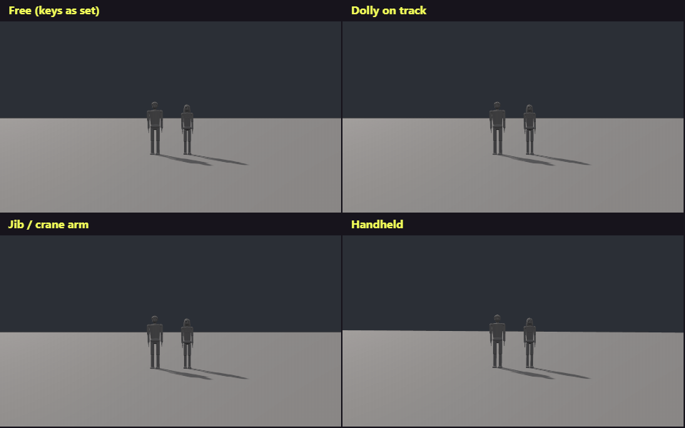</p>

| Rig | What it does to your move |
|---|---|
| **Free (keys as set)** | Exactly the keyed path. Every other rig also lands on each key at its frame, the way a grip or a pilot hits a mark, and keeps a dutch angle you key. The rig only changes how the camera gets from one key to the next. |
| **Tripod (pan / tilt)** | The camera stays at the first key and only pans and tilts. The fluid head eases the aim but keeps even a whip pan at full speed. If your keys travel, the keyed path shows as a faint dashed ghost, and the Coach offers a rig that can make the move. |
| **Dolly on track** | Runs on a track laid through your keys, so curves and orbits keep their shape. The dolly's weight smooths out any sudden change of speed. The rails rumble a little, with a bump at each joint. The height stays locked unless your keys change it. |
| **Chapman dolly (track + boom)** | A dolly whose boom takes your keyed heights, a little slower than the track moves. |
| **Slider** | One straight rail from the first key, very smooth. A key off the rail shows the keyed path as a dashed ghost. The Coach warns when the move needs more than 1.5 m, or when any rig is asked to go faster than a real one can. |
| **Jib / crane arm** | The camera rides an arm of 3 to 15 m on a post behind the first key. The arm's length and pivot are worked out from your keys. Rising moves swing and sideways moves arc, and the arm sways a little after it stops. For a key beyond the arm's reach, the base tracks across the floor. |
| **Steadicam** | Floats a centimetre or two between keys, with a soft bob on each step and a little roll. |
| **Handheld** | Breathes, shakes, dips with each footstep and lets the frame wander a little, but still gets to each key on time. |
| **Drone (gimbal)** | Very smooth, with a slow drift from the wind. The gimbal keeps the horizon level. |
| **Drone (FPV)** | A racing quad. It banks into each turn as far as the turn's physics says (atan of v² / (R·g)), and never rolls faster than 30° a second. |

The rig is deterministic, so the clay, the first frame and the video model all see exactly the same move.

### Adding and arranging things

**Add object** takes plain words: "dog", "police car", "man on a horse", "driver in a red car", "woman on a bench". The built-in library has people (man, woman, child), animals (dog, horse, cat, bird), vehicles (car, truck, police car, sports car, hatchback, motorboat, speedboat, fishing boat, sailboat, sailing dinghy, sailing yacht, catamaran, jet ski, canoe, kayak, rowboat, whitewater raft, log raft, bicycle, motorcycle), street and set dressing (tree, bush, house, bench, table, chair, street lamp, rock, crate, wall, campfire, flashlight, flying saucer), furniture (beds, sofa, armchair, tables, TV, kitchen counter, fridge, bathtub, toilet, washbasin, wardrobe, bookshelf, desk, rug, door, house plant) and primitives (cube, sphere, pyramid, cylinder, cone, set flat). The horse and the police, sports and hatchback cars are rigged CC0 models: the horse walks and gallops, the wheels turn. Anything else you type ("food truck") is designed as a clay stand-in by the local LLM, if Qwen3.5 is installed.

**Type a room with its size** and you get a true-scale interior: "bedroom 4x3.5 m", "studio 6x4 m, ceiling 2.7". Rooms get walls, doors, a ceiling light and a first camera at eye height; Free view shows them as a cutaway.

In the **Object** tab:

| Control | What it does |
|---|---|
| **Import 3D…** | Your own models: GLB/glTF, FBX (Mixamo animations play on the timeline), OBJ, PLY, STL, or a Gaussian splat (`.ply .spz .splat .ksplat .sog`). Splats show in **Color** view; a clay stand-in drives the passes. |
| **Import an image as…** | **Floor plan → true-scale interior**, **Backdrop plate (behind everything)**, **Cut-out card** (removes the background, ~7 s), **Card as-is**, **Location photo → the whole 3D set** (~5 s), **Video → 3D set** (Video → Stage), **Object → Gaussian splat** (~15 s), **Object → solid 3D mesh** (~12 s), **Remove the backdrop plate**. |
| **Export GLB** | Download the whole set as a `.glb` for Blender, Unreal, Unity, C4D. |
| **Outliner** | A list of everything on the set, lights included. Pick one to select it. |
| **Move** / **Rotate** / **Scale** | The gizmo mode (G, R, T). Move works on the floor plane; Rotate turns around the vertical. |
| **Measure** | Show the selection's width × depth × height in metres. |
| **Snap** | Snap the gizmo: 0.1 m moves, 15° turns. |
| **Turn**, **Scale** | Facing (−180° to 180°) and size (0.1× to 5×). |
| **Duplicate** | A copy next to it (Cmd/Ctrl+D). |
| **Delete** | Remove it. Deleting is a button only; the Delete key does nothing on the stage. |

### People

Select a person and the **Object** tab shows their **Appearance**: **Build** (slim, average, athletic, heavy), **Hair** (short, long, bun, ponytail, curly, bald, cap, hat), **Top** (t-shirt, shirt, sweater, hoodie, jacket, suit, coat, dress, uniform, tank), **Bottom** (jeans, trousers, shorts, skirt), **Skin** (tone 1 to 6) and colours for hair, top and bottom. The figures are deliberately faceless.

- **Ride / sit on**: put them on a horse, bike, vehicle or seat (or **Get off / stand**).
- **Seat**: which seat in a vehicle (Driver, Front passenger, Rear left, Rear right in cars; Skipper, Helm, Rider, Pillion… on boats and jet skis).
- **Hop on at playhead**: they stay on foot until the playhead, then hop on. Give them a walk to the horse before that frame. Move the playhead to 0 and press it again to ride from the start.
- **Beam** (a selected flashlight): **On (steady)**, **Flicker**, **Blink on/off**, **Off**.

### Vehicles and in-car cameras

Cars drive between their position keys and their wheels turn; horses walk or gallop to match the speed. Big animals and vehicles can't spin on the spot, so give them room to turn.

Select a car (or truck, horse, motorcycle, bicycle or boat) and pick an **In-car camera**. The shot camera then rides along in the vehicle's own space: move the car and the world goes by outside.


| Option | Framing |
|---|---|
| **＋ All interior shots (one per angle)** | Adds a setup for each interior angle in one click: Dashboard two-shot, Driver profile, Over the shoulders, Driver's POV, plus Back seat single when someone sits in the back. They go straight into the cut. |
| **Ride along (keep framing)** | Rides with the car, keeping your current framing. |
| **Through the windshield (two-shot)** | 30 mm |
| **Driver's POV (road ahead)** | 24 mm |
| **From the passenger seat, on the driver** | 32 mm |
| **From the back seat (both front seats + road)** | 22 mm |
| **Dashboard, looking back at both front seats** | 20 mm |
| **Between the front seats, back at the back seat** | 24 mm |
| **Tracking alongside (outside)** | 35 mm |
| **Top down (overhead)** | 24 mm |
| **Stop riding along** | Puts the camera back in the world. |

A style's suggested lens never overrides an in-car camera: the status line tells you when the lens was kept wide.

<a id="stunts-j-turn-donut-handbrake-180"></a>

### Stunts: J-turn, donut, handbrake 180


1. Put a car on the set where the stunt should start, facing the way it should go.
2. Select it and pick **Stunt** in its properties: **Reverse J-turn** (races backwards, whips round 180° and drives off nose first), **Donut** (two tight spins in a cloud of tyre smoke) or **Handbrake 180** (slides round and roars back the way it came).
3. Press **Play**. The keys are written on the set you're on, from where the car starts. The body rolls out of the turn, squats on the launch and dives under braking on its springs; the wheels stay planted and turn backwards in reverse; tyre smoke pours off the wheels. A driver in the seat leans with the car.
4. Adjust: drag the keys, or turn the car at a key with **Turn**. Keys can steer the nose and drive in reverse, so you can build your own stunt the same way.
5. Frame and render as usual. The prompts tell the image and video models which end of the car leads in each beat, and the take check flags a car that ends up facing the wrong way.

Tip: in ② Cast, **Generate** on a car makes a vehicle turnaround (front, rear, side, three-quarter), so a car seen tail-first in frame 1 has a front that belongs to it when it spins round. Or just tell the Director: *"use the J-turn stunt"*.

### Sets, weather and light

**Set & weather** (the **Set** tab):

- **Set**: Plaza exterior, City street, Interior room, Studio cyc / green screen, Forest, Desert, Beach & ocean, Water tank, Open water (sea / lake), Lake (calm, wooded shore, a dock), River rapids (whitewater), Stadium / ballfield, Underwater reef, Burning building (night), Airplane cabin, Airport runway, Above the clouds, Train carriage, Train station platform, Empty stage.
- **Elements**: Clear, Rain, Snow, Fog / haze, Smoke, Dust, Fire sparks, Fire (flames, embers, smoke) on any set, with an **Amount**.
- **Water**: the water level in the Water tank (0 to 4 m).

**Lighting** (the **Light** tab):

| Control | What it does |
|---|---|
| **Light** | A time-of-day preset: Dawn, Golden hour AM, Midday, Overcast, Magic hour, Blue hour, Night (moonlight), or **Manual sun**. The sun is solar-accurate: "Magic hour" really puts it a few degrees above the horizon. |
| **Time** | The hour, 4:00 to 22:00. |
| **North** | Which way the set faces, so you can put the sunset behind your actors. |
| **Sun** / **Height** and the sun dial | Set the sun by hand: drag around the dome for the direction, towards the middle to raise it. |
| **Add light** | Key, Fill, Rim / back, Practical (lamp), Spot, Neon. Placed relative to the camera and subject; drag its glowing handle to move it. |
| **Auto 3-point** | Key, fill and rim around the selected actor, placed relative to the camera. |
| **Light it like…** | 18 setups from cinematography practice: Classic three-point, Rembrandt, Butterfly / Paramount, Loop, Split, Clamshell beauty, High-key comedy / sitcom, Low-key noir, Silhouette backlight, Motivated window light, Book light (soft key), Practical-only night interior, Moonlight night exterior, Neon / mixed-color night, Firelight / campfire flicker, Horror underlight, Interrogation hard top light, Golden-hour backlit rim. Real lights are placed around the subject, and the setup's words go into the prompt. |
| selected light | **K** (colour temperature, 1800 to 12000 K), **Power**, **Height**, **Soft**, **Delete light**. |

The line **Lighting note for the prompt:** shows exactly how your lighting will be described to the image and video models.

<a id="the-new-sets"></a>

#### The new sets

<p align="center">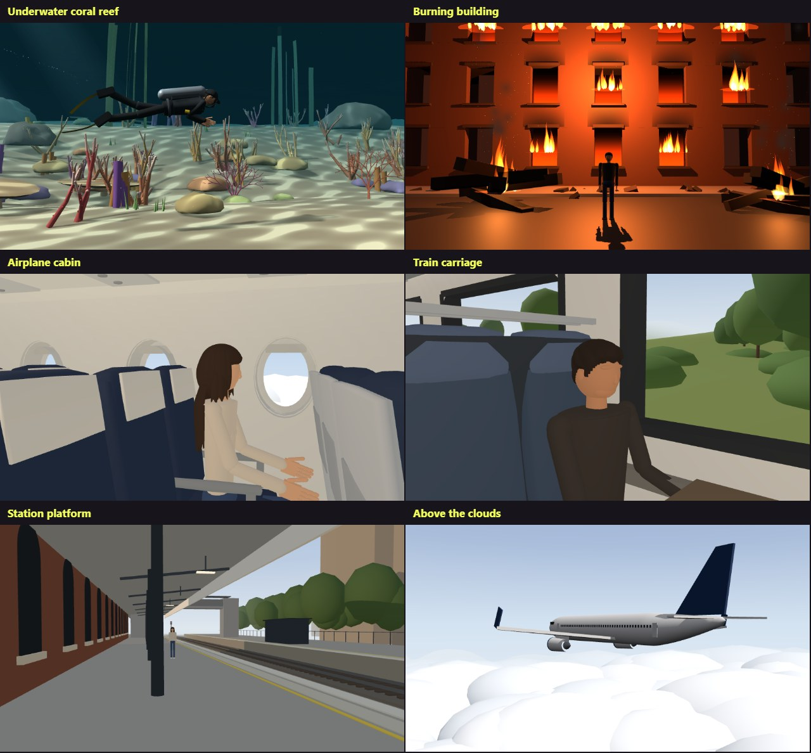</p>

1. Pick one under **Set** (or start from a script scene whose slugline names it: *UNDERWATER*, *EXT. BURNING BUILDING*, *INT. AIRPLANE CABIN*, *INT. TRAIN*, *EXT. TRAIN STATION*). Scene setup then places the set, a camera and the blocking for you.
2. **Underwater reef:** a dense coral swim lane. People off the seabed swim (the prompts say "swims", not "walks").
3. **Burning building:** flames in the windows and debris at night. Add **Fire** under Elements to put flames on any other set.
4. **Airplane cabin** and **Train carriage:** seat people by the window (drag them onto a seat); clouds and countryside stream past the windows in the stage and the guides, and the view out of the train is softened so the video paints real fields and trees.
5. **Airport runway**, **Above the clouds** (with an airliner) and **Train station platform** (with a train) for the exteriors.


### Posing people

Select a person, then **Person** in the tool rail (or scroll the Object tab). The pose panel header reads **Pose · Name**, with where you are: **Key here**, **Between keys**, or **No pose yet**.

| Control | What it does |
|---|---|
| **Pose in 3D** (key **P**) | Pose directly in the view (below). |
| **Pose** | The gallery: Relaxed, Look left, Look right, Look back over shoulder, Look up, Point, Wave, Hands up, Phone to ear, Arms crossed, Fists, Thinking, Hold flashlight up, Lean in. Applied at the playhead. |
| **Interact** | See below. |
| **Capture from video**, **Act it out** | Motion capture (below). |
| **Joints** | A slider for every joint, fingers included: Head & spine, each arm, each hand (every finger knuckle), each leg. Double-click a slider to reset it. |
| **Mirror L↔R** | Swap the left and right side of the pose at the playhead. |
| **Clear key here** | Remove the pose key at the playhead. |
| **Reset pose** | Remove every pose key: back to the plain walk or seated pose. |

One pose key holds for the whole shot. Add another at a later frame and the pose eases between them (a head turn at 2 s). The video follows the clay pose.

**Pose in 3D.** Press **P** with a person selected (or the **Pose in 3D** button). White dots appear on every joint and yellow dots on the hands and feet.

<p align="center">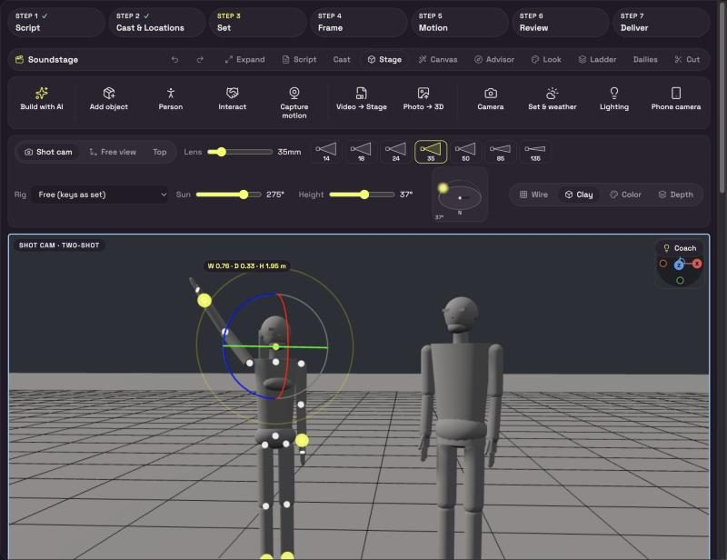</p>

- **Click a body part or dot** and a rotate ring appears on that joint: turn it on any axis. Fingers too.
- **Drag a yellow dot** to move a hand or foot: the arm or leg follows (IK). Elbows bend back and knees forward, the way real joints do, and the reach stops at the limb's length.
- Option/Alt-drag moves the camera while posing, never a joint: in the Soundstage and Blender styles it looks around in place, and in the Maya and Unreal styles it orbits.
- **P** or **Esc** ends pose mode; so does clicking empty space. Selecting another person keeps you posing.

Everything you turn is a pose key at the playhead, the same keys the sliders write.

### Interactions

**Interact** in the pose panel: pick an action, **with** whom or what, then **Do it at the playhead**. Soundstage positions, faces and poses them for it.

Actions: **Look at**, **Talk to (face each other)**, **Shake hands**, **Hug**, **Hold hands**, **Point at**, **Pet (dog, cat, horse)**, **Lead by the reins (horse)**, **Stop looking**.

### Physics: drop it, knock it over, bake it

Select a prop and press **Physics** in its card. A small panel opens beside the inspector (in a short window it docks over the Properties column instead). **Esc** closes it wherever the focus is.

| Control | What it does |
|---|---|
| **Dynamic / Static / Off** | Dynamic falls, tumbles and gets knocked over. Static (the default) stays put but things hit it and land on it. Off is ignored. People, animals and vehicles can't be Dynamic: they push props with their keyed motion. |
| **Mass** | 0.2 kg to 2 t. A heavy crate shrugs off a light one. |
| **Bounce** | 0 is a thud, 100 % a superball. |
| **Friction** | 0.2 ice, 0.6 wood, 1.0 rubber. |
| **Height** | Start this far off the floor: drop it from there, or stack it on another crate (0.8 m per crate). |
| **Same for all N crates** | The same physics for every object of that kind. |
| **Simulate & bake** | Runs the whole shot once and bakes every Dynamic object into ordinary keys: one per frame while it moves, two at each rest. |
| **Clear simulation** | Puts every simulated object back on the keys it had before. |

- What it hits: the floor, the set's walls, kerbs and buildings, Static props, and people and vehicles on their keyed paths (a car is a low body plus a cabin, so a crate rides up over the bonnet).
- **Everything collides** (World, on by default): cars, people, street lamps, benches and walls are bodies too. A keyed car keeps its keys until its first real hit, then the physics takes over: keyed through another car it crashes into it (momentum shared by real masses, spin, roll or stop), into a lamp it knocks it down, into a solid wall it stops and crumples (a dent the clay shows), through a weak (wooden) wall it breaks a hole. A person in the way is knocked over. The bake message and the panel say where: *"physics took over at f 42"*. **Keep keyed** holds one actor on its keys. Editing a key or dragging anything re-bakes by itself; one Undo takes the bake back. The Director's consequence check (*"check for collisions"*) says what still passes through what. Steps and limits: [World collisions](#world-collisions-everything-collides), [world.md](world.md)
- **Throw something:** key it moving (two keys or more). It follows its keys, then physics takes over at the last key at that speed.
- The clay, the previz video and the LTX layout guide only ever play keys, so every render of a baked shot is the same. Simulate again (or Cmd/Ctrl+Z) to redo it.
- The solver is a small built-in one (substepped XPBD rigid bodies, the position-based sibling of three-avbd's vertex block descent). Box-like props collide as boxes; a chair or a table collides as up to four convex hulls of its own mesh, not its bounding box.
- **Live solver: CPU / GPU · beta.** At the bottom of the panel. **CPU** (XPBD) runs in every browser; **GPU · beta** solves live drags, car hits and drops on the graphics card with [three-avbd](https://github.com/sbobyn/three-avbd) (WebGPU), and falls back to the CPU, saying why, where WebGPU isn't available. Simulate & bake always runs on the CPU.

<a id="practical-effects-explosions-fire-squibs"></a>

### Practical effects: explosions, fire, squibs

Rig an effect the way an SFX crew does: **Physics → SFX · practical effects → Add rig** (an explosion, fire, a sparks
shower, a bullet-hit squib, a smoke bomb, breakaway glass, a road flare, a body squib or blood pack on a person, a
stunt-knife gag). Give it a **cue**: at a time, on contact, a delay after another cue, or **Manual**: press **💥 Fire**
or **K** at the moment during playback (or **K** during a Drive-mode ● REC take) and that moment becomes its key.

When it fires the set reacts in the bake: an explosion pushes every body near it, falling off with distance and by
mass (crates fly, a car rocks or rolls, a lamp post falls, a person is knocked down, crates break), lights what burns
and leaves a scorch; fire spreads along wooden and cardboard props; a body squib bursts on the wardrobe with stage blood,
the performer reacts by where it hit (a chest hit falls back, an arm flinches) and the stain stays. The fireball, smoke
and sparks show in Clay and Color, the rigs' markers never do, and the motion prompt names each beat (*"At 1.5 s a huge
fireball erupts beside the red car…"*).

Scrub back before a cue: everything is untouched. **Reset to before** puts everything an effect touched back exactly
(one Undo step); changing a setting re-bakes from the untouched scene; **A / B** compares the last two runs. One-click
versions are in **Presets → Action**: Car explosion, Building blast, Sparks shower, Squib hit. → [Practical effects](sfx.md)

<a id="live-3d-drag-climb-mount-carry"></a>

### Live 3D: drag, climb, mount, carry

Physics stays live while you drag, so you can block by hand the way you'd move things on a real set.

<table>
<tr>
<td width="50%">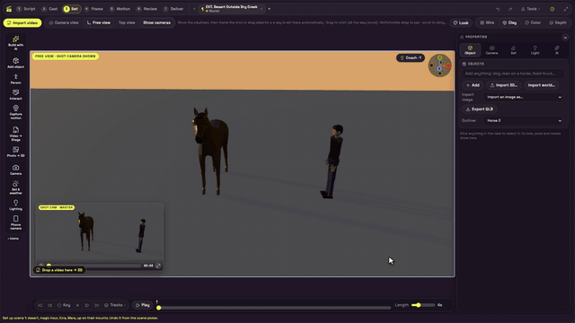</td>
<td width="50%">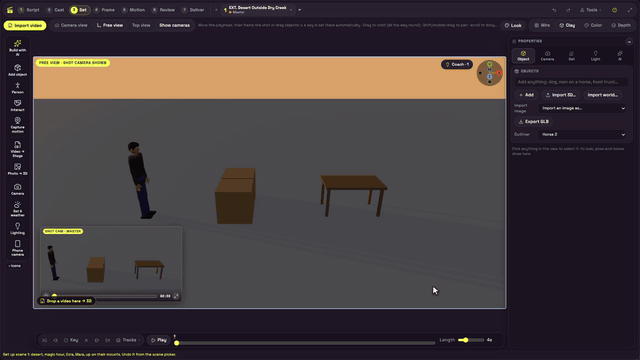</td>
</tr>
</table>

1. **Push things.** Drag a crate into others and they're shoved along live; the point you grabbed stays under the cursor. Stacks and towers stand rock-still until something hits them.
2. **Stack things.** While dragging, scroll the wheel to lift the prop straight up, carry it over another crate and let go: it drops and stacks.
3. **Walk people.** Drag a person: they turn to face where they're going and their legs swing.
4. **Climb.** Drag a person against a crate or a table and they step up onto it. Drag them off the far side and they hop down.
5. **Mount a horse.** Drag a person onto a horse and they swing up into the saddle; drag them off and they stand beside it, legs together.
6. **Carry a prop.** Drag a person into a light box and, still dragging, press **C**: they pick it up. Carry it somewhere and press **C** again to put it down.
7. **Crash.** Key a car through a crate stack (or tell the Director *"have the car crash through the crates"*): the car throws them clear. **Simulate & bake** when you like it, so every render plays the same crash. Key it through another car, a lamp or a wall (or say *"the police car rams the red car into the crates"*) and the bake crashes them for real; *"check for collisions"* lists anything still passing through anything, with **Crash them** / **Reroute** fixes.

Each drag is one undo step (Cmd/Ctrl+Z, Shift+Cmd/Ctrl+Z redoes). Press on a selected person's body to grab the person; the move arrows still work where they stick out past them.


### Drive mode: control anything like a video game, and record it

Select a person, a car, a horse or a prop and press **D** (or **🎮 Drive** on its bar, or in Properties › Parts). You now control it with the keyboard and mouse or any game controller (Xbox, PlayStation, Switch Pro, through the browser's Gamepad API). The HUD shows the hints for what you are driving, the speed, the gear or the gait, and the take's timecode.

| | Keyboard and mouse | Controller |
|---|---|---|
| Move (people, relative to the camera; horses: pace and turn) | W A S D or the arrows | left stick (how far you push = walk, jog) |
| Run · gallop · boost | Shift | L3 or LB |
| Jump · climb a crate (on foot) | Space | A / Cross |
| Throttle · brake and reverse · steer (cars, bikes, boats) | W · S · A D | RT · LT · left stick |
| Handbrake (J-turns, drifts) | Space | A or RB |
| Motor trim out (bow up) · in (motorboats) | Space · Q | A · B |
| Paddle, row or pole (canoe, kayak, rowboat, rafts) · back-paddle | W (Shift harder) · S | RT · LT |
| Get in / out of a car, mount / dismount, sit | E | Y / Triangle |
| Pick up · set down | C | X / Square |
| Throw (hold to aim) · drop | F or a click (hold the right button) · X | RT (hold LT) · B |
| Look around | drag | right stick |
| Headlights · indicators · driver's door · light bar | L · I · O · B | D-pad |
| Camera: follow, shot camera, orbit | V | View |
| ● REC / stop · keep · discard | R · Enter · Backspace | Menu |
| Leave | Esc | |

**On foot** the speed comes from the stick and picks the gait (walk, jog, run) with planted feet. Walk up to a car and press **E**: they walk to the nearest front door, it opens, they climb in, it shuts, and you are driving the car with them in the driver's seat (the camera swings over to the car). **E** again brakes, opens the door and lets them out on foot. The same with a horse (the one-second swing up into the saddle) and with bikes and boats. **C** picks up a crate or a box in front of them; **F** throws it (it flies, tumbles, bounces and comes to rest on a face), **X** drops it, **C** sets it down. Walk into a wall and you stop; walk at a low crate and press Space to climb onto it.

**Cars** run on the same vehicle dynamics as the stunt presets (Pacejka tyres, weight transfer, a body that rolls and pitches): hold the brake at a stop and it reverses, flick the wheel at 40 km/h in reverse and the nose comes round (a J-turn by hand), pull the handbrake through a corner and the tail slides.

**Recording.** Press **R** (● REC): a 3-2-1 countdown, then the timeline plays from frame 0 (or from the playhead) while you drive. Everything already animated plays back, so you can drive actor A, keep the take, rewind and drive actor B around A, like Sequencer's Take Recorder. When you stop (or the shot ends) the take plays back once: **Keep** (one undo step), **Discard**, or **Again**. Pick the smoothing (raw, light, smooth, heavy) before you keep it. A take writes ordinary keys on the current shot: position and heading for everything you moved; a car's body roll, pitch and steering; the door opening as they get in; when they were in the car or the saddle; where the head looked (look at someone with the camera and they look at them); the lights you switched; and a thrown crate's whole flight. Nothing you do in Drive mode changes the shot unless you keep a take.

**Driving takes over from the keys.** You can drive anything, even when it is keyed: a stunt car in the middle of its J-turn, a person mid-jump, someone with Pose Studio keys or a mocap take. While you drive it, its keys stop applying to it (they are not changed), and the HUD says **Took over from keys: Esc to leave**. It starts where the keys had it at the playhead, settled to a physical state: a car keeps its heading, stands on its wheels and eases out of its keyed roll and pitch in about 0.3 s; a person stands upright with their feet on the ground; a horse the same. If the keyed pose was cutting through a kerb, a wall or a parked car, it is moved clear first. Leave without keeping a take (**Esc**) and the keys play again exactly as before.

**Kept takes are auto-corrected.** When you keep a take, Soundstage cleans what isn't physical before writing the keys, using the limits of the thing you drove (a car's own tyre grip, top gear and body roll; a person's or a horse's top speed, acceleration and turn rate):

- a frame that jumps out and back (a spike) is put back on the path; a hit, a stop or a launch is kept;
- a teleport (a jump far past what it could travel in a frame) is taken out, and the rest of the take carries on from there;
- faster than its top speed is held to its top speed; turn-rate spikes are clamped;
- a car rolled or pitched further than its tyres and springs allow is settled;
- feet and wheels stay on the ground (no floating, no sinking), except in a jump or a climb.

Then the take is fitted with **as few keys as possible** that still play back within about 2 cm and 1° (scaled to the object's size). A change of mode (getting in, getting out, a take-off and a landing) always keeps its own key. The HUD shows what happened, for example **Smoothed 3 spikes, settled roll · 1,440 keys → 38**, with **Undo** to put the raw take back, as you drove it (a key every 2 frames, no corrections).

**Finding your way back.** If you drove or flew the view far away, use the two buttons at the top-left of the viewport: **⌂ Back to the set** (key **.**) frames the whole set from the front in the free view, and **↶ Last view** (key **,**) steps back through your last 10 views (each view you rest on for half a second, and the view just before Drive, ● REC, Back to the set, **F** or a compass click). The keys work while the viewport has the keyboard, and both buttons hide while you drive. When the camera ends up far outside the set or inside a building, a **Lost? Back to the set** chip appears: one tap brings you back. More: [⌂ Back to the set and ↶ Last view](#back-to-the-set-and-last-view).

**Boats** run on the boat physics: a speedboat climbs its bow wave and planes, a sailboat sails on the wind (steer through it to tack; the sheet trims itself), and paddle craft paddle while you hold W (Shift harder). See [Boats](#boats).

**Bindings.** The HUD's Bindings button remaps any action to another key or controller button (remembered in this browser). The Inputs button draws the controller and the keys on screen, for screen recordings.

### Motion capture: from a video or the webcam

Any clip of one person, or you acting it out on the webcam, drives a clay actor: body, hands, fingers, the path they travel and the jumps. It needs the SAM 3D Body model (see [Install](#download-the-models)) and runs on the GPU.

<p align="center">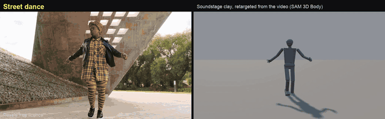</p>

1. Select the person to drive (or press **Capture motion** in the tool rail: it picks the selected person, else the first one, else adds one).
2. Either **Capture from video** and pick a clip (a few seconds of one person is best), or **Act it out**: choose a **Length** (3 to 15 s), press **● Record**, act after the 3-2-1 countdown, then **Use this take** (or **Retake**, **Cut** to stop early, **Cancel** / Esc).
3. Wait for "Reading the performance on the GPU (body, hands, fingers)…".

**The take is placed into your existing set**: it starts at the playhead, from where the person stands, turned the way they face. Their feet stay on your floor and jumps lift off it. If the take is longer than the shot, the shot is lengthened to fit (up to 20 s).

The take row under the panel shows **Name · seconds · frames a–b** with:

- **Start at playhead**: move the take to begin at the current frame;
- **Travel**: on, they move through the set as the performer did; off, they perform on the spot;
- **Remove take**: back to the walk and pose keys.

### Video → Stage

**Video → Stage** (labelled **Video → 3D set** in the App) turns a clip into an editable 3D scene: the location, the camera move, the set pieces and the performer.

<p align="center">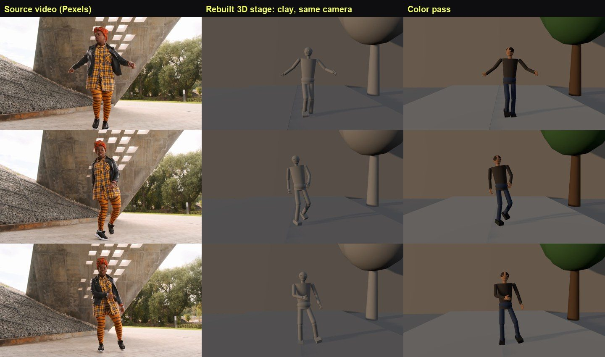</p>

Press the yellow **Import video** button, **Video → 3D set** in the tool rail or **Import an image as… → Video → 3D set**, or drop a clip on the stage, and pick an `.mp4`, `.mov`, `.webm`, `.mkv`, `.mxf` or `.m4v`. A one-screen chooser asks what the clip is for: **Rebuild as a 3D set**, **Capture motion** (onto a person, as above) or **Edit with Ripple**. For a rebuild it also offers **Quality** (Fast, Standard, Max), **Stage** (**Replace the set** or **Add to it**) and, under **Advanced**, **Set scan** (on this server, a depth mesh of the first frame behind the set) and the vision model on or off. Press **Rebuild**. The chooser also shows a **Trim** filmstrip, **People** and lens fields, but the server doesn't use them yet: it rebuilds the whole clip, and it caps Quality at 24 depth samples.

A progress card shows the server's current step: sampling frames, measuring depth (Depth Anything 3), reading the shot (the vision model), capturing the performance (SAM 3D Body), tracking the camera (with SAM's lens), building the set. **Cancel** stops waiting and leaves your set as it was; a job already on the server finishes there.

What you get:

- **Subjects at real size** from the library, with start and end marks for the ones that move.
- **Set pieces** as clay (road with real lane widths, water, cliffs, rocks…) and the first frame as a backdrop plate.
- **The camera move as keys** (up to 8) that you can drag in **Top** view to re-shoot it.
- **The performer**, motion-captured, standing on the rebuilt floor where they stood.

The result card offers **Play the take** (when there is a performer), **Identical? Compare**, **Passes**, **Undo: bring the old set back** (after replacing a set), **↻ Regenerate** and **Shoot it → Frame**. The **Identical?** bar over the view puts the source clip over the stage (**Overlay**, **Wipe**, **Onion**, **Off**; keys 1 to 4). Its per-object **Match** score and one-click fixes (**Fit to plate**, **Swap**, **Nudge**, **Re-key**, **Lock camera**) need clip masks, which the current server doesn't write yet. Details: [video2stage.md](video2stage.md).

**When it comes out wrong (it may take one or two tries).**

- **↻ Regenerate** (on the result card) runs the rebuild again with a new seed. A dialog asks what to keep: **Keep the camera solve**, **Keep the performer**, **Keep the set**. What you tick is not run again: the server reuses that stage from the last run (the camera solve, SAM 3D Body's take, the vision model's read), and the App keeps it from your scene as it is now, edits included. Depth is always reused (Depth Anything 3 has no seed). The card then says what was kept and what was re-run ("camera solve kept · set read re-run").
- **Fix this object** rebuilds ONE object instead of the whole world. Select a rebuilt object and press **Fix this object** in the selection bar, or right-click the view (or use its row in the Identical? bar), then click the object on the source frame (Esc: start from where the rebuild has it). SAM 3.1 tracks just that object over the source frames, the clearest frames are picked, and it is rebuilt alone through the Photo → 3D object path (TripoSplat, then a mesh). It keeps its place, turn and size from the solve and comes in as a new version: **Undo** puts the old one back.
- **Remove (not in the video)** takes out an object the rebuild invented (Undo puts it back).
- **Add a missed object** (the right-click menu, or **+ Missed object** on the Identical? bar): click it on the source frame. It is tracked and rebuilt the same way, and stood where the bottom of its mask meets the floor.

Regenerate and the fixes are server jobs: the job card shows their steps and they appear by name in **Activity**. In the try-it demo they only give the "available in the full install" note. A fix needs the rebuild's stage record, so a clip rebuilt before this version must be rebuilt (or regenerated) once first. Without TripoSplat on the server, Fix this object keeps the shape and only re-reads its colour (a note says so).

**One lens.** When there is a performer, the camera, the set and the clay share SAM 3D Body's focal length (it is fitted to the person), and the set's scale comes from the performer's measured size, so the clay covers the person in the picture. On the street-dance clip the clay used to come out at about two-thirds of the dancer's size, with its shoulders at her chest, because the solve used Depth Anything 3's 25 mm guess against SAM's 41 mm.

Notes: **Replace the set** (the default on an empty stage) clears what is there; **Undo: bring the old set back** restores it. **Add to it** keeps your actors and adds the clip's camera as a new shot. It needs a Depth Anything 3 checkpoint; without Qwen3.5 you get the camera move only (no subjects or set pieces); without SAM 3D Body, no performer. Camera roll isn't tracked, and very fast whip pans can break the track. The clip is also saved in `input/` so the graph's Footage and Recast nodes can use it.

<a id="interop-blender-unreal-maya-nuke"></a>

### Interop: Blender, Unreal, Maya, Nuke

<p align="center">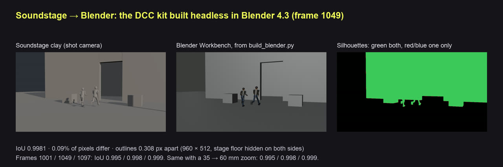</p>

**Bring a world in**

1. In ③ Set › Object, open **More: import & export** and press **Import world…**.
2. Pick a GLB, glTF, FBX or OBJ (from Blender, Unreal, Maya or Sketchfab) or a Gaussian splat. It replaces the set: the main floor goes on the stage floor, with units and up axis read from the file.
3. Check the size line (*This world is 120 m × 80 m, 15 m tall*). If it looks wrong, press **Fix scale**.
4. Block as usual. The meshes are colliders, so people stand on its floors and crates land on its tables; cameras in the file become shots and animated objects play on the timeline. Heavy worlds are merged by material with far LODs, so a 4,000-object town still runs at well over 60 fps.
5. A Nuke or Maya `.chan` or a camera.json comes in as a shot the same way.

**Send the shot out**

1. In ⑦ Deliver, press **Export for Blender · Unreal · Maya · Nuke** (**Download the DCC kit**). You get one zip: the staged shot as an animated GLB (every move baked, plus the camera and its lens), camera.json and `.chan`, a frame-one OBJ and a builder script for each app.
2. **Blender:** `blender --python blender/build_blender.py` (or run it from the Scripting tab). It sets fps, frame range (from 1001), resolution and the camera, with the Layer Pack plates as the camera background. Verified headless in Blender 4.3 at silhouette IoU 0.995–0.999.
3. **Unreal:** run the script in the editor's Python console for a CineCameraActor and a Level Sequence. **Maya:** an animated camera (rotate order zxy). **Nuke:** a Camera, ReadGeo and ScanlineRender. These three are unit-tested but not yet run in those apps.

Details and how to rerun the checks: [interop.md](interop.md).

<a id="phone-camera"></a>

### Phone camera

**The phone viewfinder: the phone is the camera you look through.**

<p align="center">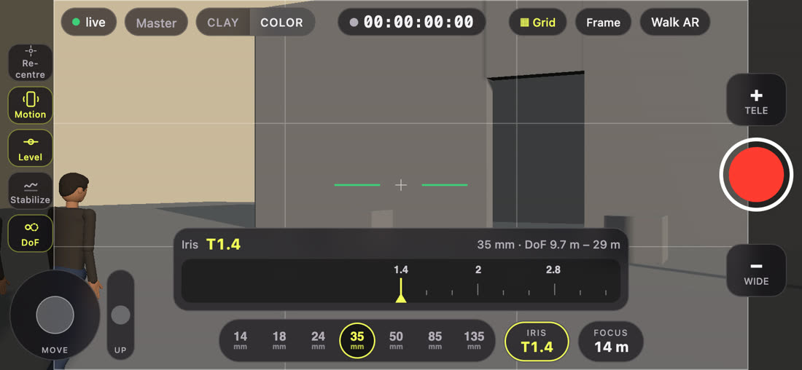</p>

1. If ComfyUI runs on another machine (a pod over an SSH tunnel), start the LAN bridge on your computer first: `python3 tools/vcam_bridge.py`. It serves https on your Wi-Fi only, with a pairing code; the phone can only reach the viewfinder, never the queue or your files.
2. In ③ Set, press **Phone camera** in the tool rail and **Phone viewfinder** in its row. A QR code appears.
3. Scan it with the phone, hold the phone sideways and tap **Start**. The phone shows the live stage through the shot camera in Clay or Color; the desktop's camera follows the phone.
4. **Aim** by moving the phone (**Level** keeps the horizon flat, **Re-centre** goes back to the shot's framing). Walk and crane with the **MOVE** stick and **UP** strip, or **Walk AR** on Android Chrome.
5. **Zoom** with a pinch, **+ TELE / − WIDE**, or the **14 18 24 35 50 85 135** primes.
6. **Focus:** tap the picture to focus there. Open **FOCUS** to set marks **A** and **B**, then **Pull ⇄** racks between them. **IRIS** sets T1.4 to T22 with a live depth-of-field preview.
7. Press **●**: a count-in, then it records from the top of the shot in step with the action, and stops at the shot's end.
8. Watch it back on both screens, then **Keep**, **Discard** or **● Again**. A kept take becomes the shot's camera keys (stabilized; **Stabilize** = gimbal) plus lens keys for focus, T-stop and roll.

Details: [vcam.md](vcam.md).

**Film a real clip on the phone.** The viewfinder's **Film** button records with the phone's own camera and sends the clip to the computer as **Capture motion**, **Real performance** or **Footage**. Start it from ✦ One-click › **Send a move from your phone**: see [Film a move](#film-a-move-on-your-phone).

**The VCam page (phone, iPad, Quest, Vision Pro).** Hand-hold the shot camera with a phone, iPad, Quest or Vision Pro. In the **Camera** tab press **Connect a phone**, then open `/soundstage/vcam` on the device (on the same ComfyUI address). The device page offers AR and VR 6-DoF tracking or a 3-DoF gyro, a **Recenter** button, and recording. Motion sensors need https or localhost on the device.

Recorded takes land in the **Take** list. **Steady** sets how much the stabilizer smooths (it removes shake but keeps your move); **Use take** turns the take into camera keys. If the move looks like a known rig, a **Snap to …?** button offers to make it that rig's clean move.

---

## 5. Keyboard and mouse cheat sheet

Keys only reach the 3D stage while the pointer is over it (or you clicked it), and never while you are typing in a box.

**The 3D stage**

| Key / gesture | What it does |
|---|---|
| click | Select (click empty space to deselect) |
| drag empty space or anything unselected | Orbit about the point under the cursor (look around in place when close in or inside a car) |
| drag the selected object | Move it (keys its position at the playhead) |
| both buttons + drag, Shift-drag, middle-drag | Pan |
| hold right + W A S D Q E | Fly (mouse-look while held; the wheel sets the fly speed) |
| double-click | Free view: glide to what you clicked (frames an object; on the floor, a wall or a set piece, moves the target there) |
| Option/Alt-drag | Soundstage / Blender style: look around in place (tripod head), or turn the object under it. Maya / Unreal style: orbit |
| scroll | Zoom toward the cursor (a trackpad's two-finger scroll orbits, Shift pans, pinch zooms) |
| hold W / S | Glide forward / back while held |
| hold A / D | Glide left / right (D with something drivable selected: Drive mode, unless right is held) |
| hold Q / E | Glide down / up |
| Shift + W A S D Q E | Four times faster |
| 0 | Toggle Camera view / Free view |
| F | Frame the selection (or everything, with nothing selected) |
| P | Toggle Pose in 3D (select a person first) |
| Space | On ③ Set: play / stop the shot |
| Esc | Close what is open first (the Physics panel, the ✦ One-click window, the ⋯ menu or any other menu or pop-over); end pose mode; leave Drive mode; with nothing open, leave the full window |
| G / R / T | Gizmo: move / rotate / scale (with something selected) |
| L, Shift+L, I, O, K | On a selected vehicle: headlights, light bar, indicators, driver's door, key every part at the playhead |
| K, Shift+K | Fire the SFX cue at the playhead (the selected rig, else the first armed manual one) and write it as its key; with a vehicle selected plain K keys its parts, so use Shift+K. In Drive mode, K during ● REC records the cue into the take. → [Practical effects](sfx.md) |
| Cmd/Ctrl+D | Duplicate the selection |
| Cmd/Ctrl+Z, Shift+Cmd/Ctrl+Z | Undo / redo (up to 120 steps; a drag is one step; a bake is one step). Works from anywhere in the workspace, not only on the 3D canvas |
| . | ⌂ Back to the set: fly the free view to the whole set (the shot camera doesn't move) |
| , | ↶ Last view: step back through your last 10 views |

In **Shot cam** every orbit, pan, dolly and fly move edits the camera key at the playhead. Use **Free view** (0) to look around without changing the shot.

**Pose in 3D**

| Gesture | What it does |
|---|---|
| click a body part or a white dot | Put a rotate ring on that joint |
| drag the ring | Turn the joint (keys the pose at the playhead) |
| drag a yellow dot (hands, feet) | Move the hand or foot; the arm or leg follows (IK) |
| double-click a joint slider | Reset it to 0 |

**Top view**

| Gesture | What it does |
|---|---|
| drag a camera ◆ or cast ■ key | Move it (Shift carries a camera key's aim along) |
| Option/Alt-drag a key | Change its height |
| drag a target dot | Re-aim |
| click the path | New key at that frame |
| right-click a key | Delete it |
| drag empty / scroll / double-click | Pan / zoom / fit |

**Timeline and Tracks**

| Gesture | What it does |
|---|---|
| drag a diamond in Tracks | Retime the key |
| double-click a track row | Add a key |
| right-click a diamond | Delete the key |
| click a name in Tracks | Select that object |

**Shot strip** (click it first)

| Key | What it does |
|---|---|
| Space, J / K / L | Play / pause, shuttle back / stop / forward |
| ← / → | Step a frame (Shift: 24 frames) |
| ↑ / ↓ | Previous / next clip |
| B or Cmd/Ctrl+B | Split at the playhead |
| Delete / Backspace | Remove the clip from the cut (the setup stays on the stage) |
| Cmd/Ctrl+D | Duplicate the setup |
| Cmd/Ctrl+Z, Shift+Cmd/Ctrl+Z | Undo / redo |

**Cut editor**

| Key | What it does |
|---|---|
| Space | Play / stop |
| J / K / L | Shuttle reverse / stop / forward (again for 2×, 4×, 8×) |
| ← / → | Step a frame (Shift: one second) |
| ↑ / ↓ | Previous / next edit |
| Home / End | Head / tail |
| I / O / G | Mark in / mark out / clear marks |
| B or Cmd/Ctrl+B | Split |
| X | Extract the I/O range |
| M | Match action |
| Delete / Backspace | Delete the selected transition, title, graphic or subtitle; otherwise ripple delete |
| [ / ] | Gain −1 / +1 dB on the selected audio clip |
| = / - / \ | Zoom in / out / fit |
| Cmd/Ctrl+Z, Shift+Cmd/Ctrl+Z (or Cmd/Ctrl+Y) | Undo / redo |
| Esc | Deselect |
| Option/Alt-drag an edit | Roll it |
| S | Split at the playhead |
| Cmd/Ctrl-drag a clip, `,` / `.` (Shift: 5 frames) | Slip |
| T | Dissolve on the cut nearest the playhead |
| R | Keys (rubber bands) on / off |

**Paint Studio**

| Key | What it does |
|---|---|
| V M L W B E P C I H Z | Move, Marquee, Lasso, Magic select, Brush mask, Eraser, Paint, Crop / Extend, Eyedropper, Hand, Zoom |
| [ / ] | Brush size |
| hold Space | Pan |
| F or Cmd/Ctrl+0 | Fit |
| Cmd/Ctrl + = / - | Zoom in / out |
| Cmd/Ctrl+A / Cmd/Ctrl+D / Shift+Cmd/Ctrl+I | Select all / deselect / invert |
| Delete / Backspace | Erase the selection on the active layer |
| Enter (in the prompt) | Generative Fill |
| Cmd/Ctrl+Z, Shift+Cmd/Ctrl+Z | Undo / redo |
| Esc | Clear magic points, then variations, then the selection |

**Dailies**

| Key | What it does |
|---|---|
| arrows | Nudge a card (Shift: half a cell) |
| Enter / double-click | Open the circled take |
| Space | Show the takes |
| C or * | Circle the take |
| Option/Alt-drag | Place a card freely |
| ScriptSync: Enter or Space / ↑ ↓ / Shift+↑ ↓ | Load the line's take in the player / move a line's end / move its start |
| ScriptSync: ⌘Z / Ctrl+Z, Delete (in Edit lining) | Undo a lining change / delete the focused line |

**Elsewhere**

| Where | Key | What it does |
|---|---|---|
| Script scene list | ↑ ↓, Home / End, PgUp / PgDn | Move through the scenes |
| Script search | Esc | Clear the search |
| Add, Build scene, Change it, Look boxes | Enter | Add / build / apply |
| Advisor | Cmd/Ctrl+Enter | Suggest shots |
| Anywhere in the App | / or Cmd/Ctrl+K | ✦ Ask: open the assistant (the Director's chat), cursor in the box |
| Anywhere in the App | hold ` (or hold the Ask button) | Talk to it (let go to send) |
| Director | Enter / Esc | Send, or apply the plan on an empty box / cancel the plan, then close |
| Anywhere in the App | Shift+P | Start or stop Pitch Mode in the Director |
| Anywhere in the App | V | Open Presets |
| Anywhere in the App | ? | Keyboard shortcut sheet |
| Drive mode, on a motorboat | Space / Q | Motor trim out (bow up) / in |
| Any menu or pop-over | ↑ ↓, Home / End, Esc | Move between items, close |
| ✦ One-click window | Esc | Back out of the ask, then close |
| Passes viewer | Space · ← → or , . · 1-4 · F · + − 0 · Esc | Play · step a frame · switch tab · Flicker against the original · zoom in / out / fit · close |
| Act it out | Esc | Cancel the recording |
| Full window | Esc | Back to the App panel |

---

## 6. Tips and tricks

**Blocking**

1. **Lock the blocking in clay before you render anything.** Press **Play** in **Shot cam** and watch the whole shot as clay. Every later step copies it: if a person drifts out of frame in clay, they drift out in the final. Clay is free; renders aren't.
2. **Two keys make a camera move.** Playhead at 0, frame the start. Drag the playhead to the end, frame the end. Done. Add a key in the middle only when you want a curve.
3. **Look around in Free view, not Shot cam.** In Shot cam every orbit or scroll edits the camera key at the playhead. Press **0** to fly freely, then **0** again to come back to the shot untouched. If you did nudge the shot, Cmd/Ctrl+Z.
4. **Fix camera moves from above.** **Top** shows the whole move as a plan: drag the numbered keys, Option/Alt-drag for height, drag the dots to re-aim. It's much easier than re-flying the camera.
5. **Choose the rig after the keys.** Key the move as a clean path first, then try **Dolly on track**, **Jib / crane arm** or **Handheld** on the same keys. Use the slider next to **Rig** to dial the feel up or down.
6. **People and vehicles turn by themselves.** They face where they are going, and a horse or a car turns at a realistic rate (it even turns before setting off). Give a car room to turn instead of a sharp corner between two keys.
7. **Drop to interact.** Drag a person onto a horse to mount, onto a car to take a seat, onto a bench to sit; drop a flashlight on someone to hand it over. For a mount mid-shot, put the playhead at the frame and use **Hop on at playhead**.
8. **A car dialogue scene in one click.** Put two people in a car, select the car, and pick **＋ All interior shots (one per angle)** under **In-car camera**: you get a dashboard two-shot, a driver profile, over the shoulders and the driver's POV, already in the cut.
9. **Type a room with its size.** "kitchen 4x3 m" builds a true-scale room with walls, a door, a window and a ceiling light. Free view shows it as a cutaway so you can block inside.
10. **Use Measure for scale.** **Measure** shows the selection's width, depth and height in metres. A prop that's twice the size it should be will be twice the size in the frame.
11. **Put the sun where you want it with North.** Pick **Magic hour**, then turn **North** until the sun sits behind your actors for a backlit rim. **Lighting note for the prompt** tells you how it will be described.
12. **Light like a DP in one pick.** **Light it like… → Low-key noir** or **Rembrandt** places real lights around the selected actor and writes the setup into the prompt.
13. **Get coverage the way a crew would.** Block the action once, then add **New setup** → Master, Two-shot, Over-the-shoulder A and B, Singles, an Insert. Every setup shares the same action, so they cut together. The **Advisor** tab can suggest a shot list and **Add as setups** for you.
14. **Open the Coach.** When the **Coach · N** pill shows a number, click it: it catches things like a camera inside a wall or a cut across the 180° line, and offers a one-click fix.

**Frames**

15. **Fix the first frame before Motion.** The video inherits everything in the frame. A stray bystander, a sign, or a car with the wrong colour is a ten-second **Remove** or **Generative Fill** in Paint Studio, and a re-render if you leave it.
16. **Keep references to four or fewer.** FLUX 3 Klein takes four reference pictures, characters first. Untick anyone who isn't in the shot, so the slots go to who is.
17. **Explore on Fast, keep on Standard or High.** Use **Quality: Fast** with 4 variations to find the composition, then generate again on Standard or High for the frame you'll animate.
18. **Use Krea 2 + stage depth when the layout must not move.** It holds the stage's depth very tightly (it takes no reference pictures, though). FLUX 3 Klein is the better default when faces and costumes must match the cast.
19. **Extend instead of re-rendering.** Need 2.39:1 from a 1.85 frame? **Crop / Extend → 2.39**, then **Extend**. Pixels inside the original frame never change.

**Motion and sound**

20. **Draft to check the motion, then Final.** A **Draft** (8 + 3 steps) tells you whether the blocking, the direction of travel and the camera are right. Quality starts on **Final**; switch a shot to Draft while you work it out, back to Final for the keeper, and keep **Advanced** (1408p, the Hero final recipe) for hero shots.
21. **Type the dialogue line to get lip sync.** A line typed into **Dialogue line** turns on **Let the sound/dialogue drive the video**, so the mouth is animated *from* the words. A voice added afterwards never syncs.
22. **Lower Motion freedom for precise action.** Car chases and stunts follow the clay more exactly near **exact**; dialogue and walking look more natural around the default **natural**.
23. **Describe the sound you want.** **Sound (generated with the final)** is filled from the stage if you leave it empty, but "hooves on packed dirt, distant thunder" beats a guess.
24. **Batch overnight.** **Draft every shot**, check them, then **Final for every shot**. ComfyUI's cache means a second Run only does the new work.
25. **Stop clears the queue.** **■ Stop** cancels everything waiting in ComfyUI (from any workflow) and interrupts the running job. Use it when you spot a mistake in a Draft instead of waiting for the batch.

**Look, review and delivery**

26. **Re-render the same animation in another look.** Change the style card, **Generate frames**, render Motion again: the same blocking and camera, a different film.
27. **Copy the prompts.** **Compiled prompts** in the Look tab shows exactly what goes to the models, with **Copy**. Handy for testing a look in another tool.
28. **Edit from the timeline.** Right-click a clip in the Cut editor (or ✎, or E; in the strip, **Edit in…**) and jump to the step that made it with that clip loaded; ↩ Back to the cut, then Replace in cut makes the new take a new version of the clip.
29. **Fill the gaps before you export.** **Render missing shots** queues a Final for any shot that has none, then joins the cut into one video.
30. **Hand off the set.** **Export GLB** takes the whole set into Blender, Unreal, Unity or C4D, and the Layer Pack's `camera.chan` carries the exact camera into Nuke or After Effects.
31. **Take the full window.** **Open the full workspace** (or **Expand**) gives Soundstage the screen; Esc puts it back in the App panel.

---

## 7. Troubleshooting and FAQ

**Missing models, or "N issues found" when I press Run.** App mode lists problems before running; **Show errors in graph** shows which node. "Value not in list" on a loader means that model file isn't where ComfyUI looks: check the exact filename and folder in [Download the models](#download-the-models), then refresh ComfyUI (or restart it) so the new file is listed. Missing node types mean a node pack is missing: install ComfyUI-LTXVideo and comfyui-krea2-controlnet as in [Install](#install-the-node-packs).

**"No image edit model is installed (FLUX 3 Klein or Krea 2): Generative Fill is off."** Paint Studio's fill needs one of the two image models. Painting, masking, layers and extending the canvas still work without them.

**"References need the updated Soundstage nodes (restart ComfyUI once)."** You updated the repo while ComfyUI was running. Restart ComfyUI.

**The queue looks stalled.** It usually isn't. Progress moves one sampling step at a time, and at 1408p (an Advanced hero shot) a single step can take about 60 seconds, so the bar can sit still for a minute. The first render of a session also loads the models. Rough warm times: a frame 6 to 10 s, a Draft about 6 to 7 minutes, a Final 8 to 9, an Advanced hero shot at 1408p 15 to 17 (121 frames on a 48 GB card), MiniMax H3 20 to 30 minutes (its first run also encodes the prompt on the CPU for several minutes). While **■ Stop (N)** is showing, the jobs are still there.

**I pressed Stop and other work disappeared too.** Stop clears the whole ComfyUI queue, not only Soundstage's jobs. Queue them again.

**The car drives in reverse.** A grey clay car reads the same nose-first or tail-first, so Soundstage names the headlights, tail lights and the direction of travel in the prompts, with negatives against reversing. If it still happens: check in Clay that the car's keys move it forward the way it faces; make sure the chosen frame shows the car's front or back clearly (fix it in Paint Studio if not); lower **Motion freedom**; and check with a **Draft** before the Final.

**Extra people (or extra cars) appear in the frame.** The prompts already say how many vehicles there are, that nobody else is in the background, and that nobody and nothing else enters the frame. If someone still turns up: untick cast members who aren't in this shot under **Cast in this shot**; **Remove** them from the first frame in Paint Studio before Motion (the video copies the frame); or generate a few more frames and pick a clean one.

**The mouth doesn't move with the line.** Type the line in **Dialogue line** (don't only add it in the edit) and make sure **Let the sound/dialogue drive the video** is ticked, then render the Final again.

**The video ignores my blocking.** Use the LTX-2.5 Layout-to-Render model (MiniMax H3 follows blocking only loosely), lower **Motion freedom**, and check the frame: if the frame doesn't match the clay, the video won't either. Raise **Follow the clay** towards strict when you use Krea 2.

**My framing changed when I only wanted to look around.** In Shot cam, navigating edits the camera key at the playhead. Cmd/Ctrl+Z, then use **Free view** (0) to look around.

**The Delete key doesn't delete the selected object.** On the stage, deleting is the **Delete** button in the Object tab.

**Esc didn't leave the full window.** In Pose in 3D, the first Esc ends pose mode; press it again.

**My imported splat is invisible.** Splats show in **Color** view; the clay view shows their stand-in.

**"Couldn't read …: no scene headings found."** Scenes must start with `INT.` or `EXT.`. A scanned PDF has no text to read: export the script as `.fdx`, `.fountain` or a text PDF. "Could not load pdf.js from cdnjs" means the browser couldn't fetch the PDF reader: import `.fdx` or `.fountain` instead, or check the connection.

**"Depth Anything 3 is not on this server (models/geometry_estimation)."** Video → Stage and location photos need a Depth Anything 3 checkpoint in that folder. Without Qwen3.5 you get the camera move only; without SAM 3D Body, no performer.

**"Motion capture needs the ComfyUI server (it runs SAM 3D Body on the GPU)."** Capture runs in ComfyUI; check the server is up and `sam_3d_body_dinov3_bf16.safetensors` is in `models/detection/`.

**The phone camera doesn't move the shot.** Open `/soundstage/vcam` on the device at the same address as ComfyUI, and press **Connect a phone** on the stage first. Phone motion sensors only work over https or on localhost.

**"Couldn't design …" or "the GPU was busy for 15 minutes".** Designing a new object uses the local LLM on the GPU; it waits behind renders. Try again when the queue is free, or add a library object instead.

**Do I need the GPU models to try it?** No. ① Script, ② Cast (with your own pictures), ③ Set, the Look tab, the Cut editor and its NLE exports all run in the browser.

**Where do my files go?** Under `ComfyUI/output/`: the ladder renders in `soundstage/` (`previz`, `look`, `draft`, `final`…), Layer Packs in `soundstage_layerpacks/`, joined cuts in `soundstage_cuts/`, motion-capture takes in `soundstage/mocap/`. Cast pictures go to `ComfyUI/input/soundstage_refs/`. The scene, the shots, the cut and the chosen frames are saved in the workflow, so **save the workflow** to keep them.

**Can I use it commercially?** The Soundstage code is MIT. The models have their own licenses (FLUX 3 Klein, Krea 2, LTX-2.5, MiniMax H3 and others have revenue limits or regional limits). Check [MODELS.md](../MODELS.md) before commercial use.

---

More detail on each part: [look](look.md), [canvas (Paint Studio)](canvas.md), [cut](cut.md), [layerpack](layerpack.md), [audio](audio.md), [video2stage](video2stage.md), [floorplan](floorplan.md), [quality](quality.md), [vcam](vcam.md), [agent](agent.md), [advisor](advisor.md), [coach](coach.md), [router](router.md), [recast](recast.md), and the development log, [decisions.md](decisions.md).
