# Soundstage: the complete tutorial

Soundstage turns ComfyUI into a small film set. You bring in a script, cast it, block each scene with clay actors in a 3D stage, paint a first frame, animate it with sound, review it like dailies and cut it, all on one screen and all on open models running on your own GPU.

**100% open weights: every model runs locally.** (Paid partner API models are hidden; they are opt-in only, with `SOUNDSTAGE_PARTNER_MODELS=1` when you start ComfyUI.)

This guide is for anyone who has just cloned the repo. It covers where every panel and button is, what each one does, and the habits that get good shots quickly. Every control named here is in the code, with the same label you see on screen.

<p align="center">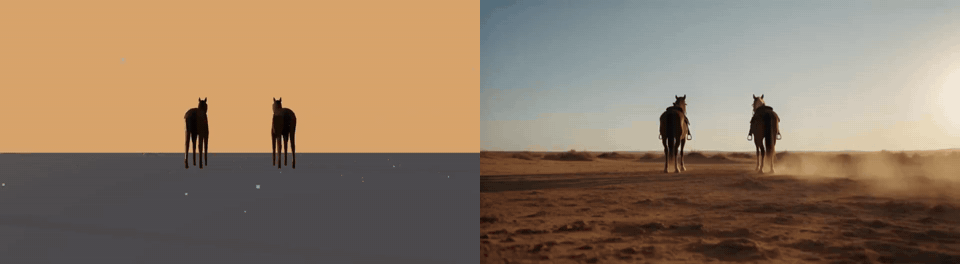</p>
<p align="center"><em>What you are working towards: block it in clay (left), Soundstage renders it (right). Same blocking, same camera.</em></p>

## Contents

1. [Install](#1-install)
2. [A tour of the workspace](#2-a-tour-of-the-workspace)
3. [The seven steps, one by one](#3-the-seven-steps-one-by-one)
   - [① Script](#step-1-script) · [② Cast & Locations](#step-2-cast) · [③ Set](#step-3-set) · [④ Frame](#step-4-frame) · [⑤ Motion](#step-5-motion) · [⑥ Review](#step-6-review) · [⑦ Deliver](#step-7-deliver)
   - [Dailies and the lined script](#dailies-and-the-lined-script) · [The Look tab: re-render in any film look](#the-look-tab-re-render-in-any-film-look) · [The Stop button](#the-stop-button)
4. [The 3D stage in depth](#4-the-3d-stage-in-depth)
5. [Keyboard and mouse cheat sheet](#5-keyboard-and-mouse-cheat-sheet)
6. [Tips and tricks](#6-tips-and-tricks)
7. [Troubleshooting and FAQ](#7-troubleshooting-and-faq)

---

## 1. Install

### What you need

| | |
|---|---|
| ComfyUI | A recent version with **App mode**. |
| GPU | NVIDIA, **48 GB of VRAM recommended** (tested on an RTX 6000 Ada). 24 GB cards need offloading and are untested. |
| Disk | About 60 GB for the models. |
| Browser | Any modern browser. The 3D stage, the Look tab and the Cut tab run in the browser and need no GPU models at all. |

### Install the node packs

Open a terminal in your ComfyUI folder and use the same Python environment that runs ComfyUI:

```bash
cd ComfyUI/custom_nodes
git clone https://github.com/theboord/ComfyUI-Soundstage
git clone https://github.com/Lightricks/ComfyUI-LTXVideo
git clone https://github.com/facok/comfyui-krea2-controlnet
pip install -r ComfyUI-Soundstage/requirements.txt
pip install -r ComfyUI-LTXVideo/requirements.txt
```

Soundstage itself only needs `soundfile` (audio read/write). `pyaaf2` is optional and only used for Avid AAF export from the Cut tab; EDL, XML and OTIO exports need nothing extra.

**On Linux or RunPod** one script installs the node packs, copies the workflows into `user/default/workflows/` and downloads the Krea 2, LTX-2.5 and Qwen3.5 files listed below:

```bash
bash ComfyUI/custom_nodes/ComfyUI-Soundstage/tools/install_runpod.sh /path/to/ComfyUI
# SKIP_MODELS=1  installs the node packs only
# SKIP_LLM=1     skips the optional Qwen3.5 file
```

Some model repos are gated. Accept the license on Hugging Face first, then run `hf auth login` (or set `HF_TOKEN`).

### Download the models

All folders are relative to `ComfyUI/models/`. You don't need everything on day one: the table says which step needs which file. The full list, with sources and licenses, is in [MODELS.md](../MODELS.md).

**④ Frame, the default image model: FLUX 3 Klein** (also used by Cast & Locations and Paint Studio)

| File | Folder |
|---|---|
| `flux3-image-klein-int8-convrot.safetensors` | `diffusion_models/` |
| `qwen3vl_4b_fp8_scaled.safetensors` (or `qwen3vl_4b_int8_convrot.safetensors`) | `text_encoders/` |
| `flux2-vae.safetensors` | `vae/` |

**④ Frame, the strict depth lock: Krea 2 Turbo + stage depth**

| File | Folder |
|---|---|
| `Krea-2-Turbo.safetensors` (or Comfy-Org's `krea2_turbo_fp8_scaled.safetensors`) | `diffusion_models/` |
| `qwen3vl_4b_fp8_scaled.safetensors` | `text_encoders/` |
| `qwen_image_vae.safetensors` | `vae/` |
| `depth-control-lora.safetensors` | `loras/krea2/cn/` |

**⑤ Motion: LTX-2.5 with the Layout-to-Render IC-LoRA**

| File | Folder |
|---|---|
| `ltx-2.5-22b-distilled-transformer-comfy-int8-convrot.safetensors` | `diffusion_models/` |
| `gemma4-12b-with-proj-ltx-2.5-comfy-int8-convrot.safetensors` | `text_encoders/` |
| `ltx-2.5-video-vae-bf16.safetensors` and `ltx-2.5-audio-vae-bf16.safetensors` | `vae/` |
| `ltx-2.5-latent-spatial-upscaler-x2-bf16-1.0.safetensors` | `latent_upscale_models/` |
| `ltx-2.5-22b-ic-lora-layout-to-render-1.0.safetensors` | `loras/ltx2.5/` |

**Optional extras**

| Feature | File | Folder |
|---|---|---|
| Motion capture, and the performer in Video → Stage | `sam_3d_body_dinov3_bf16.safetensors` (Comfy-Org repackage of SAM 3D Body) | `detection/` |
| Video → Stage and Photo → 3D location rebuilds | a Depth Anything 3 checkpoint: `depth_anything_3_base.safetensors` or `_small` (these also give the camera move directly), or `depth_anything_3_mono_large.safetensors` | `geometry_estimation/` |
| Layer Pack mattes from the final frames | `sam3.1_multiplex_fp16.safetensors` | `checkpoints/` |
| | `birefnet.safetensors` | `background_removal/` |
| Object designer ("add a food truck") and the scene agent ("Build with AI") | `qwen3.5_4b_bf16.safetensors` | `text_encoders/` |
| MiniMax H3, an optional second video engine | see [MODELS.md](../MODELS.md#motion-optional-second-engine-minimax-h3) | |

Without SAM 3.1 and BiRefNet the Layer Pack falls back to the stage's own mattes. Without Qwen3.5 the scene agent builds from its own rules instead, and the library's built-in objects still work.

### Open the Soundstage App

1. Start ComfyUI as usual (`python main.py`) and open it in your browser.
2. Load a workflow from `example_workflows/`: drag the JSON onto the canvas, or copy it into `ComfyUI/user/default/workflows/` and open it from **Workflows**.

   | Workflow | What it is |
   |---|---|
   | `Soundstage_App_Full.json` | The full App with every step. **Start here.** |
   | `Soundstage_Western.json` | The same App with riders on horses at sunset already blocked. |
   | `Soundstage_Car_Chase.json` | A three-shot car chase. |
   | `Soundstage_In_The_Car.json` | Four in-car angles. |
   | `Soundstage_Three_In_A_Car.json` | Three people in a car. |
   | `Soundstage_App.json` | A leaner App with the ladder only. |
   | `Soundstage_AudioDriven_Dialogue.json`, `Soundstage_AudioDriven_Walkin.json` | Graph examples of audio-driven (lip-sync) shots. |
   | `Soundstage_Recast_*.json` | Recast: swap one person in real footage. |

   The demo scenes carry the blocking and the cut, not the renders.
3. Open the workflow in the normal graph view once, then switch to **App** mode.
4. App mode shows Soundstage in a narrow side panel. Click **Open the full workspace** (or **Expand** in the tab bar) to give it the whole window. **Esc** returns to the panel.

> **No GPU yet?** You can still do all of ① Script, ② Cast (uploading pictures), ③ Set, the Look tab and the Cut tab, including the NLE exports. Frame needs FLUX 3 Klein or Krea 2, Motion needs LTX-2.5.

---

## 2. A tour of the workspace

Soundstage is laid out like Blender, Maya or After Effects: one screen, nothing to scroll past. Tools on the left, the picture in the middle, settings on the right, the timeline underneath.

<p align="center">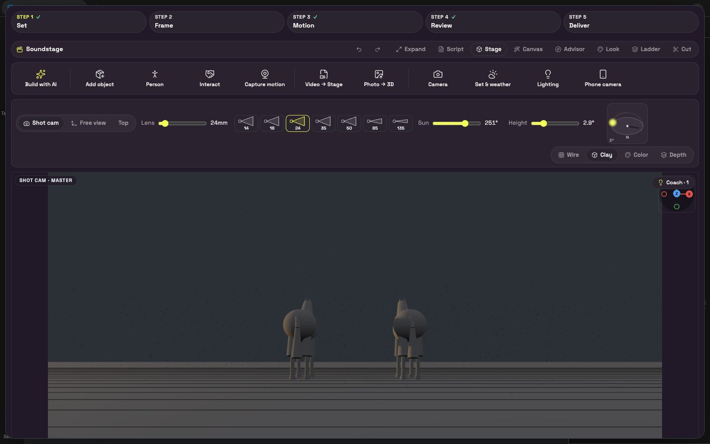</p>

From top to bottom:

### The step bar

Seven big buttons, **Step 1** to **Step 7**, in production order: **Script**, **Cast & Locations**, **Set**, **Frame**, **Motion**, **Review**, **Deliver**. Click one to go to that step. Hover for a one-line reminder of what it does. A green **✓** appears next to a step once it is done for the current shot (a clay preview exists, a frame is chosen, a video has rendered...).

On the right of the step bar, a red **■ Stop** button appears whenever anything is rendering. It shows how many jobs are waiting, for example **■ Stop (3)**. See [The Stop button](#the-stop-button).

### The tab bar

| Control | What it does |
|---|---|
| **Soundstage** | The App's name. |
| **↶** / **↷** | Undo and redo stage edits (Cmd/Ctrl+Z, Shift+Cmd/Ctrl+Z). |
| **Expand** / **Done** | Fill the whole window with Soundstage, and back. Esc also returns. |
| **Script** | The screenplay view (same as Step 1). |
| **Cast** | Cast & Locations (same as Step 2). |
| **Stage** | The 3D stage (same as Step 3). |
| **Canvas** | Paint Studio on its own, for touching up any frame. |
| **Advisor** | The Director's Advisor: describe a scene and get a shot list with the reasons. |
| **Look** | The film look: style presets, camera body, lens, film stock, grade. See [the Look tab](#the-look-tab-re-render-in-any-film-look). |
| **Ladder** | The compare view (same as Step 6). |
| **Dailies** | Setups and takes as an editor's bin, plus the lined script. |
| **Cut** | The full Cut editor (timeline, audio, NLE export). |
| **Layers** / **Lite** | Appear after a Layer Pack is written: download the whole pack, or the same pack without the per-frame PNG sequences. |

### The tool rail (left)

In ③ Set, a column of labelled icons. A tool never hides a feature of its own: it takes you to the control that does the job, lights it up and puts the cursor in it.

| Tool | What it brings up |
|---|---|
| **Build with AI** | The AI box: describe a scene in plain words and it blocks the cast, set, light and camera for you. |
| **Add object** | The add box: type any name ("dog", "food truck", "man on a horse"). Things the library doesn't have are designed by AI. |
| **Person** | The pose gallery and per-joint pose controls for the selected person (or the first person on set; if there is nobody, it adds a woman to work on). |
| **Interact** | Look at, talk to, shake hands, hug, hold hands, point at, pet or lead someone or something. |
| **Capture motion** | Copy a real performance onto a person, from a video clip or acted out on your webcam. |
| **Video → Stage** | Pick a clip; Soundstage rebuilds the location, the performer and the camera move (about a minute). |
| **Photo → 3D** | Turn a photo into a whole 3D set, a solid object, a splat, a cut-out card, a backdrop or a floor plan. |
| **Camera** | Lens, camera setups (wide, over-the-shoulder, insert...), aspect ratio. |
| **Set & weather** | Where it happens (desert, night street, interior, water tank...) and rain, snow, fog, dust. |
| **Lighting** | Time of day with a real sun, film lights and classic setups like Rembrandt. |
| **Phone camera** | Hand-hold the shot camera with your phone or headset. |

### The viewport (middle)

The header above the picture:

| Control | What it does |
|---|---|
| **Shot cam** | Look through the camera that renders. What you frame here is the shot. |
| **Free view** | Fly around the set without moving the shot camera; the shot camera is drawn as a frustum. Key **0** toggles it. |
| **Top** | A top-down plan: the camera move and the cast's paths as lines with keys. Drag a camera key or a cast key, re-aim, add or delete keys. |
| **Cams** | In Free view, show a small camera at every camera key (where it stands, where it looks). Click one to jump the playhead there. Turning it on switches to Free view. |
| hint line | A reminder of the mouse and keyboard moves. Hover it to read it in full. |
| **Wire** / **Clay** / **Color** / **Depth** | How the stage is drawn: wireframe, grey clay (default), flat colour (splats and backdrop plates show here), or the depth pass the image model reads. |

Inside the picture: a badge in the top-left corner (**Shot cam · Master**, or **Free view · shot camera shown**), the **Coach** pill in the top right, just left of the axis gizmo (it collects tips as **Coach · 2**; click to read them, each with a one-click fix and **Not now**), and the coloured axis gizmo: click an axis dot to look straight along it.

### The inspector (right)

Five tabs. Selecting something in the view switches it for you: an object or person opens **Object**, a light opens **Light**.

| Tab | What's in it |
|---|---|
| **Object** | The add box, **Import 3D…**, the **Import an image as…** menu, **Export GLB**, the **Outliner**, and the selected object's controls: **Move** / **Rotate** / **Scale** gizmo, **Measure**, **Snap**, **Turn**, **Scale**, **Duplicate**, **Delete**; for people also Appearance, Pose, Interact and Capture. |
| **Camera** | **Shot** picker, **New setup**, **Delete setup**, **Aspect**, **Lens & rig** (the lens slider, lens cards 14 to 135 mm, **Rig** and its amount), and the phone camera. |
| **Set** | **Set**, **Elements**, **Amount**, and **Water** for the water tank. |
| **Light** | **Light** (time-of-day presets or **Manual sun**), **Time**, **North**, **Add light**, **Auto 3-point**, **Light it like…**, the **Sun** dial, and the selected light's **K**, **Power**, **Height**, **Soft**, **Delete light**. |
| **AI** | **Describe your scene…** + **Build scene**, then a second box to change it by chat ("move the camera lower", "add rain"). |

### The timeline (bottom)

| Control | What it does |
|---|---|
| ⏮ / ⏴ | First key / previous key. |
| **◆ Key** | Set a key here for the camera (and the selected object). |
| ✕ | Delete the key at the playhead. |
| ⏵ / ⏭ | Next key / last key. |
| **Tracks** | Show a row per object: drag keys to retime, double-click to add, right-click to delete. |
| **Play** / **Stop** | Play the shot in the viewport. |
| scrubber | Drag the playhead. Orange diamonds above it are camera keys, blue ones object keys. |
| timecode | Seconds:frames at 24 fps. |
| **Length** | Shot length, 2 to 10 seconds. |

Under the timeline sits the **shot strip**: every camera setup as a clip in cut order. Click a clip to edit that setup. **+ Shot** adds a setup (a copy of the current camera, or a new angle: Master, Wide, Two-shot, Over-the-shoulder, Single, Insert, POV), **Editor** opens the full Cut editor, and the play button plays the cut on the stage. Drag clips to reorder them and drag their edges to trim. Right-click a clip for **Edit this setup on the stage**, **Repaint its frame (④ Frame)**, **Touch up its frame in Canvas**, **Re-render its motion (⑤ Motion)**, **Compare on the Ladder (⑥ Review)**, **Duplicate setup**, **Duplicate clip**, **Split at playhead**, **Remove from cut** and **Delete setup**. Below it, **Cut → one video** and **Render missing shots** (see [⑦ Deliver](#step-7-deliver)).

The grey **status line** at the very bottom tells you what just happened and what to do next. Read it: most messages end with the next step.

---

## 3. The seven steps, one by one

Every step works on every shot in the scene. Each step screen has a row of shot thumbnails at the top: click one to work on that shot. Once a script is loaded, every step also has a **scene switcher** (a button showing **Scene 12** and its heading, or **All scenes**) so you can jump between scenes without going back to the script.

**The scene strip.** With a script loaded, one slim row sits over ③ Set, ④ Frame and ⑤ Motion: a chip per scene with its number, place, a time-of-day dot and the initials of who is in it. The current scene's chip opens to show its shots as small thumbnails with a status dot. Click a scene to switch to it (and set it up, see below), click a shot to work on it, and use ◀ ▶ or ← → to step through the scenes. On a scene you have already worked on, a button named after the setup ("Set up scene 3 — EXT. PACIFIC BEACH — SUNSET (Mara)") adds its set, time of day, characters and vehicles: it adds what's missing and removes nothing you placed. **↶ Undo setup** takes it back. Without a script the strip shows the stage's own shots.

<a id="step-1-script"></a>

### ① Script

Optional, but it makes everything after it faster. Soundstage reads your screenplay scene by scene; it never changes it. There are no writing tools: it is your script.

<p align="center">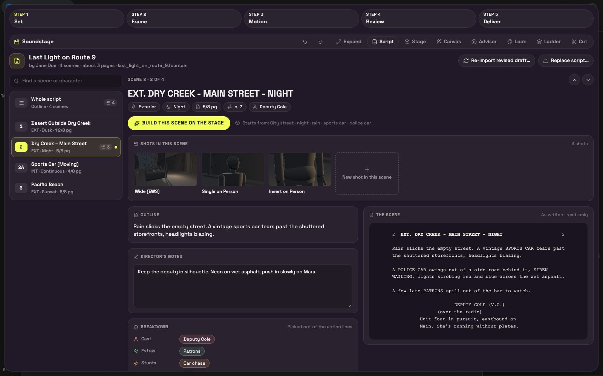</p>

**Bringing a script in**

| Control | What it does |
|---|---|
| **Choose file…** | Import a script: Fountain (`.fountain`, `.spmd`), Final Draft (`.fdx`), PDF, or plain text (`.txt`, `.text`, `.md`). |
| **Try the sample script** | Loads a short sample ("Last Light on Route 9", four scenes) so you can look around. |
| drag and drop | Drop a file anywhere on the Script view. With a script already loaded you get two drop zones: **Revised draft** (scenes matched by number, your notes kept) and **New script** (starts fresh). |
| **Re-import revised draft…** | Bring in a new version. Scenes are matched by number; your notes and shot links carry over. |
| **Replace script…** | Bring in a different script. If you have notes, it asks first and offers **Re-import as revised draft…** instead. |

Scenes are found by their headings, so every scene must start with `INT.` or `EXT.`. A PDF needs a text layer: a scanned PDF has no text to read. PDF reading loads pdf.js from cdnjs the first time, so it needs an internet connection; `.fdx` and `.fountain` work offline.

**The scene list (left)**

- **Find a scene or character**: filter by number, heading, location, character or synopsis. Esc clears it.
- **Whole script**: the overview, with the speaking parts (how many scenes each is in), the outline, and any shots that don't belong to a scene.
- One row per scene: number, location, `INT · Night · 1 3/8 pg`, a clapperboard pill with its shot count, and a yellow dot if you've written notes on it. Arrow keys, Home/End and PgUp/PgDn move through the list.

**A scene (right)**

| Part | What it is |
|---|---|
| ‹ › arrows | Previous and next scene. |
| tags | Interior / Exterior, time of day, length in pages, the page it starts on, and the characters in it. |
| **Build this scene on the stage** | The scene agent blocks the scene in 3D: set, time of day, cast and vehicles. Next to it, **Starts from:** shows what it will start from. |
| **Shots in this scene** | One tile per shot (click to open it on the stage), plus **New shot in this scene**. |
| **Synopsis** | The action lines. |
| **Director's notes** | Your notes for the scene: tone, coverage, references. Saves itself as you type (**✓ Saved**). |
| **Breakdown** | Colour-coded chips picked out of the action lines: Cast, Extras, Stunts, Effects, Props, Vehicles, Animals, Wardrobe, Set dressing, Sound, Music. |
| **The scene** | The scene's pages, read-only, in screenplay format. |

**Each scene gets its own stage, its own shots and its own cut, and picking a scene sets it up for you.** The first time you open a scene (or whenever its stage is empty), Soundstage reads its heading and breakdown and puts it on the stage: the set and weather, the time of day (NIGHT → Night (moonlight), DAWN → Dawn, DUSK or MAGIC HOUR → Magic hour, MORNING → Golden hour AM…), the scene's characters as named actors in simple blocking (with their looks from ② Cast & Locations where known) and the vehicles or animals it calls for. The status line says what it did ("Set up scene 3: beach, magic hour, Mara, Ezra…"). A stage you have already worked on is never changed by itself. **Build this scene on the stage** goes further: the scene agent blocks the action and the cameras too.

<a id="step-2-cast"></a>

### ② Cast & Locations

Everyone and everything that must look the same in every shot. Each item gets a reference picture, and ④ Frame shows those pictures to the image model, so faces, costumes, cars and places stay consistent from shot to shot.

<p align="center">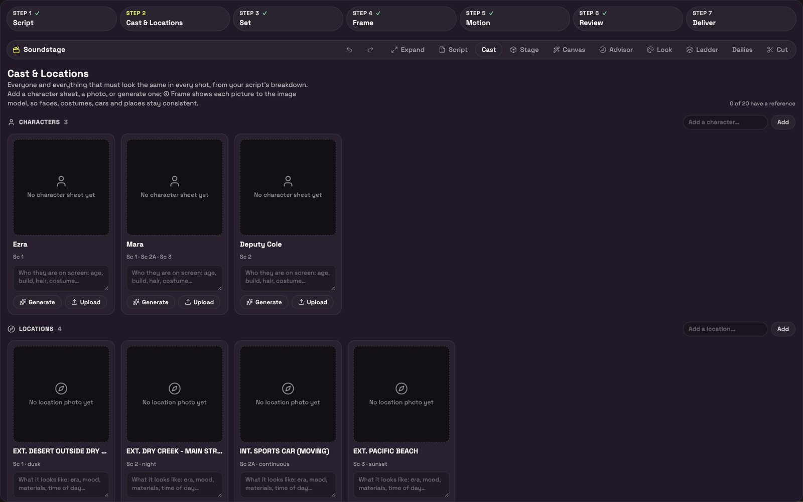</p>

The list fills itself: from the script's breakdown if you have one (characters, locations, props, vehicles, animals; clothing props are filed under Wardrobe), otherwise from the people and props on the stage. There are four sections, **Characters**, **Locations**, **Wardrobe** and **Props, vehicles & animals**, each with its own **Add** box ("Add a character…", "Add a location…", "Add a costume piece…", "Add a prop or vehicle…"). **S M L XL** at the top sets the thumbnail size, and a counter shows how many items have a reference.

Each card:

| Control | What it does |
|---|---|
| picture | Drop an image on it to upload. Click it to open it full size. |
| description | What it looks like ("Who they are on screen: age, build, hair, costume…"). Used when you generate. |
| **Generate** / **Regenerate** | Makes a 1024×1024 reference with FLUX 3 Klein from the description. For characters it is a full-body sheet: front, side and back. |
| **Upload** / **Replace** | Use your own picture or character sheet. |
| **Edit** | Open the picture in Paint Studio. **Save to reference** replaces it, and ④ Frame uses the new picture. |
| **Clear** | Remove the picture. |

<p align="center">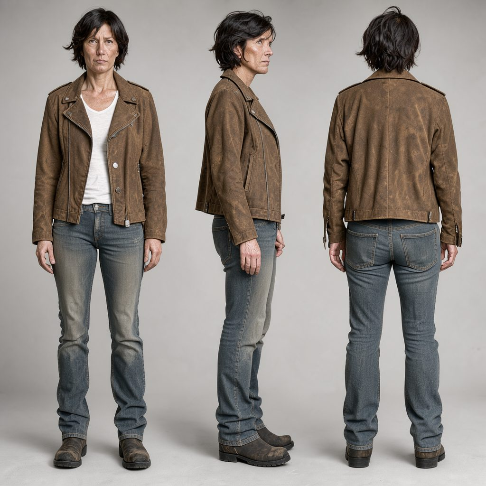</p>


<a id="step-3-set"></a>

### ③ Set

Block the scene in 3D clay: who stands where, what moves, where the camera is and how it moves. Nothing here needs a GPU model. Everything later (the frame, the video, the layers) follows what you block here, so this is where the film is made.

<p align="center">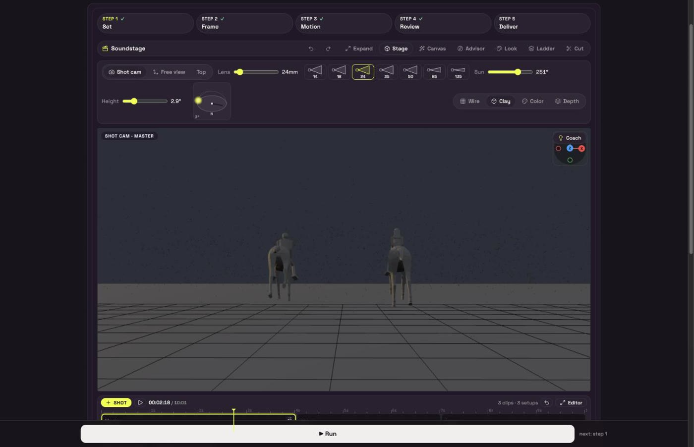</p>

A typical pass through the step:

1. **Get the scene on the stage.** With a script, just pick the scene in the scene strip: its set, light, characters and vehicles appear. Or press **Build with AI** and describe it ("two cops question a cowboy on a horse outside a diner at magic hour"), or use **Build this scene on the stage** in ① Script, or add things by hand with **Add object**. To start from real material, use **Video → Stage** or **Photo → 3D**.
2. **Pick the world.** **Set & weather** for the location and the elements; **Lighting** for the time of day, film lights or a classic setup.
3. **Place and move the cast.** Click a person to select it, drag it to place it. Move the playhead and drag again: a key is set at the playhead and the person walks between keys. Use **Person**, **Interact** and **Capture motion** for poses, interactions and real performances.
4. **Frame the shot.** Stay in **Shot cam**, pick a lens, and frame by dragging in the view, scrolling, or flying with W A S D. Move the playhead and reframe for a camera move; choose a **Rig** to give the move a real dolly, jib or handheld feel.
5. **Add coverage.** **New setup** (Master, Wide, Two-shot, Over-the-shoulder A/B, Single A/B, Insert, POV) or **+ Shot** on the shot strip adds another camera on the same action.
6. **Press Play** to watch the clay, then go to ④ Frame.

**The AI box** (**Build with AI**, or the **AI** tab in the inspector):

| Control | What it does |
|---|---|
| **Describe your scene: …** + **Build scene** | The scene agent blocks the whole scene: cast, set, light and camera. Enter also builds. |
| **Change it: "move the camera lower", "add rain"… (Enter)** | Edit the scene by chat after it is built. |

The scene agent runs on Qwen3.5 4B if you installed it, and on its own rules otherwise. The section [The 3D stage in depth](#4-the-3d-stage-in-depth) covers every stage control.

<a id="step-4-frame"></a>

### ④ Frame

**Paint the first frame from your clay.** The image model keeps your blocking (layout, camera, who stands where) and adds the photography. Generate a few, pick one, fix it in Paint Studio if needed, and the video starts from it. Every shot gets its own frame: pick the shot in the row at the top.

<p align="center">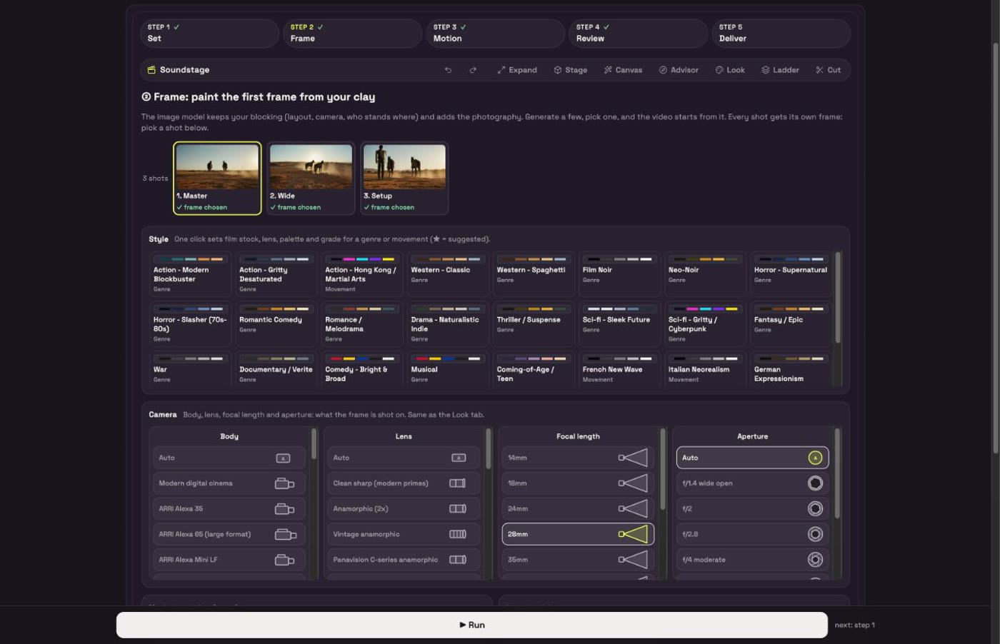</p>

Each shot card in the row says where it stands: **no frame yet**, **painting…**, **N to pick from**, **✓ frame chosen**.

**The main card (left)**

| Control | What it does |
|---|---|
| **Image model** | **FLUX 3 Klein (local, recommended)**: steered by the stage picture and depth, and it takes the cast's reference pictures. **Krea 2 Turbo + stage depth (local, strict depth lock)**: holds the stage's depth very tightly, but takes no references. Other installed image models are listed after them. |
| **Prompt: describe the frame** | What's in the frame and how it should feel ("golden hour, dust, worn leather saddles…"). The Look tab adds camera, lens and style to it. This is the same text as the Look tab's **Describe the scene**. |
| **Follow the clay** | How closely the frame sticks to the clay, from **strict** through **balanced (recommended)** to **free**. It drives the Krea 2 + stage depth path. |
| **LoRA (character, product, style)** + **LoRA strength** | Add a LoRA to the image model, for a recurring character, a product or a house style. |
| **Variations** | 1, 2 or 4 frames per click (default 4). |
| **Quality** | **Fast**, **Standard**, **High**, **Max**: the number of steps. FLUX 3 Klein: 8, 20 (default), 28, 40. Krea 2: 6, 8 (default), 14, 20. CFG stays at 1: these models are distilled. |
| **Generate frames** | Queue the variations for this shot. About 6 to 10 s a frame once the models are warm; a new shot also renders its clay passes first. Pressing it again adds more candidates. |
| **…for every shot** | The same number of variations for every shot in the scene. |
| **Advanced: steps & CFG** | **Steps**, **CFG** and a negative prompt. Leave CFG at 1: above about 1.5 it burns and doubles the time. |
| **Style** | The 31 style cards from the Look tab: one click sets film stock, lens, palette and grade. |
| **Camera** | Body, lens, focal length and aperture cards, the same as the Look tab. |

**Cast in this shot.** Under the main card: the characters, location, wardrobe, props and style references from ② Cast & Locations, as tiles. Tick who is in this shot (click the picture, or the **In this shot** box). The tiles that go to the model get a badge, **#1** to **#4**: FLUX 3 Klein takes **four references**, ranked characters first, then the location, wardrobe and props. A fifth tick shows **over** and is not sent. **S M L** sets the tile size, **② Cast & Locations** jumps to step 2, **Edit** opens a reference in Paint Studio (**Save to reference** keeps the edit for every shot that uses it), and **Add picture** / **Replace** uploads one. The note underneath says exactly what is sent ("Sent to the image model: …"). Nobody ticked means the frame is painted from the prompt and the clay alone.

**The candidates (right).** Your clay ("your clay, frame 1") and the frames as they land. Click a frame's **Use this frame** to choose it (**✓ Chosen**). The first frame to land is chosen for you. Choosing locks that model and seed, so ⑤ Motion reproduces exactly this frame from cache.

**Paint Studio.** The card **Paint Studio: get the first frame right before you animate it** has **Open Paint Studio**, which opens the chosen frame in a small Photoshop right here. When you press **Use as first frame** in Paint Studio, the painted picture becomes the shot's frame (captioned **Paint Studio** in the candidates) and **Animate my edited frame** is ticked for you.

Then **⑤ Animate this frame →**.

#### Paint Studio

Paint Studio is a layered image editor with Soundstage's own Generative Fill (FLUX 3 Klein by default, crop and stitch: nothing outside your area changes). It opens inside ④ Frame, from a Cast reference's **Edit**, and on its own in the **Canvas** tab.

<p align="center">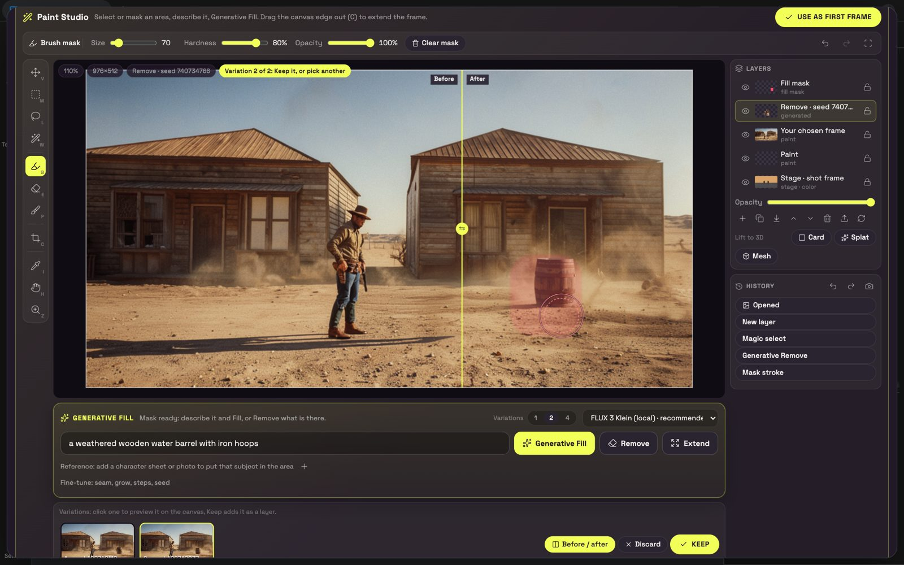</p>

**Tools** (left rail; the letter is the shortcut):

| Tool | Key | What it does |
|---|---|---|
| Move | V | Drag the active layer or the selected pixels; corners scale (Shift keeps the shape). |
| Marquee select | M | Drag a rectangle. Shift adds, Alt subtracts. |
| Lasso select | L | Draw around an area. Shift adds, Alt subtracts. |
| Magic select | W | Click an object and SAM 3.1 selects it. Shift-click or right-click excludes. |
| Brush mask | B | Paint the area Generative Fill should repaint (the default tool). |
| Eraser | E | Erase the mask, or a layer's pixels (switch it in the top bar). |
| Paint brush | P | Paint colour on the active layer. |
| Crop / Extend | C | Drag an edge past the picture to outpaint it, or pick **16:9**, **2.39**, **1.85**, **9:16**, **4:3**. |
| Eyedropper | I | Pick a paint colour from the picture. |
| Hand | H | Pan (or hold Space, or middle-drag). |
| Zoom | Z | Click to zoom in, Alt-click to zoom out. Scroll zooms anywhere, F fits. |

The bar at the top changes with the tool: **Size** (`[` and `]`), **Hardness**, **Opacity**, **Clear mask**, **Clear points**, the extend presets and **Reset**. With a selection: **Grow**, **Shrink**, **Feather**, **To mask**, **To layer**, **Invert**, **Deselect**.

**The Generative Fill bar** (under the picture):

| Control | What it does |
|---|---|
| prompt | What to put there ("a brass floor lamp"), what to remove, or what lies beyond the frame. |
| **Generative Fill** (Enter) | Repaint the selected or masked area with what you describe. The area is widened to a box with headroom above, so an added object (a car) is never clipped. |
| **Remove** | Erase what's in the area: the background continues through it. |
| **Extend** | Paint the empty canvas around the picture after you drag the edges out with Crop / Extend. With no prompt it uses the frame's description. |
| **Variations** | 1, 2 or 4 (default 2). |
| model | The image model that paints the fill. |
| **Reference** row | Tick a cast picture to put that subject in the area (the button becomes **Fill with reference**); **+** adds one. |
| **Fine-tune: seam, grow, steps, seed** | Seam feather, mask grow, steps, detail, and a fixed seed. |

Results come back as a filmstrip of **Variations**: click one to preview it on the canvas, toggle **Before / after** and drag the line to compare, then **Keep** (adds it as a new layer) or **Discard**.

**Layers** (right): the stage frame, your chosen frame, **Paint**, **Fill mask** and every kept fill, with show/hide, lock, rename (double-click), **Opacity**, new, duplicate, merge down, reorder, delete, import an image, and **Re-render the Stage layer at the playhead**. **Lift to 3D** sends the layer back to the stage as a **Card**, **Splat** or **Mesh**.

**History**: every step since **Opened**, click to jump back; the camera button saves a **Snapshot** to return to.

**Use as first frame** (top right) makes the picture the shot's first frame. When you came from a Cast reference, it reads **Save to reference** instead, with **Cancel**.

Keyboard: Cmd/Ctrl+Z / Shift+Cmd/Ctrl+Z undo and redo, Cmd/Ctrl+A select all, Cmd/Ctrl+D deselect, Shift+Cmd/Ctrl+I invert, Delete erases the selection on the active layer, Cmd/Ctrl+0 or F fits, Esc clears.

<p align="center">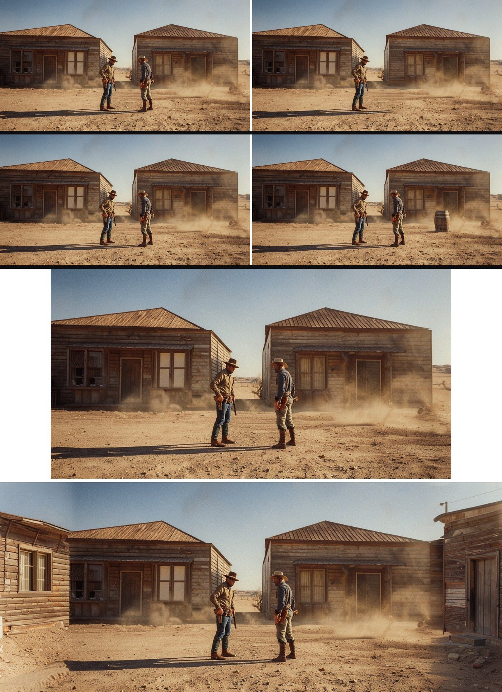</p>

<a id="step-5-motion"></a>

### ⑤ Motion

**Animate it with LTX-2.5.** LTX follows your clay animation (positions, camera, timing) and paints it in the style of your chosen frame, with generated sound. Pick a shot, or render them all.

<p align="center">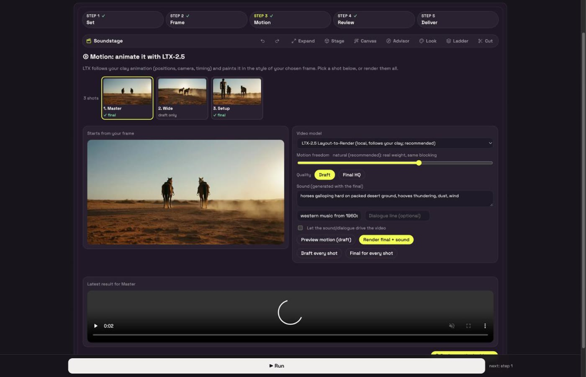</p>

| Control | What it does |
|---|---|
| **Starts from your frame** | The frame this shot will animate. |
| **Video model** | **LTX-2.5 Layout-to-Render (local, follows your clay; recommended)**. Other installed image-to-video models are listed after it, and **MiniMax H3** if you installed it (see below). |
| **Motion freedom** | How freely the video moves away from the clay: **exact** (copies the clay motion), **natural (recommended)** (real weight, same blocking), **loose** (more invention, framing may drift). Default 0.5. |
| **Quality** | **Draft** (the default while you build), **Final** or **Final HQ**. It sets the quality of what you render next, so switch to **Final** before your keeper render. See the table below. |
| **Advanced: steps, CFG, sampler** | CFG, sampler and a negative prompt. LTX-2.5 here is distilled: CFG 1 is its tuned setting. |
| **Sound (generated with the final)** | The sound effects ("hooves galloping on packed dirt, wind…"). Left empty, it is filled in from what's on the stage. |
| **Music mood (optional)** | With **Music ideas** chips: tense western strings, pulsing synth chase, eerie horror drones, and more. |
| **Dialogue line (optional)** | A spoken line, with **Line ideas** chips. Typing one turns on lip sync (below). |
| **Let the sound/dialogue drive the video** | The audio drives the picture, so the mouth follows the words. |
| **Preview motion (draft)** | Queue a draft of this shot: about 2 to 4 minutes once warm. |
| **Render final + sound** | Queue the final with sound: about 4 to 6 minutes once warm. |
| **Draft every shot** | A draft for every shot that doesn't have one, each from its own chosen frame. |
| **Final for every shot** | A final with sound for every shot that doesn't have one yet. |

**Quality tiers** (steps for the render + the upscale pass):

| Tier | Steps | Use it for |
|---|---|---|
| **Draft** | 8 + 3 | The default. A quick look at the motion: is the blocking right, does the car go the right way? Faces are readable. |
| **Final** | 12 + 6 | Clean fast motion, faces and hands. Your keeper renders. |
| **Final HQ** | 18 + 12 | Hero shots. About twice as long as Final. |

**Lip sync: type the line.** A line pasted over a mouth that never heard it doesn't sync. So when you type or pick a **Dialogue line**, Soundstage turns on **Let the sound/dialogue drive the video** for you, and the final is rendered *from* the line (LTX audio-driven): the status line says "Lip sync on: the final is driven by the line, so the mouth follows the words." You can still untick it on purpose.

Shot length comes from **Length** in ③ Set, frame size from **Aspect**, and the camera move from the keys and **Rig**. The video panel at the bottom shows the **Latest result** for the shot. Then **⑥ Review on the Ladder →**.

**MiniMax H3 (optional).** If installed, **MiniMax H3 (local, looser blocking, rich motion, own sound; ~20+ min)** appears in **Video model**. It makes richer motion and its own sound in one pass, but follows your blocking only loosely, and a final takes 20 to 30 minutes. Drafts still preview with LTX. Extra options: **Use the clay as a motion reference** (slower, closer blocking) and **Add images** (up to 7 reference pictures). See [MODELS.md](../MODELS.md) for its files and region-limited license.

<a id="step-6-review"></a>

### ⑥ Review

**Compare the same frame across the stages.** The Ladder shows a shot at every stage it has been through, on one picture: the clay previz, the painted frame, the draft and the final. Drag across the picture to slide between them, and scrub or play the timeline to compare any moment.

<p align="center">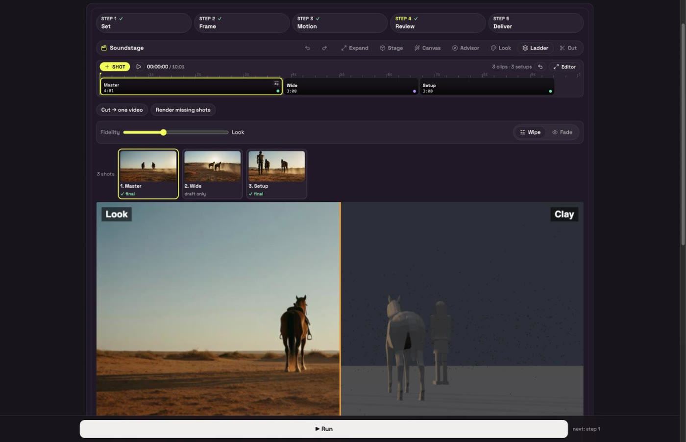</p>

Use it to check that the final still matches your blocking: the same people in the same places, the car going the right way, the camera doing what you keyed. A stage that hasn't been rendered yet says so on the picture. If something's off, right-click the shot in the strip and use **Edit original** to go straight back to the step that made it.

The bar above the picture picks what you compare and how:

| Control | What it does |
|---|---|
| **3-way** (default) | The same frame cut into three slices, **Left** \| **Middle** \| **Right**, with two handles you drag across it. Left is **Clay** (or **Color**, **Wire**, **Frame**), Middle is **Frame** or **Draft** (click it again to drop the middle), Right is **Draft** or **Final**. Every layer is cropped to the render's own aspect, so they line up while you drag: what changes between them is only what the model changed. |
| **Wipe** | Two stages, **A** and **vs B** (any of Wire, Clay, Color, Frame, Draft, Final), split by one handle. |
| **Side by side** | A and B next to each other. |
| **Fade** | Drag to mix from A to B. |

Drag anywhere on the picture and the nearest handle follows; a click jumps it there. Greyed-out buttons are stages not rendered yet.

<a id="step-7-deliver"></a>

### ⑦ Deliver

Hand a shot to post, or the whole cut to an editor. The shot cards at the top show where each shot stands: **✓ final**, **draft only**, **frame ✓, no video**, **nothing yet**, or **making layers…**.

<p align="center">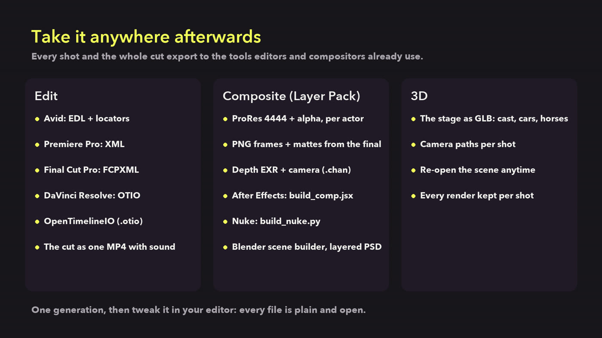</p>

| Control | What it does |
|---|---|
| **Make the Layer Pack** | For the shot picked above: one layer per actor with mattes cut from the final frames (SAM 3.1 + BiRefNet edges), depth, the camera, and builders for After Effects, Nuke, Resolve, Blender and Photoshop. The final is reused from cache; the mattes take about a minute. |
| **Layer Packs for every shot with a final** | The same for every shot that has a final. |
| **Cut → one video** | Every shot in the strip, trimmed and in order, with sound, joined into one MP4. Each clip uses its best render (Final with sound, then Final, Draft, the clay preview, the frame); a shot with nothing yet becomes a black slate of the right length. When it's done you get **Watch** and **Download**. |
| **Render missing shots first** | Queue a Final for every shot in the cut that has none, then join the cut. |
| **Open the editor (Avid / Premiere / Resolve / FCP / OTIO)** | Opens the Cut tab. |

When a Layer Pack is ready, **Layers** and **Lite** download links appear in the tab bar, top right. **Lite** is the same pack without the per-frame PNG sequences (the ProRes 4444 movies, EXRs, camera and builders are kept).

**What's in a Layer Pack** (`ComfyUI/output/soundstage_layerpacks/<shot>_<date>_<time>/`):

| Folder / file | Contents |
|---|---|
| `layers/<nn>_<name>/png/` | RGBA frames per actor, straight alpha, numbered from 1001 |
| `matte/` | 16-bit mattes |
| `<name>_4444.mov` | ProRes 4444 with alpha, timecode from 1001 |
| `aovs/depth/` | depth EXRs in metres, plus a viewable `depth_vis/` |
| `camera/camera.json`, `camera/camera.chan` | the exact staged camera |
| `dcc/ae/`, `dcc/nuke/`, `dcc/blender/`, `dcc/resolve/`, `dcc/photoshop/` | an After Effects `.jsx`, a Nuke script, a Blender script, a Resolve OTIO timeline and a layered PSD |
| `preview/` | a contact sheet and a comp preview movie |

#### The Cut editor

The **Cut** tab (or **Editor** on the shot strip) is a real timeline over your coverage, with the keys editors expect.

<p align="center">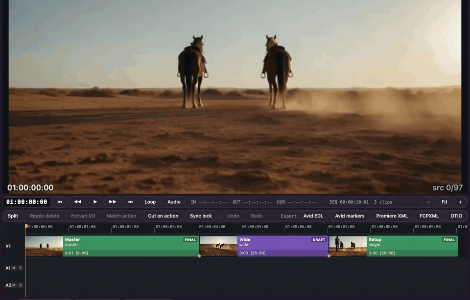</p>

| Control | What it does |
|---|---|
| timecode box | Record timecode: 24 fps non-drop, starting at 01:00:00:00. |
| transport | Previous edit (↑), shuttle reverse (J), play/stop (Space), shuttle forward (L), next edit (↓). Press J or L again for 2×, 4×, 8×. |
| **Loop** | Loop playback (the I/O range when marked). |
| **Audio** | Play the audio of Draft and Final clips. |
| **−** / **Fit** / **+** | Zoom the timeline (`-`, `\`, `=`). |
| **Split** | Add an edit at the playhead (B or Cmd/Ctrl+B). |
| **Ripple delete** | Delete the selected clip and close the gap; with nothing selected, extract the I/O range (Backspace). |
| **Extract I/O** | Remove the marked range and close the gap (X). |
| **Match action** | Slide the selected clip so it continues the action of the clip before it (M). |
| **Cut on action** | On by default: match the scene frame when cutting between setups of one scene, and snap trims to it. |
| **Sync lock** | On by default: picture ripple edits move the audio after them too. |
| **Undo** / **Redo** | Cmd/Ctrl+Z, Shift+Cmd/Ctrl+Z. |
| **Shots** bin | Click a shot to splice it in at the playhead, Shift-click to overwrite, drag onto the track to insert. |
| audio tracks | A1, A2… with **M** (mute) and **S** (solo). Select an audio clip for gain dB, fade in, fade out, track, **Remove**. `[` and `]` change gain by 1 dB. |

On the timeline: drag a clip to reorder, drag its edge to trim, Option/Alt-drag an edit to roll it (the viewer shows a two-up trim monitor). Mark in and out with I and O, clear with G.

**Right-click any clip → Edit original.** This jumps back to whatever made the clip: **Edit the shot on the Stage (blocking, camera)**, **Repaint its frame (④ Frame)**, **Touch up its frame in Canvas**, **Re-render its motion (⑤ Motion)**, or **Compare on the Ladder (⑥ Review)**. Fix it there and the cut picks up the new render by itself, because the cut always plays each shot's latest render.

**Export to your NLE** (the **Export** buttons; all download straight from the browser):

| Button | File | For |
|---|---|---|
| **Avid EDL** | `.edl` (CMX3600, picture + audio events) | Avid Media Composer |
| **Avid markers** | `_avid_locators.txt` | Avid's Markers window → Import Markers |
| **Premiere XML** | `_premiere.xml` (FCP 7 XML) | Premiere Pro, with the audio tracks |
| **FCPXML** | `.fcpxml` (1.10) | DaVinci Resolve and Final Cut Pro |
| **OTIO** | `.otio` | DaVinci Resolve and other OpenTimelineIO tools |

Avid AAF comes from the graph node **Soundstage · Cut: Export to Avid / Premiere / Resolve / FCP**, which writes every format plus an `.aaf` and per-shot audio mixes into `output/soundstage_cuts/<name>/`. Add it in the graph view and install `pyaaf2` to use it. There are no picture dissolves: cuts are cuts, and fades are on the audio clips.

### Dailies and the lined script

The **Dailies** tab shows a scene's setups and takes the way an editor's bin does. It has no step of its own: open it from the tab bar.

<p align="center">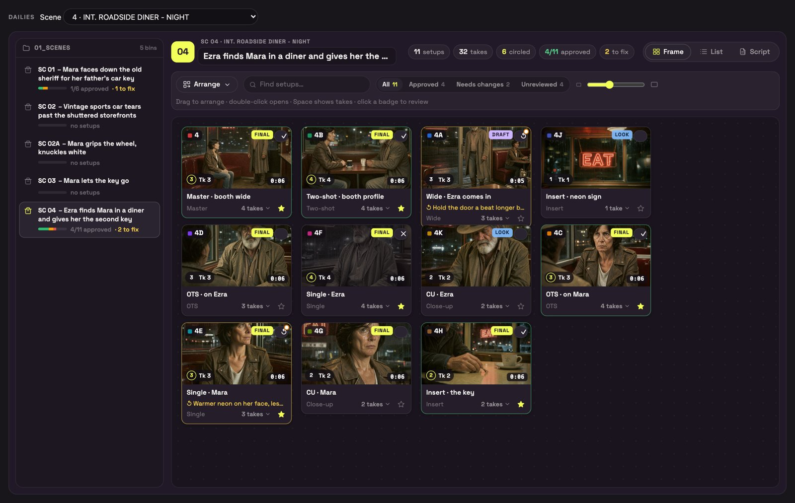</p>

**Every render is a take.** The clay preview, each frame variation, each Draft and each Final of a setup become takes 1, 2, 3… Setups are slated like a real shoot: the first setup of scene 12 is **12**, then **12A**, **12B** (I and O are skipped). A clip is named **12B-3**: scene 12, setup B, take 3.

The header shows `Dailies · Scene N`, the counts of setups, takes and circled takes, and three views: **Frame**, **List** and **Script**.

**Frame view**

| Control | What it does |
|---|---|
| **Arrange ▾** | **Script order** (where each setup starts in the scene), **By setup type** (masters, two-shots, OTS, singles, close-ups, inserts), **Tidy grid**. |
| **Find setups…** | Filter by slate, name, setup type or take kind. Type `circled` to see only circled setups. |
| size slider | Thumbnail size. |
| card | Thumbnail, slate, take kind (Previz / Look / Draft / Final), take number, duration, setup type. |
| **N takes ▾** | Show the takes (also on hover, or Space). Each row opens that take or circles it. |
| ☆ | Circle the shown take (one circled take per setup). |

Drag cards to arrange them (Option/Alt-drag places freely), arrow keys nudge, Enter or double-click opens the circled take, `C` or `*` circles.

**Approvals.** Review every take the way a director signs off dailies. A small round badge sits on each frame, draft and final (in the bin, on ④ Frame's variations, on ⑤ Motion's latest result and in the shot rows). Click it for the **Review** pop-over: **✓ Approve**, **↺ Needs changes** or **✕ Reject**, plus **Clear** to go back to unreviewed. With **Needs changes**, write what should change ("warmer light, she looks left, slower push-in") and press **↺ Redo in ④ Frame** or **↺ Redo in ⑤ Motion**: Soundstage opens that step for the shot with your note on top, and in ④ Frame it adds the note to the frame prompt (**Undo prompt edit** takes it back out). The same status shows everywhere and is saved with the workflow. The bin has a status filter to show setups by review status, such as the takes that need changes.

**Scene bins.** Like an Avid project, there is one bin per script scene, named like **SC 03 – what happens**, in script order, each showing how much of it is approved.

**List view** is a sortable table: Setup, Name, Type, Takes, Circled, Kind, Duration, Coverage. Click a column header to sort, Enter opens, C circles.

**Script view: the lined script.** The scene's page with a coloured vertical line per setup, ScriptSync-style. A straight line means on camera; a **zig-zag** means rolling but off screen. A thumbnail and slate sit on top of each line.

<p align="center">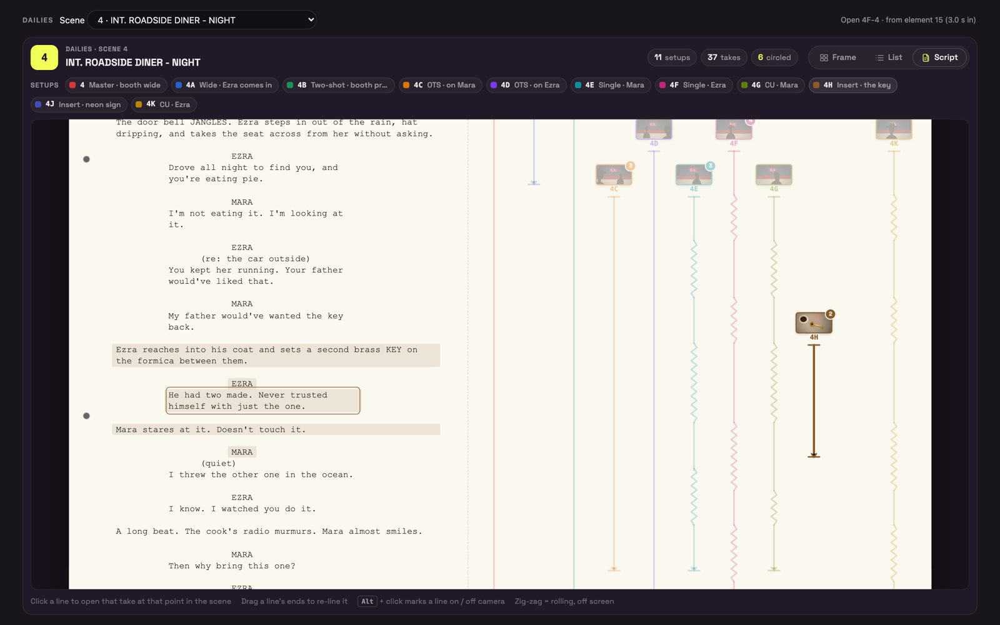</p>

- **Click a line** to play that take from that point in the scene.
- **Click the page text** to open the tightest setup covering that line.
- **Drag a line's ends** to re-line it. Keyboard: ↑/↓ moves the end, Shift+↑/↓ the start.
- **Option/Alt+click** marks a line on or off camera.
- A dashed chip in the legend is a setup that isn't lined yet: click it to line it at the top of the scene, then drag its ends.

Soundstage lines setups for you to start with: masters, wides and two-shots cover the whole scene; singles and close-ups run from the character's first cue to their last speech (zig-zag where others talk); inserts cover the action line that mentions their subject.


### The Look tab: re-render in any film look

The look lives apart from the stage. Change it and the clay, depth and camera are untouched (and reused from cache), so **the same blocking and the same animation can be rendered again in any film look**: a western as film noir, a car chase as a 70s New Hollywood picture.

<p align="center">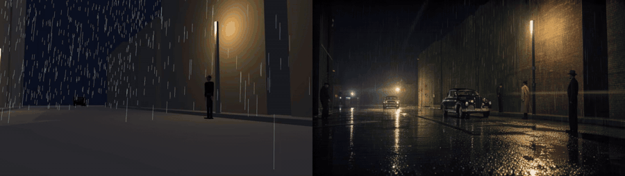</p>

**To re-render a shot in another look:**

1. Open the **Look** tab (or the **Style** section in ④ Frame) and click a style card.
2. In ④ Frame press **Generate frames**: new frames from the same clay and depth. Pick one.
3. In ⑤ Motion render again. LTX is guided by the same clay animation, so the positions, the camera path and the timing stay; only the photography changes.

**The 31 style swatches.** Each card shows its palette as a colour strip; hover for a one-line summary. One click sets the camera body, lens, aperture, film stock, genre, era, technique, mood, energy, palette and grade, and the stage lens. In-car cameras keep their wide lens. In the Look tab, a **director's notes** panel then explains the style's lighting, camera and framing, and ★ marks its suggested film stocks, lenses, focal lengths and apertures.

| Group | Styles |
|---|---|
| Action | Action - Modern Blockbuster · Action - Gritty Desaturated · Action - Hong Kong / Martial Arts |
| Western | Western - Classic · Western - Spaghetti |
| Noir and thriller | Film Noir · Neo-Noir · Thriller / Suspense · Korean Thriller · Nordic Noir |
| Horror | Horror - Supernatural · Horror - Slasher (70s-80s) |
| Romance and drama | Romantic Comedy · Romance / Melodrama · Drama - Naturalistic Indie · Coming-of-Age / Teen |
| Sci-fi and fantasy | Sci-fi - Sleek Future · Sci-fi - Gritty / Cyberpunk · Fantasy / Epic |
| Others | War · Documentary / Verite · Comedy - Bright & Broad · Musical · Music Video / Commercial Gloss |
| Movements and eras | French New Wave · Italian Neorealism · German Expressionism · Dogme 95 / Handheld Realism · Storybook Symmetry · 70s New Hollywood · Hong Kong Mood Cinema |

**Everything else on the Look tab**, top to bottom:

| Control | What it does |
|---|---|
| **Type a look** + **Apply** | Plain words ("Korean thriller, anamorphic, teal-orange") set the matching controls. Words it doesn't recognise go into the scene description. **Reset** clears every look control. |
| **Describe the scene** | Who they are, wardrobe, props, place details. Blocking, lens and time of day come from the stage. |
| **Camera** | Four columns of cards: **Body**, **Lens**, **Focal length** (14 to 135 mm; sets the stage camera at the playhead) and **Aperture**. |
| selects | **Film stock / sensor look** (Kodak Vision3, CineStill 800T, bleach bypass, Double-X black and white, VHS…), **Genre**, **Subgenre**, **National cinema / movement**, **Era**, **Director technique**, **Mood / emotion** with an intensity slider, and **Energy** (the pacing of the motion). |
| **Colour palette** | 32 palettes (Teal & orange, Sodium decay, Moonlit blue, Technicolor primaries, Vaporwave…), editable swatches, **+ Swatch**, **Randomize**, and **From image…** to pull five swatches from a reference picture. |
| **Grade** | Contrast, Saturation, Warmth, Grain, Halation, Vignette, and extra negative words. |
| **Restyle brief** | Describe the finished world: target world, atmosphere, surfaces, set dressing, colour, light, what's outside the windows. |
| **Compiled prompts** | The exact prompts Soundstage will send: **Look still · frame 1**, **Still negative**, **Motion · LTX**, each with **Copy**. |

The 18 lighting setups (**Light it like…**) live with the lights in ③ Set → **Light**.

### The Stop button

The red **■ Stop** at the end of the step bar is there whenever ComfyUI is rendering. With several jobs waiting it shows the count, **■ Stop (4)**.

Press it to **cancel every queued render and interrupt the one running now**. The status line confirms: "Stopped: 3 queued renders cancelled, the running one interrupted." Shots marked painting… or rendering… go back to normal, and anything already rendered stays.

It clears the **whole ComfyUI queue**, including jobs you queued from other workflows or tabs on the same server.

---

## 4. The 3D stage in depth

### The mouse

The rule is simple: **a click selects, a drag on anything not selected moves the camera, a drag on the selected thing moves it.** You can't knock something out of place by accident.

| Gesture | What it does |
|---|---|
| click an object or person | Select it. The inspector opens its **Object** tab. |
| click empty space | Deselect. |
| drag on empty space, or on something not selected | Orbit the view, all the way round (over and under too). Close in, or inside a car or a room, it turns into looking around in place. |
| drag the selected object | Move it across the floor. It writes a position key at the playhead. |
| drag the gizmo arrows / ring | Move along one axis, rotate, or scale (see below). |
| Shift-drag or middle-drag | Pan. |
| Option/Alt-drag | Look around in place, like a tripod head. |
| scroll | Dolly in and out. Close to the target it flies through it. |
| drag a glowing light handle | Move that light. |

Set pieces (a rebuilt location, walls, sidewalks, photo-built sets) never move from a drag, so you can orbit across them freely.

**Drop to interact.** When you drag a selected person or prop and let go on top of something, the stage reads it as an action:

- a person dropped on a horse, bicycle or motorcycle **mounts** it (after frame 0 it is a timed hop-on);
- on a car or boat, they take the **nearest seat**;
- on a chair, bench, sofa, armchair or stool, they **sit**;
- on anything up to 1.7 m tall, they **climb onto** it;
- a small prop dropped on or next to a person is **picked up and carried** from the playhead; drag it away to put it down. Drop a **Flashlight** on someone to hand it to them.

### Shot cam, Free view and Top

| View | Use it for |
|---|---|
| **Shot cam** | Framing. You look through the camera that renders. **Every orbit, pan, dolly or W A S D move edits the camera key at the playhead** (it makes one if there is none). |
| **Free view** (key **0**) | Looking around the set without touching the shot. The shot camera is drawn in the world: its path as a violet line, **a small numbered camera at every camera key** (body, lens and a frustum in the shot's aspect, showing where it stands and where it looks; the one at the playhead is highlighted), blue start and end arrows, the lens frustum at the playhead, and a label with its height and focal length. A picture-in-picture monitor (bottom left) shows the shot camera, with **Play the shot**, a scrubber and a button to **Look through the shot camera**. |
| **Top** | A top-down plan of the set, bottom right: grid, set footprints, the cast with their paths and their keys (small squares), and the camera move coloured by time (◆ keys), with a lens wedge and an aim line for every key. It is the second way to edit the camera and the cast keys, and usually the easiest. Ride-along shots follow their vehicle here too. |

**Editing the camera move in Top view:**

| Gesture | What it does |
|---|---|
| drag a numbered ◆ key | Move that camera position (height kept). Shift carries its aim along. |
| drag a ■ cast key, or a person | Move that cast key (or key the person at the playhead). |
| Option/Alt-drag a key | Change its height. |
| drag a target dot | Re-aim that key. |
| click the path | Add a key at that frame. |
| drag the path or the playhead | Scrub. |
| right-click a key | Delete it (camera or cast key; a shot keeps at least one camera key). |
| drag empty space / scroll / double-click | Pan / zoom / fit. **Fit** in the header does the same; ✕ hides the view. |

**Click a key camera** in Free view to jump the playhead to that key; **Cams** in the viewport header hides or shows them.

The coloured axis gizmo in the corner of the viewport snaps the view: click X, Y or Z (or the hollow dot opposite) to look straight along that axis.

**Display modes** (**Wire**, **Clay**, **Color**, **Depth**) only change what you see while you work. The renders always use their own passes.

### Keys and the timeline

Soundstage animates with keys, like any animation package, but you rarely press a key button: **editing at the playhead sets the key for you** (the hint above the view says so: "a ◆ key is set there automatically"). Moving the camera in Shot cam, dragging an object, changing the lens, posing a joint: each keys at the playhead.

To make a camera move: put the playhead at 0 and frame the start; drag the playhead to the end and frame the end. That's two keys and a move. Add keys in between for a curve; the camera travels on a smooth spline through them and eases in and out at the ends.

| Control | What it does |
|---|---|
| **◆ Key** | Set a key here for the camera and the selected object, without changing anything. |
| ✕ | Delete the key at the playhead (camera and selected object). The last key always stays. |
| ⏮ ⏴ ⏵ ⏭ | First, previous, next, last key. |
| key strip | Orange diamonds = camera keys, blue = the selected object's keys, white line = playhead. |
| **Length** | 2 to 10 seconds. The frame count is rounded to what LTX needs (a multiple of 8, plus 1). |

**Tracks** opens a dope sheet under the timeline: a **Camera** row first, then a row per object, with a ruler in seconds. Click a name to select it, drag a diamond to retime it, double-click a row to add a key, right-click a diamond to delete it. Tracks show position keys; pose keys show in the pose panel.

Things that are **not** keyed: an object's **Turn** and **Scale** are one value for the whole shot.

### Lens, aspect and camera rigs

In the **Camera** tab:

- **Lens**: a slider from 14 to 135 mm, plus lens cards for **14, 18, 24, 35, 50, 85, 135** (hover a card for its horizontal field of view). The lens is stored on the key at the playhead, so a zoom is just two keys with different lenses.
- **Aspect**: **1.85:1 (flat)**, **16:9**, **2.39:1 (scope)**, **9:16 (vertical)**, **1:1**, **4:3**, **3:4**. The view letterboxes to match.
- **Rig**: the keys say *where* the camera goes; the rig says *how* a real camera support gets there. The slider next to it sets how much of the rig's feel you get (0 to 2).

<p align="center">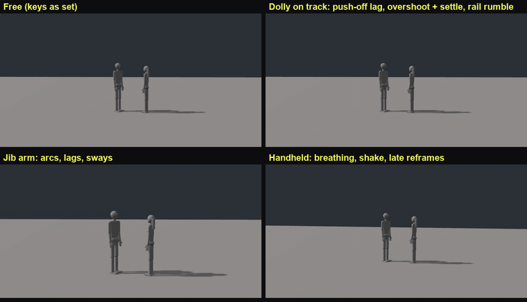</p>

| Rig | What it does to your move |
|---|---|
| **Free (keys as set)** | Exactly the keyed path. |
| **Tripod (pan / tilt)** | The camera stays at the first key and only pans and tilts, eased like a fluid head. |
| **Dolly on track** | The move runs on a straight track from the first to the last mark at a fixed height: it takes a moment to push off, overshoots and settles at the stop, and rumbles a little over the rail joints. |
| **Chapman dolly (track + boom)** | A dolly whose boom keeps your keyed heights. |
| **Slider** | A short, stiff, smooth dolly (up to 1.2 m). |
| **Jib / crane arm** | The camera swings on an arm around a post, so moves arc, then lag and sway at the stop. |
| **Steadicam** | Floats, bobs gently with the operator's steps, drifts and rolls slightly. |
| **Handheld** | Breathes, shakes, reframes late, wanders. |
| **Drone** | Very smooth, banks into turns. |

The rig is deterministic, so the clay, the first frame and the video model all see exactly the same move.

### Adding and arranging things

**Add object** takes plain words: "dog", "police car", "man on a horse", "driver in a red car", "woman on a bench". The built-in library has people (man, woman, child), animals (dog, horse, cat, bird), vehicles (car, truck, police car, sports car, hatchback, motorboat, sailboat, catamaran, jet ski, bicycle, motorcycle), street and set dressing (tree, bush, house, bench, table, chair, street lamp, rock, crate, wall, campfire, flashlight, flying saucer), furniture (beds, sofa, armchair, tables, TV, kitchen counter, fridge, bathtub, toilet, washbasin, wardrobe, bookshelf, desk, rug, door, house plant) and primitives (cube, sphere, pyramid, cylinder, cone, set flat). The horse and the police, sports and hatchback cars are rigged CC0 models: the horse walks and gallops, the wheels turn. Anything else you type ("food truck") is designed as a clay stand-in by the local LLM, if Qwen3.5 is installed.

**Type a room with its size** and you get a true-scale interior: "bedroom 4x3.5 m", "studio 6x4 m, ceiling 2.7". Rooms get walls, doors, a ceiling light and a first camera at eye height; Free view shows them as a cutaway.

In the **Object** tab:

| Control | What it does |
|---|---|
| **Import 3D…** | Your own models: GLB/glTF, FBX (Mixamo animations play on the timeline), OBJ, PLY, STL, or a Gaussian splat (`.ply .spz .splat .ksplat .sog`). Splats show in **Color** view; a clay stand-in drives the passes. |
| **Import an image as…** | **Floor plan → true-scale interior**, **Backdrop plate (behind everything)**, **Cut-out card** (removes the background, ~7 s), **Card as-is**, **Location photo → the whole 3D set** (~5 s), **Video clip → set + camera move** (Video → Stage), **Object → Gaussian splat** (~15 s), **Object → solid 3D mesh** (~12 s), **Remove the backdrop plate**. |
| **Export GLB** | Download the whole set as a `.glb` for Blender, Unreal, Unity, C4D. |
| **Outliner** | A list of everything on the set, lights included. Pick one to select it. |
| **Move** / **Rotate** / **Scale** | The gizmo mode (G, R, T). Move works on the floor plane; Rotate turns around the vertical. |
| **Measure** | Show the selection's width × depth × height in metres. |
| **Snap** | Snap the gizmo: 0.1 m moves, 15° turns. |
| **Turn**, **Scale** | Facing (−180° to 180°) and size (0.1× to 5×). |
| **Duplicate** | A copy next to it (Cmd/Ctrl+D). |
| **Delete** | Remove it. Deleting is a button only; the Delete key does nothing on the stage. |

### People

Select a person and the **Object** tab shows their **Appearance**: **Build** (slim, average, athletic, heavy), **Hair** (short, long, bun, ponytail, curly, bald, cap, hat), **Top** (t-shirt, shirt, sweater, hoodie, jacket, suit, coat, dress, uniform, tank), **Bottom** (jeans, trousers, shorts, skirt), **Skin** (tone 1 to 6) and colours for hair, top and bottom. The figures are deliberately faceless.

- **Ride / sit on**: put them on a horse, bike, vehicle or seat (or **Get off / stand**).
- **Seat**: which seat in a vehicle (Driver, Front passenger, Rear left, Rear right in cars; Skipper, Helm, Rider, Pillion… on boats and jet skis).
- **Hop on at playhead**: they stay on foot until the playhead, then hop on. Give them a walk to the horse before that frame. Move the playhead to 0 and press it again to ride from the start.
- **Beam** (a selected flashlight): **On (steady)**, **Flicker**, **Blink on/off**, **Off**.

### Vehicles and in-car cameras

Cars drive between their position keys and their wheels turn; horses walk or gallop to match the speed. Big animals and vehicles can't spin on the spot, so give them room to turn.

Select a car (or truck, horse, motorcycle, bicycle or boat) and pick an **In-car camera**. The shot camera then rides along in the vehicle's own space: move the car and the world goes by outside.


| Option | Framing |
|---|---|
| **＋ All interior shots (one per angle)** | Adds a setup for each interior angle in one click: Dashboard two-shot, Driver profile, Over the shoulders, Driver's POV, plus Back seat single when someone sits in the back. They go straight into the cut. |
| **Ride along (keep framing)** | Rides with the car, keeping your current framing. |
| **Through the windshield (two-shot)** | 30 mm |
| **Driver's POV (road ahead)** | 24 mm |
| **From the passenger seat, on the driver** | 32 mm |
| **From the back seat (both front seats + road)** | 22 mm |
| **Dashboard, looking back at both front seats** | 20 mm |
| **Between the front seats, back at the back seat** | 24 mm |
| **Tracking alongside (outside)** | 35 mm |
| **Top down (overhead)** | 24 mm |
| **Stop riding along** | Puts the camera back in the world. |

A style's suggested lens never overrides an in-car camera: the status line tells you when the lens was kept wide.

### Sets, weather and light

**Set & weather** (the **Set** tab):

- **Set**: Plaza exterior, City street, Interior room, Studio cyc / green screen, Forest, Desert, Beach & ocean, Water tank, Open water (sea / lake), Stadium / ballfield, Empty stage.
- **Elements**: Clear, Rain, Snow, Fog / haze, Smoke, Dust, Fire sparks, with an **Amount**.
- **Water**: the water level in the Water tank (0 to 4 m).

**Lighting** (the **Light** tab):

| Control | What it does |
|---|---|
| **Light** | A time-of-day preset: Dawn, Golden hour AM, Midday, Overcast, Magic hour, Blue hour, Night (moonlight), or **Manual sun**. The sun is solar-accurate: "Magic hour" really puts it a few degrees above the horizon. |
| **Time** | The hour, 4:00 to 22:00. |
| **North** | Which way the set faces, so you can put the sunset behind your actors. |
| **Sun** / **Height** and the sun dial | Set the sun by hand: drag around the dome for the direction, towards the middle to raise it. |
| **Add light** | Key, Fill, Rim / back, Practical (lamp), Spot, Neon. Placed relative to the camera and subject; drag its glowing handle to move it. |
| **Auto 3-point** | Key, fill and rim around the selected actor, placed relative to the camera. |
| **Light it like…** | 18 setups from cinematography practice: Classic three-point, Rembrandt, Butterfly / Paramount, Loop, Split, Clamshell beauty, High-key comedy / sitcom, Low-key noir, Silhouette backlight, Motivated window light, Book light (soft key), Practical-only night interior, Moonlight night exterior, Neon / mixed-color night, Firelight / campfire flicker, Horror underlight, Interrogation hard top light, Golden-hour backlit rim. Real lights are placed around the subject, and the setup's words go into the prompt. |
| selected light | **K** (colour temperature, 1800 to 12000 K), **Power**, **Height**, **Soft**, **Delete light**. |

The line **Lighting note for the prompt:** shows exactly how your lighting will be described to the image and video models.

### Posing people

Select a person, then **Person** in the tool rail (or scroll the Object tab). The pose panel header reads **Pose · Name**, with where you are: **Key here**, **Between keys**, or **No pose yet**.

| Control | What it does |
|---|---|
| **Pose in 3D** (key **P**) | Pose directly in the view (below). |
| **Pose** | The gallery: Relaxed, Look left, Look right, Look back over shoulder, Look up, Point, Wave, Hands up, Phone to ear, Arms crossed, Fists, Thinking, Hold flashlight up, Lean in. Applied at the playhead. |
| **Interact** | See below. |
| **Capture from video**, **Act it out** | Motion capture (below). |
| **Joints** | A slider for every joint, fingers included: Head & spine, each arm, each hand (every finger knuckle), each leg. Double-click a slider to reset it. |
| **Mirror L↔R** | Swap the left and right side of the pose at the playhead. |
| **Clear key here** | Remove the pose key at the playhead. |
| **Reset pose** | Remove every pose key: back to the plain walk or seated pose. |

One pose key holds for the whole shot. Add another at a later frame and the pose eases between them (a head turn at 2 s). The video follows the clay pose.

**Pose in 3D.** Press **P** with a person selected (or the **Pose in 3D** button). White dots appear on every joint and yellow dots on the hands and feet.

<p align="center">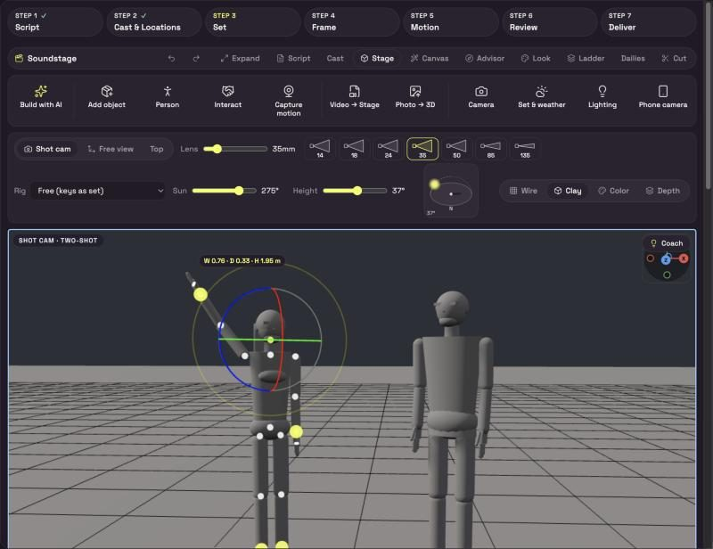</p>

- **Click a body part or dot** and a rotate ring appears on that joint: turn it on any axis. Fingers too.
- **Drag a yellow dot** to move a hand or foot: the arm or leg follows (IK). Elbows bend back and knees forward, the way real joints do, and the reach stops at the limb's length.
- Option/Alt-drag still looks around while posing.
- **P** or **Esc** ends pose mode; so does clicking empty space. Selecting another person keeps you posing.

Everything you turn is a pose key at the playhead, the same keys the sliders write.

### Interactions

**Interact** in the pose panel: pick an action, **with** whom or what, then **Do it at the playhead**. Soundstage positions, faces and poses them for it.

Actions: **Look at**, **Talk to (face each other)**, **Shake hands**, **Hug**, **Hold hands**, **Point at**, **Pet (dog, cat, horse)**, **Lead by the reins (horse)**, **Stop looking**.

### Motion capture: from a video or the webcam

Any clip of one person, or you acting it out on the webcam, drives a clay actor: body, hands, fingers, the path they travel and the jumps. It needs the SAM 3D Body model (see [Install](#download-the-models)) and runs on the GPU.

<p align="center">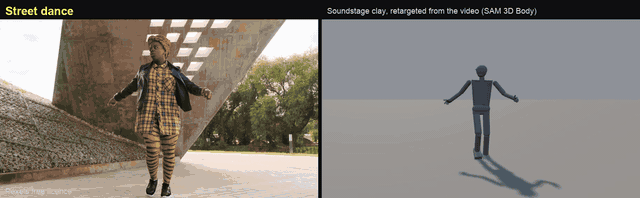</p>

1. Select the person to drive (or press **Capture motion** in the tool rail: it picks the selected person, else the first one, else adds one).
2. Either **Capture from video** and pick a clip (a few seconds of one person is best), or **Act it out**: choose a **Length** (3 to 15 s), press **● Record**, act after the 3-2-1 countdown, then **Use this take** (or **Retake**, **Cut** to stop early, **Cancel** / Esc).
3. Wait for "Reading the performance on the GPU (body, hands, fingers)…".

**The take is placed into your existing set**: it starts at the playhead, from where the person stands, turned the way they face. Their feet stay on your floor and jumps lift off it. If the take is longer than the shot, the shot is lengthened to fit (up to 20 s).

The take row under the panel shows **Name · seconds · frames a–b** with:

- **Start at playhead**: move the take to begin at the current frame;
- **Travel**: on, they move through the set as the performer did; off, they perform on the spot;
- **Remove take**: back to the walk and pose keys.

### Video → Stage

**Video → Stage** turns a clip into an editable 3D scene in about a minute: the location, the camera move, the set pieces and the performer.

<p align="center">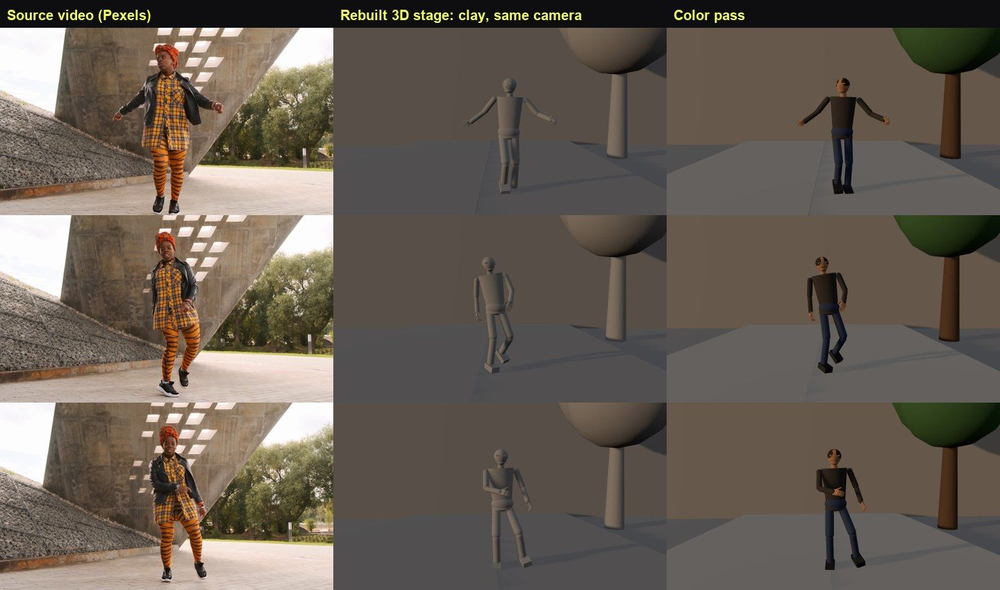</p>

Press **Video → Stage** in the tool rail (or **Import an image as… → Video clip → set + camera move**) and pick an `.mp4`, `.mov`, `.webm` or `.mkv`. The status line walks through the steps: sampling frames, measuring depth (Depth Anything 3), tracking the camera, reading the shot (the vision model), building the set, capturing the performance (SAM 3D Body).

What you get:

- **Subjects at real size** from the library, with start and end marks for the ones that move.
- **Set pieces** as clay (road with real lane widths, water, cliffs, rocks…) and the first frame as a backdrop plate.
- **The camera move as keys** (up to 8) that you can drag in **Top** view to re-shoot it.
- **The performer**, motion-captured, standing on the rebuilt floor where they stood.

Notes: it **replaces the current stage**, so start a new setup or scene first if you want to keep what you have. It needs a Depth Anything 3 checkpoint; without Qwen3.5 you get the camera move only (no subjects or set pieces); without SAM 3D Body, no performer. Camera roll isn't tracked, and very fast whip pans can break the track. The clip is also saved in `input/` so the graph's Footage and Recast nodes can use it.

### Phone camera

Hand-hold the shot camera with a phone, iPad, Quest or Vision Pro. In the **Camera** tab press **Connect a phone**, then open `/soundstage/vcam` on the device (on the same ComfyUI address). The device page offers AR and VR 6-DoF tracking or a 3-DoF gyro, a **Recenter** button, and recording. Motion sensors need https or localhost on the device.

Recorded takes land in the **Take** list. **Steady** sets how much the stabilizer smooths (it removes shake but keeps your move); **Use take** turns the take into camera keys. If the move looks like a known rig, a **Snap to …?** button offers to make it that rig's clean move.

---

## 5. Keyboard and mouse cheat sheet

Keys only reach the 3D stage while the pointer is over it (or you clicked it), and never while you are typing in a box.

**The 3D stage**

| Key / gesture | What it does |
|---|---|
| click | Select (click empty space to deselect) |
| drag empty space or anything unselected | Orbit (look around in place when close in or inside a car) |
| drag the selected object | Move it (keys its position at the playhead) |
| Shift-drag, middle-drag | Pan |
| Option/Alt-drag | Look around in place (tripod head) |
| scroll | Dolly in / out |
| W / S | Fly forward / back |
| A / D | Fly left / right |
| Q / E | Fly down / up |
| Shift + W A S D Q E | Fly four times faster |
| 0 | Toggle Shot cam / Free view |
| P | Toggle Pose in 3D (select a person first) |
| Esc | End pose mode; otherwise leave the full window |
| G / R / T | Gizmo: move / rotate / scale (with something selected) |
| Cmd/Ctrl+D | Duplicate the selection |
| Cmd/Ctrl+Z, Shift+Cmd/Ctrl+Z | Undo / redo (up to 120 steps; a drag is one step) |

In **Shot cam** every orbit, pan, dolly and fly move edits the camera key at the playhead. Use **Free view** (0) to look around without changing the shot.

**Pose in 3D**

| Gesture | What it does |
|---|---|
| click a body part or a white dot | Put a rotate ring on that joint |
| drag the ring | Turn the joint (keys the pose at the playhead) |
| drag a yellow dot (hands, feet) | Move the hand or foot; the arm or leg follows (IK) |
| double-click a joint slider | Reset it to 0 |

**Top view**

| Gesture | What it does |
|---|---|
| drag a camera ◆ or cast ■ key | Move it (Shift carries a camera key's aim along) |
| Option/Alt-drag a key | Change its height |
| drag a target dot | Re-aim |
| click the path | New key at that frame |
| right-click a key | Delete it |
| drag empty / scroll / double-click | Pan / zoom / fit |

**Timeline and Tracks**

| Gesture | What it does |
|---|---|
| drag a diamond in Tracks | Retime the key |
| double-click a track row | Add a key |
| right-click a diamond | Delete the key |
| click a name in Tracks | Select that object |

**Shot strip** (click it first)

| Key | What it does |
|---|---|
| Space, J / K / L | Play / pause, shuttle back / stop / forward |
| ← / → | Step a frame (Shift: 24 frames) |
| ↑ / ↓ | Previous / next clip |
| B or Cmd/Ctrl+B | Split at the playhead |
| Delete / Backspace | Remove the clip from the cut (the setup stays on the stage) |
| Cmd/Ctrl+D | Duplicate the setup |
| Cmd/Ctrl+Z, Shift+Cmd/Ctrl+Z | Undo / redo |

**Cut editor**

| Key | What it does |
|---|---|
| Space | Play / stop |
| J / K / L | Shuttle reverse / stop / forward (again for 2×, 4×, 8×) |
| ← / → | Step a frame (Shift: one second) |
| ↑ / ↓ | Previous / next edit |
| Home / End | Head / tail |
| I / O / G | Mark in / mark out / clear marks |
| B or Cmd/Ctrl+B | Split |
| X | Extract the I/O range |
| M | Match action |
| Delete / Backspace | Ripple delete |
| [ / ] | Gain −1 / +1 dB on the selected audio clip |
| = / - / \ | Zoom in / out / fit |
| Cmd/Ctrl+Z, Shift+Cmd/Ctrl+Z (or Cmd/Ctrl+Y) | Undo / redo |
| Esc | Deselect |
| Option/Alt-drag an edit | Roll it |

**Paint Studio**

| Key | What it does |
|---|---|
| V M L W B E P C I H Z | Move, Marquee, Lasso, Magic select, Brush mask, Eraser, Paint, Crop / Extend, Eyedropper, Hand, Zoom |
| [ / ] | Brush size |
| hold Space | Pan |
| F or Cmd/Ctrl+0 | Fit |
| Cmd/Ctrl + = / - | Zoom in / out |
| Cmd/Ctrl+A / Cmd/Ctrl+D / Shift+Cmd/Ctrl+I | Select all / deselect / invert |
| Delete / Backspace | Erase the selection on the active layer |
| Enter (in the prompt) | Generative Fill |
| Cmd/Ctrl+Z, Shift+Cmd/Ctrl+Z | Undo / redo |
| Esc | Clear magic points, then variations, then the selection |

**Dailies**

| Key | What it does |
|---|---|
| arrows | Nudge a card (Shift: half a cell) |
| Enter / double-click | Open the circled take |
| Space | Show the takes |
| C or * | Circle the take |
| Option/Alt-drag | Place a card freely |
| Lined script: Enter or Space / ↑ ↓ / Shift+↑ ↓ | Open / move a line's end / move its start |

**Elsewhere**

| Where | Key | What it does |
|---|---|---|
| Script scene list | ↑ ↓, Home / End, PgUp / PgDn | Move through the scenes |
| Script search | Esc | Clear the search |
| Add, Build scene, Change it, Look boxes | Enter | Add / build / apply |
| Advisor | Cmd/Ctrl+Enter | Suggest shots |
| Act it out | Esc | Cancel the recording |
| Full window | Esc | Back to the App panel |

---

## 6. Tips and tricks

**Blocking**

1. **Lock the blocking in clay before you render anything.** Press **Play** in **Shot cam** and watch the whole shot as clay. Every later step copies it: if a person drifts out of frame in clay, they drift out in the final. Clay is free; renders aren't.
2. **Two keys make a camera move.** Playhead at 0, frame the start. Drag the playhead to the end, frame the end. Done. Add a key in the middle only when you want a curve.
3. **Look around in Free view, not Shot cam.** In Shot cam every orbit or scroll edits the camera key at the playhead. Press **0** to fly freely, then **0** again to come back to the shot untouched. If you did nudge the shot, Cmd/Ctrl+Z.
4. **Fix camera moves from above.** **Top** shows the whole move as a plan: drag the numbered keys, Option/Alt-drag for height, drag the dots to re-aim. It's much easier than re-flying the camera.
5. **Choose the rig after the keys.** Key the move as a clean path first, then try **Dolly on track**, **Jib / crane arm** or **Handheld** on the same keys. Use the slider next to **Rig** to dial the feel up or down.
6. **People and vehicles turn by themselves.** They face where they are going, and a horse or a car turns at a realistic rate (it even turns before setting off). Give a car room to turn instead of a sharp corner between two keys.
7. **Drop to interact.** Drag a person onto a horse to mount, onto a car to take a seat, onto a bench to sit; drop a flashlight on someone to hand it over. For a mount mid-shot, put the playhead at the frame and use **Hop on at playhead**.
8. **A car dialogue scene in one click.** Put two people in a car, select the car, and pick **＋ All interior shots (one per angle)** under **In-car camera**: you get a dashboard two-shot, a driver profile, over the shoulders and the driver's POV, already in the cut.
9. **Type a room with its size.** "kitchen 4x3 m" builds a true-scale room with walls, a door, a window and a ceiling light. Free view shows it as a cutaway so you can block inside.
10. **Use Measure for scale.** **Measure** shows the selection's width, depth and height in metres. A prop that's twice the size it should be will be twice the size in the frame.
11. **Put the sun where you want it with North.** Pick **Magic hour**, then turn **North** until the sun sits behind your actors for a backlit rim. **Lighting note for the prompt** tells you how it will be described.
12. **Light like a DP in one pick.** **Light it like… → Low-key noir** or **Rembrandt** places real lights around the selected actor and writes the setup into the prompt.
13. **Get coverage the way a crew would.** Block the action once, then add **New setup** → Master, Two-shot, Over-the-shoulder A and B, Singles, an Insert. Every setup shares the same action, so they cut together. The **Advisor** tab can suggest a shot list and **Add as setups** for you.
14. **Open the Coach.** When the **Coach · N** pill shows a number, click it: it catches things like a camera inside a wall or a cut across the 180° line, and offers a one-click fix.

**Frames**

15. **Fix the first frame before Motion.** The video inherits everything in the frame. A stray bystander, a sign, or a car with the wrong colour is a ten-second **Remove** or **Generative Fill** in Paint Studio, and a re-render if you leave it.
16. **Keep references to four or fewer.** FLUX 3 Klein takes four reference pictures, characters first. Untick anyone who isn't in the shot, so the slots go to who is.
17. **Explore on Fast, keep on Standard or High.** Use **Quality: Fast** with 4 variations to find the composition, then generate again on Standard or High for the frame you'll animate.
18. **Use Krea 2 + stage depth when the layout must not move.** It holds the stage's depth very tightly (it takes no reference pictures, though). FLUX 3 Klein is the better default when faces and costumes must match the cast.
19. **Extend instead of re-rendering.** Need 2.39:1 from a 1.85 frame? **Crop / Extend → 2.39**, then **Extend**. Pixels inside the original frame never change.

**Motion and sound**

20. **Draft to check the motion, then Final.** A **Draft** (8 + 3 steps) tells you whether the blocking, the direction of travel and the camera are right. Quality starts on Draft; once it looks right, click **Final** and render again, and keep **Final HQ** for hero shots.
21. **Type the dialogue line to get lip sync.** A line typed into **Dialogue line** turns on **Let the sound/dialogue drive the video**, so the mouth is animated *from* the words. A voice added afterwards never syncs.
22. **Lower Motion freedom for precise action.** Car chases and stunts follow the clay more exactly near **exact**; dialogue and walking look more natural around the default **natural**.
23. **Describe the sound you want.** **Sound (generated with the final)** is filled from the stage if you leave it empty, but "hooves on packed dirt, distant thunder" beats a guess.
24. **Batch overnight.** **Draft every shot**, check them, then **Final for every shot**. ComfyUI's cache means a second Run only does the new work.
25. **Stop clears the queue.** **■ Stop** cancels everything waiting in ComfyUI (from any workflow) and interrupts the running job. Use it when you spot a mistake in a Draft instead of waiting for the batch.

**Look, review and delivery**

26. **Re-render the same animation in another look.** Change the style card, **Generate frames**, render Motion again: the same blocking and camera, a different film.
27. **Copy the prompts.** **Compiled prompts** in the Look tab shows exactly what goes to the models, with **Copy**. Handy for testing a look in another tool.
28. **Edit original from the cut.** Right-click a clip in the strip or the Cut editor and jump straight to the stage, the frame, Paint Studio or Motion for that shot. The cut picks up the new render by itself.
29. **Fill the gaps before you export.** **Render missing shots** queues a Final for any shot that has none, then joins the cut into one video.
30. **Hand off the set.** **Export GLB** takes the whole set into Blender, Unreal, Unity or C4D, and the Layer Pack's `camera.chan` carries the exact camera into Nuke or After Effects.
31. **Take the full window.** **Open the full workspace** (or **Expand**) gives Soundstage the screen; Esc puts it back in the App panel.

---

## 7. Troubleshooting and FAQ

**Missing models, or "N issues found" when I press Run.** App mode lists problems before running; **Show errors in graph** shows which node. "Value not in list" on a loader means that model file isn't where ComfyUI looks: check the exact filename and folder in [Download the models](#download-the-models), then refresh ComfyUI (or restart it) so the new file is listed. Missing node types mean a node pack is missing: install ComfyUI-LTXVideo and comfyui-krea2-controlnet as in [Install](#install-the-node-packs).

**"No image edit model is installed (FLUX 3 Klein or Krea 2): Generative Fill is off."** Paint Studio's fill needs one of the two image models. Painting, masking, layers and extending the canvas still work without them.

**"References need the updated Soundstage nodes (restart ComfyUI once)."** You updated the repo while ComfyUI was running. Restart ComfyUI.

**The queue looks stalled.** It usually isn't. Progress moves one sampling step at a time, and on **Final HQ** a single step can take about 60 seconds, so the bar can sit still for a minute. The first render of a session also loads the models. Rough warm times: a frame 6 to 10 s, a Draft 2 to 4 minutes, a Final 4 to 6 minutes, Final HQ about twice a Final, MiniMax H3 20 to 30 minutes (its first run also encodes the prompt on the CPU for several minutes). While **■ Stop (N)** is showing, the jobs are still there.

**I pressed Stop and other work disappeared too.** Stop clears the whole ComfyUI queue, not only Soundstage's jobs. Queue them again.

**The car drives in reverse.** A grey clay car reads the same nose-first or tail-first, so Soundstage names the headlights, tail lights and the direction of travel in the prompts, with negatives against reversing. If it still happens: check in Clay that the car's keys move it forward the way it faces; make sure the chosen frame shows the car's front or back clearly (fix it in Paint Studio if not); lower **Motion freedom**; and check with a **Draft** before the Final.

**Extra people (or extra cars) appear in the frame.** The prompts already say how many vehicles there are, that nobody else is in the background, and that nobody and nothing else enters the frame. If someone still turns up: untick cast members who aren't in this shot under **Cast in this shot**; **Remove** them from the first frame in Paint Studio before Motion (the video copies the frame); or generate a few more frames and pick a clean one.

**The mouth doesn't move with the line.** Type the line in **Dialogue line** (don't only add it in the edit) and make sure **Let the sound/dialogue drive the video** is ticked, then render the Final again.

**The video ignores my blocking.** Use the LTX-2.5 Layout-to-Render model (MiniMax H3 follows blocking only loosely), lower **Motion freedom**, and check the frame: if the frame doesn't match the clay, the video won't either. Raise **Follow the clay** towards strict when you use Krea 2.

**My framing changed when I only wanted to look around.** In Shot cam, navigating edits the camera key at the playhead. Cmd/Ctrl+Z, then use **Free view** (0) to look around.

**The Delete key doesn't delete the selected object.** On the stage, deleting is the **Delete** button in the Object tab.

**Esc didn't leave the full window.** In Pose in 3D, the first Esc ends pose mode; press it again.

**My imported splat is invisible.** Splats show in **Color** view; the clay view shows their stand-in.

**"Couldn't read …: no scene headings found."** Scenes must start with `INT.` or `EXT.`. A scanned PDF has no text to read: export the script as `.fdx`, `.fountain` or a text PDF. "Could not load pdf.js from cdnjs" means the browser couldn't fetch the PDF reader: import `.fdx` or `.fountain` instead, or check the connection.

**"Depth Anything 3 is not on this server (models/geometry_estimation)."** Video → Stage and location photos need a Depth Anything 3 checkpoint in that folder. Without Qwen3.5 you get the camera move only; without SAM 3D Body, no performer.

**"Motion capture needs the ComfyUI server (it runs SAM 3D Body on the GPU)."** Capture runs in ComfyUI; check the server is up and `sam_3d_body_dinov3_bf16.safetensors` is in `models/detection/`.

**The phone camera doesn't move the shot.** Open `/soundstage/vcam` on the device at the same address as ComfyUI, and press **Connect a phone** on the stage first. Phone motion sensors only work over https or on localhost.

**"Couldn't design …" or "the GPU was busy for 15 minutes".** Designing a new object uses the local LLM on the GPU; it waits behind renders. Try again when the queue is free, or add a library object instead.

**Do I need the GPU models to try it?** No. ① Script, ② Cast (with your own pictures), ③ Set, the Look tab, the Cut editor and its NLE exports all run in the browser.

**Where do my files go?** Under `ComfyUI/output/`: the ladder renders in `soundstage/` (`previz`, `look`, `draft`, `final`…), Layer Packs in `soundstage_layerpacks/`, joined cuts in `soundstage_cuts/`, motion-capture takes in `soundstage/mocap/`. Cast pictures go to `ComfyUI/input/soundstage_refs/`. The scene, the shots, the cut and the chosen frames are saved in the workflow, so **save the workflow** to keep them.

**Can I use it commercially?** The Soundstage code is MIT. The models have their own licenses (FLUX 3 Klein, Krea 2, LTX-2.5, MiniMax H3 and others have revenue limits or regional limits). Check [MODELS.md](../MODELS.md) before commercial use.

---

More detail on each part: [look](look.md), [canvas (Paint Studio)](canvas.md), [cut](cut.md), [layerpack](layerpack.md), [audio](audio.md), [video2stage](video2stage.md), [floorplan](floorplan.md), [quality](quality.md), [vcam](vcam.md), [agent](agent.md), [advisor](advisor.md), [coach](coach.md), [router](router.md), [recast](recast.md), and the development log, [decisions.md](decisions.md).
