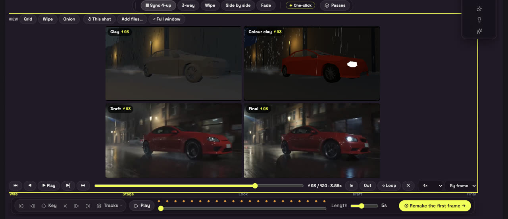

# ⑥ Review: Sync 4-up

Play a shot's **stage video**, **live stage**, **Draft** and **Final** at the same time, locked to the same frame, so you can see where the render stops following the blocking.

## Open it

Go to **⑥ Review**. **▦ Sync 4-up** is the first button on the Review bar, and Review opens on it. The older **3-way**, **Wipe**, **Side by side** and **Fade** views are still there, next to it. Review remembers the last view you picked.

## The four tiles

| Tile | What it shows | Where it comes from |
|---|---|---|
| **Stage video** | The stage preview video the generators were guided by | The shot's latest ③ Set run (`previz`) |
| **Live stage** | The lifelike colour stage | Drawn live from the 3D stage, frame by frame, as the stage is **now** |
| **Draft** | The latest Draft | The shot's saved takes |
| **Final** | The latest Final (the version with sound when there is one) | The shot's saved takes |

An empty tile says what belongs there. **↺ This shot** reloads the current shot's takes. **Add files…** (or dropping files on the tiles) loads up to four of your own videos or stills. A file dropped on a tile goes into that tile. Several files dropped together fill the empty tiles first.

Each tile's label shows the frame the browser actually decoded, as **f 52**. When you pause, all four labels should read the same number. A red number means that tile could not reach the frame. A file shorter than the others stops on its last frame and its label says **held**.

## Views (keys 1, 2, 3)

- **Grid** shows all four tiles. You get 2×2 on a normal screen, four across on a very wide one, and one column on a tall phone.
- **Wipe** splits any two tiles (**Left** and **Right**) with a handle you drag anywhere on the picture.
- **Onion** puts one tile (**Over**) on top of another (**Under**) at the **Opacity** you set. **Difference** shows only what changed: black where the render matches the stage, and bright where the car, a person or the camera has moved.

In Wipe and Onion, both tiles are cropped to the top tile's aspect ratio, the same centre crop the router uses to fit the guide, so the two line up.

## Transport

| Control | Key |
|---|---|
| Play / pause | Space or K |
| One frame back / forward | ← / → (with Shift: 10 frames) |
| Go to In / Out | Home / End |
| Set In / Out at this frame | I / O |
| Loop between In and Out (on by default) | L |
| Clear In / Out | X |
| Speed: 0.25×, 0.5×, 0.75×, 1× | the speed menu |
| **By frame** / **By time** | the map menu |
| Full window / back | **⤢ Full window** / Esc |

**By frame** (the default) shows frame N of every file together, which is right for renders of the same shot: a 25 fps re-encode of a 24 fps stage video still has the same 121 frames. **By time** shows the same second of every file instead. The fps and frame count come from the MP4 / MOV header. A WebM or a damaged header falls back to the shot's frame rate.

Click inside the player first so the keys go to it and not to the stage.

## How the sync works

- A single master clock (wall time × speed) decides the frame. Every video plays natively at its own rate. `requestVideoFrameCallback` reports the frame that is actually on screen, and any tile more than one frame away from the master is seeked back into place. A tile that runs out of data holds the clock, so the others wait for it.
- When you pause, step or scrub, every tile is seeked to the exact frame. A new frame requested while a seek is still decoding waits for that seek to land, so seeks never pile up.
- While paused, nothing runs: no timer and no animation frame.
- Clips are read into memory once (a `blob:` URL), so any frame can be reached even when the server ignores HTTP Range requests. Python's `http.server`, which serves the local test build, is one such server. Files over 768 MB stream from their URL instead.

## Known limits

- **Live stage is the stage as it is now**, not as it was when the take was rendered. If you have moved things since the render, that tile shows the new blocking. The Stage video tile is the recorded one.
- The tiles play with no sound.
- The colour stage is re-rendered for every frame while playing. On a slow machine that tile can fall behind and catch up in jumps. The videos keep their sync.
- Measured on the try-it build in headless Chrome (Metal): 4 tiles, every view, 1× and 0.5×: of 613 checks of a playing video against the master at display time, 610 were within ±1 frame and 3 were 2 frames out (in the full-window resize), which the next check corrected. Not yet measured in a real ComfyUI tab on a GPU machine during a render.
